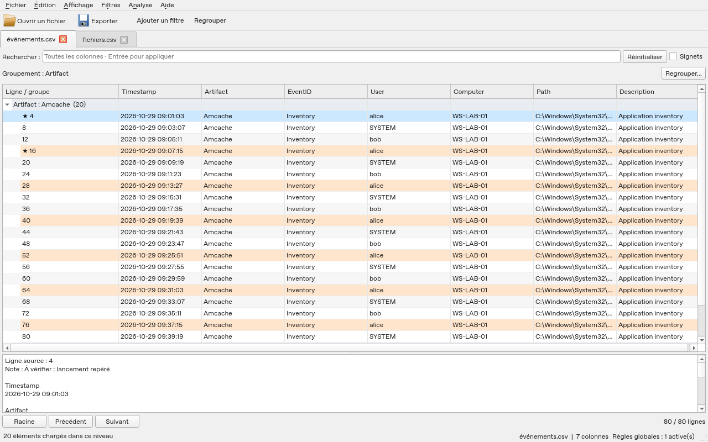

# Fireblade

[](https://github.com/23R0534ZXT/fireblade/actions/workflows/windows.yml)

**Explorateur de données forensic pour Windows : CSV, TSV, XLS et XLSX, avec recherche, filtres, regroupements, signets et notes.**

Fireblade sert à explorer des exports forensic volumineux sans perdre le fil de l’analyse. Ouvrez vos CSV, classeurs ou exports de timelines, puis cherchez, filtrez, regroupez, annotez et exportez depuis une seule grille. Les analyses restent enregistrées dans des bases locales ; vous pouvez fermer le programme et reprendre votre travail plus tard.

## Télécharger et lancer

1. Ouvrir les **[Releases](https://github.com/23R0534ZXT/fireblade/releases)** et choisir la préversion intitulée **Fireblade - prototype Windows** la plus récente. La Release du jeu de test contient seulement des données.
2. Télécharger **`Fireblade.exe`**.
3. Double-cliquer dessus.

**Un seul fichier à conserver pour le programme.** Aucun Python, Excel, installateur, script `.cmd` ou dossier `_internal` n’est nécessaire à côté du `.exe`. Les bibliothèques, réglages par défaut, guide et licences sont intégrés.

Le programme prépare ses bibliothèques dans un dossier temporaire Windows au lancement, puis le nettoie à la fermeture normale. Ce démarrage peut prendre quelques secondes. Les analyses et préférences sont enregistrées séparément dans le profil utilisateur pour conserver le travail.

Si aucune Release n’est encore disponible, ouvrir une [exécution réussie d’Actions](https://github.com/23R0534ZXT/fireblade/actions/workflows/windows.yml), puis télécharger l’artefact **Fireblade-exe**. GitHub enveloppe les artefacts dans un ZIP : l’extraire donne uniquement `Fireblade.exe`.

> Le ZIP « Source code » proposé automatiquement par GitHub contient le dépôt de développement, pas le programme Windows à lancer.



## Pourquoi Fireblade ?

Une timeline forensic peut vite devenir difficile à parcourir. Fireblade garde les données dans une base DuckDB sur disque et n’affiche que les pages nécessaires. On peut alors retrouver un événement, explorer un groupe, ajouter un signet ou une note, puis exporter les résultats filtrés sans charger toute la grille en mémoire.

- **Pour les timelines volumineuses** : DuckDB conserve l’analyse dans un fichier `.timeline` ; la grille charge les lignes par pages. Les regroupements, résumés et exports portent sur tous les résultats filtrés, même si seule une partie des lignes est affichée.
- **Ressources réglables** : buffer du moteur, nombre de threads, taille des pages et fenêtres de lignes sont configurables. Le fichier source et la grille ne sont pas intégralement copiés en RAM par l’import CSV natif.
- **Code disponible sous licence MIT** : Python pour l’application, Qt pour l’interface et DuckDB pour les requêtes ; le lecteur de données, les règles, l’interface et la validation sont organisés en modules. Les profils JSON permettent d’ajouter des présentations sans modifier la grille.
- **Analyses conservées** : données importées, vues, signets et notes restent dans les bases `.timeline`. Les dispositions sont mémorisées automatiquement par format et schéma.
- **Programme Windows en un fichier** : `Fireblade.exe` intègre ses bibliothèques, son guide et ses licences. Le destinataire n’installe ni Python ni .NET pour utiliser les fonctions intégrées.
- **Un moteur éprouvé sur de gros volumes** : le parcours documenté a importé 12,2 millions de lignes sur 16,1 Go, avec un buffer DuckDB limité à 256 Mio, puis vérifié filtres, groupes, pages profondes et réouverture de l’analyse. La validation Windows utilise aussi un CSV de 3 GiB.

Fireblade a été conçu pour continuer à travailler sur des analyses volumineuses : stockage sur disque, pages bornées et réglages du moteur. Les temps dépendent de la machine et des opérations effectuées ; les résultats publiés donnent des exemples concrets de charge, sans promettre le même gain pour chaque fichier.

## Fireblade et Timeline Explorer

Fireblade reprend les gestes familiers de l’exploration forensic et les associe à une base locale sur disque, une grille paginée et des analyses persistantes. Il s’adresse aux personnes qui veulent parcourir de gros exports, garder leurs annotations et adapter un outil open source à leur méthode de travail.

| Sujet | Fireblade | Comparaison avec Timeline Explorer |
|---|---|---|
| Recherche, filtres, tris et groupements | Plusieurs niveaux, glisser-déposer, résumés, expressions et règles de coloration | Les usages d’exploration sont au cœur des deux outils ; Fireblade apporte des pages et fenêtres bornées pour parcourir les grands résultats |
| Gros CSV | Import DuckDB sur disque, grille paginée et ressources réglables ; moteur validé sur un parcours de 16,1 Go et 12,2 millions de lignes | Fireblade cible explicitement les gros volumes. Les temps dépendent de la charge et de la machine ; aucun facteur de vitesse comparatif universel n’est revendiqué |
| Personnalisation du programme | Code MIT disponible, modules Python et profils JSON | Atout pour comprendre, modifier et redistribuer Fireblade ; il n’est pas nécessaire d’adapter une interface DevExpress pour modifier sa grille Qt |
| Présentation | Épinglage gauche/droite simultané, thèmes, polices, formats de dates et règles locales/globales | Les usages de présentation sont repris ; les skins et dessins DevExpress ne sont pas identiques |
| Layouts TLE | Import des colonnes, groupes, tris, résumés, expressions et apparences compatibles ; `.layout.local` automatiques | Compatibilité encore partielle : apparences non reprises signalées, variantes XML à qualifier et styles personnalisés nécessitant parfois une définition séparée |
| Plugins TLE | Détection par en-tête, pont .NET intégré, fonctions et objets CLR natifs entre composants compatibles | TLE reste la référence pour ses DLL ; chaque dépendance ou variante tierce doit être qualifiée dans Fireblade |
| Réutilisation d’une analyse | Base `.timeline` contenant données importées, annotations et vues ; sessions par références aux bases | Format propre à Fireblade ; l’import d’une session TLE reprend les sources et tags, sans équivalence complète des formats de session |
| Distribution | Un EXE Windows x64 ; compilation personnelle documentée | Atout pratique de Fireblade, sans revendication d’exclusivité ; les plugins tiers peuvent nécessiter leurs DLL et dépendances |
| Validation | Tests automatisés Windows, EXE autonome, parcours de charge de 3 GiB et moteur exercé sur 16,1 Go sous Linux | Les résultats et leurs conditions sont documentés ; les parcours sur données synthétiques ne remplacent pas la validation de chaque environnement et lecteur tiers |

Si votre travail porte sur de gros exports et que vous souhaitez conserver vos analyses, régler les ressources et personnaliser l’outil, Fireblade est une vraie alternative à considérer. Il sait aussi reprendre plusieurs formats de layouts, préférences, sessions et lecteurs TLE. Les détails sont dans le [comparatif de compatibilité](docs/development/PARITE-TIMELINE-EXPLORER.md).

## CSV de test de 3 Go

**[Télécharger le CSV complet en ZIP](https://github.com/23R0534ZXT/fireblade/releases/download/test-data-3gib/Fireblade-test-3GiB.zip)** · [Release du jeu de test et empreintes](https://github.com/23R0534ZXT/fireblade/releases/tag/test-data-3gib)

Extraire le ZIP, puis ouvrir **`Fireblade-test-3GiB.csv`** dans Fireblade. Il contient **2 441 216 enregistrements, 18 colonnes et 3 222 648 632 octets** (environ 3,22 Go). C’est le même contenu que celui utilisé pour la qualification Windows, vérifié par SHA-256 ; les données sont synthétiques.

Le ZIP contient le CSV entier et un manifeste `dataset.json`, également [versionné dans le dépôt](docs/validation/datasets/3gib.json). Aucun Python ni générateur n’est nécessaire pour l’utiliser. Le fichier volumineux est publié dans une Release pour garder le clone Git léger ; son générateur, les tests et la documentation sont sur `main`. Les tests Windows réutilisent ce CSV, localement ou depuis le cache Actions, et vérifient son SHA-256 à chaque préparation. Ils ne le régénèrent plus.

Pour commencer : regrouper par **Artifact**, ajouter **User** puis **Computer** au groupement ; après réinitialisation, filtrer `User` sur `user042` doit donner **9 405 enregistrements**. Voir [les étapes et résultats attendus](docs/guides/TESTER-3GIB.md).

## Sommaire

- [Pourquoi Fireblade ?](#pourquoi-fireblade)
- [Fireblade et Timeline Explorer](#fireblade-et-timeline-explorer)
- [CSV de test de 3 Go](#csv-de-test-de-3-go)
- [Fonctionnalités](#fonctionnalités)
- [Première analyse](#première-analyse)
- [Données, confidentialité et sauvegardes](#données-confidentialité-et-sauvegardes)
- [Formats et fidélité des valeurs](#formats-et-fidélité-des-valeurs)
- [Mémoire et gros fichiers](#mémoire-et-gros-fichiers)
- [Configuration](#configuration)
- [Organisation du dépôt](#organisation-du-dépôt)
- [Lancer les sources](#lancer-les-sources)
- [Vérifier le code et compiler soi-même](#vérifier-le-code-et-compiler-soi-même)
- [Construire le fichier Windows](#construire-le-fichier-windows)
- [Tests et publication](#tests-et-publication)
- [Diagnostic](#diagnostic)
- [Conversions et compatibilité TLE](#conversions-et-compatibilité-tle)
- [Contraste Windows et qualification en charge](#contraste-windows-et-qualification-en-charge)
- [Formats avancés et plugins TLE](#formats-avancés-et-plugins-tle)
- [Limites actuelles](#limites-actuelles)
- [Documentation et contribution](#documentation-et-contribution)
- [Licence](#licence)

## Fonctionnalités

Les ajouts de présentation restent dans les menus : le démarrage conserve une grille classique. Voir le [suivi de parité détaillé](docs/development/PARITE-TIMELINE-EXPLORER.md) pour les limites de chaque fonction ; aucune parité exhaustive n’est annoncée.

| Domaine | Disponible |
|---|---|
| Import | CSV, TSV, TXT délimité, XLS/XLSX avec choix de feuille ; ouverture multiple et file d’attente |
| Recherche | Analyse active et recherche entre toutes les analyses ouvertes ; résultats par fichier, filtres et calendrier |
| Filtres avancés | Arbres ET / OU / NON, texte, égalité, regex RE2, nombres, dates ISO et cellules vides ; éditeur et expressions textuelles |
| Expressions et calculs | Fonctions texte/nombre/date, calculs imbriqués, conversions, collections et références parent ; colonnes calculées persistantes |
| Dates et heures | Conversions UTC, fuseaux Windows/IANA, précision jusqu’à neuf décimales et colonnes sources conservées |
| Regroupements | Plusieurs niveaux par glisser-déposer, année/mois/jour/heure, effectifs, sommes/moyennes/min/max/distincts, tri multicritère des résumés par niveau ; dépliage complet indexé sur disque |
| Tri | Texte, nombre exact ou date ISO ; plusieurs clés et sens réglables |
| Onglets | Recherche par nom, plusieurs rangées, réouverture du dernier fermé ; une seule base active |
| Sessions | Vues, analyses et dispositions ; import des sources et tags des sessions `.tle_sess` |
| Signets et notes | Ligne individuelle ou sélection multiple : marquer, ajouter, remplacer, retirer |
| Présentation | Colonnes épinglées à gauche/droite, clair/sombre, police et formats de dates ; règles locales/globales, couleurs, styles de texte, barres, dégradés et indicateurs |
| Règles statistiques et graphiques | Top/bottom, moyennes, uniques/doublons ; bornes automatiques, pourcentages et percentiles exacts ; dégradés à deux/trois couleurs, barres négatives avec axe zéro, jeux de trois à cinq icônes et images PNG |
| Apparences et layouts | Import XML TLE compatible, images intégrées, bordures, polices, alignements, renvoi à la ligne et troncatures ; styles nommés via bibliothèque JSON, sauvegarde dans les vues |
| Dispositions automatiques | Rechargement des `.layout.local` selon le lecteur/profil et le schéma ; ordre, largeur, visibilité, épinglage et vue conservés |
| Règles partagées | Correspondance par noms de colonnes, import/export JSON, rechargement et désactivation par vue |
| Plugins TLE | Lecteurs DLL détectés par en-tête ; helpers CLR4 ou .NET moderne intégrés, fonctions personnalisées et passage d’objets CLR complexes entre composants compatibles |
| Préférences TLE | Import de `TLE_settings.xml` : police, onglets, copie, détails et formats de dates compatibles ; adaptations signalées |
| Supertimelines | Adaptations Plaso/L2T, Psort, mactime et ForensicTimeline ; UTC, MACB, catégories/couleurs ; variantes encore partielles |
| Détails | Valeurs complètes, notes, JSON/XML formaté, panneau à droite/en bas et filtrage depuis les détails ; affichage booléen par cases |
| Intégration Windows | Ouvrir un chemin dans l’Explorateur ou un programme choisi ; préférences de copie au clic droit et avec en-têtes |
| Profils forensic | Catalogue de 222 signatures / 193 noms de formats ; types et présentation ; profils personnels JSON |
| Export | CSV/XLSX, colonnes visibles dans leur ordre, résultats filtrés, résumés et annotations |
| Provenance | Chemin, taille, nombre d’enregistrements et empreinte SHA-256 de la source à l’import |
| Annulation | Requêtes, import, export et annotations ; restauration de l’analyse précédente après import échoué |
| Aide intégrée | Guide, licences et informations de construction consultables dans le `.exe` |

La grille ouvre les exports produits par les outils forensic. **Importer un dossier de collecte…** délègue aussi les artefacts bruts reconnus aux 13 parseurs EZ Tools intégrés au pack Windows, puis charge leurs CSV dans une session. **Analyser la collecte avec Hayabusa** ajoute les alertes EVTX à la session. Les formats non reconnus et les erreurs restent dans le bilan. Voir [le parcours collecte et détection](docs/guides/UTILISATION.md#importer-une-collecte-dartefacts-et-lancer-hayabusa). Fireblade ne monte pas une image disque et ne prétend pas parser tous les formats forensic existants.

## Première analyse

1. Cliquer sur **Ouvrir un fichier**, ou utiliser **Ctrl+O**.
2. Choisir le CSV/TSV/XLS/XLSX.
3. Confirmer où enregistrer l’analyse `.timeline`. Pour XLSX, choisir la feuille.
4. Après l’import, utiliser le clic droit des en-têtes pour trier, filtrer ou regrouper.
5. Sélectionner des lignes pour poser des signets ou des notes depuis **Édition**.
6. Exporter la vue filtrée ou les lignes marquées depuis **Fichier**.

Les menus gardent les fonctions avancées à portée sans ajouter d’étape obligatoire au démarrage. Le **[guide d’utilisation](docs/guides/UTILISATION.md)** présente les parcours principaux. Le **[tutoriel complet](docs/guides/TUTORIEL-COMPLET.md)** passe en revue les commandes, fonctions avancées et limites ; il est intégré au programme sous **Aide → Tutoriel complet — toutes les fonctionnalités**. Le guide reste accessible via **Aide → Guide d’utilisation** ou **F1**.

### Raccourcis principaux

| Action | Raccourci |
|---|---|
| Ouvrir des données / une analyse | Ctrl+O / Ctrl+Maj+O |
| Exporter | Ctrl+E |
| Enregistrer / charger une vue | Ctrl+S / Ctrl+L |
| Enregistrer la session | Ctrl+Maj+S |
| Éditeur ET / OU / NON | Ctrl+Maj+F |
| Marquer / retirer la sélection | Ctrl+M / Ctrl+Maj+M |
| Onglet suivant / précédent | Ctrl+Tab / Ctrl+Maj+Tab |
| Fermer l’onglet | Ctrl+W |
| Copier les lignes sélectionnées | Ctrl+C |
| Guide intégré | F1 |

## Données, confidentialité et sauvegardes

L’application fonctionne localement. Elle n’a pas besoin d’un serveur et n’envoie pas les fichiers d’analyse vers un service distant. L’installation des dépendances pour les développeurs et le téléchargement du programme nécessitent Internet ; l’usage ordinaire du `.exe` est local.

Le CSV ou classeur source est lu sans réécriture. L’import calcule son SHA-256 avant et après lecture et vérifie qu’il n’a pas changé. Les identifiants de ligne suivent l’ordre des enregistrements importés, hors en-tête ; ils ne correspondent pas nécessairement aux lignes physiques d’un CSV contenant des cellules multilignes.

| Fichier ou dossier | Contenu |
|---|---|
| `Fireblade.exe` | Programme et ressources intégrées, remplaçable sans effacer les analyses |
| `*.timeline` | Copie importée des données, provenance, signets, notes et vues nommées |
| `*.fireblade-session` | Références aux analyses, onglets, vues et dispositions ; aucune copie des données |
| `%LOCALAPPDATA%\Fireblade\Analyses` | Destination proposée pour les nouvelles analyses |
| `%LOCALAPPDATA%\Fireblade\regles-globales.json` | Bibliothèque de règles partagées |
| `%LOCALAPPDATA%\Fireblade\fireblade.toml` | Configuration utilisateur facultative |
| `%LOCALAPPDATA%\Fireblade\Journaux` | Journaux de démarrage |

Une session dépend des bases `.timeline` qu’elle référence. Conserver ces bases avec la session et sauvegarder séparément les sources utiles. Exporter les règles globales si la présentation doit être partagée sur un autre poste.

Les anciennes analyses `.timeline` restent ouvrables. Celles d’un ancien prototype peuvent se trouver dans `%LOCALAPPDATA%\TimelineNext\Analyses` ; elles ne sont pas déplacées automatiquement.

## Formats et fidélité des valeurs

- Les colonnes sont stockées comme texte, notamment pour préserver `0001` et les grands identifiants Windows.
- Les tris et filtres numériques évitent de convertir les grands entiers en flottants. Les valeurs hors des bornes de conversion ou malformées ne sont pas assimilées à des nombres valides.
- Le préambule `#TYPE` des exports CSV PowerShell est reconnu uniquement en première ligne ; les enregistrements ordinaires commençant par `#TYPE` restent conservés.
- Encodages CSV proposés : UTF-8, UTF-16, Windows-1252 et Latin-1. Les champs vides deviennent NULL.
- Les imports CSV ambigus ou malformés sont signalés. Le séparateur peut être choisi explicitement.
- Pour XLS, les formules sont lues comme leurs résultats mémorisés ; leur formule originale et la mise en forme ne sont pas disponibles via ce lecteur. Les macros ne sont pas exécutées.
- Pour XLSX, les formules restent leur texte ; Fireblade ne les exécute pas et n’en recalcule pas le résultat. Les styles, macros et zéros provenant seulement d’un format numérique Excel ne sont pas importés.
- XLSX est lu progressivement et exporté en écriture progressive. L’export utilise plusieurs feuilles si nécessaire et refuse les cellules dépassant 32767 caractères pour éviter une troncature silencieuse.
- Les exports XLSX écrivent les données comme texte, y compris les valeurs commençant par `=`. CSV conserve les valeurs d’origine.
- L’export annoté ajoute `Fireblade_SourceRecord`, `Fireblade_Bookmarked` et `Fireblade_Note`, avec suffixe si un nom existe déjà dans la source.

## Mémoire et gros fichiers

Le moteur utilise DuckDB sur disque ; la grille Qt charge des pages et libère les descendants des groupes repliés. Les notes sont chargées avec les pages, pas en totalité à l’ouverture. Les onglets inactifs gardent des snapshots légers de leur vue, sans base ouverte ni copie de toutes leurs lignes.

Les règles de couleur sont évaluées sur les valeurs déjà chargées. Un cache de tri temporaire peut conserver l’ordre des identifiants pour les pages profondes, sans recopier les colonnes source.

Par défaut :

| Réglage | Valeur |
|---|---:|
| Buffer DuckDB | 256 MB |
| Threads du moteur | 2 |
| Page | 250 éléments |
| Fenêtre chargée par parent | 1000 éléments |
| Bloc d’export | 2048 lignes |

**Le buffer DuckDB n’est pas un plafond de RAM du processus entier.** Qt, les cellules larges, les branches ouvertes et les bibliothèques ajoutent leur propre coût. Réduire le buffer peut augmenter les accès disque. L’import crée une base et certains traitements peuvent déborder sur disque : prévoir de l’espace libre.

Les mesures historiques se trouvent dans `docs/archive/`. Elles ne démontrent pas un gain face à Timeline Explorer sur des données Windows réelles. Une comparaison sur le même poste, avec les mêmes CSV forensic de plusieurs Go, reste à réaliser.

## Configuration

Aucun fichier externe n’est nécessaire pour démarrer. Les valeurs par défaut sont intégrées dans le `.exe`.

Pour les personnaliser, créer facultativement `%LOCALAPPDATA%\Fireblade\fireblade.toml` :

```toml
[resources]
memory_mb = 256
threads = 2
page_size = 250
max_loaded_rows = 1000
export_batch_rows = 2048
cache_sorted_pages = true
```

`max_loaded_rows` doit être un multiple de `page_size`. Les clés inconnues et les valeurs incohérentes produisent une erreur explicite.

Ordre de sélection : `--config` explicite, configuration du profil utilisateur, ancienne configuration facultative à côté du `.exe`, puis configuration intégrée. Pour les sources, le défaut est `config/fireblade.toml`.

```powershell
.\Fireblade.exe --config "C:\Analyses\petit-poste.toml"
```

Les règles globales ont leur propre fichier JSON, limité à 2 Mo : 32 règles globales, 1024 conditions au total. Les vues peuvent ajouter 32 règles locales. Une règle dont un champ nécessaire manque est ignorée et signalée. Un fichier invalide reste intact ; une bibliothèque valide peut être importée explicitement.

## Organisation du dépôt

```text
fireblade/
├── src/fireblade/           # Code du programme
│   ├── core/                # Import, requêtes, filtres, notes, XLSX, règles
│   ├── ui/                  # Fenêtres, grille, menus, éditeurs et aide Qt
│   ├── runtime/             # Démarrage, ressources intégrées et chemins Windows
│   └── validation/          # Contrôles intégrés au véritable .exe
├── tests/
│   ├── core/                # Moteur, précision, transactions et annulations
│   ├── ui/                  # Grille, interactions, onglets, sessions et notes
│   ├── runtime/             # Ressources et configuration du programme
│   └── windows/             # Verrous et comportements propres à Windows
├── scripts/
│   ├── windows/             # Lancement des sources, construction et vérification
│   └── benchmarks/          # Mesures reproductibles, hors code du programme
├── config/                  # Configuration par défaut intégrée au .exe
├── requirements/            # Dépendances runtime, développement et construction
├── examples/                # CSV de démonstration synthétique
├── docs/
│   ├── guides/              # Guide utilisateur actuel, aussi intégré au .exe
│   ├── development/         # Architecture, contribution, parité et publication
│   ├── validation/          # Périmètre des vérifications Windows
│   ├── assets/              # Captures actuelles de documentation
│   └── archive/             # Anciennes notes, mesures et captures
├── licenses/                # Notices et textes des licences tierces
├── .github/workflows/       # Tests, construction et publication Windows
├── pyproject.toml          # Métadonnées, package src et réglages des tests
├── LICENSE                  # Licence MIT du projet
└── README.md
```

Les sorties générées restent séparées : `.venv`, `.venv-build`, `build/`, `dist/` et `artifacts/` sont ignorés par Git. Le dossier `dist/` reçoit **`Fireblade.exe`** ; les rapports de développement restent dans `artifacts/`.

## Lancer les sources

Cette section concerne les développeurs ; elle n’est pas requise pour utiliser le `.exe`.

Prérequis : Python 3.12 64 bits recommandé sur Windows ; Python 3.11 et 3.13 sont aussi testés. Depuis la racine du dépôt :

```powershell
py -3.12 -m venv .venv
.\.venv\Scripts\python.exe -m pip install --only-binary=:all: -r requirements/development.txt
.\.venv\Scripts\python.exe -m pip install --no-deps -e .
.\.venv\Scripts\python.exe -m fireblade
```

Ou double-cliquer sur `scripts/windows/Lancer.cmd`. Ce lanceur prépare l’environnement des sources à la première utilisation. L’installation initiale nécessite Internet ; les lancements suivants peuvent réutiliser les dépendances installées.

Cinq dépendances directes d’exécution : **DuckDB**, **PySide6 Essentials**, **openpyxl**, **xlrd** (ancien XLS) et **NumPy** (pont des fonctions .NET). Aucun serveur, navigateur embarqué, chaîne JavaScript ou framework d’injection de dépendances.

## Vérifier le code et compiler soi-même

Il n’est pas nécessaire d’utiliser le binaire fourni : vous pouvez lire les sources et fabriquer votre propre `Fireblade.exe`. Cette démarche permet de choisir le code et les dépendances utilisés pour votre construction ; elle ne remplace pas leur examen.

### 1. Récupérer les sources

Télécharger **Source code (zip)** depuis la préversion souhaitée dans [Releases](https://github.com/23R0534ZXT/fireblade/releases), puis extraire l’archive. Cette archive correspond au tag de la préversion.

Ou, avec Git :

```powershell
git clone https://github.com/23R0534ZXT/fireblade.git
cd fireblade
git rev-parse HEAD
```

Pour reconstruire une préversion précise, sélectionner son tag ou son commit plutôt que la branche main qui peut évoluer. Le commit utilisé par le binaire publié figure dans les notes de Release et dans **Aide → À propos**. Avec Git, `git checkout --detach` suivi de ce commit permet de travailler sur cette révision exacte.

Si le dépôt est privé, son propriétaire doit vous donner accès aux sources ou vous transmettre leur archive. Recevoir uniquement le `.exe` ne donne pas automatiquement accès au dépôt.

### 2. Examiner ce qui sera exécuté

Avant de lancer la construction, consulter :

| Élément | À examiner |
|---|---|
| `src/fireblade/` | Code du programme, accès aux fichiers et logique d’analyse |
| `scripts/windows/build.py` | Préparation de l’environnement, commande PyInstaller et vérification du binaire |
| `scripts/windows/bundle.py` | Ressources et bibliothèques embarquées, licences et provenance |
| `scripts/windows/verify.py` | Conditions du contrôle du fichier autonome |
| `requirements/runtime.txt` | Versions épinglées des dépendances d’exécution |
| `requirements/windows-build.txt` | Outils ajoutés pour fabriquer l’exécutable |
| `.github/workflows/windows.yml` | Étapes exécutées pour les binaires publiés |

La construction installe ses dépendances depuis PyPI dans `.venv-build`. Ces dépendances ont leurs propres sources et licences, référencées dans `licenses/THIRD_PARTY.md`. Elles font aussi partie de ce qu’il faut examiner si votre politique exige une revue complète.

### 3. Construire votre propre fichier

Sur Windows x64, installer [Python 3.12 64 bits depuis python.org](https://www.python.org/downloads/windows/) et le [SDK .NET 10](https://dotnet.microsoft.com/download/dotnet/10.0) pour construire l’hôte de plugins intégré. Ces outils servent à compiler ; le destinataire du `.exe` n’a pas à les installer. Ouvrir PowerShell dans le dossier extrait ou cloné, là où se trouve `pyproject.toml`, puis lancer :

```powershell
py -3.12 -m scripts.windows.build
```

La commande prépare les outils, construit le programme et lance ses contrôles Windows. Après succès, votre fichier est **`dist/Fireblade.exe`**. Aucun installateur ou environnement Python n’est ensuite requis sur le poste qui reçoit ce fichier.

Les scripts et dépendances nécessaires à la compilation sont dans le dépôt ; le `.exe` fourni dans Releases n’est pas utilisé pour produire le vôtre. Les contrôles et leurs résultats se trouvent dans `artifacts/windows-single-file.json`.

### 4. Identifier votre binaire et vérifier un téléchargement

Calculer l’empreinte du fichier construit :

```powershell
Get-FileHash .\dist\Fireblade.exe -Algorithm SHA256
```

Pour un fichier téléchargé, remplacer ce chemin par celui du téléchargement et comparer son SHA-256 à celui indiqué dans les notes de sa Release. Cela vérifie que les octets correspondent au fichier annoncé ; une empreinte ne prouve pas à elle seule l’innocuité d’un programme.

**La construction n’est pas encore reproductible octet pour octet.** Un binaire compilé localement peut donc avoir un SHA-256 différent du binaire publié, même à partir du même commit : versions des outils, métadonnées et environnement de construction peuvent intervenir. Ne pas interpréter cette différence seule comme la preuve d’une modification malveillante.

Le fichier publié n’est pas signé avec un certificat de signature de code. Un avertissement Windows sur l’éditeur ou la réputation ne constitue, à lui seul, ni une preuve de malveillance ni une garantie d’innocuité. Les sources, la provenance de construction et les rapports restent consultables pour décider selon votre propre politique.

## Construire le fichier Windows

Sur Windows, depuis la racine :

```powershell
py -3.12 -m scripts.windows.build
```

Ou utiliser `scripts/windows/Construire.cmd`.

La construction :

1. Prépare un environnement `.venv-build` dédié et installe les roues précompilées.
2. Collecte les versions, les notices des dépendances et les ressources intégrées.
3. Crée un exécutable PyInstaller **onefile**, sans console.
4. Copie uniquement ce `.exe` dans un dossier vide et le lance avec un environnement isolé.
5. Publie le fichier dans **`dist/Fireblade.exe`** après réussite des contrôles.

Le fichier final contient Python, Qt, DuckDB, XLS/XLSX, NumPy et l’hôte .NET autonome, ainsi que l’aide et les réglages par défaut. Les scripts de construction et les rapports ne sont pas des fichiers à distribuer à côté du programme.

## Tests et publication

```powershell
.\.venv\Scripts\python.exe -m pytest -q
```

Le workflow Windows teste les sources avec Qt natif sur Python 3.11, 3.12 et 3.13, puis construit et lance le véritable `.exe`. La publication est aussi bloquée tant que la matrice visuelle et la qualification 3 GiB n’ont pas réussi. Il contrôle notamment import en lecture seule, Unicode, grands entiers, groupes, annulations, export verrouillé, presse-papiers, sessions, XLSX, règles partagées et annotations.

Pour le fichier unique, le contrôle vérifie aussi les ressources embarquées, l’absence de DLL ou de configuration à côté du programme et le nettoyage du dossier temporaire d’extraction. Voir le **[périmètre de validation](docs/validation/WINDOWS.md)**.

Après succès sur `main`, le workflow publie une préversion GitHub dont le seul fichier joint est `Fireblade.exe`. Les rapports restent dans Actions. Les constructions de PR sont vérifiées mais ne créent pas de Release.

Le numéro du paquet reste celui du prototype ; il ne constitue pas une validation de production.

Dernière qualification : [`fe2518a`](https://github.com/23R0534ZXT/fireblade/actions/runs/41237678884), **317 tests réussis par version Python Windows**, 32 contrôles du fichier unique, huit variantes visuelles et 43 contrôles sur les 3 GiB existants. Pic du processus : **454,3 Mio** ; pause maximale mesurée : **3,125 s**. [Rapports et limites](docs/validation/AJOUTS-TLE.md) · [Télécharger cet EXE](https://github.com/23R0534ZXT/fireblade/releases/tag/prototype-fe2518a5dc14c43bce0797fe305739bc706fbfed).

## Diagnostic

Si le programme ne démarre pas, consulter :

```text
%LOCALAPPDATA%\Fireblade\Journaux\demarrage.log
```

Le bootstrap peut conserver un diagnostic même si une bibliothèque Qt ou DuckDB ne se charge pas. Le profil utilisateur et le dossier temporaire Windows doivent être accessibles en écriture.

Pour relancer les contrôles intégrés sans script supplémentaire :

```powershell
.\Fireblade.exe --self-test-report "$env:TEMP\fireblade-controle.json"
```

Choisir un nouveau chemin de rapport. Les données de contrôle sont synthétiques ; cette commande ne réalise pas une expertise sur les fichiers de l’utilisateur.

## Conversions et compatibilité TLE

Les profils forensic reconnus sont appliqués automatiquement lors de l’import ; une préférence permet de conserver l’affichage générique. Les conversions restent dans des colonnes distinctes.

**Analyse → Convertir une date** crée une colonne UTC distincte : ISO, dates jour/mois ou mois/jour, Unix s/ms/us/ns, FILETIME, WebKit, ticks .NET et OLE Automation. Les décalages explicites, fuseaux IANA et 142 identifiants Windows sont pris en charge. La précision atteint neuf décimales, y compris avant 1970 ; les valeurs invalides deviennent NULL dans la colonne dérivée, sans retirer leur enregistrement. Le contrôle des colonnes dérivées compte ces NULL. Les heures locales ambiguës ou inexistantes suivent les conventions DST d’ICU : utiliser un décalage explicite lorsque l’enquête doit les départager.

**Analyse → Ajouter une colonne calculée** accepte des expressions imbriquées (`Iif`, texte, nombres, dates). Les colonnes dérivées sont des vues SQL persistantes ; aucune copie complète supplémentaire de la table n’est nécessaire. Elles sont utilisables pour filtrer, regrouper, trier et exporter. Les transformations des profils JSON passent par le même registre explicite.

**Déplier tous les groupes (vue paginée)** indexe toute la hiérarchie sur disque, y compris au-delà des premiers groupes. Suivant/Précédent parcourent une fenêtre bornée de lignes. Le repli rétablit l’arbre interactif ; l’indexation est annulable. La première indexation peut prendre du temps et utilise de l’espace temporaire.

Les dispositions sont **mémorisées automatiquement par format** à la fermeture ou au changement d’onglet : ordre, largeur, colonnes masquées, épinglage gauche/droite et vue (groupes, tris, filtres, recherche, résumés, couleurs). Le fichier `.layout.local` est conservé dans `%LOCALAPPDATA%\Fireblade\Layouts\Local`. Un nouveau fichier avec le même lecteur et les mêmes colonnes dans le même ordre reprend cette disposition ; un schéma différent conserve une disposition distincte. Une session Fireblade déjà enregistrée conserve sa propre vue.

Pour reprendre des dispositions XML TLE sans import manuel, copiez vos fichiers `<NomDuLecteur>.layout.local` et `.layout` dans `%LOCALAPPDATA%\Fireblade\Layouts\Default` (ou dans `Layouts\Default` à côté de l’EXE). Le nom du profil reconnu est aussi accepté, par exemple `EvtxECmd.layout.local`. Priorité : disposition Fireblade mémorisée, XML local, XML par défaut. Supprimer la disposition mémorisée permet de retrouver le XML ; supprimer les variantes locales permet de retrouver le `.layout` par défaut. Un fichier invalide est signalé dans **Affichage → Messages** et conservé sans empêcher l’ouverture des données. Aucun fichier de disposition n’est écrit près du CSV original.

Le tri de groupes sérialisé dans `GroupSummarySortInfoState` est repris : sens croissant/décroissant, résumé référencé par index ou tag, plusieurs critères et directions différentes selon le niveau. Les index restent corrects même si certains résumés partagent le même calcul ou représentent le comptage intégré. La grille paginée, le dépliage complet et l’export groupé utilisent ces mêmes critères ; l’export trie les parents selon leurs propres agrégats.

Les apparences XML personnalisées des lignes, lignes paires/impaires, groupes, cellules, en-têtes, sélection et focus sont aussi reprises : texte/fond, polices, gras/italique/souligné/barré, alignements et dégradés. Les options `Use…` sont respectées. Les propriétés explicites complètent ou remplacent celles d’un style conditionnel prédéfini ; les dégradés et alignements conditionnels sont conservés dans les vues et bibliothèques. Les bordures, images raster intégrées, renvois à la ligne, troncatures et préfixes clavier sont aussi repris dans la grille et les en-têtes, y compris les colonnes épinglées. Les panneaux de groupement, comptage, titre, recherche, filtres, détails et grille vide reprennent les apparences correspondantes. Les styles personnalisés nommés peuvent être définis dans une bibliothèque JSON locale ou associée au layout ; leurs valeurs sont intégrées à la vue à l’import. Voir [les formats, exemples et limites du rendu](docs/guides/LAYOUTS-TLE.md).

L’import des layouts TLE traduit les noms `col…`, les filtres et expressions compatibles, la recherche, les groupes temporels, les résumés et les règles de couleur textuelles/de valeur, statistiques et graphiques standards (barres, dégradés à deux/trois couleurs et icônes). Les tests de comportement incluent quatre layouts XML officiels et les deux fixtures Plaso de TLEFilePlugins ; un corpus épinglé couvre aussi le contrat de lecture/écriture des 190 layouts publics par défaut. L’export XML se choisit dans **Analyse → Exporter la disposition** ; son acceptation dans l’application TLE cible reste à qualifier. Une règle non traduite est refusée ; une colonne absente de la version du CSV est signalée. **Fichier → Importer les préférences Timeline Explorer** reprend aussi le fichier documenté `TLE_settings.xml` (police, taille, copie, onglets, format des dates, détails et épinglage par défaut), avec compte rendu des adaptations. Voir [les détails et limites](docs/development/COMPATIBILITE.md).

## Périmètre et compatibilité

- Fireblade est un explorateur forensic autonome, avec ses formats natifs et une compatibilité étendue avec plusieurs formats TLE.
- Compatibilité partielle avec les fichiers TLE : sources et tags des sessions, colonnes/groupes/tris de certains layouts ; expressions courantes, règles textuelles et de valeur, résumés, recherche et noms de contrôles ; les variantes et réglages spécifiques non traduits restent signalés. Les formes d’icônes prédéfinies sont adaptées ; les PNG intégrés sont conservés.
- Le catalogue de schémas n’est pas une qualification de 193 parseurs : voir [profils et plugins](docs/development/PLUGINS.md).
- Pas de rapports HTML/PDF ni de catégories de tags personnalisées ; ces absences ne sont pas présentées comme des écarts vérifiés de Timeline Explorer.
- Sessions par référence aux bases, sans empaquetage autonome d’un dossier d’enquête.
- Pagination et groupes conservés par fenêtres ; pas de plafond global de RAM garanti en octets.
- Pas de reprise d’un import après une panne au milieu de l’écriture.
- Les qualifications automatisées couvrent des runners Windows, des jeux synthétiques, un partage SMB local et des chemins longs. Elles complètent les essais manuels sur les postes et données propres à chaque équipe.
- Le binaire n’est pas signé avec un certificat de signature de code.

Le **[suivi de parité](docs/development/PARITE-TIMELINE-EXPLORER.md)** distingue les fonctions présentes et le travail restant.

## Documentation et contribution

- [Guide utilisateur](docs/guides/UTILISATION.md)
- [Architecture et points de modification](docs/development/ARCHITECTURE.md)
- [Installer, tester et contribuer](docs/development/CONTRIBUER.md)
- [Validation Windows](docs/validation/WINDOWS.md)
- [Suivi des fonctions](docs/development/PARITE-TIMELINE-EXPLORER.md)
- [Archives du prototype](docs/archive/README.md)

Un signalement utile indique la version ou le commit affiché dans **Aide → À propos**, la version de Windows, les étapes de reproduction et le journal pertinent. Pour des données d’enquête, préférer un échantillon synthétique reproduisant le problème.

## Licence

Le code du projet conserve la **[licence MIT](LICENSE)** et son attribution existante. Les composants intégrés gardent leurs propres licences ; leurs notices sont accessibles dans **Aide → Licences** et documentées dans **[licenses/THIRD_PARTY.md](licenses/THIRD_PARTY.md)**.

## Contraste Windows et qualification en charge

Le rendu clair utilise une palette et un style Fusion cohérents, y compris lorsque Windows préfère le mode sombre. La police générale du système et les tailles logiques Qt remplacent le réglage fixe en pixels ; les hauteurs de lignes suivent les métriques de police. Ce changement corrige le cas de texte blanc sur fond clair observé dans une préversion.

Les captures Windows sont contrôlées sur les préférences clair/sombre et les facteurs d’échelle 1, 1,25, 1,5 et 2. Le contrôle cherche les pixels des glyphes réellement dessinés, notamment dans les menus et boutons, y compris les états inactifs et désactivés.

La qualification en charge réutilise le CSV publié de **3 GiB** (plus de 3 Go décimaux), avec des contenus variés, Unicode, champs multilignes, valeurs vides et grands identifiants. Elle importe intégralement le fichier dans le programme autonome, vérifie les comptages avec une référence Python indépendante, parcourt des groupes imbriqués et des pages profondes, puis teste filtres, tris, règles, notes, sessions, exports complets et annulations. Les rapports contiennent durées, mémoire, réactivité et captures.

Ces parcours automatisés QtTest utilisent le plugin Windows natif et des données synthétiques : ils couvrent le véritable EXE, les contrôles visuels et les opérations d’analyse sur le fichier complet. Les captures et rapports sont disponibles dans les artefacts `Windows-visual-captures` et `Windows-3GiB-report-and-captures` de l’exécution concernée ; la [procédure de qualification](docs/validation/QUALIFICATION.md) détaille les contrôles.

La [qualification du 31 octobre 2026](docs/validation/QUALIFICATION.md#résultat-du-31-octobre-2026--63fa493) a réussi sur le binaire `63fa493` : 30 contrôles intégrés, huit variantes visuelles et 42 contrôles sur le CSV existant de 3 GiB. Pic mémoire : 455,4 Mio. Une pause maximale de 3,8 s après import reste à améliorer ; les rapports et limites sont conservés dans le dépôt.

Derniers ajouts qualifiés : [mises en forme graphiques, styles de règles et préambules PeScan/Wisp](docs/validation/AJOUTS-TLE.md), avec rapports conservés et limites de compatibilité.


## Formats avancés et plugins TLE

Les règles proposent maintenant des bornes automatiques, pourcentages et **percentiles exacts calculés sur tous les résultats filtrés**, des dégradés à trois couleurs, barres négatives avec axe zéro et jeux de trois à cinq icônes. Chaque seuil accepte `>` ou `>=` ; couleurs et images PNG sont personnalisables. Les règles peuvent combiner fond, texte et police, puis arrêter les suivantes. Une police et une taille fractionnaire peuvent être propres à une règle. Classements haut/bas, moyenne, doublons et valeurs uniques utilisent également le résultat filtré complet.

Les lecteurs TLE installés sont détectés automatiquement par leur `ExpectedHeaders` dès **Ouvrir un fichier**, sans première sélection de DLL ou de lecteur. Placez les DLL de confiance et leurs dépendances dans `%LOCALAPPDATA%\Fireblade\Readers` (ou dans `Readers` à côté de `Fireblade.exe` pour une installation portable). Les DLL déjà sélectionnées explicitement sont aussi reconnues pour les nouveaux fichiers. Aucune DLL présente seulement à côté d’un CSV n’est chargée.

La détection compare les colonnes complètes dans leur ordre, sans tenir compte de la casse, des guillemets CSV ou des espaces autour des noms. Elle prend en charge virgule, tabulation, point-virgule et barre verticale, BOM UTF-8/16/32, ainsi que les préambules reconnus. Elle lit d’abord 64 Kio du fichier et étend la sonde jusqu’à 4 Mio si le premier enregistrement est incomplet ; un préfixe tronqué n’est jamais accepté. Un en-tête dépassant cette borne reste importable nativement. Les signatures des DLL sont mises en cache et réinspectées après modification d’une DLL installée. Les lecteurs génériques sans signature ne remplacent pas l’import natif. Deux lecteurs correspondants déclenchent un message explicite : utilisez alors l’import manuel pour fixer le lecteur de ce fichier. Les sessions `.tle_sess` utilisent la même détection ; une association explicite déjà enregistrée reste prioritaire.

**Fichier → Importer avec un plugin TLE (.NET)…** reste disponible pour imposer une DLL et son lecteur `ProcessFile`/`DataList`. Le moteur .NET Windows est intégré à l’exécutable et démarre dans un processus séparé. Sans lecteur DLL correspondant, Fireblade utilise son import CSV natif. Pour les gros volumes, ce chemin natif reste le plus économe : retirez le lecteur du dossier `Readers` si vous souhaitez le privilégier. Un lecteur tiers peut matérialiser tout son résultat en mémoire ; son coût dépend de son implémentation. Les valeurs converties sont identifiées comme telles ; l’empreinte de la source et celle du plugin sont conservées.

**Analyse → Charger des fonctions .NET…** rend accessibles les fonctions `Name`/`Evaluate(object[])`, par leur nom ou `Custom('Nom', …)`. Les adaptateurs `PluginText/Number/Bool/Date` permettent de préciser le type. Les fonctions déjà choisies pour une analyse sont rechargées automatiquement à sa réouverture, après contrôle de l’empreinte de la DLL et de son approbation locale. Une analyse reçue d’un autre poste ne peut pas lancer une DLL inconnue automatiquement.

Les fonctions .NET peuvent recevoir directement les **objets CLR complexes** produits par un lecteur : classe originale, méthodes, état privé, collections typées et références partagées sont conservés. `MaFonction([Details])`, `MaFonction([Details.Children])` et les appels imbriqués transmettent des références aux instances natives, y compris entre deux DLL compatibles. Les objets retournés par une fonction peuvent alimenter la suivante sans conversion JSON intermédiaire.

Le contexte CLR est créé à la demande. Pour retrouver les objets d’une analyse importée, Fireblade relit sa source avec le lecteur approuvé après contrôle des empreintes et du nombre de lignes, puis garde le graphe dans le processus .NET jusqu’à la fermeture de l’analyse. **La source et la DLL doivent rester disponibles et inchangées.** Un lecteur tiers peut charger toute sa `DataList` en mémoire ; ce coût apparaît seulement lorsque les objets sont utilisés. La grille continue d’afficher son instantané sur disque. L’import CSV natif et les fonctions scalaires seules ne chargent pas ce graphe.

Le langage de critères accepte aussi les champs simples sans crochets (`EventID=4624`) et les mots réservés échappés (`@Or='valeur'`), les constantes numériques typées (`12m`, `1s`, `2b`, `3f`, `4d`, `5L`, `6UL`), les caractères (`'x'c`), GUID et constantes `DateOnly`/`TimeOnly` (`#!2026-01-02!#`, `#!12:34:56.1234567!#`). Les nouvelles fonctions incluent `InRange`, `DateTimeFromParts`, `DateOnlyFromParts`, `TimeOnlyFromParts`, `GetTimeOfDay`, `AddTimeSpan`, `IsSameDay/Hour/Time`, les mois/périodes relatives, `Atn/Atn2/Sqr`, les fonctions hyperboliques, `Rnd` et `CharIndex` avec position initiale.

Les restrictions de collection sont utilisables directement comme condition : `[Items][[Amount]>10]` et `[Items][]`. Les références `[^.Limit]` et `[^.^.Limit]` accèdent au parent et au grand-parent ; filtres, règles de couleur, colonnes calculées et import des layouts utilisent le même compilateur. Les paramètres positionnels peuvent être liés par l’API `parse_filter(texte, colonnes, parameters=[…])`, puis enregistrés sous forme de valeurs typées et échappées dans la vue. Sans valeur fournie, `?` représente `Null` ; les chaînes contenant un point d’interrogation restent du texte.

Les collections JSON acceptent la syntaxe `[Items][[Amount] > 5].Sum([Amount])`, ainsi que `Count`, `Exists`, `Avg`, `Min`, `Max` et `Single`. Il s’agit de collections JSON stockées dans une cellule, pas d’un ORM DevExpress. Voir [compatibilité](docs/development/COMPATIBILITE.md) et [plugins](docs/development/PLUGINS.md).


Les règles statistiques et graphiques proposent aussi un calcul sur toute la source, en ignorant le filtre actif. Les moyennes acceptent les comparaisons strictes ou inclusives. Les dates relatives utilisent `InDateRange([Date], 'Today')` et les périodes proposées dans l’éditeur de règles ; les jours sont calculés en UTC, les semaines commencent le lundi. L’import XML reprend les dates relatives combinées, les listes de valeurs et les douze styles texte/fond prédéfinis documentés de DevExpress. Les palettes prédéfinies sont adaptées ; les styles personnalisés nommés sont résolus dans les bibliothèques locales ; un nom sans définition reste refusé avec un message explicite.


### Fonctions complémentaires

Reprise automatique des fonctions approuvées, lecteurs de session mémorisés, sélection du helper .NET Framework/CLR4 ou moderne, navigation dans les objets/collections imbriqués, formes d’icônes supplémentaires (étoiles, classements, drapeaux, triangles, carrés, losanges) et couleurs de thème personnalisables. Les tests ciblés sont exécutés localement ; la construction et la qualification du nouvel EXE sont visibles dans [GitHub Actions](https://github.com/23R0534ZXT/fireblade/actions). Le lien de qualification précédent identifie explicitement le dernier binaire déjà publié.


Les résumés de groupes et les totaux globaux disposent maintenant de listes et d’apparences séparées. Les pieds de groupes peuvent être affichés après dépliage ou même lorsque le groupe est replié ; leurs valeurs suivent les filtres et ne deviennent pas des événements exportés. Les propriétés de hauteur des layouts, dont `RowAutoHeight`, sont reprises. Le menu **Affichage → Hauteur des lignes** active une hauteur variable partagée avec les colonnes épinglées, sans mesurer le fichier entier. [Détails et limites](docs/guides/LAYOUTS-TLE.md#pieds-de-groupes-et-pied-global).


**Galerie de thèmes** : Affichage → Préférences propose douze thèmes Qt, un aperçu isolé et des couleurs personnalisables. Le choix est sauvegardé ; Annuler conserve l’apparence actuelle. Les familles Office/Studio et les modes à contraste élevé sont des adaptations Fireblade ; aucun skin DevExpress propriétaire n’est intégré.
