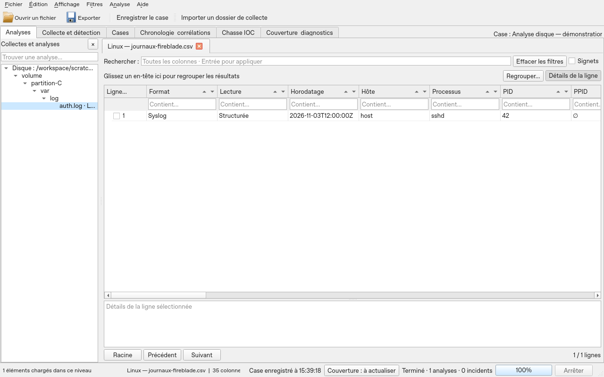

# Fireblade 0.2.1

**Un espace d’investigation local pour analyser des disques, explorer des artefacts Windows et Linux et examiner des exports de données.**

**[Télécharger Fireblade 0.2.0 — Windows x64](https://github.com/23R0534ZXT/fireblade/releases/download/v0.2.0/Fireblade.exe)** · [Notes et SHA-256](https://github.com/23R0534ZXT/fireblade/releases/tag/v0.2.0) · [Qualification Windows réussie](https://github.com/23R0534ZXT/fireblade/actions/runs/41673982489) · [Donner un retour](https://github.com/23R0534ZXT/fireblade/issues/6)

**La 0.2.1 est en préparation et qualification.** Le téléchargement disponible ci-dessus reste la 0.2.0.

**La 0.2.0 est publiée.** Téléchargez directement **Fireblade.exe**, puis lancez-le sous Windows x64. Le fichier publié est exactement celui qui a passé les qualifications Windows. Les packs de données ci-dessous sont des téléchargements séparés.

Fireblade s’adresse aux analystes DFIR et aux personnes qui apprennent l’investigation numérique. Il rassemble les résultats dans des dossiers d’enquête persistants : filtrer les données, retrouver les événements liés à une alerte, conserver des notes et exporter ses constatations.

*Interface en français. Capture de l’application avec des données de démonstration, rendue sous Linux hors écran.*

> **Fireblade 0.2.0 a passé les contrôles Windows** : 1 169 tests réussis sur chacune des versions Python 3.11, 3.12 et 3.13, EXE autonome, lecteurs, chemins UNC/longs, apparences, scénario de plus de 3 Gio et parcours à 320 analyses. [Résultats et artefacts](https://github.com/23R0534ZXT/fireblade/actions/runs/41673982489).

## Nouveautés de la 0.2

- **Un case obligatoire au démarrage** : créez une enquête ou reprenez un case existant avant de commencer.
- **Deux parcours depuis le case** : analyser un fichier de données ou analyser un disque logique / disque complet.
- **Analyse de disque en arrière-plan** : volumes montés, dossiers contenant les collectes et partitions, images RAW / E01 ou chemins de périphériques physiques. Les artefacts reconnus sont copiés en lecture seule puis traités par les lecteurs existants.
- **Résultats disponibles progressivement** : l’espace de travail s’ouvre immédiatement ; les analyses terminées s’ajoutent sans changer l’onglet consulté. Une progression en bas à droite indique l’étape en cours, avec un bouton d’arrêt.
- **Arbre des sources** : disque → partition → dossiers → analyses, ou regroupement par type d’artefact ou en liste.
- **Espace de travail configurable** dans **Affichage → Organiser l’espace de travail** : arbre à gauche ou à droite, panneaux visibles, position des détails et barres d’outils ; préférences enregistrées.
- **Animation de démarrage**, désactivable depuis le menu d’organisation.

Les copies d’artefacts, leur provenance et les références de l’arbre sont conservées dans les archives portables. Les lecteurs de systèmes de fichiers intégrés sont NTFS, FAT et ext ; leur qualification et celle des sources physiques/E01 sont détaillées dans le guide. Cette version ne fait ni acquisition, ni déchiffrement, ni récupération de fichiers supprimés.

[Guide des disques et de l’organisation](docs/guides/DISQUES-ET-ESPACE-DE-TRAVAIL.md) · [Notes 0.2.0](docs/development/RELEASE-NOTES.md) · [Validation locale](docs/validation/reports/20261103-v02-case-disk-linux.md)

## Ce que vous pouvez faire

- **Importer des artefacts Windows** avec 13 EZ Tools embarqués, 70 plugins RECmd et des lecteurs dédiés Shellbags et WebCache.
- **Lire les journaux Linux `/var/log/`** : fichiers et rotations compressées, syslog, audit, web, JSON, journal systemd et connexions Linux. Les limites et formats non décodés sont [documentés](docs/guides/JOURNAUX-LINUX.md).
- **Explorer une collecte CatScale**, en dossier ou en archive, organisée en sept familles.
- **Examiner les alertes Hayabusa** et leur contexte EVTX, avec retour à l’événement source.
- **Filtrer, grouper et annoter** des CSV, TSV, TXT délimités, XLS et XLSX ; les requêtes portent sur le résultat complet, pas seulement la page affichée.
- **Construire une chronologie et chercher des IOC**, puis produire un rapport HTML/PDF ou un export CSV/XLSX vérifié.
- **Reprendre et transporter une enquête** avec les sauvegardes de session et les archives de dossiers portables.

[Référence complète : fonctionnalités, captures et limites](docs/guides/FONCTIONNALITES.md) · [Compatibilité Timeline Explorer](docs/development/COMPATIBILITE.md)

## Choisir un jeu d’essai

| Jeu | Taille | Usage |
|---|---|---|
| [Découverte v1](https://github.com/23R0534ZXT/fireblade/releases/download/test-pack-v1/Fireblade-Test-Pack-v1.zip) | ~5,1 Mo ZIP, ~60,6 Mo extraits | Premier essai des formats et de l’interface |
| [**Grand pack BRUT v1**](https://github.com/23R0534ZXT/fireblade/releases/download/raw-artifacts-v1/Fireblade-Raw-Artifacts-v1.zip) | **~521 Mo ZIP, 3,44 Go de données brutes extraites** | Parser des MFT, ruches, EVTX, Prefetch, LNK et autres artefacts natifs ; scénario Linux en journaux bruts, aucun CSV d’analyse |
| [CSV de charge](https://github.com/23R0534ZXT/fireblade/releases/download/test-data-3gib/Fireblade-test-3GiB.zip) | 3 Gio de CSV | Tester le volume de la grille, des filtres et des exports ; ce n’est pas une collecte native |

Le grand pack réunit **2,37 Go d’artefacts Windows publics** et **1,07 Go de journaux Linux synthétiques**. Les collections Windows restent indépendantes. Son contrôle Windows a soumis 2 795 fichiers au parsing et vérifié exactement 7 585 912 lignes Linux. **16 refus de lecteurs** et 48 diagnostics d’avertissement ou de sortie vide sont consignés dans le rapport ; ils ne sont pas comptés comme des réussites.

[Guide du grand pack brut](docs/guides/PACK-BRUT.md) · [Choisir une collecte et connaître les paramètres de validation](docs/guides/COLLECTES-PACK-BRUT.md) · [Rapport, empreinte et limites](https://github.com/23R0534ZXT/fireblade/releases/tag/raw-artifacts-v1)

## Nouveautés de la 0.2.1 (qualification en cours)

Les sources de développement proposent désormais **Analyse → Parser un dossier…**, directement depuis l’accueil et la grille. Fichiers, dossiers et disques sont réunis dans Analyse ; la gestion des enquêtes reste dans Case, les recherches dans Détection et les sorties dans Exporter. Le suivi des imports et la détection EVTX ont chacun leur écran. Les vérifications d’intégrité et de couverture se consultent à la demande dans **Aide → Vérifier les imports et diagnostics…**, sans onglet principal permanent.

Le parsing des dossiers utilise le traitement de fond des disques : un seul import à la fois, arrêt possible, résultats vérifiés affichés progressivement par défaut. Les regroupements par artefact ou dans une seule grille se construisent en arrière-plan et s’ouvrent une fois terminés. Les réglages par défaut passent à un thread et 128 Mio par base DuckDB ; le parsing de fond utilise 64 Mio avec ces réglages. Il s’agit de budgets de base de données, pas d’une limite de RAM de tout le processus ni des moteurs externes. L’animation de démarrage dure 4,8 secondes et reste désactivable.

Ces changements et les correctifs d’audit ne sont pas encore inclus dans l’EXE 0.2.0 téléchargeable ci-dessus.

## Essayer Fireblade 0.2.0 en 15 minutes

1. Téléchargez **Fireblade.exe** avec le lien 0.2.0 ci-dessus, puis lancez-le sous **Windows x64**. Python, Excel et une installation préalable de .NET ne sont pas nécessaires.
2. Au démarrage, **créez un case ou ouvrez une enquête existante**. Toute analyse est rattachée à ce dossier d’enquête.
3. Téléchargez et décompressez le [pack de découverte (~5,1 Mo)](https://github.com/23R0534ZXT/fireblade/releases/download/test-pack-v1/Fireblade-Test-Pack-v1.zip). Son fichier **LIRE-MOI.md** décrit les données et les avertissements attendus.
4. Depuis l’accueil du case, choisissez **Analyser un fichier de données…** et ouvrez un CSV du dossier `03-Exports`. Filtrez une colonne, ajoutez un signet et une note.
5. Pour explorer un dossier d’artefacts sauvegardés, choisissez **Analyser un disque logique ou un disque complet… → Disque logique / volume monté**. Sélectionnez le dossier source et conservez le case hors de ce dossier. Les analyses terminées apparaissent progressivement dans l’arbre ; l’indicateur en bas à droite suit le traitement. Pour une image RAW/E01, choisissez le type de source correspondant et consultez les [limites des lecteurs](docs/guides/DISQUES-ET-ESPACE-DE-TRAVAIL.md).
6. Personnalisez les panneaux avec **Affichage → Organiser l’espace de travail**, enregistrez le case, fermez-le puis rouvrez-le. Partagez vos impressions dans [l’issue des testeurs](https://github.com/23R0534ZXT/fireblade/issues/6).

L’import de collecte classique reste disponible via **Fichier → Importer un dossier de collecte…**.

Ce petit pack couvre des exemples de formats : il ne contient pas une collecte complète de poste ni un incident unique. Le [CSV de 3 Gio](docs/guides/TESTER-3GIB.md) sert au test de charge. [Comprendre les deux jeux et leurs limites](docs/guides/JEUX-DE-TEST.md).

**F1** ouvre le guide rapide ; **Aide → Tutoriel complet** présente les autres parcours.

Le programme est encore un **prototype non signé** : Windows peut afficher un avertissement au lancement. Les [notes de la release 0.2.0](https://github.com/23R0534ZXT/fireblade/releases/tag/v0.2.0) donnent le commit qualifié et l’empreinte SHA-256 du téléchargement. Le premier démarrage extrait les ressources embarquées ; prévoyez de l’espace pour les analyses et leurs fichiers temporaires.

[Voir la démonstration commentée de 75 secondes](docs/assets/fireblade-demo.mp4) · [Contexte et reproduction](docs/guides/DEMONSTRATION.md)

*Cette démonstration présente le parcours d’analyse antérieur à la 0.2 ; le nouvel accueil impose désormais un case.*

## Retours et problèmes

Les premiers retours de testeurs francophones sont les bienvenus, y compris de débutants.

- **Impressions et questions sur le premier essai** : [commenter l’issue d’accueil](https://github.com/23R0534ZXT/fireblade/issues/6).
- **Bug précis ou amélioration** : [ouvrir une issue avec le formulaire adapté](https://github.com/23R0534ZXT/fireblade/issues/new/choose). Vérifiez si le problème existe déjà ; un problème par issue facilite son suivi.
- Indiquez **Aide → À propos**, le tag de la release, votre version de Windows et les étapes du problème. Utilisez le pack public pour les exemples et masquez les informations sensibles.

Un compte GitHub est nécessaire pour publier un retour.

## Validation et limites

La [0.2.0 corrigée sous Windows](https://github.com/23R0534ZXT/fireblade/actions/runs/41673982489) a passé les tests Python 3.11/3.12/3.13 (1 169 tests réussis par version), la construction de l’EXE autonome, les lecteurs, les chemins UNC/longs, les contrôles visuels, le scénario de plus de 3 Gio et les 320 analyses. Les essais Linux couvrent aussi un disque RAW à deux partitions et les requêtes pendant l’indexation. Ces contrôles ne qualifient pas tous les formats d’image ni les périphériques physiques. [Rapport et limites de la 0.2](docs/validation/reports/20261103-v02-case-disk-linux.md).

Les essais automatisés ne remplacent pas les essais sur vos postes et vos formats d’artefacts. Les [résultats historiques de la 0.1.1](https://github.com/23R0534ZXT/fireblade/actions/runs/41652792123) restent consultables séparément.

- Le traitement est local ; le parcours normal n’a pas besoin de télécharger les moteurs ou les règles.
- La **0.2.0** lit des volumes montés et des images disque pour extraire les artefacts pris en charge ; elle ne les monte pas dans le système hôte. L’EXE **0.1.1** reste limité aux artefacts collectés et exports. Hayabusa s’applique aux EVTX Windows.
- Les avertissements, résultats partiels et erreurs de lecteurs restent visibles. Une alerte est une piste à examiner, pas une conclusion automatique.
- Les analyses sont stockées dans des bases DuckDB `.timeline`. Le budget mémoire DuckDB ne plafonne pas toute la RAM du programme et de ses outils externes.
- Les sessions référencent leurs bases et leurs sources. Pour déplacer une enquête, utilisez une archive portable ; conservez les éléments nécessaires à une nouvelle analyse des artefacts.
- Les DLL optionnelles s’exécutent avec les permissions de l’utilisateur et leur compatibilité doit être vérifiée.

[Validation détaillée et mesures](docs/guides/FONCTIONNALITES.md#validation-and-known-limitations) · [Données de charge de 3 Gio](docs/guides/TESTER-3GIB.md) · [Sauvegardes et dossiers portables](docs/guides/CHRONOLOGIE-ET-SAUVEGARDES.md)

## Documentation et contribution

[Guide utilisateur](docs/guides/UTILISATION.md) · [Tutoriel complet](docs/guides/TUTORIEL-COMPLET.md) · [Index des guides](docs/README.md) · [Contribuer](CONTRIBUTING.md) · [Architecture](docs/development/ARCHITECTURE.md) · [Publier une version](docs/development/PUBLICATION.md)

Le code est dans `src/fireblade`, les tests dans `tests`, les versions des moteurs dans `config` et les scripts de construction dans `scripts/windows`. Les contrôles s’exécutent automatiquement ; une nouvelle release de l’application nécessite une publication explicite.

## English overview

Fireblade 0.2.0 adds a mandatory case-first workflow, background disk artifact analysis, progressive results, a configurable source tree and an optional startup animation. The Windows 0.2.0 build passed its qualification, including 1,169 tests per Python version, the standalone executable, visual checks, the >3 GiB scenario and 320 analyses. Download **Fireblade.exe** directly from the published **v0.2.0 release** linked above. The release notes include its qualified commit and SHA-256. See the linked validation limits before using disk images or physical devices.

Fireblade is a local Windows x64 forensic investigation workspace. Import Windows artifacts, raw Linux logs and rotations, CatScale collections or CSV/TSV/XLS/XLSX exports; filter and annotate the results, investigate Hayabusa alerts with EVTX context, build timelines, hunt IOCs and export findings. The desktop interface and guides currently use French.

Create or open a case at startup, then choose a data file or disk analysis. Try the public sample pack for a French walkthrough and expected results. Fireblade remains an unsigned prototype; see the linked Windows qualification, compatibility notes and limitations. Feedback is welcome in [Issues](https://github.com/23R0534ZXT/fireblade/issues).

## Licence

Le code de Fireblade est sous [licence MIT](LICENSE). Les moteurs et dépendances conservent leurs licences, dont l’AGPL de Hayabusa, Dissect et flow.record. Les notices sont disponibles dans **Aide → Licences** ; les sources Hayabusa embarquées peuvent être exportées depuis le menu Aide. [Licences tierces](licenses/THIRD_PARTY.md).
