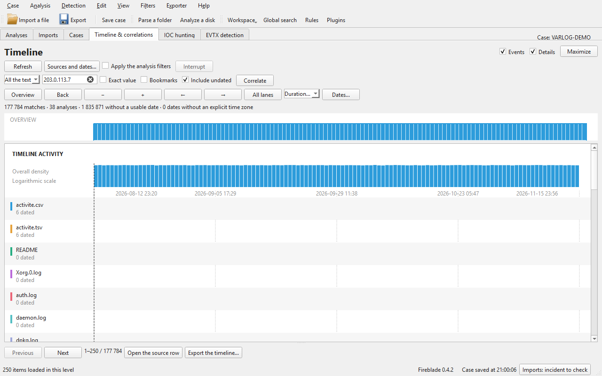
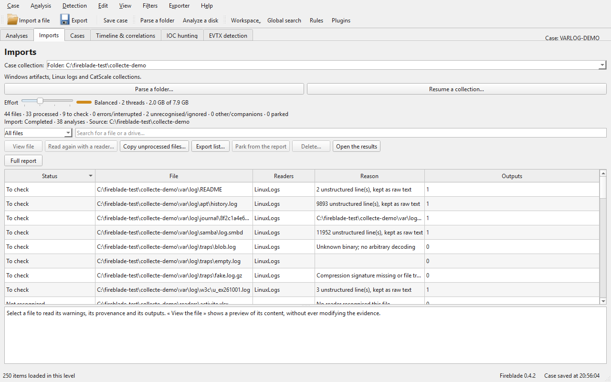

# Fireblade

[](https://github.com/23R0534ZXT/fireblade/actions/workflows/windows.yml)

**A local DFIR workspace for Windows artifacts, Linux logs and tabular evidence — with an
analyst assistant that runs on your own machine.**

Fireblade parses a collected folder, keeps every file accounted for, and puts the results
in one workspace: filterable tables, a cross-analysis timeline, indicator hunting,
detection results grouped into findings, an attack graph, and a case that can be saved,
archived and reopened. Everything runs locally: no server, no upload, no cloud account,
no API key.

The same engine ships in two editions: the **Host**, maintained, and the **Desktop**,
frozen at 0.7.9 — its window still works, but it no longer receives changes.

## Two editions, one engine

| | **Desktop** | **Host** |
| --- | --- | --- |
| Status | **frozen — 0.7.9** | **maintained — 0.8.0** |
| Runs on | Windows x64, one unzipped folder | a Linux container, a browser |
| Interface | Qt window, English | web page, English |
| Cases | on disk, portable `.fireblade` | one container per case, same format |
| For | one analyst at a workstation | one analyst (or a small team) on a server |

> ### The Host edition is a beta of a beta
> It exists, it imports real evidence, and it was walked screen by screen against the
> desktop. It is **not** a production deliverable: no support, no migration promise, its
> HTTP API may change between two commits, and there is no published image or upgrade
> path. Do not put an investigation you cannot redo in it.
> Read [docs/host/BETA.md](docs/host/BETA.md) before you rely on anything there.

| Desktop | Host |
| --- | --- |
|  |  |

*The same workspace in both editions — artifact tree, filterable table, per-column
filters, row details: the desktop's Qt window on the left, the Host's page on the right,
each on its own case.*

## Desktop edition — frozen at 0.7.9

The Windows window is no longer updated: this is its last published build, kept for the
cases it already reads. Everything new happens in the Host edition below.

**[Download Fireblade 0.7.9 — Windows x64](https://github.com/23R0534ZXT/fireblade/releases/download/v0.7.9/Fireblade-0.7.9-win64.zip)**
· [Release notes and SHA-256](https://github.com/23R0534ZXT/fireblade/releases/tag/v0.7.9)
· [Windows qualification](https://github.com/23R0534ZXT/fireblade/actions/runs/44548361173)

Unzip, then run **Fireblade.exe**. There is nothing else to install: Python, Qt, the
parsers and the .NET readers are inside the folder. The assistant is optional and
downloaded once.

1. Create a case.
2. Point Fireblade at a collected folder (**Parse a folder…**), a file (**Import a
   file…**) or a disk image (**Analyze a disk…**).
3. Open the Imports tab to see what was read and what was not, then work the table or the
   timeline.
4. Optional: **Set up the local model…** in the Hayabusa + AI tab.

Sample data, if you have nothing at hand: the
[sample collection](https://github.com/23R0534ZXT/fireblade/releases/download/test-pack-v2/Fireblade-Sample-Collection-2026-11-18.zip)
(a real Windows 11 machine: 183 event logs, Amcache, 60 Prefetch entries, 251 scheduled
tasks) · the
[discovery pack](https://github.com/23R0534ZXT/fireblade/releases/download/test-pack-v1/Fireblade-Test-Pack-v1.zip)
· the
[raw artifact pack](https://github.com/23R0534ZXT/fireblade/releases/download/raw-artifacts-v1/Fireblade-Raw-Artifacts-v1.zip)
· a [3 GiB CSV](https://github.com/23R0534ZXT/fireblade/releases/download/test-data-3gib/Fireblade-test-3GiB.zip).

The executable is **unsigned**: Windows may show a SmartScreen prompt on first launch
(*More info* → *Run anyway*), and Smart App Control on a fresh Windows 11 may refuse it.
Verify the download against the SHA-256 in the release notes.

The desktop's own documentation lives in [docs/desktop](docs/desktop): user guides,
release notes, architecture, plugins.

## Host edition — beta of a beta

The desktop's engine behind HTTP: the same `src/fireblade/core`, the same readers, the
same case format — without Qt, without a Windows session. One analyst, one container
per case, a browser as the window.

```bash
docker run -p 8080:8080 ghcr.io/23r0534zxt/fireblade:latest
# then open http://localhost:8080
```

That is the whole install: nothing to clone, nothing to build. Without `-v` the cases live
inside the container; to keep them, add `-v /srv/fireblade/cases:/data/cases` (and
`-v /srv/fireblade/plugins:/data/plugins` for the presentation plugins).

`:latest` is the newest release, `:0.8.0` pins one, `:edge` follows `main`. Building from
source stays one command: `docker build -t fireblade:host .`.

One container per case — the 0.8 shape: a driver creates a container for each case opened,
mounts that case's volume alone, and takes the container and the volume with the case when
it is erased. The certificate is written outside the volumes.

```bash
docker network create fireblade-cases 2>/dev/null || true
docker run -d --name fireblade-driver -p 8080:8080 --network fireblade-cases \
    -v /var/run/docker.sock:/var/run/docker.sock \
    -v /srv/fireblade/volumes:/data/volumes \
    -v /srv/fireblade/certificates:/data/certificates \
    ghcr.io/23r0534zxt/fireblade-driver:latest \
    python -m fireblade.web.agency serve \
      --volumes /data/volumes --host-volumes /srv/fireblade/volumes \
      --certificates /data/certificates --host-certificates /srv/fireblade/certificates \
      --host 0.0.0.0 --port 8080
# the driver's page lists the cases; each opens under /case/<id>/
```

From a clone, the same driver comes with its compose:
`docker compose -f deploy/host/docker-compose.driver.yml up -d --build`.

The image carries the .NET 10 runtime and the thirteen pinned readers, so it reads the
same artifacts as the desktop. A case written by the desktop opens as soon as its folder
is in `/data/cases`.


*The Host builds a five-analysis timeline: the bar counts the analyses and the message is
the core's own — every long command (import, IOC scan, timeline, Hayabusa, report,
portable case) reports and can be stopped.*


*Hayabusa findings drawn as a clock — the desktop's four views are all in the Host.*

**What it does not do — measured, not guessed**

| | |
| --- | --- |
| `SRUDB.dat` (SRUM) | `SrumECmd` refuses to run outside Windows (ESE libraries). The Host says so and points at the desktop's CSV. |
| Assistant IA | no model is connected; the button that would lie is absent. |
| Language | English only, by product decision since 0.3.2. |
| Windows | no detach/dock, no splash: a browser tab has no window manager. |
| Files | no "show in Explorer", no "open with": no file manager behind a browser. |
| Timeline Explorer | the .NET plugin is not in the container. |

An import of 333 real artifact files in the container reads 327 of them, with the same
row counts as Windows on the same files (EVTX 1 327, AppCompatCache 239). Every reader,
tool by tool, with the rows it wrote: [docs/host/LINUX-READERS.md](docs/host/LINUX-READERS.md).
The feature-by-feature audit against the desktop, and the seven defects it found and
fixed: [docs/host/HOST-AUDIT.md](docs/host/HOST-AUDIT.md).

Build and deployment notes: [deploy/host](deploy/host). The edition's documents:
[docs/host](docs/host).

## The engine both editions share

### Investigate a table

Per-column filters, grouping by one or more columns, sorting, pinned columns, calculated
columns, bookmarks, row and cell notes, colour rules and a command palette. Values are
never rewritten: the source columns, the source row number and the reader that produced
them stay available.


### Build a timeline across analyses

One histogram and one lane per analysis, built from the dates the analyst designates. A
counter says how many rows carry no usable date and how many carry none with an explicit
time zone, so a gap in the chronology is a stated fact rather than a silent one.



### Hunt indicators in bulk

Paste IPs, domains, URLs or hashes (or load a CSV), hunt across every open analysis, then
read the matches per indicator, per analysis and per source row — and export the summary
and the details as verified CSV.


### Know what was imported — and what was not

The Imports report lists every file with its status, the readers that touched it, the
reason when something went wrong and the hash taken at collection. Files can be previewed,
re-read with a chosen reader, copied aside, parked or removed — and a removal is refused
if the file changed since it was collected.



An empty jump list, a prefetch without an executable or an engine that needs Windows each
come back with a sentence that says which one it is, not with an exit code.

### Detect, and open the context

Hayabusa rules run locally over the parsed EVTX. An alert opens the events around its date
on the same machine, kept as an analysis tab like any other. The **Hayabusa + AI** tab
takes the same analysis further: findings, maps, and — in the desktop edition — the local
analyst.

### Case work that survives the investigation

Cases hold their analyses, views, notes and history. A case can be archived after being
verified, moved as a portable package, and reopened later with its recovery history
intact. Exports carry the SHA-256 of what they contain.

### The local analyst (desktop only)

Reading 30 000 alerts one at a time is not analysis. Fireblade groups them, draws them, and
then lets a small local model explain one of them under a rule that makes the answer usable
in a report: **it may not state anything it cannot cite.**


A fact that cites no event, or an event that is not in the pack, is dropped with its
reason; a link is kept only when both of its ends exist. Every answer ends with what the
evidence does *not* establish. The engine is the CPU build of llama.cpp, the weights
MiniCPM5-2B (1.5 GB), fetched once and then offline; measured at 25 to 45 s per
explanation on four cores with no GPU.

## Compared with Timeline Explorer — measured

Same machine, same files, both tools driven to completion. Timeline Explorer 2026.10.0;
Fireblade 0.4 with a 1 GB budget.

| On a 3.65 GB / 32 M-row CSV | Fireblade | Timeline Explorer |
| --- | --- | --- |
| Open the file | **56.6 s** | 108.3 s |
| Search "host07" in every column | **2.4 s** | 149.9 s |
| Group by host (37 groups) | **0.12 s** | 134.3 s |
| Sort by timestamp | **0.64 s** | 8.5 s |
| Memory while open | **1.1 GB** | 15.3 GB |

Both tools were checked to return the same rows (864 865 for one host, 37 groups). The
durable difference is memory, not seconds: Timeline Explorer holds roughly 4.2× the file
size in RAM, so an 8 GB machine caps it near 1.9 GB of log; Fireblade stays at its
configured budget. Method, every figure, and what the comparison does not prove:
[BENCHMARK-0.4.0.md](docs/development/BENCHMARK-0.4.0.md).

## Repository map

```
src/fireblade/
  core/          the engine both editions run: cases, readers, grid, timeline, reports
  ui/            the desktop edition (Qt) — not imported by the Host
  web/           the Host edition: FastAPI service, client in static/
  runtime/       bootstrap, resources, settings shared by both
  validation/     the Windows qualification harness
config/          the pinned readers (forensic-toolchain.json), profiles
deploy/host/     how to build and run the Host image
docs/
  desktop/       the desktop's documents
  host/          the Host's documents, its audit and its beta statement
  guides/        the user guides, shipped inside the desktop application
  development/   architecture, releases, plugins, contributor notes
  assets/        screenshots, demo animation, theme gallery
tests/           core, ui (desktop), web (Host), runtime, fixtures
```

## Build and test

```bash
python -m venv .venv
python -m pip install -e '.[dev]'
python -m scripts.dev_check        # version, ruff, client JavaScript, window, full suite
fireblade                          # the desktop edition
```

`scripts/dev_check --quick` skips the suite. The same gate runs in CI on Windows.

## Documentation

- **Desktop** — [docs/desktop](docs/desktop): user guides, release notes, architecture.
- **Host (beta)** — [docs/host](docs/host): edition, audit, parity, readers, beta statement.
- **Releases** — [release notes](docs/development/RELEASE-NOTES.md) and the
  [releases page](https://github.com/23R0534ZXT/fireblade/releases).

The interface is English. French remains selectable in **Preferences → Language** for the
parts already translated and is no longer maintained; the local assistant answers in the
language you ask in, whatever the interface shows.

## Known limits

- **Unsigned binary**: SmartScreen warns, and Smart App Control can block it on a fresh
  Windows 11 install.
- **Paths beyond 260 characters** need `LongPathsEnabled=1`.
- **An analysis workspace, not an acquisition tool**: no disk imaging, no carving, no
  decryption, no OCR. A PDF without a text layer is reported as such.
- **Detection assists, it does not conclude**: alerts require an analyst's review.
- **The assistant is an assistant**: a verified citation is not a verified conclusion.
- **.NET plugins run with your rights** — load only assemblies you trust.
- **The Host is a beta of a beta** — its limits are listed in
  [docs/host/BETA.md](docs/host/BETA.md).

## License

Code under [MIT](LICENSE). Bundled tools and dependencies keep their own licences, including
AGPL components; notices are in [licenses/THIRD_PARTY.md](licenses/THIRD_PARTY.md) and in
**Help → Licences**.
