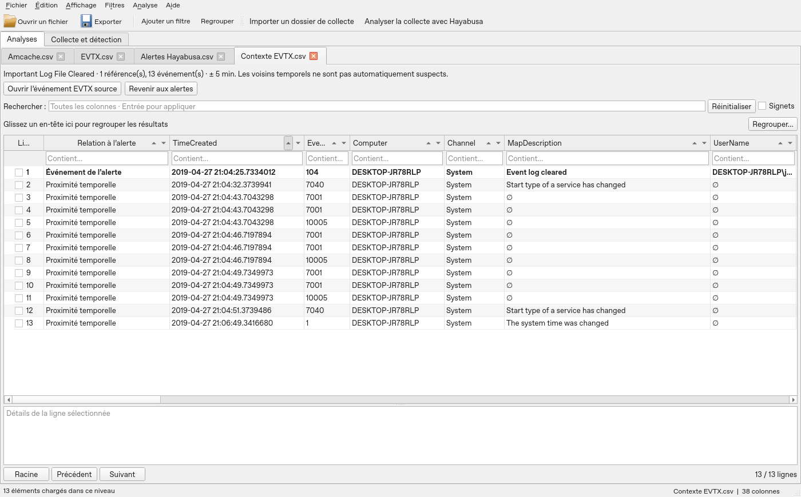
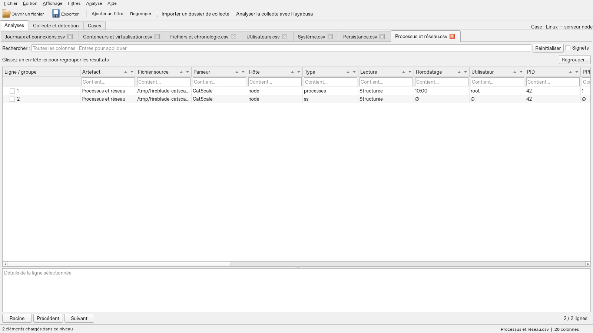
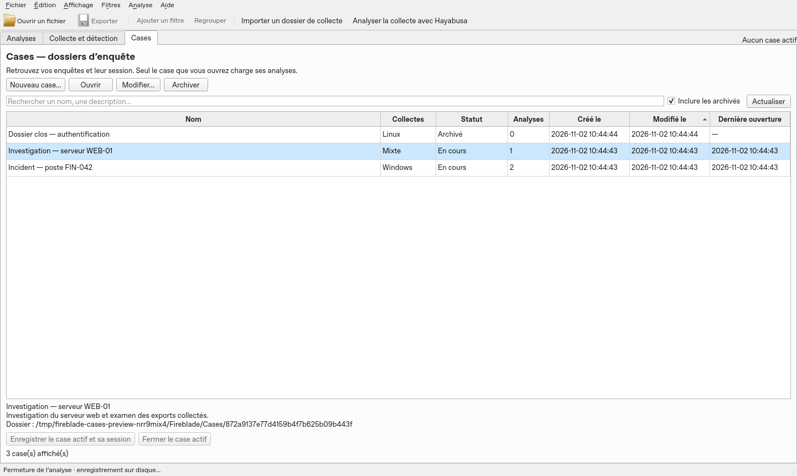

# Fireblade

[](https://github.com/23R0534ZXT/fireblade/actions/workflows/windows.yml)

**A local forensic tool for Windows: import Windows artifacts or Linux CatScale collections, explore the results, and investigate Hayabusa alerts with their EVTX context.**

Select a folder of artifacts, let the bundled engines process it, then investigate in Fireblade using search, column filters, AND/OR/NOT conditions, sorting, grouping, bookmarks, notes, and exports. You can also open existing CSV, TSV, delimited TXT, XLS, and XLSX files directly.

Imported data is stored in DuckDB `.timeline` databases on disk. The grid loads pages; filters, counts, and exports operate on the complete result set. The Windows application ships as **a single `Fireblade.exe`**, including its engines and dependencies. Evidence and analysis results remain separate files.

## Download and run

1. Open [Releases](https://github.com/23R0534ZXT/fireblade/releases) and select the latest **Fireblade - prototype Windows** prerelease. The test dataset release contains data, not the application.
2. Download `Fireblade.exe` and run it on Windows x64.
3. Open **Aide → Tutoriel complet — toutes les fonctionnalités**, or press **F1** for the quick guide.

UI labels quoted below match the application's current French interface.

Users do not need to install Python, Excel, or a separate .NET runtime for the bundled features. At startup, the EXE extracts its resources into a temporary Windows folder; allow enough disk space for this. The forensic engine bundle increases the executable's size. The executable is not code-signed.

A build running on `main` does not mean its release is ready: publication waits for the Windows checks. [GitHub Actions artifacts](https://github.com/23R0534ZXT/fireblade/actions/workflows/windows.yml) also provide a **Fireblade-exe** ZIP. GitHub's “Source code” archives contain source files that must be built.

## From artifact collection to alerts and context

1. Click **Importer un dossier de collecte…** and select the artifact folder. Subfolders are scanned; links are skipped.
2. Choose **Un onglet par type d’artefact ou famille CatScale** for one tab per artifact type, or **Tout dans un seul onglet, regroupé par artefact ou famille CatScale** for a single table grouped by artifact. Results retain their provenance and format-specific fields.
3. Review the report in **Collecte et détection**. It distinguishes completed processing, warnings, errors, unrecognized files, and missing outputs. Original parser outputs and logs are retained.
4. Click **Analyser la collecte avec Hayabusa**. Inventoried EVTX files are verified using SHA-256, copied temporarily, and analyzed together with the bundled rules.
5. In **Alertes Hayabusa**, select a detection, set the time window before and after it, and click **Voir le contexte de cette alerte**.
6. The new **Contexte EVTX** tab displays a timeline of imported events from the same computer, including other event logs. **Ouvrir l’événement EVTX source** opens the original record; **Revenir aux alertes** returns to the alerts with filters and annotations preserved.

Context links use **the EVTX file and EventRecordID**, with computer and EventID checks when available. The pinned relationship column distinguishes the alert event, candidate references from an aggregation, and nearby events. A nearby event is not automatically suspicious. The default window is ±5 minutes, adjustable from 1 minute to 24 hours, with a maximum of 1000 events and explicit notices when limits are reached.

Hayabusa analyzes **EVTX files** in this workflow. Other artifacts are parsed and available for exploration; EVTX rules are not applied to them. A detection is an investigative lead to review.



Screenshot from a real workflow using a public demonstration EVTX, captured with Qt offscreen on Linux.

### Bundled engines

| Engine | Artifacts routed by Fireblade |
|---|---|
| EvtxECmd | EVTX event logs |
| AmcacheParser | Recognized Amcache / Inventory files |
| AppCompatCacheParser | AppCompatCache in a SYSTEM registry hive |
| PECmd | Prefetch `.pf` files |
| MFTECmd | `$MFT`, `$J`, `$Boot`, and recognized inputs |
| RECmd | Registry hives, the Kroll batch, and RegistryPlugins |
| LECmd | LNK shortcuts |
| JLECmd | Automatic and custom Jump Lists |
| SrumECmd | `SRUDB.dat` |
| WxTCmd | `ActivitiesCache.db` |
| RBCmd | Recycle Bin `$I` metadata |
| RecentFileCacheParser | `RecentFileCache.bcf` |
| SQLECmd | SQLite databases recognized by its maps |
| Hayabusa 4.3.1 | Detections and correlations across inventoried EVTX files |

Versions, sources, and hashes are pinned in the [engine configuration](config/forensic-toolchain.json). EvtxECmd and SQLECmd include their maps; RECmd includes 70 registry plugins. A SQLite database requires a matching map. This list does not guarantee every variant or every input supported by each upstream tool's command line. Fireblade does not mount disk images.

## Linux CatScale collections

Create or open a case, then use **Importer un dossier de collecte…**. Select either an extracted CatScale collection, the `extracted` parent containing several hosts, or a folder containing original `catscale_*.tar.gz` / legacy `FSecure_*.tar.gz` archives. No Linux tools, collector, Logstash, or additional runtime are required on the analysis PC.

Choose separate tabs by family, or one table grouped by family:

- **Processus et réseau**: processes, `/proc` status, connections, hashes, links, and command/environment captures.
- **Persistance**: crontabs, systemd configuration and service status.
- **Journaux et connexions**, **Système**, **Utilisateurs**, **Fichiers et chronologie**, and **Conteneurs et virtualisation** retain the corresponding outputs.

Dedicated readers extract fields from supported process tables, `ss`/`netstat`, hashes, links, cron, systemctl, passwd/group, shell histories, syslog/audit lines, and the collector's file timeline. Remaining text is retained with **Lecture = Brute** and reported as a warning. Container/configuration text has key/value parsing where applicable; arbitrary tables and JSON are retained as text rather than claimed as fully structured records. Entirely empty columns are removed from each generated CSV.

Each record retains its raw text, source, and physical line range. Archive references use `archive!/member`; gzip logs and nested tar archives are streamed without extracting input paths to disk. Source files are SHA-256 checked before and after processing. Unknown binary files (including binary journals/login databases), links, unsafe paths, corrupt data, and limits are explicitly reported; they are not silently treated as parsed events.

Limits per input: 1 MiB per line or `/proc` block, 256 MiB per archived member, three archive layers, a 100,000-entry traversal guard, and a 4 GiB expanded-data budget (nested reads also count). Results completed before a limit remain in the working directory; inspect the report. Timestamps retain their source representation, including missing years or time zones. The reader follows [LinuxCatScale](https://github.com/WithSecureLabs/LinuxCatScale) commit `0014f234a472f536d28664902daed90527ff5858`; it does not execute or redistribute the collector. Hayabusa detection applies only to Windows EVTX, not CatScale text.



Illustrative capture from the representative CatScale acceptance corpus, rendered with Qt offscreen on Linux.

## Investigation cases

The **Cases** tab opens at startup and lists saved investigations without loading their analyses. Create a case with a name, description, platform label (Windows, Linux, mixed, or unspecified), and status. The platform label organizes the catalogue; it does not add parser support.

Open a case explicitly to restore its analysis tabs, active tab, filters, grouping, sorting, and column layout. Bookmarks and notes remain in the analysis databases. Saving the case saves its session too; switching cases, closing a case, and quitting save the active case first. A failed save prevents closing or switching. Only one window can open a given case at a time.

Use search, sortable columns, and **Archiver** to keep the catalogue organized. Archived cases are retained and can be shown with **Inclure les archivés**, then reactivated. Each case can retain several collection workspaces; choose one in **Collecte et détection**. Importing another collection adds its analyses to the active case.

New imports, collection results, and automatic layouts default to the case's own folder under `%LOCALAPPDATA%\Fireblade\Cases\<case-id>`. Existing analyses can also be included when creating a case. These remain references: adding an existing database does not copy it, and reusing the same database shares its annotations. Back up the case folder **and every externally referenced database and original artifact**. Moving files does not rewrite saved paths.



## Explore the results

| Task | Command or gesture |
|---|---|
| Search a column | Use **Contient…** below its header; filtering runs after a short delay or when you press Enter |
| Sort quickly | Use ▲ / ▼ on the right of the header; its menu selects Text, Number, or ISO Date sorting |
| Combine conditions | **Filtres → Éditeur ET / OU / NON** provides nested blocks, exclusions, and a filter preview |
| Group results | Drag a header into the grouping bar; × removes a level |
| Read a complete value | Use the Details panel or **Afficher la cellule / JSON** |
| Keep an investigative lead | Add a bookmark and note to a row, or annotate the selection |
| Search across analyses | **Filtres → Rechercher dans toutes les analyses** |
| Resume work | Save a named view in the analysis and a `.fireblade-session` workspace |
| Share results | Export filtered CSV/XLSX data, annotations, or summaries |

The grid also supports sorting by multiple columns, group summaries and a global footer, paged expansion, columns pinned on either side, row heights, themes, and local/shared formatting rules. Date conversions create separate UTC columns; expressions support persistent calculated columns.

Forensic profiles organize columns; each profile is not a raw artifact parser. Fireblade imports some Timeline Explorer layouts, preferences, and sessions, along with compatible DLL readers and functions through its .NET helpers. Compatibility remains partial: see [supported formats and limitations](docs/development/COMPATIBILITE.md) and [profiles and plugins](docs/development/PLUGINS.md).

### Main keyboard shortcuts

| Action | Shortcut |
|---|---|
| Create a case / save the case and session | Ctrl+Alt+N / Ctrl+Alt+S |
| Open data / an analysis | Ctrl+O / Ctrl+Shift+O |
| Export results | Ctrl+Shift+E |
| Clear filters | Ctrl+E |
| AND / OR / NOT editor | Ctrl+Alt+F |
| Filter on the active cell | Ctrl+Shift+F |
| Search across analyses | Ctrl+F |
| Save / load a view | Ctrl+S / Ctrl+L |
| Save the session (or the active case and session) | Ctrl+Shift+S |
| Bookmark the selection / remove its bookmarks | Ctrl+Alt+B / Ctrl+Shift+M |
| Expand / collapse all groups | Ctrl+M / Ctrl+K |
| Next / previous tab | Ctrl+Tab / Ctrl+Shift+Tab |
| Close / reopen a tab | Ctrl+W / Ctrl+Shift+T |
| User guide | F1 |

## Data and backups

Source files are read without rewriting them and verified using SHA-256. Native imports preserve text values, leading zeros, and large identifiers; empty cells become NULL. Excel fidelity also depends on cell type and reader: XLSX formulas are retained as text, while XLS formulas use cached results. Macros are not executed.

| Item | What to retain |
|---|---|
| `.timeline` | Imported data, provenance, annotations, and views |
| `.fireblade-session` | Database references: keep every referenced database |
| Investigation case | Entire case folder (`case.json`, session, analyses, collection workspaces, layouts), plus external references |
| Fireblade collection workspace | `collection.json`, session, individual and organized databases, CSV files, contexts, and logs |
| Original artifacts | Required to rerun Hayabusa; imported databases remain readable without them |
| User profile | Preferences, shared rules, personal profiles, and automatic layouts |

Outside an active case, collection workspaces are created in `%LOCALAPPDATA%\Fireblade\Collectes`. **Reprendre une collecte…** opens a collection's working directory. Both `collection.json` and session files store path references: moving a directory does not automatically migrate every reference.

Settings and ordinary analyses live under `%LOCALAPPDATA%\Fireblade`. Session backups do not include the evidence. Third-party DLLs may require their own files and dependencies, and run with the user's permissions.

Processing takes place locally. The bundle includes its engines and rules; the normal workflow does not require downloads. Building the application retrieves dependencies and pinned upstream sources.

## Validation and known limitations

Validation tests the sources on Windows with Python 3.11, 3.12, and 3.13, then runs the actual EXE alone in an empty folder: resources, engines, imports, rendering, sessions, cancellation, annotations, and exports. Publication also depends on Windows storage checks, reader checks, visual captures, a 320-analysis workflow, and the 3 GiB dataset.

The forensic check requires nonempty output from each of the 13 parsers, opens every result in the grid, and checks displayed values. It also checks Hayabusa detections and their context. Public fixtures are pinned and their SHA-256 hashes are verified. **Adding a test is not proof that it passed**: consult the workflow results for the relevant commit.

Results and limitations are documented in [forensic validation](docs/validation/COLLECTE-FORENSIC.md), [Windows validation](docs/validation/WINDOWS.md), and [qualification reports](docs/validation/QUALIFICATION.md). Linux and native Windows results are distinguished. Representative examples do not qualify every Windows version, every SQLite map, or every damaged file.

The configured memory limit applies to the DuckDB buffer, not the entire application or external engines. Groups, caches, large fields, and plugins add their own costs. Allow disk space for results, organized databases, and temporary copies. A session is limited to 1000 analyses. An import cannot resume midway through a write after a crash; completed collection tasks are retained. HTML/PDF report export is not available.

### Large test dataset

[Download the 3 GiB CSV ZIP](https://github.com/23R0534ZXT/fireblade/releases/download/test-data-3gib/Fireblade-test-3GiB.zip) · [Manifest and hash](docs/validation/datasets/3gib.json) · [Exercise and expected results](docs/guides/TESTER-3GIB.md)

The synthetic dataset contains 2,441,216 records and 18 columns, totaling 3,222,648,632 bytes. It is used for load testing and does not replace parser fixtures. Measurements from older commits do not automatically qualify the current binary.

### Large CSV engine test: 12.2 million records

A recorded Linux engine test imported **12,206,080 records from a 16,113,242,560-byte CSV** (16.1 GB, about 15.0 GiB). The file was built by repeating the verified 3 GiB dataset's records five times while keeping one header; the base dataset was not regenerated.

| Check | Recorded result |
|---|---|
| Import the complete CSV | 519.58 seconds, with a 256 MiB DuckDB buffer and 2 engine threads |
| Read the first and last records | Passed, including record 12,206,080, Unicode, and source precision |
| Filter the complete dataset | 47,025 matching records; 0.179 seconds |
| Count groups across all records | 8 groups over 12,206,080 records; 0.023 seconds |
| Close and reopen the analysis | Passed; all 12,206,080 records retained |

[Read the complete test report and dataset SHA-256](docs/validation/reports/20261101-15gib-engine-linux.json).

These are measurements from that recorded Linux engine run. The 256 MiB setting limits DuckDB's buffer, not total process memory. This run does not qualify the Windows GUI at that file size or establish a performance comparison with Timeline Explorer.

## Development and building

From the repository root, on Windows x64 with Python 3.12:

```powershell
py -3.12 -m venv .venv
.\.venv\Scripts\python.exe -m pip install --only-binary=:all: -r requirements/development.txt
.\.venv\Scripts\python.exe -m pip install --no-deps -e .
.\.venv\Scripts\python.exe -m fireblade
.\.venv\Scripts\python.exe -m pytest -q
```

To rebuild the single-file executable, also install Git and the .NET 10 SDK, then run:

```powershell
py -3.12 -m scripts.windows.build
```

The build prepares `.venv-build`, compiles the engines and helpers, bundles the .NET runtime, rules, and maps, creates the EXE, and verifies it after moving it to an empty folder. The output is `dist/Fireblade.exe`; reports are written to `artifacts/`. Building requires Internet access. Builds are not byte-for-byte reproducible.

Application code is in `src/fireblade`, tests in `tests`, pinned engines/fixtures in `config`, and build scripts in `scripts/windows`. See [Contributing](docs/development/CONTRIBUER.md) and [Architecture](docs/development/ARCHITECTURE.md) for details.

## Troubleshooting and documentation

For startup issues, check `%LOCALAPPDATA%\Fireblade\Journaux\demarrage.log`. For a collection, review **Collecte et détection**, then `parser.log` or `hayabusa.log` in its working directory. To report a reproducible issue, include the commit/version from **Aide → À propos**, Windows version, reproduction steps, expected result, and exact error message.

Run the built-in check with a new report destination:

```powershell
.\Fireblade.exe --self-test-report "$env:TEMP\fireblade-controle.json"
```

This uses synthetic qualification data and bundled public artifacts; it can take time and disk space. It does not analyze a user's collection.

- [Complete tutorial](docs/guides/TUTORIEL-COMPLET.md): collection, detection, context, exploration, rules, backups, and reference sections.
- [User guide](docs/guides/UTILISATION.md): getting started.
- [Documentation index](docs/README.md).
- [Timeline Explorer compatibility](docs/development/COMPATIBILITE.md).

The linked guides currently use French, matching the application interface.

## License

Fireblade's code is licensed under [MIT](LICENSE). Dependencies and engines retain their respective licenses, including Hayabusa's AGPL. Notices are available through **Aide → Licences**, and bundled Hayabusa sources can be exported from **Collecte et détection**. See [third-party licenses](licenses/THIRD_PARTY.md).
