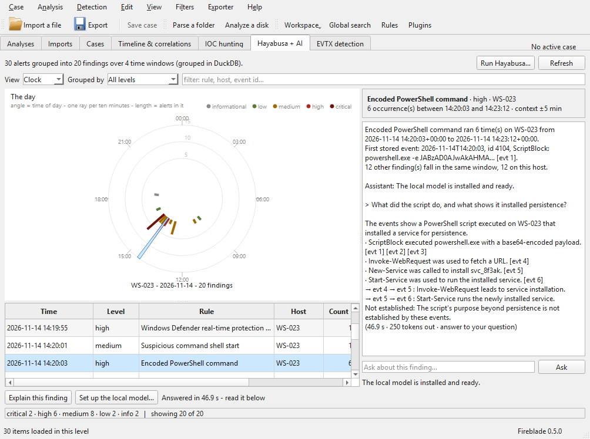
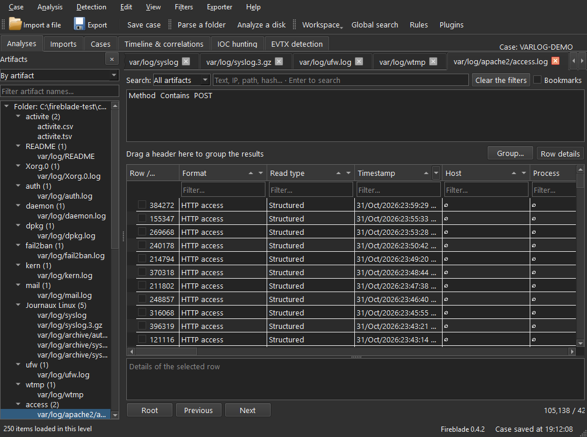

# Fireblade

[](https://github.com/23R0534ZXT/fireblade/actions/workflows/windows.yml)

**A local DFIR workspace for Windows artifacts, Linux logs and tabular evidence — with an
analyst assistant that runs on your own machine.**

Fireblade parses a collected folder, keeps every file accounted for, and puts the results
in one desktop workspace: filterable tables, a cross-analysis timeline, indicator hunting,
detection results and a case that can be saved, archived and reopened. Since 0.5.0 it also
groups the detections into findings, draws them, and lets a local language model read a
finding with you — offline, with every sentence of its answer tied to the events it came
from. Everything runs locally: no server, no upload, no cloud account, no API key.

**[Download Fireblade 0.7.8 — Windows x64](https://github.com/23R0534ZXT/fireblade/releases/download/v0.7.8/Fireblade-0.7.8-win64.zip)** · [Release notes and SHA-256](https://github.com/23R0534ZXT/fireblade/releases/tag/v0.7.8) · [Windows qualification](https://github.com/23R0534ZXT/fireblade/actions/runs/44529984353)

The desktop interface and most user guides are currently in French.

Windows, a folder to unzip, no installation: Python, Qt, the parsers and the .NET readers
are inside it. The assistant is optional and downloaded separately, once.


*A workspace over synthetic Linux logs: artifact tree, table, per-column filters and row
details.*

## The local analyst

Reading 30 000 alerts one at a time is not analysis. Fireblade groups them, draws them, and
then lets a small local model explain one of them — under a rule that makes the answer
usable in a report: **it may not state anything it cannot cite.**



*A real answer, on a real case: the finding, the events it rests on, what is not
established, and the two links the assistant asserted between events.*

**How it works**

1. **Group, in the database.** A Hayabusa analysis becomes findings — one rule, one host,
   one burst — through a window function in DuckDB, then gathered into time windows. A
   collection with millions of alerts never has to fit in memory.
2. **Draw, three ways, one selector.** The day as a polar histogram (angle = time of day,
   one ray per ten minutes, length = alerts, colour = worst severity in the slice), rules
   over time, and the chain of a finding: its events in order, and the links the assistant
   asserted between them. A finding without a usable timestamp is counted and reported,
   never hidden.
3. **Ask a bounded question.** `Explain this finding`, or any question typed in the box,
   sends an evidence pack — the finding, its events numbered `[evt 1]`…`[evt n]`, the other
   findings of the same window, and what could not be established — and asks for JSON:
   a summary, facts with the events they rest on, links between events, and what is missing.
4. **Check the answer before showing it.** A fact that cites no event, or an event that is
   not in the pack, is dropped with its reason; a link is kept only when both of its ends
   exist. A well-formed answer is not a true one, so the guard is a check, not a promise.
5. **Stay honest about the gaps.** Every answer ends with what the evidence does *not*
   establish — and the model is told to say so rather than guess. Ask it who wrote a file
   and it answers that the events do not say.

**What it costs, and what it needs**

- The engine is the CPU build of llama.cpp; the weights are MiniCPM5-2B (Q4_K_M, 1.5 GB,
  digest checked on download). Both are pinned and fetched once from **Set up the local
  model…**, then everything is offline. A manifest next to the user's cases records what is
  installed; Fireblade checks weights, engine and memory before promising anything.
- Measured on a four-core, 8 GB virtual machine with no GPU: **25 to 45 s** for one
  explanation, **about 30 s** for a follow-up question, and the engine stays loaded between
  questions. Answers are checked, so a slow answer is never a wrong one.
- French questions get French answers. The interface is English; the conversation is not.
- No model installed is a supported state: the tab still explains a finding from the data
  alone, greys out the buttons, and says why.

**What it will not do** — and this is deliberate for a prototype:

- It explains **one finding** and answers questions about it. It does not drive an
  investigation or hop from finding to finding on its own.
- It uses the model as shipped: the prompt was tuned and measured, the weights were not
  fine-tuned.
- It is an assistant. Counts, joins, ordering and every conclusion that needs a decision
  remain in the code and in the analyst's hands.

## What it does

- **Turns a collection into one workspace** — Windows artifacts (EVTX, MFT, Prefetch,
  registry, Shellbags, WebCache), raw Linux logs and rotations, CatScale output, CSV/TSV,
  XLS/XLSX, saved HTML pages and PDF text layers.
- **Never loses a file silently** — every file ends in a report with its status, its reason
  and its SHA-256, including the ones no reader recognised.
- **Answers questions fast** on tables of tens of millions of rows without loading them
  into memory.
- **Builds one chronology** across analyses, with the time zone assumption stated rather
  than hidden.
- **Hunts indicators in bulk** and keeps the result attached to the case.
- **Turns detections into findings**, draws them, and lets a local model explain them with
  citations that are checked before they appear.
- **Produces evidence** an examiner can defend: provenance, annotations, verified exports
  and a portable archive whose content is checked before it replaces anything.

## Investigate a table

Per-column filters, grouping by one or more columns, sorting, pinned columns, calculated
columns, bookmarks, row and cell notes, colour rules and a command palette. Values are
never rewritten: the source columns, the source row number and the reader that produced
them stay available.



## Build a timeline across analyses

One histogram and one lane per analysis, built from the dates the analyst designates. A
counter says how many rows carry no usable date and how many carry none with an explicit
time zone, so a gap in the chronology is a stated fact rather than a silent one.


## Hunt indicators in bulk

Paste IPs, domains, URLs or hashes (or load a CSV), hunt across every open analysis, then
read the matches per indicator, per analysis and per source row — and export the summary
and the details as verified CSV.


## Know what was imported — and what was not

The Imports report lists every file with its status, the readers that touched it, the
reason when something went wrong and the hash taken at collection. Files can be previewed,
re-read with a chosen reader, copied aside, parked or removed — and a removal is refused
if the file changed since it was collected. The coverage audit then checks the analyses
themselves and reports what it cannot verify.


## Detect, and open the context

Hayabusa rules run locally over the parsed EVTX. An alert opens the events around its date
on the same machine, kept as an analysis tab like any other. The **Hayabusa + AI** tab takes
the same analysis further: findings, maps, and the local analyst.

## Case work that survives the investigation

Cases hold their analyses, views, notes and history. A case can be archived after being
verified, moved as a portable package, and reopened later with its recovery history
intact. Exports carry the SHA-256 of what they contain.

## Compared with Timeline Explorer — measured

Same machine, same files, both tools driven to completion. Timeline Explorer 2026.10.0;
Fireblade 0.4 with a 1 GB budget.

| On a 3.65 GB / 32 M-row CSV | Fireblade | Timeline Explorer |
|---|---|---|
| Open the file | **56.6 s** | 108.3 s |
| Search "host07" in every column | **2.4 s** | 149.9 s |
| Group by host (37 groups) | **0.12 s** | 134.3 s |
| Sort by timestamp | **0.64 s** | 8.5 s |
| Memory while open | **1.1 GB** | 15.3 GB |

Both tools were checked to return the same rows (864 865 for one host, 37 groups). The
durable difference is memory, not seconds: Timeline Explorer holds roughly 4.2× the file
size in RAM, so an 8 GB machine caps it near 1.9 GB of log; Fireblade stays at its
configured budget. Method, every figure, and what the comparison does not prove:
[BENCHMARK-0.4.0.md](docs/development/BENCHMARK-0.4.0.md).

## Install

1. Download **Fireblade-<version>-win64.zip** from the
   [latest release](https://github.com/23R0534ZXT/fireblade/releases).
2. Unzip it anywhere and run **Fireblade.exe** from the folder. There is nothing else to
   install — no Python, no Excel, no separate .NET. Unzipping once is what makes every
   launch fast: the 0.5.0 single file re-extracted itself at every start.
3. Create a case, then point Fireblade at a collected folder (**Parse a folder…**), a file
   (**Import a file…**) or a disk image (**Analyze a disk…**).
4. Optional: **Set up the local model…** in the Hayabusa + AI tab downloads the assistant
   once. Fireblade is complete without it.

**First five minutes**: create a case → parse a folder → open the Imports tab to see what
was read and what was not → filter the table or open the timeline → save the case.

The executable is **unsigned**: Windows may show a SmartScreen prompt on first launch
("More info" → "Run anyway"), and Smart App Control on a fresh Windows 11 may refuse it
outright. Verify the download against the SHA-256 published in the release notes.

Sample data, if you have nothing at hand. The **sample collection** is a real Windows 11
machine (183 event logs, Amcache, 60 Prefetch entries, 251 scheduled tasks, 5.6 MB):
[sample collection](https://github.com/23R0534ZXT/fireblade/releases/download/test-pack-v2/Fireblade-Sample-Collection-2026-11-18.zip) ·
[discovery pack](https://github.com/23R0534ZXT/fireblade/releases/download/test-pack-v1/Fireblade-Test-Pack-v1.zip) ·
[raw artifact pack](https://github.com/23R0534ZXT/fireblade/releases/download/raw-artifacts-v1/Fireblade-Raw-Artifacts-v1.zip) ·
[3 GiB CSV](https://github.com/23R0534ZXT/fireblade/releases/download/test-data-3gib/Fireblade-test-3GiB.zip).

## Known limits

- **Unsigned binary**, so SmartScreen warns and Smart App Control can block it on a fresh
  Windows 11 install.
- **Paths beyond 260 characters** need `LongPathsEnabled=1` on the machine.
- **An analysis workspace, not an acquisition tool**: no disk imaging, no carving, no
  decryption and no OCR. A PDF without a text layer is reported as such instead of
  producing empty rows.
- **Detection assists, it does not conclude**: alerts require an analyst's review, and the
  coverage audit states what it could not verify.
- **The assistant is an assistant**: its answers are checked against the evidence and what
  it cannot establish is written out, but a verified citation is not a verified conclusion.
- **The model needs the Visual C++ runtime**, which the Windows installer of any recent
  application already provides; without it the engine refuses to start and the tab says so.
- **.NET plugins run with your rights** — load only assemblies you trust.

## What's new in 0.5.1

- **A readable tree.** Left panel entries are named for what they are - `Event logs .
  Security`, `Amcache`, `Browser history`, `Prefetch` - or for the folder they came
  from; the full path is in the tooltip.
- **A fast launch.** The download is a folder zipped once, not an executable that
  unpacks itself at every start: 0.6 s measured against 41 to 50 s for the 0.5.0 file.
  The 6.5 s startup ident is kept, and it now covers the window build instead of
  following it.
- **The local assistant stays optional**, and nothing is downloaded unless you ask.
- **One import for several sources.** Files and folders are chosen in one list and read
  as one operation: one report, one journal, one working folder.
- **Resume an interrupted import** instead of starting it over: what was read is kept,
  and only the rows that were never read — or whose analysis went missing — are read again.
- **Duplicate detection on the SHA-256** of the evidence, inside one operation and across
  the imports of a case: the second copy is a `Duplicate` row naming the copy that was read,
  never a second set of tabs.
- **A proof after the write.** Every analysis is reopened and counted against the number
  recorded at import; the report shows `verification: N checked · N failed`.
- **`journal.jsonl` per operation**: one line per file with its status, its reason and its
  seconds, plus duplicates, memory retries and the verification.
- **One bad file costs one row.** A reader that crashes no longer ends a collection that
  had already read two thousand files.

## Previous release — 0.5.0

- **A new tab: Hayabusa + AI.** Alerts become findings (one rule, one host, one burst),
  grouped in DuckDB and gathered into time windows; a short grid lists them and three views
  show them — the day as a polar histogram, rules over time, and the chain of a finding.
- **A local analyst, offline and optional.** llama.cpp CPU build and MiniCPM5-2B weights,
  pinned and downloaded once; 25 to 45 s per explanation on four cores.
- **Answers that cannot invent.** Every fact and every link must cite events of the pack;
  anything citing an event that does not exist is dropped and the reason is shown; what the
  evidence does not establish is written in the answer.
- **The tab is built to work with your hands**: the columns, the bands and the chat are all
  resizable, and the whole thing still fits a 1024×600 window.
- The interface keeps working with no model at all, and says so.

## Previous release — 0.4.2

- A 9.74 GiB collection parses in **6 min 0 s** instead of 50 min 49 s, for the same 246
  analyses: each file is read in its own process and a huge file is split into line-aligned
  ranges.
- The Imports table fills while the collection runs, and its report is fully in the
  interface language.
- Tab labels no longer collide, Preferences shows the effective thread count and memory,
  and the coverage and IOC summaries read in English.
- The whole set of findings from the 0.4.1 acceptance run is closed. Details:
  [release notes](docs/development/RELEASE-NOTES.md).

## Documentation

- **User guides** — [documentation index](docs/README.md): tutorial, workspace, collection,
  timeline, IOC hunting, coverage, disk analysis. They are in French today and being
  translated; the interface itself is English.
- **For contributors** — [architecture](docs/development/ARCHITECTURE.md),
  [compatibility](docs/development/COMPATIBILITE.md),
  [benchmark](docs/development/BENCHMARK-0.4.0.md), [plugins](docs/development/PLUGINS.md).
- **Releases** — [release notes](docs/development/RELEASE-NOTES.md) and the
  [releases page](https://github.com/23R0534ZXT/fireblade/releases).

The interface ships in English; French remains selectable in **Preferences → Language** for
the parts already translated, and is no longer maintained. The local assistant answers in
the language you ask in, whatever the interface shows.

## Development

```bash
python -m venv .venv
python -m pip install -e '.[dev]'
python -m pytest -q
python -m ruff check src scripts tests
fireblade
```

Source execution is for development; the distributable targets Windows x64 and is built and
qualified by CI on every tag. See [CONTRIBUTING.md](CONTRIBUTING.md).

## License

Code under [MIT](LICENSE). Bundled tools and dependencies keep their own licences, including
AGPL components; notices are listed in [licenses/THIRD_PARTY.md](licenses/THIRD_PARTY.md) and
in **Help → Licences**.
