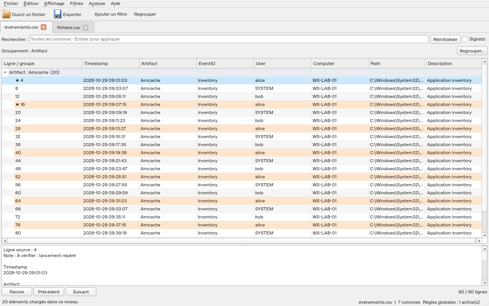

# Fireblade

[](https://github.com/23R0534ZXT/fireblade/actions/workflows/windows.yml)

**Explorateur de données forensic pour Windows : CSV, TSV, XLS et XLSX, avec recherche, filtres, regroupements, signets et notes.**

Fireblade utilise une interface de bureau classique et une base DuckDB sur disque pour explorer les données sans charger toutes les lignes dans la grille. Le projet reste un **prototype** : il ne revendique pas encore la parité complète avec Timeline Explorer ni des gains de performances démontrés sur tous les exports réels.

## Télécharger et lancer

1. Ouvrir les **[Releases](https://github.com/23R0534ZXT/fireblade/releases)** et choisir la préversion intitulée **Fireblade - prototype Windows** la plus récente. La Release du jeu de test contient seulement des données.
2. Télécharger **`Fireblade.exe`**.
3. Double-cliquer dessus.

**Un seul fichier à conserver pour le programme.** Aucun Python, Excel, installateur, script `.cmd` ou dossier `_internal` n’est nécessaire à côté du `.exe`. Les bibliothèques, réglages par défaut, guide et licences sont intégrés.

Le programme prépare ses bibliothèques dans un dossier temporaire Windows au lancement, puis le nettoie à la fermeture normale. Ce démarrage peut prendre quelques secondes. Les analyses et préférences sont enregistrées séparément dans le profil utilisateur pour conserver le travail.

Si aucune Release n’est encore disponible, ouvrir une [exécution réussie d’Actions](https://github.com/23R0534ZXT/fireblade/actions/workflows/windows.yml), puis télécharger l’artefact **Fireblade-exe**. GitHub enveloppe les artefacts dans un ZIP : l’extraire donne uniquement `Fireblade.exe`.

> Le ZIP « Source code » proposé automatiquement par GitHub contient le dépôt de développement, pas le programme Windows à lancer.



## CSV de test de 3 Go

**[Télécharger le CSV complet en ZIP](https://github.com/23R0534ZXT/fireblade/releases/download/test-data-3gib/Fireblade-test-3GiB.zip)** · [Release du jeu de test et empreintes](https://github.com/23R0534ZXT/fireblade/releases/tag/test-data-3gib)

Extraire le ZIP, puis ouvrir **`Fireblade-test-3GiB.csv`** dans Fireblade. Il contient **2 441 216 enregistrements, 18 colonnes et 3 222 648 632 octets** (environ 3,22 Go). C’est le même contenu que celui utilisé pour la qualification Windows, vérifié par SHA-256 ; les données sont synthétiques.

Le ZIP contient le CSV entier et un manifeste `dataset.json`, également [versionné dans le dépôt](docs/validation/datasets/3gib.json). Aucun Python ni générateur n’est nécessaire pour l’utiliser. Le fichier volumineux est publié dans une Release pour garder le clone Git léger ; son générateur, les tests et la documentation sont sur `main`. Les tests Windows réutilisent ce CSV, localement ou depuis le cache Actions, et vérifient son SHA-256 à chaque préparation. Ils ne le régénèrent plus.

Pour commencer : regrouper par **Artifact**, ajouter **User** puis **Computer** au groupement ; après réinitialisation, filtrer `User` sur `user042` doit donner **9 405 enregistrements**. Voir [les étapes et résultats attendus](docs/guides/TESTER-3GIB.md).

## Sommaire

- [CSV de test de 3 Go](#csv-de-test-de-3-go)
- [Fonctionnalités](#fonctionnalités)
- [Première analyse](#première-analyse)
- [Données, confidentialité et sauvegardes](#données-confidentialité-et-sauvegardes)
- [Formats et fidélité des valeurs](#formats-et-fidélité-des-valeurs)
- [Mémoire et gros fichiers](#mémoire-et-gros-fichiers)
- [Configuration](#configuration)
- [Organisation du dépôt](#organisation-du-dépôt)
- [Lancer les sources](#lancer-les-sources)
- [Vérifier le code et compiler soi-même](#vérifier-le-code-et-compiler-soi-même)
- [Construire le fichier Windows](#construire-le-fichier-windows)
- [Tests et publication](#tests-et-publication)
- [Diagnostic](#diagnostic)
- [Limites actuelles](#limites-actuelles)
- [Documentation et contribution](#documentation-et-contribution)
- [Licence](#licence)

## Fonctionnalités

Les ajouts de présentation restent dans les menus : le démarrage conserve une grille classique. Voir le [suivi de parité détaillé](docs/development/PARITE-TIMELINE-EXPLORER.md) pour les limites de chaque fonction ; aucune parité exhaustive n’est annoncée.

| Domaine | Disponible |
|---|---|
| Import | CSV, TSV, TXT délimité, XLS/XLSX avec choix de feuille ; ouverture multiple et file d’attente |
| Recherche | Analyse active et recherche entre toutes les analyses ouvertes ; résultats par fichier, filtres et calendrier |
| Filtres avancés | Arbres ET / OU / NON, texte, égalité, regex RE2, nombres, dates ISO et cellules vides |
| Regroupements | Plusieurs niveaux, périodes de dates, effectifs, sommes/moyennes/min/max/distincts, tri des groupes, pagination |
| Tri | Texte, nombre exact ou date ISO ; plusieurs clés et sens réglables |
| Onglets | Recherche par nom, plusieurs rangées, réouverture du dernier fermé ; une seule base active |
| Sessions | Vues, analyses et dispositions ; import des sources et tags des sessions `.tle_sess` |
| Signets et notes | Ligne individuelle ou sélection multiple : marquer, ajouter, remplacer, retirer |
| Présentation | Colonnes épinglées, clair/sombre, police et formats de dates ; règles locales/globales, couleurs et gras |
| Règles partagées | Correspondance par noms de colonnes, import/export JSON, rechargement et désactivation par vue |
| Détails | Valeurs complètes, notes, JSON/XML formaté, panneau à droite/en bas et filtrage depuis les détails |
| Profils forensic | Catalogue de 222 signatures / 193 noms de formats ; types et présentation ; profils personnels JSON |
| Export | CSV/XLSX, colonnes visibles dans leur ordre, résultats filtrés, résumés et annotations |
| Provenance | Chemin, taille, nombre d’enregistrements et empreinte SHA-256 de la source à l’import |
| Annulation | Requêtes, import, export et annotations ; restauration de l’analyse précédente après import échoué |
| Aide intégrée | Guide, licences et informations de construction consultables dans le `.exe` |

Fireblade ouvre les exports déjà produits par les outils forensic. Il ne lit pas directement une MFT, une ruche de registre, un fichier EVTX ou un Prefetch brut.

## Première analyse

1. Cliquer sur **Ouvrir un fichier**, ou utiliser **Ctrl+O**.
2. Choisir le CSV/TSV/XLS/XLSX.
3. Confirmer où enregistrer l’analyse `.timeline`. Pour XLSX, choisir la feuille.
4. Après l’import, utiliser le clic droit des en-têtes pour trier, filtrer ou regrouper.
5. Sélectionner des lignes pour poser des signets ou des notes depuis **Édition**.
6. Exporter la vue filtrée ou les lignes marquées depuis **Fichier**.

Les menus gardent les fonctions avancées à portée sans ajouter d’étape obligatoire au démarrage. Le **[guide d’utilisation](docs/guides/UTILISATION.md)** détaille chaque parcours ; il est aussi intégré au programme via **Aide → Guide d’utilisation** ou **F1**.

### Raccourcis principaux

| Action | Raccourci |
|---|---|
| Ouvrir des données / une analyse | Ctrl+O / Ctrl+Maj+O |
| Exporter | Ctrl+E |
| Enregistrer / charger une vue | Ctrl+S / Ctrl+L |
| Enregistrer la session | Ctrl+Maj+S |
| Éditeur ET / OU / NON | Ctrl+Maj+F |
| Marquer / retirer la sélection | Ctrl+M / Ctrl+Maj+M |
| Onglet suivant / précédent | Ctrl+Tab / Ctrl+Maj+Tab |
| Fermer l’onglet | Ctrl+W |
| Copier les lignes sélectionnées | Ctrl+C |
| Guide intégré | F1 |

## Données, confidentialité et sauvegardes

L’application fonctionne localement. Elle n’a pas besoin d’un serveur et n’envoie pas les fichiers d’analyse vers un service distant. L’installation des dépendances pour les développeurs et le téléchargement du programme nécessitent Internet ; l’usage ordinaire du `.exe` est local.

Le CSV ou classeur source est lu sans réécriture. L’import calcule son SHA-256 avant et après lecture et vérifie qu’il n’a pas changé. Les identifiants de ligne suivent l’ordre des enregistrements importés, hors en-tête ; ils ne correspondent pas nécessairement aux lignes physiques d’un CSV contenant des cellules multilignes.

| Fichier ou dossier | Contenu |
|---|---|
| `Fireblade.exe` | Programme et ressources intégrées, remplaçable sans effacer les analyses |
| `*.timeline` | Copie importée des données, provenance, signets, notes et vues nommées |
| `*.fireblade-session` | Références aux analyses, onglets, vues et dispositions ; aucune copie des données |
| `%LOCALAPPDATA%\Fireblade\Analyses` | Destination proposée pour les nouvelles analyses |
| `%LOCALAPPDATA%\Fireblade\regles-globales.json` | Bibliothèque de règles partagées |
| `%LOCALAPPDATA%\Fireblade\fireblade.toml` | Configuration utilisateur facultative |
| `%LOCALAPPDATA%\Fireblade\Journaux` | Journaux de démarrage |

Une session dépend des bases `.timeline` qu’elle référence. Conserver ces bases avec la session et sauvegarder séparément les sources utiles. Exporter les règles globales si la présentation doit être partagée sur un autre poste.

Les anciennes analyses `.timeline` restent ouvrables. Celles d’un ancien prototype peuvent se trouver dans `%LOCALAPPDATA%\TimelineNext\Analyses` ; elles ne sont pas déplacées automatiquement.

## Formats et fidélité des valeurs

- Les colonnes sont stockées comme texte, notamment pour préserver `0001` et les grands identifiants Windows.
- Les tris et filtres numériques évitent de convertir les grands entiers en flottants. Les valeurs hors des bornes de conversion ou malformées ne sont pas assimilées à des nombres valides.
- Le préambule `#TYPE` des exports CSV PowerShell est reconnu uniquement en première ligne ; les enregistrements ordinaires commençant par `#TYPE` restent conservés.
- Encodages CSV proposés : UTF-8, UTF-16, Windows-1252 et Latin-1. Les champs vides deviennent NULL.
- Les imports CSV ambigus ou malformés sont signalés. Le séparateur peut être choisi explicitement.
- Pour XLS, les formules sont lues comme leurs résultats mémorisés ; leur formule originale et la mise en forme ne sont pas disponibles via ce lecteur. Les macros ne sont pas exécutées.
- Pour XLSX, les formules restent leur texte ; Fireblade ne les exécute pas et n’en recalcule pas le résultat. Les styles, macros et zéros provenant seulement d’un format numérique Excel ne sont pas importés.
- XLSX est lu progressivement et exporté en écriture progressive. L’export utilise plusieurs feuilles si nécessaire et refuse les cellules dépassant 32767 caractères pour éviter une troncature silencieuse.
- Les exports XLSX écrivent les données comme texte, y compris les valeurs commençant par `=`. CSV conserve les valeurs d’origine.
- L’export annoté ajoute `Fireblade_SourceRecord`, `Fireblade_Bookmarked` et `Fireblade_Note`, avec suffixe si un nom existe déjà dans la source.

## Mémoire et gros fichiers

Le moteur utilise DuckDB sur disque ; la grille Qt charge des pages et libère les descendants des groupes repliés. Les notes sont chargées avec les pages, pas en totalité à l’ouverture. Les onglets inactifs gardent des snapshots légers de leur vue, sans base ouverte ni copie de toutes leurs lignes.

Les règles de couleur sont évaluées sur les valeurs déjà chargées. Un cache de tri temporaire peut conserver l’ordre des identifiants pour les pages profondes, sans recopier les colonnes source.

Par défaut :

| Réglage | Valeur |
|---|---:|
| Buffer DuckDB | 256 MB |
| Threads du moteur | 2 |
| Page | 250 éléments |
| Fenêtre chargée par parent | 1000 éléments |
| Bloc d’export | 2048 lignes |

**Le buffer DuckDB n’est pas un plafond de RAM du processus entier.** Qt, les cellules larges, les branches ouvertes et les bibliothèques ajoutent leur propre coût. Réduire le buffer peut augmenter les accès disque. L’import crée une base et certains traitements peuvent déborder sur disque : prévoir de l’espace libre.

Les mesures historiques se trouvent dans `docs/archive/`. Elles ne démontrent pas un gain face à Timeline Explorer sur des données Windows réelles. Une comparaison sur le même poste, avec les mêmes CSV forensic de plusieurs Go, reste à réaliser.

## Configuration

Aucun fichier externe n’est nécessaire pour démarrer. Les valeurs par défaut sont intégrées dans le `.exe`.

Pour les personnaliser, créer facultativement `%LOCALAPPDATA%\Fireblade\fireblade.toml` :

```toml
[resources]
memory_mb = 256
threads = 2
page_size = 250
max_loaded_rows = 1000
export_batch_rows = 2048
cache_sorted_pages = true
```

`max_loaded_rows` doit être un multiple de `page_size`. Les clés inconnues et les valeurs incohérentes produisent une erreur explicite.

Ordre de sélection : `--config` explicite, configuration du profil utilisateur, ancienne configuration facultative à côté du `.exe`, puis configuration intégrée. Pour les sources, le défaut est `config/fireblade.toml`.

```powershell
.\Fireblade.exe --config "C:\Analyses\petit-poste.toml"
```

Les règles globales ont leur propre fichier JSON, limité à 2 Mo : 32 règles globales, 1024 conditions au total. Les vues peuvent ajouter 32 règles locales. Une règle dont un champ nécessaire manque est ignorée et signalée. Un fichier invalide reste intact ; une bibliothèque valide peut être importée explicitement.

## Organisation du dépôt

```text
fireblade/
├── src/fireblade/           # Code du programme
│   ├── core/                # Import, requêtes, filtres, notes, XLSX, règles
│   ├── ui/                  # Fenêtres, grille, menus, éditeurs et aide Qt
│   ├── runtime/             # Démarrage, ressources intégrées et chemins Windows
│   └── validation/          # Contrôles intégrés au véritable .exe
├── tests/
│   ├── core/                # Moteur, précision, transactions et annulations
│   ├── ui/                  # Grille, interactions, onglets, sessions et notes
│   ├── runtime/             # Ressources et configuration du programme
│   └── windows/             # Verrous et comportements propres à Windows
├── scripts/
│   ├── windows/             # Lancement des sources, construction et vérification
│   └── benchmarks/          # Mesures reproductibles, hors code du programme
├── config/                  # Configuration par défaut intégrée au .exe
├── requirements/            # Dépendances runtime, développement et construction
├── examples/                # CSV de démonstration synthétique
├── docs/
│   ├── guides/              # Guide utilisateur actuel, aussi intégré au .exe
│   ├── development/         # Architecture, contribution, parité et publication
│   ├── validation/          # Périmètre des vérifications Windows
│   ├── assets/              # Captures actuelles de documentation
│   └── archive/             # Anciennes notes, mesures et captures
├── licenses/                # Notices et textes des licences tierces
├── .github/workflows/       # Tests, construction et publication Windows
├── pyproject.toml          # Métadonnées, package src et réglages des tests
├── LICENSE                  # Licence MIT du projet
└── README.md
```

Les sorties générées restent séparées : `.venv`, `.venv-build`, `build/`, `dist/` et `artifacts/` sont ignorés par Git. Le dossier `dist/` reçoit **`Fireblade.exe`** ; les rapports de développement restent dans `artifacts/`.

## Lancer les sources

Cette section concerne les développeurs ; elle n’est pas requise pour utiliser le `.exe`.

Prérequis : Python 3.12 64 bits recommandé sur Windows ; Python 3.11 et 3.13 sont aussi testés. Depuis la racine du dépôt :

```powershell
py -3.12 -m venv .venv
.\.venv\Scripts\python.exe -m pip install --only-binary=:all: -r requirements/development.txt
.\.venv\Scripts\python.exe -m pip install --no-deps -e .
.\.venv\Scripts\python.exe -m fireblade
```

Ou double-cliquer sur `scripts/windows/Lancer.cmd`. Ce lanceur prépare l’environnement des sources à la première utilisation. L’installation initiale nécessite Internet ; les lancements suivants peuvent réutiliser les dépendances installées.

Quatre dépendances directes d’exécution : **DuckDB**, **PySide6 Essentials**, **openpyxl** et **xlrd** (ancien XLS). Aucun serveur, navigateur embarqué, chaîne JavaScript ou framework d’injection de dépendances.

## Vérifier le code et compiler soi-même

Il n’est pas nécessaire d’utiliser le binaire fourni : vous pouvez lire les sources et fabriquer votre propre `Fireblade.exe`. Cette démarche permet de choisir le code et les dépendances utilisés pour votre construction ; elle ne remplace pas leur examen.

### 1. Récupérer les sources

Télécharger **Source code (zip)** depuis la préversion souhaitée dans [Releases](https://github.com/23R0534ZXT/fireblade/releases), puis extraire l’archive. Cette archive correspond au tag de la préversion.

Ou, avec Git :

```powershell
git clone https://github.com/23R0534ZXT/fireblade.git
cd fireblade
git rev-parse HEAD
```

Pour reconstruire une préversion précise, sélectionner son tag ou son commit plutôt que la branche main qui peut évoluer. Le commit utilisé par le binaire publié figure dans les notes de Release et dans **Aide → À propos**. Avec Git, `git checkout --detach` suivi de ce commit permet de travailler sur cette révision exacte.

Si le dépôt est privé, son propriétaire doit vous donner accès aux sources ou vous transmettre leur archive. Recevoir uniquement le `.exe` ne donne pas automatiquement accès au dépôt.

### 2. Examiner ce qui sera exécuté

Avant de lancer la construction, consulter :

| Élément | À examiner |
|---|---|
| `src/fireblade/` | Code du programme, accès aux fichiers et logique d’analyse |
| `scripts/windows/build.py` | Préparation de l’environnement, commande PyInstaller et vérification du binaire |
| `scripts/windows/bundle.py` | Ressources et bibliothèques embarquées, licences et provenance |
| `scripts/windows/verify.py` | Conditions du contrôle du fichier autonome |
| `requirements/runtime.txt` | Versions épinglées des dépendances d’exécution |
| `requirements/windows-build.txt` | Outils ajoutés pour fabriquer l’exécutable |
| `.github/workflows/windows.yml` | Étapes exécutées pour les binaires publiés |

La construction installe ses dépendances depuis PyPI dans `.venv-build`. Ces dépendances ont leurs propres sources et licences, référencées dans `licenses/THIRD_PARTY.md`. Elles font aussi partie de ce qu’il faut examiner si votre politique exige une revue complète.

### 3. Construire votre propre fichier

Sur Windows x64, installer [Python 3.12 64 bits depuis python.org](https://www.python.org/downloads/windows/). Ouvrir PowerShell dans le dossier extrait ou cloné, là où se trouve `pyproject.toml`, puis lancer :

```powershell
py -3.12 -m scripts.windows.build
```

La commande prépare les outils, construit le programme et lance ses contrôles Windows. Après succès, votre fichier est **`dist/Fireblade.exe`**. Aucun installateur ou environnement Python n’est ensuite requis sur le poste qui reçoit ce fichier.

Les scripts et dépendances nécessaires à la compilation sont dans le dépôt ; le `.exe` fourni dans Releases n’est pas utilisé pour produire le vôtre. Les contrôles et leurs résultats se trouvent dans `artifacts/windows-single-file.json`.

### 4. Identifier votre binaire et vérifier un téléchargement

Calculer l’empreinte du fichier construit :

```powershell
Get-FileHash .\dist\Fireblade.exe -Algorithm SHA256
```

Pour un fichier téléchargé, remplacer ce chemin par celui du téléchargement et comparer son SHA-256 à celui indiqué dans les notes de sa Release. Cela vérifie que les octets correspondent au fichier annoncé ; une empreinte ne prouve pas à elle seule l’innocuité d’un programme.

**La construction n’est pas encore reproductible octet pour octet.** Un binaire compilé localement peut donc avoir un SHA-256 différent du binaire publié, même à partir du même commit : versions des outils, métadonnées et environnement de construction peuvent intervenir. Ne pas interpréter cette différence seule comme la preuve d’une modification malveillante.

Le fichier publié n’est pas encore signé avec un certificat de signature de code. Un avertissement Windows sur l’éditeur ou la réputation ne constitue, à lui seul, ni une preuve de malveillance ni une garantie d’innocuité. Les sources, la provenance de construction et les rapports restent consultables pour décider selon votre propre politique.

## Construire le fichier Windows

Sur Windows, depuis la racine :

```powershell
py -3.12 -m scripts.windows.build
```

Ou utiliser `scripts/windows/Construire.cmd`.

La construction :

1. Prépare un environnement `.venv-build` dédié et installe les roues précompilées.
2. Collecte les versions, les notices des dépendances et les ressources intégrées.
3. Crée un exécutable PyInstaller **onefile**, sans console.
4. Copie uniquement ce `.exe` dans un dossier vide et le lance avec un environnement isolé.
5. Publie le fichier dans **`dist/Fireblade.exe`** après réussite des contrôles.

Le fichier final contient Python, Qt, DuckDB et XLSX ainsi que l’aide et les réglages par défaut. Les scripts de construction et les rapports ne sont pas des fichiers à distribuer à côté du programme.

## Tests et publication

```powershell
.\.venv\Scripts\python.exe -m pytest -q
```

Le workflow Windows teste les sources avec Qt natif sur Python 3.11, 3.12 et 3.13, puis construit et lance le véritable `.exe`. La publication est aussi bloquée tant que la matrice visuelle et la qualification 3 GiB n’ont pas réussi. Il contrôle notamment import en lecture seule, Unicode, grands entiers, groupes, annulations, export verrouillé, presse-papiers, sessions, XLSX, règles partagées et annotations.

Pour le fichier unique, le contrôle vérifie aussi les ressources embarquées, l’absence de DLL ou de configuration à côté du programme et le nettoyage du dossier temporaire d’extraction. Voir le **[périmètre de validation](docs/validation/WINDOWS.md)**.

Après succès sur `main`, le workflow publie une préversion GitHub dont le seul fichier joint est `Fireblade.exe`. Les rapports restent dans Actions. Les constructions de PR sont vérifiées mais ne créent pas de Release.

Le numéro du paquet reste celui du prototype ; il ne constitue pas une validation de production.

## Diagnostic

Si le programme ne démarre pas, consulter :

```text
%LOCALAPPDATA%\Fireblade\Journaux\demarrage.log
```

Le bootstrap peut conserver un diagnostic même si une bibliothèque Qt ou DuckDB ne se charge pas. Le profil utilisateur et le dossier temporaire Windows doivent être accessibles en écriture.

Pour relancer les contrôles intégrés sans script supplémentaire :

```powershell
.\Fireblade.exe --self-test-report "$env:TEMP\fireblade-controle.json"
```

Choisir un nouveau chemin de rapport. Les données de contrôle sont synthétiques ; cette commande ne réalise pas une expertise sur les fichiers de l’utilisateur.

## Conversions et compatibilité TLE

Les profils forensic reconnus sont appliqués automatiquement lors de l’import ; une préférence permet de conserver l’affichage générique. Les conversions restent dans des colonnes distinctes.

**Analyse → Convertir une date** crée une colonne UTC distincte : ISO, dates jour/mois ou mois/jour, Unix s/ms/us/ns, FILETIME, WebKit, ticks .NET et OLE Automation. Les décalages explicites, fuseaux IANA et 142 identifiants Windows sont pris en charge. La précision atteint neuf décimales, y compris avant 1970 ; les valeurs invalides deviennent NULL dans la colonne dérivée, sans retirer leur enregistrement. Le contrôle des colonnes dérivées compte ces NULL. Les heures locales ambiguës ou inexistantes suivent les conventions DST d’ICU : utiliser un décalage explicite lorsque l’enquête doit les départager.

**Analyse → Ajouter une colonne calculée** accepte des expressions imbriquées (`Iif`, texte, nombres, dates). Les colonnes dérivées sont des vues SQL persistantes ; aucune copie complète supplémentaire de la table n’est nécessaire. Elles sont utilisables pour filtrer, regrouper, trier et exporter. Les transformations des profils JSON passent par le même registre explicite.

**Déplier tous les groupes (vue paginée)** indexe toute la hiérarchie sur disque, y compris au-delà des premiers groupes. Suivant/Précédent parcourent une fenêtre bornée de lignes. Le repli rétablit l’arbre interactif ; l’indexation est annulable. La première indexation peut prendre du temps et utilise de l’espace temporaire.

L’import des layouts TLE traduit les noms `col…`, les filtres et expressions compatibles, la recherche, les groupes temporels, les résumés et les règles de couleur textuelles/de valeur. Les tests incluent quatre layouts XML officiels et les deux fixtures Plaso de TLEFilePlugins. Une règle non traduite est refusée ; une colonne absente de la version du CSV est signalée. **Fichier → Importer les préférences Timeline Explorer** reprend aussi le fichier documenté `TLE_settings.xml` (police, taille, copie, onglets, format des dates, détails et épinglage par défaut), avec compte rendu des adaptations. Voir [les détails et limites](docs/development/COMPATIBILITE.md).

## Limites actuelles

- Prototype en cours de développement, sans revendication de parité complète avec Timeline Explorer.
- Compatibilité partielle avec les fichiers TLE : sources et tags des sessions, colonnes/groupes/tris de certains layouts ; expressions courantes, règles textuelles et de valeur, résumés, recherche et noms de contrôles ; les règles graphiques DevExpress et les réglages spécifiques non traduits restent signalés.
- Le catalogue de schémas n’est pas une qualification de 193 parseurs : voir [profils et plugins](docs/development/PLUGINS.md).
- Pas de rapports HTML/PDF ni de catégories de tags personnalisées ; ces absences ne sont pas présentées comme des écarts vérifiés de Timeline Explorer.
- Sessions par référence aux bases, sans empaquetage autonome d’un dossier d’enquête.
- Pagination et groupes conservés par fenêtres ; pas de plafond global de RAM garanti en octets.
- Pas de reprise d’un import après une panne au milieu de l’écriture.
- Les essais automatisés utilisent des runners Windows et des jeux synthétiques. Les gestes réels de l’Explorateur, les partages UNC, les sessions prolongées Windows 10/11 et les vrais exports multi-Go demandent encore une validation.
- Le binaire n’est pas encore signé avec un certificat de signature de code.

Le **[suivi de parité](docs/development/PARITE-TIMELINE-EXPLORER.md)** distingue les fonctions présentes et le travail restant.

## Documentation et contribution

- [Guide utilisateur](docs/guides/UTILISATION.md)
- [Architecture et points de modification](docs/development/ARCHITECTURE.md)
- [Installer, tester et contribuer](docs/development/CONTRIBUER.md)
- [Validation Windows](docs/validation/WINDOWS.md)
- [Suivi des fonctions](docs/development/PARITE-TIMELINE-EXPLORER.md)
- [Archives du prototype](docs/archive/README.md)

Un signalement utile indique la version ou le commit affiché dans **Aide → À propos**, la version de Windows, les étapes de reproduction et le journal pertinent. Pour des données d’enquête, préférer un échantillon synthétique reproduisant le problème.

## Licence

Le code du projet conserve la **[licence MIT](LICENSE)** et son attribution existante. Les composants intégrés gardent leurs propres licences ; leurs notices sont accessibles dans **Aide → Licences** et documentées dans **[licenses/THIRD_PARTY.md](licenses/THIRD_PARTY.md)**.

## Contraste Windows et qualification en charge

Le rendu clair utilise une palette et un style Fusion cohérents, y compris lorsque Windows préfère le mode sombre. La police générale du système et les tailles logiques Qt remplacent le réglage fixe en pixels ; les hauteurs de lignes suivent les métriques de police. Ce changement corrige le cas de texte blanc sur fond clair observé dans une préversion.

Les captures Windows sont contrôlées sur les préférences clair/sombre et les facteurs d’échelle 1, 1,25, 1,5 et 2. Le contrôle cherche les pixels des glyphes réellement dessinés, notamment dans les menus et boutons, y compris les états inactifs et désactivés.

La qualification en charge réutilise le CSV publié de **3 GiB** (plus de 3 Go décimaux), avec des contenus variés, Unicode, champs multilignes, valeurs vides et grands identifiants. Elle importe intégralement le fichier dans le programme autonome, vérifie les comptages avec une référence Python indépendante, parcourt des groupes imbriqués et des pages profondes, puis teste filtres, tris, règles, notes, sessions, exports complets et annulations. Les rapports contiennent durées, mémoire, réactivité et captures.

Il s’agit de parcours automatisés QtTest, exécutés avec le plugin Windows natif : ils ne sont pas présentés comme une manipulation physique humaine ni comme des essais sur tous les exports d’enquête existants. Les données restent synthétiques et le cache disque n’est pas purgé. Voir les artefacts `Windows-visual-captures` et `Windows-3GiB-report-and-captures` de l’exécution concernée et [la procédure](docs/validation/QUALIFICATION.md).

La [qualification du 31 octobre 2026](docs/validation/QUALIFICATION.md#résultat-du-31-octobre-2026--63fa493) a réussi sur le binaire `63fa493` : 30 contrôles intégrés, huit variantes visuelles et 42 contrôles sur le CSV existant de 3 GiB. Pic mémoire : 455,4 Mio. Une pause maximale de 3,8 s après import reste à améliorer ; les rapports et limites sont conservés dans le dépôt.
