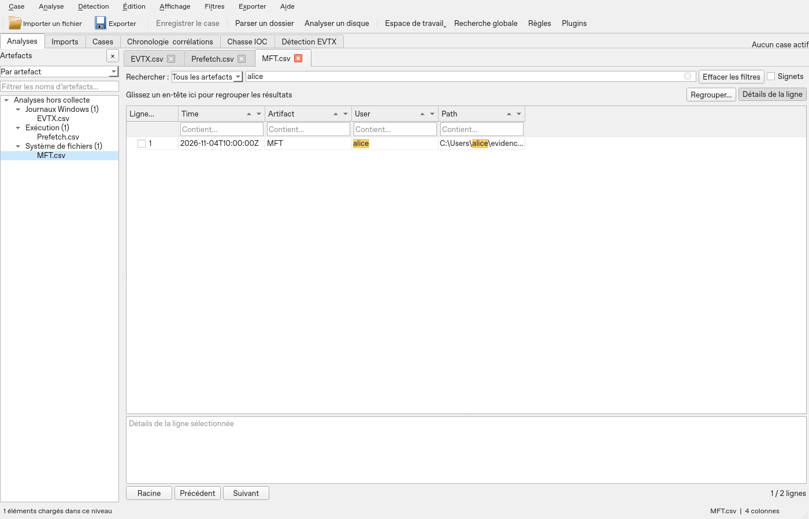

# Fireblade

[](https://github.com/23R0534ZXT/fireblade/actions/workflows/windows.yml)

**A local DFIR workspace for forensic artifact analysis and case management.**

Fireblade brings Windows artifacts, Linux logs, detection results and tabular evidence into a single desktop investigation workspace. Parse collected data, investigate timelines, annotate findings and export reproducible results while retaining source references and integrity information.

[Releases](https://github.com/23R0534ZXT/fireblade/releases) · [Documentation](docs/README.md) · [Report an issue](https://github.com/23R0534ZXT/fireblade/issues/new/choose) · [Release notes](docs/development/RELEASE-NOTES.md)

**[Download Fireblade 0.4.2 — Windows x64](https://github.com/23R0534ZXT/fireblade/releases/download/v0.4.2/Fireblade.exe)** · [Release notes and SHA-256](https://github.com/23R0534ZXT/fireblade/releases/tag/v0.4.2) · [Windows qualification](https://github.com/23R0534ZXT/fireblade/actions/runs/43964869155)

The desktop interface and most user guides are currently in French.

The interface is in English, and English is the reference from now on: new labels are written directly in English. French stays available in **Preferences → Language** for what has already been translated, but it is no longer maintained. User guides are still in French.



*Fireblade 0.2.2 workspace with synthetic demonstration data.*

Windows CI runs focused regression tests on Python 3.12, builds the standalone EXE in parallel, then checks its appearance, 320-analysis workspace and 3-GiB import/export workflow. The full Python 3.11–3.13 test matrix remains available through the workflow’s **full_validation** option.

## Version 0.4.2 · The same collection in 6 min 0 s

The 9.74 GiB collection imported for the 0.4.1 acceptance run now parses in 6 min 0 s instead of 50 min 49 s, with the same 246 analyses and the same result. The read path was changed rather than tuned, and the findings of that acceptance run are fixed here.

- Each file is read in its own process: no file waits on another, and one slow file no longer holds the rest of the collection.
- A single file much larger than the others is cut into line-aligned ranges read at the same time, then merged back in order without changing a row.
- Provenance is written by the import as it reads, instead of being copied into a second file afterwards.
- The status bar message is no longer squeezed and stays readable while a task runs.
- The Imports table shows the files of a collection as they are read, instead of staying empty until the end.
- The Imports "Full report" and the findings of the coverage panel are in English, like the rest of the interface.
- Three tabs that carried the same label now name the analysis each one shows, and Preferences shows the thread count as a number instead of the word "Automatic".

Known limit: a Windows install without `LongPathsEnabled` cannot open paths beyond 260 characters.

**[Download Fireblade 0.4.2 — Windows x64](https://github.com/23R0534ZXT/fireblade/releases/download/v0.4.2/Fireblade.exe)** · [Release notes and SHA-256](https://github.com/23R0534ZXT/fireblade/releases/tag/v0.4.2)

## Previous release · 0.4.0

- The **Imports** report is no longer a dead end. A file that was not recognised, failed or was parked keeps its line, its reason and its hash, and can be acted on without leaving Fireblade: **See the file** (text preview, cp1252 fallback, hex dump for a binary), **Copy the unprocessed files…** (copied aside with their tree, never moved), **Export the list…** (UTF-8 CSV of what the table shows, filters included), **Park / Restore** (reversible, saved with the collection, out of the working counts) and **Delete…** (refused when the SHA-256 recorded at collection no longer matches).
- **Read again with a reader…** analyses the selected file with the reader you choose — **text**, **saved HTML page** (visible text and links, no browser), **PDF (text layer)**, **CSV/TSV table** — imports the result like any other source and opens the new analysis. The file is only read; the hash taken at that read is the reference, and a later read is refused if the file changed.
- **PDF**: the text layer is extracted page by page, one row per line with its page number. No OCR, and that is a decision: a PDF with no text layer is reported as such and counted with the warnings, instead of producing empty rows that would look like an analysis. `pypdf` ships with the executable and stays an optional extra for a source install; without it the PDF reader is greyed out with the reason.
- A binary file is never read as text, a page that fails does not lose its neighbours, and every reader feeds the same timeline, search and reports. Text is decoded the way Windows writes it: UTF-16 with a byte-order mark (redirected PowerShell output, "Unicode" Notepad files), UTF-8 with a BOM, or the French code page for a saved page — and a file read in part says so.
- **Imports got faster where it matters**: a CSV is read in one pass instead of one temporary chunk every few megabytes — 3.65 GB in 57 s instead of 148 s, 62 MB/s instead of 24 — and a folder's files are parsed on several workers, merged back in file order, with the thread count on **Automatic** by default. A single log larger than the rest is
split into line-aligned ranges read at the same time: a 250 MB access.log goes from 22.8 s to
3.4 s on eight cores, for byte-identical output.
- **Measured against Timeline Explorer 2026.10.0** on the same files and machine, on 32 million rows / 3.65 GB: open in 57 s against 108 s, search every column in 2.4 s against 150 s, group by host in 0.12 s against 134 s, sort by timestamp in 0.6 s against 8.5 s. Both tools were checked to return the same rows (864 865 for one host, 37 groups). The durable difference is memory, not seconds: Fireblade peaks at 1.1 GB where Timeline Explorer holds 15.3 GB for the same file, which caps it at roughly 1.9 GB of log on an 8 GB VM. Method, every figure and the reservations: `docs/development/BENCHMARK-0.4.0.md`.
- Fixed in the verification gate itself: the suite ran in the local code page while the code reads UTF-8 (25 failures that were not product bugs), a stale `%TEMP%\pytest-of-…` folder made paths differ by one capital letter (the last 7), and the "core does not load Qt" check now keeps the interpreter's packages instead of failing on an environment detail.

## Previous release · 0.3.1

- Every window is translated, not only the menus and toolbars: dialogs, column manager, preferences, IOC hunting, coverage, timeline, table headers, drop-down lists, tooltips, input placeholders and status messages.
- Model headers (coverage, rules, IOC results), navigation tree nodes, table cells and theme names are translated as well, and a message assembled by concatenation is treated as a template: the fixed text and the value are translated, then put back together.
- **Text built at run time** goes through the same table: counters, task results, visible errors. Entries can be templates (`Analyse absente : {}`) whose values are put back at display time, and the most specific entry always wins.
- Translation applies when a window opens and again when the code writes the text, so a list filled after the fact, a refreshed counter or a late error is covered without touching each window.
- French stays complete: the source labels are remembered, and switching back loses nothing even when a text had been replaced in between.
- **Selection notes**: on a row selection the menu offers to add a note, then to edit it; the dialog pre-fills the note the rows share.
- **Cell notes**: right-click a value to add a note to that cell, then to edit it; the cell is tinted and the note is read back in the dialog and the tooltip. A row bookmark and cell notes live side by side, and analyses written before this version are migrated when opened.
- **Double-click a cell** now shows its value as text, JSON or XML instead of opening the note editor; bookmarks and notes stay in the Edit menu and on the first column. The colour-rules and sort dialogs are translated too.
- The built-in guides — full tutorial, user guide, timeline and backups, IOC hunting, coverage — are translated and opened in the chosen language, condition cards and filter operators included.
- Six strings are deliberately left as they are — sample file names (`évidence.csv`, `résumés.csv`) and two synthetic TLE expressions — because they are data, not interface.
- Fixed: a tab title accumulated ampersand escapes across language switches (`Timeline &&&& correlations`), and a language pass near a loaded workspace rewrote every tab title for no reason.
- Verification: **1,327 passed, 31 skipped** on the Windows Qt platform; a sweep of the real window and of eleven dialogs in English finds no French text left. An inventory script measures the coverage, two guard tests stop untranslated text from coming back, and a test reads the real English window to prove nothing French is left on screen.

## Previous release · 0.3.0

- The interface opens **in English**; **French** stays available in **Preferences → Language** and the choice is saved. Menus, toolbars, tabs, buttons, headers, filters and input fields are translated; text computed at display time (counters, "no active case") is still French.
- **Grouping bar** rebuilt: numbered levels, drop a header at the exact position, one `×` per level, and a single **Remove all** button.
- **Column manager** in two panes: hidden columns on the left, display order on the right, plus width and pinning for the selected column. Everything is remembered per artifact format.
- **Command palette** (`Ctrl+Shift+K`) exposes every menu entry through one field, including the commands that have no button.
- Cross-artifact search now shows **the matching events** — four real rows under the table — and the remaining volume, instead of a count per file.
- **Timeline**: bars carry the volume (their height is the number of events in the time bucket), lanes fill the available height, and the source label is centred.
- Fixed: a launch could replay the saved timeline focus and open as an empty window; the data toolbar stayed hidden until Workspace → Analysis; a dragged column left a grey ghost behind; a refused case switch said nothing; an `&` in a tab title showed as an underscore.
- The version is displayed in the status bar and on the start screen.

## Previous release · 0.2.3

- The timeline indexes an explicit UTC column (`Horodatage UTC`, `TimestampUtc`) instead of the raw column it was derived from, so Linux journals are no longer read through a syslog stamp without a year or a timezone.
- Dates without a timezone are read as **UTC** in the chronology, as they already were on import. A case keeps the same chronological order on every machine.
- The date column is resolved against the analysis itself, calculated UTC columns included. A guessed index is no longer saved as an analyst choice; timeline settings written by 0.2.2 are reset once.
- A source that stores `date` and `time` in two columns (IIS, W3C, some timelines) is indexed on both, instead of stopping at midnight.
- Artifact detection keeps the most specific profile: eighteen catalogue entries that were never selected — Hayabusa verbose and super-verbose, Chainsaw persistence, nine RECmd profiles — now match, and a declaration recorded on one tab-joined line is split into columns.
- Profile rules survive category colours, so Hayabusa severity colours are no longer overwritten.
- An interrupted export removes its temporary file, so the next export to the same target is no longer refused.

## Previous release · 0.2.2

- Group artifacts by family, source folder or a simple list directly from the navigator.
- Search all loaded artifacts from the main search field; inspect matches in a docked panel and open the original source row.
- Detach, dock and resize workbench panels. Switch to **Analysis**, **Timeline only**, or **Analysis + timeline**, and save your workspace layout.
- Drag column headers into your preferred order. Column order and widths are saved automatically per artifact format.
- Highlight matching text without recoloring the whole row.
- Set query threads, import threads and per-analysis memory in **Preferences → Resources**. Both thread counts accept **Automatic**, which is the default: it resolves to the machine (up to eight files parsed at once, where the shared disk stops paying).
- Create a column-specific rule directly from a cell value. Access existing rules and custom JSON profiles from the workspace toolbar, create a profile from the current artifact, or import a .NET reader through Preferences.

## Capabilities

| Area | Features |
|---|---|
| Evidence intake | Windows artifacts, raw Linux logs and rotations, CatScale collections, CSV/TSV/TXT and XLS/XLSX exports, saved HTML pages, PDF text layers |
| Disk triage | Read-only extraction of supported artifacts from mounted volumes, RAW/E01 images and physical-device paths |
| Analysis | Filtering, grouping, sorting, calculated columns, bookmarks, notes and source provenance |
| Detection | Embedded Hayabusa rules, EVTX alert context and bulk IOC searches |
| Timelines | Cross-analysis chronology, date normalization and event correlation |
| Case management | Persistent workspaces, recovery history, verified portable archives and cold storage |
| Reporting | CSV/XLSX exports, annotations and HTML/PDF investigation reports |

Windows parsing integrates EZ Tools, RECmd, Shellbags and WebCache readers. Linux support covers common `/var/log/` formats and CatScale output. See the [feature reference](docs/guides/FONCTIONNALITES.md) and [format compatibility](docs/development/COMPATIBILITE.md) for supported inputs and limitations.

## Getting started

1. Download **Fireblade.exe** from a published [Windows x64 release](https://github.com/23R0534ZXT/fireblade/releases). Python, Excel and a separate .NET installation are not required.
2. Create or open a case.
3. Add evidence from **Analyse**: **Importer un fichier**, **Parser un dossier** or **Analyser un disque**. Folder selection supports **Ctrl/Shift**.
4. Explore completed analyses as background parsing continues. Filter records, add notes and investigate related events.
5. Save the case, export findings or create a verified portable archive.

For a first evaluation, use the sample data below. The application remains an **unsigned prototype**; Windows may display a SmartScreen prompt. Release notes identify the qualified source commit and the executable's SHA-256.

## Earlier release · 0.2.1

- Revised menus separate case management, analysis, detection and exports.
- Multiple folders are queued and parsed sequentially in the background.
- Verified results appear progressively without replacing the active analysis.
- Import diagnostics are available on demand from **Aide**, rather than a permanent primary tab.
- A CSV that fits one transaction (about 2 GiB, or eight times the budget) is read in a single pass; above that, imports commit chunk by chunk, and a very wide file can still fall back to bounded row insertion. Wide pages are read in column batches when the native query exceeds its memory budget.
- **Archiver et libérer l’espace** creates and verifies an archive before removing local case work files. Original evidence outside the case is retained; the archive remains available for restoration.
- NTFS traversal, SQLite companion journals, analysis-file validation and export destination protection include the audit fixes.
- The optional ten-second startup sequence uses locally bundled footage and bounded frame decoding.

[Implementation and validation report](docs/validation/reports/20261104-v021-ergonomie.md) · [Audit fixes](docs/validation/reports/20261104-v020-correctifs.md)

## Resource and storage management

Fireblade uses disk-backed DuckDB databases and paged views. The default database budget is **128 MB with one thread**; background parsing receives half that budget, with a 64 MB minimum. Thread counts left on **Automatic** are resolved before they reach DuckDB — a setting of zero is never handed to the engine, which refuses it. Existing user configuration takes precedence.

These settings limit DuckDB, **not total application memory**. Qt, Python and external parsers have separate overhead. Wide tables and expensive queries may require additional resources. The low-memory import path prioritizes bounded memory over speed. Queries are answered from the database rather than by re-reading the source: on a 32-million-row analysis a search takes about two seconds, a filter or a group by a tenth of a second.

Parsed results, source CSVs and analysis databases consume disk space. Closing a case or marking it archived does not remove these files. Use **Archiver et libérer l’espace** to create verified cold storage, preferably on another volume. The operation streams closed databases without creating a second full database copy. Enough space is still required for the compressed archive itself. Retain original acquisitions independently.

Example configuration:

```toml
[resources]
memory_mb = 128
threads = 1
page_size = 250
max_loaded_rows = 1000
export_batch_rows = 2048
```

[Disk-analysis guide](docs/guides/DISQUES-ET-ESPACE-DE-TRAVAIL.md) · [Cases, backups and portable archives](docs/guides/CHRONOLOGIE-ET-SAUVEGARDES.md)

## Sample datasets

| Dataset | Purpose |
|---|---|
| [Discovery pack](https://github.com/23R0534ZXT/fireblade/releases/download/test-pack-v1/Fireblade-Test-Pack-v1.zip) | Small examples for learning the interface and supported formats |
| [Raw artifact pack](https://github.com/23R0534ZXT/fireblade/releases/download/raw-artifacts-v1/Fireblade-Raw-Artifacts-v1.zip) | Windows artifacts and synthetic Linux logs for exercising parsers |
| [3 GiB CSV](https://github.com/23R0534ZXT/fireblade/releases/download/test-data-3gib/Fireblade-test-3GiB.zip) | Large-table import, querying and export validation |

[Dataset provenance and limitations](docs/guides/JEUX-DE-TEST.md) · [Raw-pack guide](docs/guides/PACK-BRUT.md)

## Validation and scope

The default Windows pipeline runs focused Python 3.12 checks (the full Python 3.11–3.13 matrix is optional), the standalone executable, native readers, UNC and long paths, display scaling, a CSV larger than 3 GiB and a workspace containing 320 analyses. Version-specific results are linked from each release and the validation reports.

Fireblade is an analysis workspace, not a disk-acquisition or deleted-file-recovery tool. It does not provide decryption or carving. Reader errors, unsupported files and partial results remain explicit. Alerts require analyst review; automated checks do not establish complete acquisition coverage or prove the absence of malicious activity.

Optional .NET plugins run with the user's permissions. Use trusted assemblies and consult their compatibility and licensing requirements.

## Development

```bash
python -m venv .venv
# Activate the environment for your platform.
python -m pip install -e '.[dev]'
python -m pytest -q
python -m ruff check src scripts tests
fireblade
```

Source execution supports development and testing; the distributable application targets Windows x64. Native Windows qualification is required before publication.

[Contributing](CONTRIBUTING.md) · [Architecture](docs/development/ARCHITECTURE.md) · [Build and publication](docs/development/PUBLICATION.md) · [User guide](docs/guides/UTILISATION.md)

## License

Fireblade's code is licensed under [MIT](LICENSE). Embedded tools and dependencies retain their own licenses, including AGPL components. Notices are available in **Aide → Licences**, and Hayabusa sources can be exported from the Help menu. The startup footage is public domain and credited in [its provenance record](assets/startup/SOURCES.json).

[Third-party licenses](licenses/THIRD_PARTY.md)
