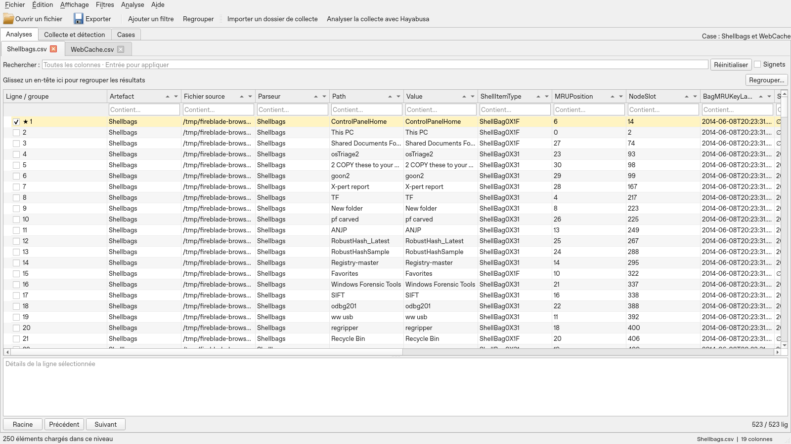
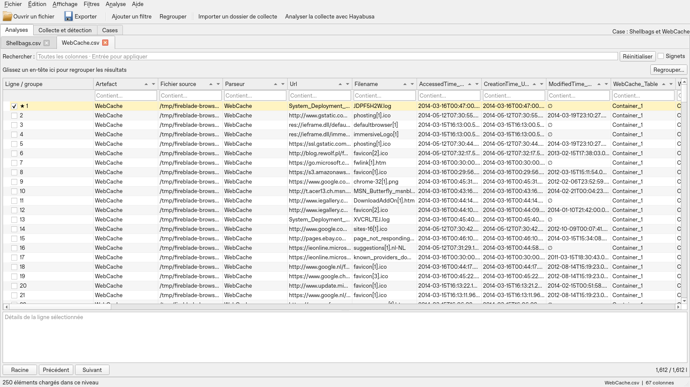
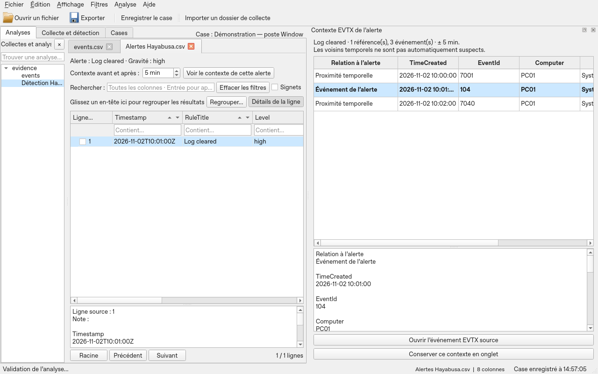
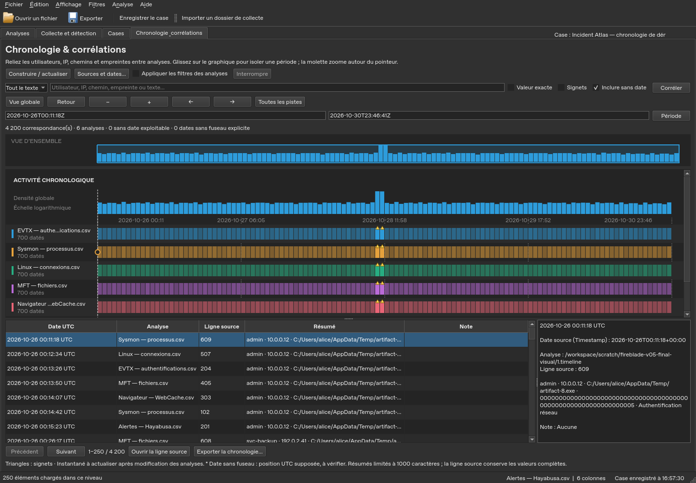
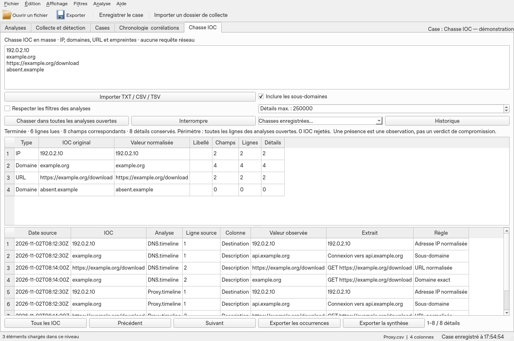
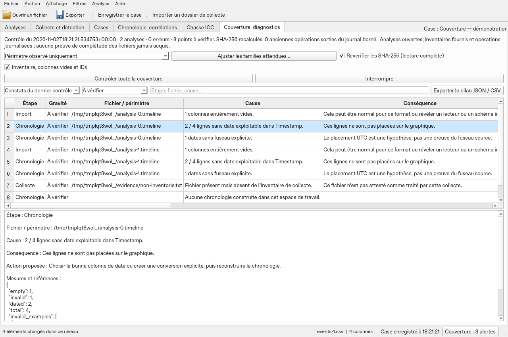
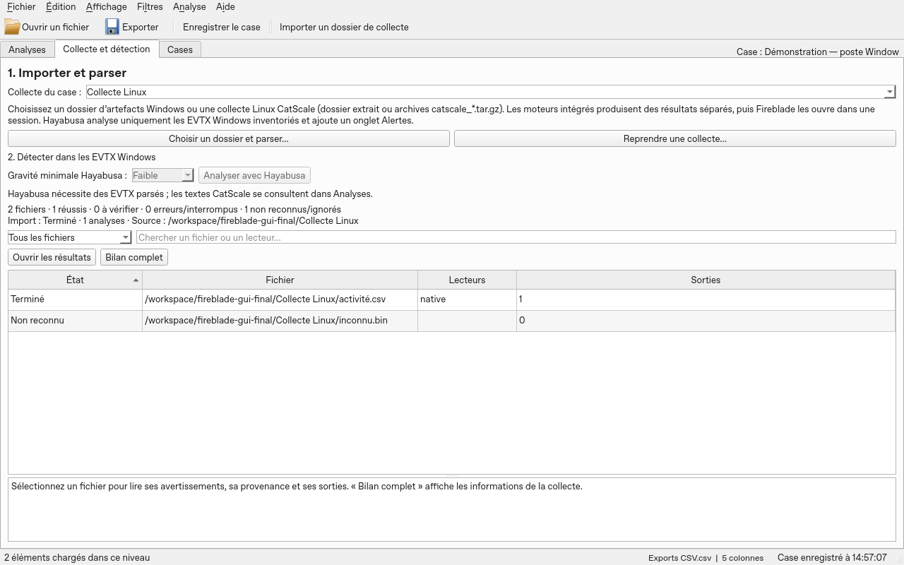

# Fireblade

[](https://github.com/23R0534ZXT/fireblade/actions/workflows/windows.yml)
[](https://github.com/23R0534ZXT/fireblade/actions/workflows/test-pack.yml)

**Investigate Windows artifacts and Linux CatScale collections from a single Windows executable.**

Choose a collection folder, parse its artifacts, and explore the results in Fireblade. Save investigations as **cases**, navigate collections and artifact families, filter and group complete datasets, mark entire rows, and investigate **Hayabusa detections with their EVTX context**. Existing CSV, TSV, delimited TXT, XLS, and XLSX exports can also be opened directly.

| Capability | What it provides |
|---|---|
| Investigation cases | Persistent catalogue, case/session saving, multiple collections per case, search and archiving |
| Recovery and transport | Automatic saves, ten session versions, verified portable case archives |
| Windows artifact parsing | 13 bundled EZ Tools, their maps, and 70 RECmd registry plugins |
| Shellbags | Dedicated offline hive reader with reconstructed paths, MRU information and raw bytes |
| Windows WebCache | Read-only ESE reader with URLs, container metadata, exact FILETIME values and separate UTC columns |
| Linux CatScale | Extracted folders and archives organized into seven analysis families |
| Hayabusa | Bundled EVTX rules, alert results, surrounding events and navigation to the source record |
| Data exploration | Column filters, AND/OR/NOT conditions, sorting, grouping, bookmarks, notes and CSV/XLSX exports |
| Graphical chronology | Cross-analysis density lanes, zoom, time selection, entity correlation and source-row navigation |
| Investigation reports | Standalone HTML/PDF findings with notes, provenance and an optional timeline capture |

Data lives in disk-backed DuckDB `.timeline` databases. The grid loads pages; filters, counts and exports operate on the complete result set. The application ships as **one `Fireblade.exe`**, with its engines and runtimes. Evidence and investigation results are stored separately.

## Downloads

| Download | Purpose |
|---|---|
| [Fireblade application releases](https://github.com/23R0534ZXT/fireblade/releases) | Choose the latest **Fireblade - prototype Windows** prerelease and download `Fireblade.exe` for Windows x64 |
| [**Forensic test pack v1 — ZIP, about 5.1 MB**](https://github.com/23R0534ZXT/fireblade/releases/download/test-pack-v1/Fireblade-Test-Pack-v1.zip) | Native Windows artifacts, synthetic CatScale examples and CSV/TSV/XLSX exercises, with a French guide |
| [Large CSV test dataset — 3 GiB ZIP](https://github.com/23R0534ZXT/fireblade/releases/download/test-data-3gib/Fireblade-test-3GiB.zip) | Separate load-test dataset with 2,441,216 records |

The test-data releases contain datasets. Download the application from a **prototype Windows** release. GitHub's automatic “Source code” archives contain source files that must be built.

Users do not need Python, Excel, a separate .NET runtime, EZ Tools, CatScale, or Logstash installed for the bundled features. Launch the EXE and open **Aide → Tutoriel complet — toutes les fonctionnalités**; **F1** opens the quick guide. The application and linked guides currently use French; UI labels quoted here follow that interface.

At startup, the EXE extracts resources into a temporary Windows directory. Allow space for this and for analysis outputs. The executable is not code-signed. Release publication waits for the required Windows checks; a running build on `main` does not make a new release available yet. [Actions artifacts](https://github.com/23R0534ZXT/fireblade/actions/workflows/windows.yml) also provide a **Fireblade-exe** ZIP.

## Start an investigation

1. Open **Cases**, click **Nouveau case…**, and enter a name, description, platform label and status.
2. Click **Importer un dossier de collecte…** and choose your artifact folder. Subfolders are scanned; links are skipped.
3. Choose **Un onglet par type d’artefact ou famille CatScale**, or **Tout dans un seul onglet, regroupé par artefact ou famille CatScale**.
4. Review **Collecte et détection** for completed tasks, warnings, errors, unrecognized files and missing outputs.
5. Explore the **Analyses** tabs, add notes and bookmarks, and save the case and its session.
6. For a collection containing EVTX, use **Analyser la collecte avec Hayabusa**, then investigate the alerts and their event context.

To explore an existing export, use **Ouvrir un fichier**. It can be imported into an active case or explored outside one.

## Investigation cases

The permanent **Enregistrer le case** button saves the active case and its session; the status bar shows the last successful save time.

The **Cases** catalogue opens at startup and lists saved investigations **without loading their analyses**. Open a case explicitly to restore its tabs, active tab, filters, grouping, sorting and column layout. Notes and bookmarks are retained in the analysis databases.

Saving a case saves its session too. Switching cases, closing a case and quitting save the active case first; a failed save prevents the switch or closure. A given case can be open in one window at a time.

Search names and descriptions, sort the catalogue, edit case details, or use **Archiver** to hide older investigations while retaining their data. **Inclure les archivés** shows them again; **Réactiver** returns them to the normal list. Windows, Linux and mixed are organizational labels.

A case can retain multiple collection workspaces. Importing another collection adds its analyses; **Collecte du case** selects the associated report. New imports, collection outputs and automatic layouts default to `%LOCALAPPDATA%\Fireblade\Cases\<case-id>`.

When creating a case from an existing workspace, you can include its open analyses. Existing databases remain at their original paths. Reusing the same database shares its annotations. Case/session files store references: back up the case folder, external databases and original evidence needed for a rerun. Moving files does not rewrite those references.


### Automatic recovery and portable cases

An active case saves automatically every two minutes when the workspace is idle.
The last ten session versions can be restored through **Historique / récupération…**,
including when the case manifest is damaged. These versions retain views and
references; they do not roll back annotations already stored in the databases.

**Exporter le case portable…** creates a `.fireblade-case` archive of the current
workspace, analysis databases, annotations and collection outputs, with available
analysis source files optionally included. Files are hash-verified before publication
and again on import. Import creates a new case and rebinds references without
rewriting original event values. Keep raw collection artifacts separately for
parser reruns; engines and approved plugins are not automatically transported.

[Recovery, transport, chronology and reporting guide](docs/guides/CHRONOLOGIE-ET-SAUVEGARDES.md).

## Windows artifacts and bundled engines

| Engine | Artifacts routed by Fireblade |
|---|---|
| EvtxECmd | EVTX event logs |
| AmcacheParser | Recognized Amcache / Inventory files |
| AppCompatCacheParser | AppCompatCache in a SYSTEM registry hive |
| PECmd | Prefetch `.pf` files |
| MFTECmd | `$MFT`, `$J`, `$Boot`, and recognized inputs |
| RECmd | Registry hives, the Kroll batch, and RegistryPlugins |
| LECmd | LNK shortcuts |
| JLECmd | Automatic and custom Jump Lists |
| SrumECmd | `SRUDB.dat` |
| WxTCmd | `ActivitiesCache.db` |
| RBCmd | Recycle Bin `$I` metadata |
| RecentFileCacheParser | `RecentFileCache.bcf` |
| SQLECmd | SQLite databases recognized by its maps |
| Fireblade Shellbags host | Offline `UsrClass.dat` / `NTUSER.DAT` Shellbags, using Registry and ExtensionBlocks |
| WebCache reader | `WebCacheV*.dat` ESE databases, using dissect.esedb |
| Hayabusa 4.3.1 | Detections and correlations across inventoried EVTX files |

Versions, sources, and hashes are pinned in the [engine configuration](config/forensic-toolchain.json). EvtxECmd and SQLECmd include their maps; RECmd includes 70 registry plugins. A SQLite database requires a matching map. This list does not guarantee every variant or every input supported by each upstream tool's command line. Fireblade does not mount disk images.

## Shellbags

Import the folder containing offline `UsrClass.dat` or `NTUSER.DAT` hives. Keep `.LOG1` and `.LOG2` companions beside their hive. The dedicated **Shellbags** results are available alongside the separate RECmd registry pass.

The reader preserves:

- Reconstructed shell namespace paths and decoded item names.
- Registry keys, value names, MRU positions and NodeSlot values.
- Key last-write timestamps and embedded item dates where available.
- Unknown/damaged item status and raw bytes for verification.

Fireblade's host uses the MIT Registry and ExtensionBlocks libraries with the bundled .NET runtime. Usable registry logs are applied in memory. A dirty hive without usable logs produces a warning; RECmd may refuse its separate pass on that same hive. The reader processes active keys, with a 512 MiB hive limit and traversal guards.

A Shellbags path can be virtual, historical, network-based or deleted. It does not establish that a directory still exists or that a file was opened. Key last-write and embedded item timestamps are not precise visit times; DOS/FAT dates do not identify an original time zone by themselves.



## Windows WebCache

Import `WebCacheV*.dat` through the collection workflow. The dedicated **WebCache** reader uses dissect.esedb to export non-system ESE tables and resolve container names and directories.

URLs, filenames, exact identifiers, binary values as `hex:...`, and original FILETIME integers are retained. Separate `*_UTC` columns add UTC interpretations with 100 ns precision; absent and sentinel timestamps remain blank.

| Field | Use |
|---|---|
| `WebCache_Table` | Identify the original ESE table |
| `WebCache_Container` / `WebCache_Directory` | Identify the container and its directory |
| `WebCache_RecordType` | Separate cache entries, app-cache entries, dependencies, metadata and other records |
| `WebCache_ReadError` | Review unreadable fields and invalid timestamp values |

Processing is read-only. ESE logs are not replayed, the database is not repaired, deleted rows are not carved, and URLs are not fetched. Dirty databases and unreadable tables/fields produce warnings; readable pages may be incomplete. Use an offline collected copy rather than a live locked database.



The Shellbags and WebCache captures use pinned public test artifacts, rendered offscreen on Linux. See [their validation and limits](docs/validation/SHELLBAGS-WEBCACHE.md).

## Linux CatScale collections

Use the same collection import command for an extracted CatScale folder, an `extracted` parent containing several hosts, or a folder containing `catscale_*.tar.gz` / legacy `FSecure_*.tar.gz` archives. Choose separate family tabs or one grouped table.

| Family | Typical contents |
|---|---|
| Processus et réseau | Processes, `/proc` status, connections, hashes, links, command lines and environments |
| Persistance | Crontabs, systemd configuration and service status |
| Journaux et connexions | Collected logs, syslog/audit and text login outputs |
| Système | Host, kernel, memory, package and configuration information |
| Utilisateurs | User files and shell histories |
| Fichiers et chronologie | Collector timeline, file lists and hashes |
| Conteneurs et virtualisation | Docker, Podman and Virsh outputs |

Dedicated readers cover supported process tables, `ss`/`netstat`, hashes, links, cron, systemctl, passwd/group, histories, syslog/audit and the collector's file timeline. Other supported text is read as key/value data where applicable; remaining lines retain **Lecture = Brute** with a warning. Arbitrary tables and JSON remain text. Entirely empty columns are removed from generated CSVs.

Records retain raw text, source and physical line ranges. TAR references use `archive[entry N]!/member` so duplicate member names remain distinguishable. Gzip logs and nested TAR archives are streamed without extracting their input paths to disk. Original files are SHA-256 checked before and after processing. Unsupported binaries, unsafe paths, links, corrupt data and limits remain explicit in the report.

Limits per input: 1 MiB per line or `/proc` block, 256 MiB per archived member, three archive layers, a 100,000-entry traversal guard and a 4 GiB expanded-data budget. Nested reads also count. Review the report for partial results. Dates retain their source representation, including missing years or time zones.

The reader follows [LinuxCatScale](https://github.com/WithSecureLabs/LinuxCatScale) commit `0014f234a472f536d28664902daed90527ff5858`. Fireblade reads its outputs locally; it does not run or redistribute the collector. Hayabusa detection applies to Windows EVTX.


Illustrative capture from the synthetic CatScale acceptance corpus, rendered offscreen on Linux.

## Hayabusa alerts and EVTX context

1. Import a collection containing EVTX and choose the minimum severity in **Collecte et détection**; the default is **Faible**.
2. Click **Analyser la collecte avec Hayabusa**. Inventoried EVTX files are SHA-256 verified, copied temporarily and analyzed together with the bundled rules.
3. Select a row in **Alertes Hayabusa**, choose the time window and click **Voir le contexte de cette alerte**.
4. Review events in the reusable **EVTX context side panel** while keeping the alerts open. **Conserver ce contexte en onglet** saves a context as an analysis in the session. Use **Ouvrir l’événement EVTX source** to inspect the referenced record and **Revenir aux alertes** to return. Unkept previews are temporary and do not add tabs.



Synthetic demonstration events and alert, rendered offscreen on Linux.

Links use the EVTX file and EventRecordID, with computer and EventID checks when available. The relationship column distinguishes the alert event, candidate references from an aggregation and nearby events. The default window is ±5 minutes, adjustable from one minute to 24 hours, with a maximum of 1000 events and explicit notices when limits are reached.

Hayabusa rules apply to EVTX, not other Windows artifacts or CatScale text. Detections and neighboring events are investigative leads to review.


Capture from a public demonstration EVTX workflow, rendered offscreen on Linux.

## Explore the results

A collapsible **Collectes et analyses** navigator groups results by collection and artifact/family without opening inactive databases. Collection outcomes use a sortable table with status/search filters and file diagnostics on demand. Partial reader errors remain visible when usable output was produced; successful EVTX parsing with warnings still allows Hayabusa detection. Preferences are divided into Appearance, Grid/copy, Dates and Compatibility; formatting rules separate conditions, target and appearance.

| Task | Command or gesture |
|---|---|
| Search a column | Use **Contient…** below its header; filtering runs after a short delay or when you press Enter |
| Sort quickly | Use ▲ / ▼ on the right of the header; its menu selects Text, Number, or ISO Date sorting |
| Combine conditions | **Filtres → Éditeur ET / OU / NON** provides nested blocks, exclusions, and a filter preview |
| Group results | Drag a header into the grouping bar; × removes a level |
| Read a complete value | Use the Details panel or **Afficher la cellule / JSON** |
| Mark a complete row | Click anywhere in the left gutter; the full row is highlighted and its bookmark survives reopening. Removing a mark with a note requires confirmation |
| Keep an investigative lead | Add a bookmark and note to a row, or annotate the selection |
| Clear a search safely | **Effacer les filtres** preserves groups, sorting and formatting; **Affichage → Réinitialiser la vue** resets the complete view |
| Search across analyses | **Filtres → Rechercher dans toutes les analyses** |
| Resume work | Save a named view in the analysis and a `.fireblade-session` workspace |
| Share results | Export filtered CSV/XLSX data, annotations, or summaries |

The grid also supports sorting by multiple columns, group summaries and a global footer, paged expansion, columns pinned on either side, row heights, themes, and local/shared formatting rules. Date conversions create separate UTC columns; expressions support persistent calculated columns.

Forensic profiles organize columns; each profile is not a raw artifact parser. Fireblade imports some Timeline Explorer layouts, preferences, and sessions, along with compatible DLL readers and functions through its .NET helpers. Compatibility remains partial: see [supported formats and limitations](docs/development/COMPATIBILITE.md) and [profiles and plugins](docs/development/PLUGINS.md).


Synthetic demonstration records, rendered offscreen on Linux.

### Graphical chronology and correlations

The dedicated **Chronologie & corrélations** tab builds a disk-backed index across
the open analyses. Choose each source's date column, then explore a global density
overview and colored lanes with mouse-wheel zoom, drag selection, panning, bookmark
markers and deep result pages. Click an entity cell's **Corréler dans toutes les
analyses** command to search users, IPs, paths, hashes or all text across artifacts.
Open a result's original row and return with its previous analysis view restored.

Timestamp keys retain nanosecond precision and explicit offsets are placed in UTC.
Dates without a timezone are flagged and positioned as UTC assumptions; choose a
converted UTC column when the source zone is known. Undated rows remain searchable
and are counted separately. Refresh the snapshot after changing annotations or
analyses. Timeline settings are saved with the case; filtered CSV export includes
every matching event, source references, notes and import-time hashes.



Synthetic demonstration: 4,200 events in six analyses, rendered offscreen on Linux.

### Bulk IOC hunting



Synthetic demonstration rendered offscreen on Linux; this is not a Windows EXE capture.

The **Chasse IOC** tab searches up to 50,000 IP, domain, HTTP/HTTPS URL and file-hash indicators across every open analysis, entirely offline. Paste a list or import TXT/CSV/TSV, inspect per-indicator row and field counts, filter paginated occurrences, jump to an original row, and export CSV/XLSX summaries or details. Subdomain matching and saved-filter scope are explicit options. Full-scan counts continue after the configurable detail-storage limit; unreadable analyses and rejected indicators are reported. Hunts persist in investigation folders and travel with portable cases. [Usage and matching limits](docs/guides/CHASSE-IOC.md) · [Synthetic IOC list](examples/ioc/indicators.csv).

### Collection coverage and diagnostics



Synthetic offscreen Linux demonstration showing missing and invalid dates, empty columns and an uninventoried file.

**Couverture & diagnostics** connects collection inventories, imports, analysis scope, timestamps, IOC hunts and exports. It reports missing or changed sources, parser failures, uninventoried files, missing outputs, closed analyses, empty columns, inconsistent row IDs and unusable dates, with causes and corrective actions. Expected artifact families can be adjusted per investigation. Optional SHA-256 checks revalidate sources and the latest export receipts. CSV/XLSX data exports are independently reopened to verify their schema, row counts and textual content before atomic replacement. The incident journal and last audit persist with portable cases; HTML/PDF reports include the latest coverage snapshot and its limitations. [Checks, workflow and limits](docs/guides/COUVERTURE-COLLECTE.md).

### Investigation reports

**Créer un rapport HTML / PDF…** exports bookmarks, notes or selected rows with your
summary, source-row references and import-time SHA-256 hashes. A timeline capture
can be included with its applied query and period. Missing analyses and truncation
are explicit; reports add no automatic conclusions. HTML is standalone, and PDF
uses the bundled Qt runtime. [Scope and limits](docs/guides/CHRONOLOGIE-ET-SAUVEGARDES.md).

### Main keyboard shortcuts

| Action | Shortcut |
|---|---|
| Create a case / save the case and session | Ctrl+Alt+N / Ctrl+Alt+S |
| Open data / an analysis | Ctrl+O / Ctrl+Shift+O |
| Export results | Ctrl+Shift+E |
| Clear filters | Ctrl+E |
| AND / OR / NOT editor | Ctrl+Alt+F |
| Filter on the active cell | Ctrl+Shift+F |
| Search across analyses | Ctrl+F |
| Save / load a view | Ctrl+S / Ctrl+L |
| Save the session (or the active case and session) | Ctrl+Shift+S |
| Bookmark the selection / remove its bookmarks | Ctrl+Alt+B / Ctrl+Shift+M |
| Expand / collapse all groups | Ctrl+M / Ctrl+K |
| Next / previous tab | Ctrl+Tab / Ctrl+Shift+Tab |
| Close / reopen a tab | Ctrl+W / Ctrl+Shift+T |
| User guide | F1 |

## Download a forensic test pack

[**Download Fireblade-Test-Pack-v1.zip**](https://github.com/23R0534ZXT/fireblade/releases/download/test-pack-v1/Fireblade-Test-Pack-v1.zip), extract it, and follow **LIRE-MOI.md**. The guide is French and includes case/session exercises, import instructions and expected warnings. The ZIP is about 5.1 MB; sources, licenses, expected counts and SHA-256 hashes are included.

### What the ZIP contains

| Folder | Contents and expected results |
|---|---|
| `01-Windows/01-Collecte-principale` | Public artifacts in their native formats covering all 13 EZ Tools; 13 EVTX events and at least two Hayabusa detections |
| `01-Windows/02-Shellbags` | Native `UsrClass.dat` hive; 523 decoded Shellbags |
| `01-Windows/03-WebCache` | Native ESE `WebCacheV01.dat`; 1,612 rows including metadata |
| `02-Linux-CatScale/01-Dossier-extrait` | Synthetic CatScale output; 26 rows across seven families |
| `02-Linux-CatScale/02-Archive` | The same synthetic input files in a CatScale archive; 26 rows across seven families |
| `02-Linux-CatScale/03-Volume` | Synthetic CatScale timeline with 100,000 records |
| `03-Exports` | Matching CSV, TSV and XLSX examples, six rows each, including Unicode, multiline text and exact identifiers |

The Windows files include EVTX, SYSTEM with transaction logs, Amcache, Prefetch, MFT, LNK, Jump Lists, SRUM, Windows Timeline, recycle-bin metadata, RecentFileCache, SQLite, UsrClass and WebCache. They are **raw artifacts in their original formats**, with public-source provenance; they come from independent collections and do not form one coherent incident.

The CatScale collection is **synthetic demonstration data** using the collector's output formats. Import either the extracted example or its archived counterpart to avoid loading the same example twice. One raw-text warning is intentional. The public Shellbags hive is dirty and lacks its logs: its warning, and RECmd's refusal of the separate registry pass, are expected.

The published ZIP was hash-verified, parsed and its outputs displayed under Windows using the engines from qualified application commit `0c36f0d` and that revision's Fireblade source. All 13 EZ Tools, Shellbags, WebCache, both CatScale forms, the 100,000-row sample and the three export formats passed. The sample set covers the bundled readers with representative inputs.

[Pack release, Windows validation report and checksums](https://github.com/23R0534ZXT/fireblade/releases/tag/test-pack-v1). The 3 GiB CSV is distributed separately below.



Illustrative collection report with a synthetic CSV and an unrecognized file, rendered offscreen on Linux.

## Data and backups

Source files are read without rewriting them and verified using SHA-256. Native imports preserve text values, leading zeros, and large identifiers; empty cells become NULL. Excel fidelity also depends on cell type and reader: XLSX formulas are retained as text, while XLS formulas use cached results. Macros are not executed.

| Item | What to retain |
|---|---|
| `.timeline` | Imported data, provenance, annotations, and views |
| `.fireblade-session` | Database references: keep every referenced database |
| Investigation case | Entire case folder (`case.json`, session, analyses, collection workspaces, layouts), plus external references |
| Fireblade collection workspace | `collection.json`, session, individual and organized databases, CSV files, contexts, and logs |
| Original artifacts | Required to rerun Hayabusa; imported databases remain readable without them |
| User profile | Preferences, shared rules, personal profiles, and automatic layouts |

Outside an active case, collection workspaces are created in `%LOCALAPPDATA%\Fireblade\Collectes`. **Reprendre une collecte…** opens a collection's working directory. Both `collection.json` and session files store path references: moving a directory does not automatically migrate every reference.

Settings and ordinary analyses live under `%LOCALAPPDATA%\Fireblade`. Session backups do not include the evidence. Third-party DLLs may require their own files and dependencies, and run with the user's permissions.

Processing takes place locally. The bundle includes its engines and rules; the normal workflow does not require downloads. Building the application retrieves dependencies and pinned upstream sources.

## Validation and known limitations

The [Windows workflow](https://github.com/23R0534ZXT/fireblade/actions/workflows/windows.yml) tests Python 3.11, 3.12 and 3.13, then runs the EXE alone in an empty folder. Required checks cover embedded resources, all 13 EZ Tools, 70 registry plugins, Hayabusa and EVTX context, Shellbags, WebCache, CatScale, cases/sessions, annotations, exports, cancellation and mixed Windows/Linux investigations.

Publication also requires the upstream reader matrix, native Windows storage checks, a 320-analysis workflow, light/dark captures at 100/125/150/200 percent scaling, and the CSV of more than 3 GiB. Public fixtures are pinned and hash-verified. Check results for the specific commit you download.

For reference, the [qualified `0c36f0d` EXE](https://github.com/23R0534ZXT/fireblade/actions/runs/41444926987) passed 46 autonomous checks, the 320-analysis exercise and 43 large-dataset checks. Local follow-up tests covered 60 case switches and a 250,000-row CatScale timeline. These recorded results describe their specific platforms and workloads.

The DuckDB memory setting limits its buffer, not total application or external-engine RAM. Wide rows, groups, caches and plugins add costs. The 250,000-row CatScale pack prototype exceeded the default 256 MiB buffer during organization on Windows; the published pack uses a 100,000-row sample that passed with default settings. A large CSV import and collection organization have different memory workloads.

Allow disk space for source data, parser outputs, organized databases, timeline indexes and temporary copies. Sessions are limited to 1000 analyses and 4 MiB. A standalone session save that exceeds either limit is rejected before replacing the previous file, preserving the existing session and reporting an error. Interrupted imports cannot resume in the middle of a write; completed collection tasks are retained. Portable archives are limited to 50,000 files and 64 GiB expanded. Reports default to 2000 findings, with explicit limits for large cells and documents. Representative tests do not qualify every Windows version, artifact variant, SQLite map or damaged file.

The [2 November 2026 Linux audit and session-save fix](docs/validation/reports/20261102-adversarial-audit-linux.md) records 922 passing tests and 28 skipped tests after integrating the workspace changes. Additional checks covered 42 CSV scenarios and a synthetic 3,275,068,297-byte CSV with 8,380,000 records. These Linux source results do not qualify the Windows executable.

The [0.5 workspace validation](docs/validation/reports/20261102-v05-workspace-linux.md)
records 963 passing tests and 28 skipped tests, plus timeline checks over one
million synthetic events, portable EVTX context references, recovery, and rendered
HTML/PDF reports. The Linux timeline index took 23.411 seconds for that dataset
under a 64 MB budget per database; this is a synthetic measurement, not Windows qualification.

- [Cases/CatScale reliability audit](docs/validation/FIABILITE-CASES-CATSCALE.md).
- [Shellbags and WebCache validation](docs/validation/SHELLBAGS-WEBCACHE.md).
- [Forensic engine validation](docs/validation/COLLECTE-FORENSIC.md).
- [Windows qualification](docs/validation/WINDOWS.md) and [qualification reports](docs/validation/QUALIFICATION.md).

### Large test dataset

[Download the 3 GiB CSV ZIP](https://github.com/23R0534ZXT/fireblade/releases/download/test-data-3gib/Fireblade-test-3GiB.zip) · [Manifest and hash](docs/validation/datasets/3gib.json) · [Exercise and expected results](docs/guides/TESTER-3GIB.md)

The synthetic dataset contains 2,441,216 records and 18 columns, totaling 3,222,648,632 bytes. It is used for load testing and does not replace parser fixtures. Measurements from older commits do not automatically qualify the current binary.

### Large CSV engine test: 12.2 million records

A recorded Linux engine test imported **12,206,080 records from a 16,113,242,560-byte CSV** (16.1 GB, about 15.0 GiB). The file was built by repeating the verified 3 GiB dataset's records five times while keeping one header; the base dataset was not regenerated.

| Check | Recorded result |
|---|---|
| Import the complete CSV | 519.58 seconds, with a 256 MiB DuckDB buffer and 2 engine threads |
| Read the first and last records | Passed, including record 12,206,080, Unicode, and source precision |
| Filter the complete dataset | 47,025 matching records; 0.179 seconds |
| Count groups across all records | 8 groups over 12,206,080 records; 0.023 seconds |
| Close and reopen the analysis | Passed; all 12,206,080 records retained |

[Read the complete test report and dataset SHA-256](docs/validation/reports/20261101-15gib-engine-linux.json).

These are measurements from that recorded Linux engine run. The 256 MiB setting limits DuckDB's buffer, not total process memory. This run does not qualify the Windows GUI at that file size or establish a performance comparison with Timeline Explorer.

## Development and building

From the repository root, on Windows x64 with Python 3.12:

```powershell
py -3.12 -m venv .venv
.\.venv\Scripts\python.exe -m pip install --only-binary=:all: -r requirements/development.txt
.\.venv\Scripts\python.exe -m pip install --no-deps -e .
.\.venv\Scripts\python.exe -m fireblade
.\.venv\Scripts\python.exe -m pytest -q
```

To rebuild the single-file executable, also install Git and the .NET 10 SDK, then run:

```powershell
py -3.12 -m scripts.windows.build
```

The build prepares `.venv-build`, compiles the engines and helpers, bundles the .NET runtime, rules, and maps, creates the EXE, and verifies it after moving it to an empty folder. The output is `dist/Fireblade.exe`; reports are written to `artifacts/`. Building requires Internet access. Builds are not byte-for-byte reproducible.

Application code is in `src/fireblade`, tests in `tests`, pinned engines/fixtures in `config`, build scripts in `scripts/windows`, and downloadable test-pack scripts in `scripts/test_pack`. See [Contributing](docs/development/CONTRIBUER.md) and [Architecture](docs/development/ARCHITECTURE.md) for details.

## Troubleshooting and documentation

For startup issues, check `%LOCALAPPDATA%\Fireblade\Journaux\demarrage.log`. For a collection, review **Collecte et détection**, then `parser.log` or `hayabusa.log` in its working directory. To report a reproducible issue, include the commit/version from **Aide → À propos**, Windows version, reproduction steps, expected result, and exact error message.

Run the built-in check with a new report destination:

```powershell
.\Fireblade.exe --self-test-report "$env:TEMP\fireblade-controle.json"
```

This uses synthetic qualification data and bundled public artifacts; it can take time and disk space. It does not analyze a user's collection.

- [Complete tutorial](docs/guides/TUTORIEL-COMPLET.md): collection, detection, context, exploration, rules, backups, and reference sections.
- [User guide](docs/guides/UTILISATION.md): getting started.
- [Documentation index](docs/README.md).
- [Timeline Explorer compatibility](docs/development/COMPATIBILITE.md).

The linked guides currently use French, matching the application interface.

## License

Fireblade's code is licensed under [MIT](LICENSE). Dependencies and engines retain their respective licenses, including Hayabusa's AGPL. Notices are available through **Aide → Licences**, and bundled Hayabusa sources can be exported from **Aide → Exporter les sources Hayabusa…**. See [third-party licenses](licenses/THIRD_PARTY.md).
