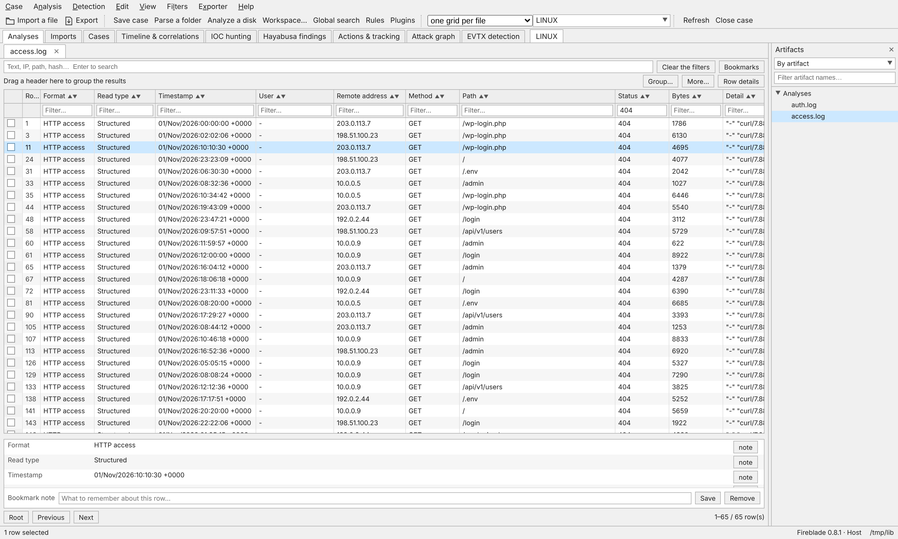
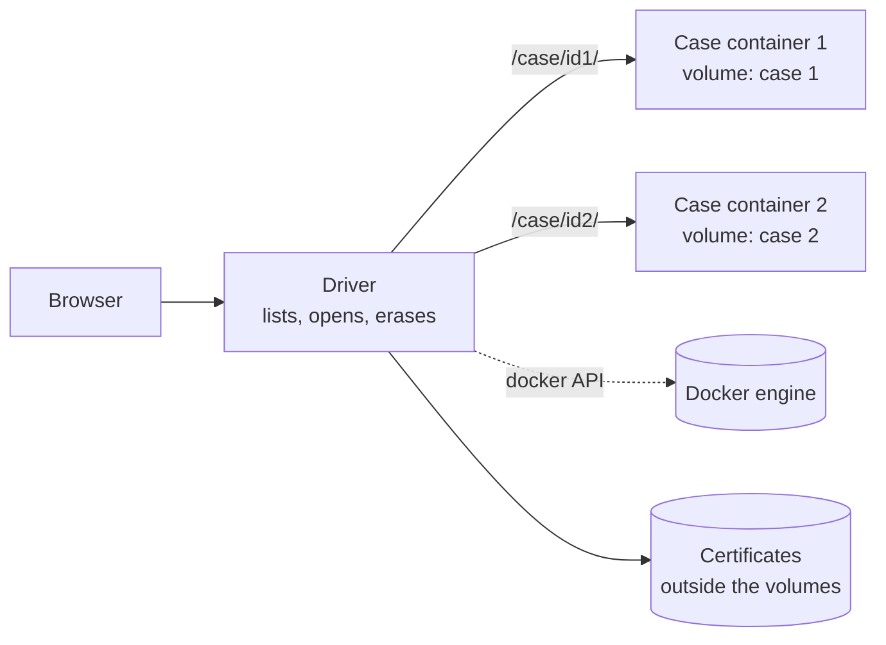
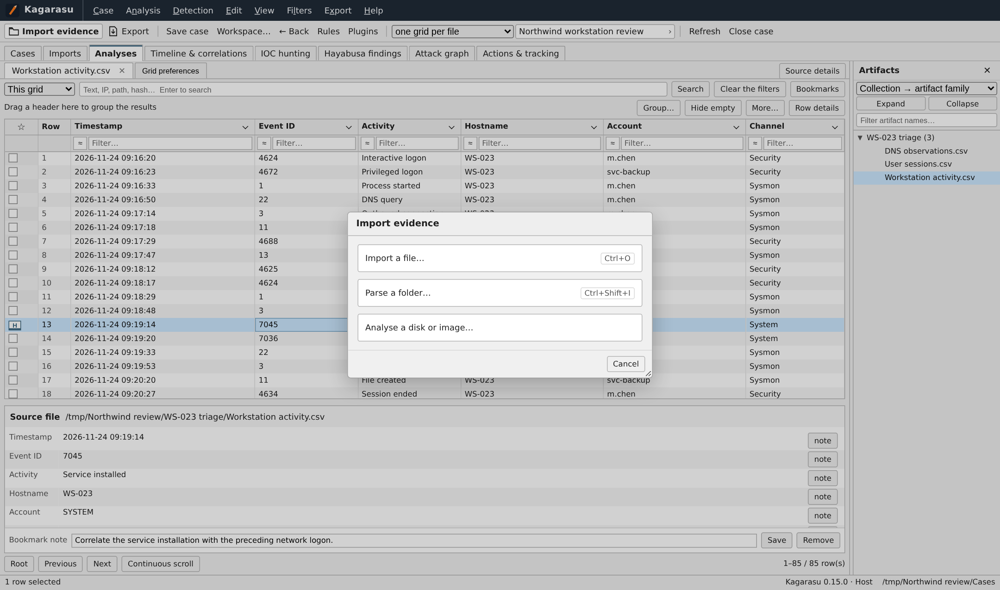
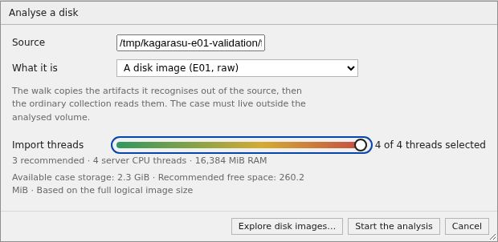

# Kagarasu Host

[](https://github.com/23R0534ZXT/kagarasu/releases/latest)
[](https://github.com/23R0534ZXT/kagarasu/actions/workflows/host.yml)
[](https://github.com/23R0534ZXT/kagarasu/actions/workflows/containers.yml)
[](https://github.com/23R0534ZXT/kagarasu/actions/workflows/windows.yml)

Kagarasu Host is a local DFIR workspace for investigating Windows artifacts, Linux logs,
disk images and tabular evidence. Import a collection, inspect its source records, track
findings and actions, and produce evidence-backed reports from the same case.

Kagarasu Host 0.14.0 adds source-aware artifact review, RECmd batch grouping, continuous
grid scrolling and scoped search. Trace timeline events, findings and analyst marks
back to their source records.



## Editions

| | **Host** | **Desktop** | **Server** |
| --- | --- | --- | --- |
| Status | **maintained** | frozen at 0.7.9 | planned |
| Runs on | a Linux container, in a browser | Windows x64 | planned Linux Docker deployment |
| Users | one analyst, on their own machine | one analyst | several analysts at once, on the same case or on different ones |
| Cases | persistent case folders; optional container per case | files on disk | one container per case |
| Access control | none — local use only | none | accounts, roles, audit log |

Host and Desktop share the analysis engine and reader toolchain. Host opens Desktop case
folders. Open newer Host workspaces, including sparse combined analyses, with a current
Host release. The Server edition is a planned collaboration deployment. See the
[Server roadmap](#roadmap).

## Quick start

Run the current stable release on a workstation with Docker.

```bash
sudo docker run --pull always -d --name kagarasu --restart unless-stopped -p 127.0.0.1:8080:8080 -v "$HOME/kagarasu-cases:/data/cases" ghcr.io/23r0534zxt/kagarasu:latest && echo "Kagarasu is starting. Open http://localhost:8080 in a few seconds."
```

Open <http://localhost:8080>. The directory mounted at `/data/cases` contains the persistent
case files. On Windows PowerShell, start the command with `docker run` and use
`"$HOME\kagarasu-cases:/data/cases"` for the mount.
Host is designed for one local analyst and has no application accounts. Bind the port to
loopback. For upgrades, stop and recreate the container with the new version and the same
case mount. The `:latest` tag follows stable releases. The `:edge` tag follows `main`.
See [deployment and per-case isolation](deploy/host/README.md).

### Operating the container

| Task | Command |
| --- | --- |
| Stop or start | `docker stop kagarasu` or `docker start kagarasu` |
| Upgrade | Stop the container, remove it with `docker rm kagarasu`, and repeat the run command with the same case mount. For a pinned release, set the new version tag |
| Pin a release | Replace `:latest` with `:0.14.0` |
| Preview changes on `main` | Replace the version tag with `:edge` |
| Remove the container | Stop it, then run `docker rm kagarasu`. The case files remain in the mounted directory |
| Build locally | `docker build -t kagarasu:host .` |

If your account already has Docker access, run the command without `sudo`. The image includes the
.NET 10 runtime and the pinned readers. See [deployment notes](deploy/host/README.md).

### Updates

Host can display a release notice with the notes and the command to pull a newer image.
The optional release check uses GitHub's public releases API and caches the result for six
hours. Set `FIREBLADE_UPDATE_CHECK=off` for an isolated deployment. Upgrades are applied by
recreating the container with the same case mount. See [published releases](https://github.com/23R0534ZXT/kagarasu/releases).

## One container per case

The default deployment above serves every case from one container. For isolation, run the
driver: it creates a container for each case that is opened, mounts that case's volume and
nothing else, and removes the container and the volume when the case is erased. The
destruction certificate is written outside the volumes.



```bash
docker network create kagarasu-cases 2>/dev/null || true
docker run -d --name kagarasu-driver -p 127.0.0.1:8080:8080 --network kagarasu-cases \
    -v /var/run/docker.sock:/var/run/docker.sock \
    -v /srv/kagarasu/volumes:/data/volumes \
    -v /srv/kagarasu/certificates:/data/certificates \
    ghcr.io/23r0534zxt/kagarasu-driver:latest \
    python -m fireblade.web.agency serve \
      --image ghcr.io/23r0534zxt/kagarasu:latest \
      --volumes /data/volumes --host-volumes /srv/kagarasu/volumes \
      --certificates /data/certificates --host-certificates /srv/kagarasu/certificates \
      --host 0.0.0.0 --port 8080
```

From a clone, run `docker compose -f deploy/host/docker-compose.driver.yml up -d --build`.
The driver needs privileged access to Docker through its socket. Pin the same release tag
on both images for a reproducible deployment. See the [Driver deployment and upgrade guide](deploy/host/README.md#one-container-per-case).

## Investigation workflow

1. **Open a case and import evidence.** Choose **Import evidence** to import a file,
   parse a folder, or analyze a mounted volume or disk image. **Imports** shows the files
   accounted for, their readers and any partial or unread results. Host reads independent
   files in parallel within the configured resources and applies detected profiles in one
   session save. Choose a grid per file, per artifact family or one combined grid. Changing
   layouts retains the source records and their annotations.
2. **Investigate and tag records.** Filter and group the grid, bookmark rows or add notes.
   Click the leftmost row control to cycle through High, Medium, Low and False positive.
   The star in the column header lets you customize the cycle. Shift-click toggles the
   row bookmark. Right-click a row to record an observation with its date, machine,
   tags, confidence and verdict.
   From an IP cell, hunt across the case or declare an indicator with its source record.
3. **Reconstruct the sequence.** Use the **Timeline** for cross-analysis chronology,
   **IOC hunting** for indicator matches, and the **Attack graph** for Hayabusa findings,
   ATT&CK mappings, saved tags and row marks. In **Actions & tracking → Investigation log**,
   filter tags, inspect timed connections, and correlate process creation, file creation and
   network records with an explicit process identity on the same host. The correlation
   view opens the exact source rows and reports its scan cap when reached. Tagged temporal
   associations are leads for review.
4. **Track and report.** Record actions, owners, machines and accounts. View actions in
   the current case, across the same client or across the library. Export the incident
   intake form (DOCX), six-sheet follow-up workbook (XLSX), or editable investigation
   report (DOCX). The standard reports still support HTML and PDF.
5. **Close the case.** Export a portable case with verified hashes, or use case erasure.
   **Quick erase** deletes the case files without overwriting them. The DoD modes overwrite
   the files and verify the last pass before deletion. Both produce HTML and editable Word
   records outside the case. Deletion frees space in the case filesystem once the files
   are closed and have no remaining links. A VMware snapshot or growing virtual disk can
   retain its size on the physical host. See [erasure limits](docs/host/STATUS.md).

## Investigation layouts

Choose **one grid per file**, **one grid per artifact family**, or **one combined grid**
from the collection settings. A combined grid retains the original fields, source provenance
and a common event clock. **Row details** shows the source file and reader. Right-click a merged
analysis in **Artifacts** to list its source files and select one to narrow the grid. Row marks
and notes follow their source records when the layout changes.

- **Columns and scrolling.** Open **Grid preferences** to reorder, pin or hide columns and
  save the layout for the artifact family. Use **Hide empty** for columns that contain no
  values or **Hidden columns** to restore individual fields. The button in each column
  header lists values and counts for checkbox filtering. **Continuous scroll** loads bounded
  row windows as you scroll. Wide grids also load columns as they enter view.
- **RECmd.** Use **RECmd…** next to **Group…** to sort by category, group by category,
  rule and hive, or review results by collected file. Row details distinguish the hive
  read by RECmd from the imported export and show the batch name when identifiable.
- **Search and navigation.** In **Analyses**, choose **This grid**, **In this case** or
  **Across cases** before searching. Case results show matching fields and link to the
  source row. **Across cases** is available in the single-container deployment.
  **Back** restores the previous workspace view. Grouped views retain a path back to
  their parent groups.
- **Timeline.** The UTC chart legend lets you toggle individual data sources. Shortcut (LNK)
  details distinguish the timestamps of the shortcut file from target metadata embedded in
  it. Choose **Use in timeline** next to the timestamp that fits the question you are investigating.

| Workflow | Available controls and output |
| --- | --- |
| Review an analysis | Value checklists, nested grouping, multi-column sorting, pinned and derived columns, saved views, color rules and visual formats |
| Record findings | Custom row marks, bookmarks, row and cell notes, and observations linked to source records |
| Build a timeline | Cross-analysis chronology with selected date fields, source lanes, nested groups and undated records counted |
| Hunt indicators | Case-wide matches for IPs, domains, URLs and hashes, with grouped match review |
| Run detections | Local Hayabusa analysis of EVTX, findings grouped by rule and mapped to ATT&CK in the attack graph |
| Follow an investigation | Actions, machines, accounts, indicators, client scope and a tagged chronology |
| Deliver findings | Analyst and client reports in HTML and PDF, editable Word reports and follow-up workbooks |
| Keep or move a case | Verified portable `.fireblade` packages, case history and recovery |

Background jobs expose progress, parser messages and a Stop control where cancellation is
supported. See [Host status and verified coverage](docs/host/STATUS.md).

## Import source and resources

**Import evidence** opens a source chooser for files, folders and disks. **Parse a folder**
and **Analyse a disk or image** offer a slider for the number of workers. The recommendation
and upper limit use the resources available to Host, including Docker CPU and memory limits.
Green shows lighter resource use and red shows the upper range. The choice applies to
that job. Preferences set the default for other imports.

<details>
<summary>Import workflow screenshots</summary>






</details>

Folder and disk dialogs show the space available in the case filesystem and the
recommended free space before analysis. For a folder selected in the browser,
the first estimate includes room for the uploaded copy. Host refreshes the
estimate once the folder is staged. For disk images, the estimate uses the
logical image size when available. Actual storage use depends on the readers
and analysis layouts.

In VMware, check the physical host's volume or datastore as well. The free
space displayed by Host comes from inside the guest. VMware must also have
room to grow the VMDK and any snapshots. See [storage planning](deploy/host/README.md#storage-for-imports).

## Explore an E01 image

Mount the directory containing the image and all its segments read-only by adding
`-v /path/to/images:/evidence:ro` to the Docker command. With a case open, choose
**Import evidence**, select **Analyse a disk or image…**, then **Explore disk images…**.
Enter the container path, such as `/evidence/disk.E01`. Select a file system, navigate directories, preview bytes and
collect selected files. The case records the original image, partition, path, available
timestamps and the SHA-256 of the extracted copy. Interactive collection supports files
up to 2 GiB. **Analyse a disk…** runs the artifact readers across mounted evidence,
including accessible NTFS `$Extend` entries and the `$UsnJrnl:$J` stream.

## Document templates and local inference

The Office exports include layouts based on the French reference documents. Mount your
organization's templates privately and set the matching path inside the container.

| Export | Environment variable |
| --- | --- |
| Follow-up workbook with the six expected sheets | `FIREBLADE_TRACKING_TEMPLATE` |
| Investigation report | `FIREBLADE_REPORT_TEMPLATE` |
| Incident intake form | `FIREBLADE_IR_TEMPLATE` |
| Destruction certificate | `FIREBLADE_DESTRUCTION_TEMPLATE` |

Use a blank workbook for the tracking template. Word exports reuse the template's styles
and page setup with case-generated content. With one container per case, the driver writes
the erasure certificate, so configure its destruction template on the driver.

The optional **Suggest rewrite** command sends the selected draft to an explicitly
configured private OpenAI-compatible inference service. Set `FIREBLADE_REWRITE_URL`
to its chat-completions URL and `FIREBLADE_REWRITE_MODEL` to the model name. The analyst
reviews the suggestion before saving. Host rejects changes to recognized identifiers and
time literals. By default only the optional GitHub release
check makes an outbound request. Disable it with `FIREBLADE_UPDATE_CHECK=off`.

## Qualification and scope

The 0.10.0 Docker GUI qualification imported **2,674 source files** into **1,386,061 rows**
and **1,478 source analyses**. The three layouts retained the same row total.

| Layout | Result |
| --- | --- |
| One grid per file | 1,478 grids |
| One grid per artifact family | 56 grids |
| One combined grid | 1 grid with 12,559 data columns |

The review checked source counts, 66,308 original values, independent EVTX counts, filtered
CSV and Excel exports, IOC matches, timeline behavior, notes across layouts and persistence
after container recreation. Layout rebuilding took several minutes on the qualified case.
The evidence and customer Office templates remain private. See the [0.10.0 qualification report](docs/validation/reports/20261127-host-gui/REAL_COLLECTION.md).

The 0.10.1 qualification covers the new investigation workflows and synthetic FAT and NTFS
E01 fixtures. Its 320-file synthetic import comparison measured 34.8 s to 12.4 s in the
per-file layout and 28.3 s to 24.6 s in the combined layout. Timings depend on the evidence,
layout, hardware and available resources. See the [0.10.1 qualification](docs/validation/reports/20261127-host-0101/README.md).

## Host limits

| Area | Scope |
| --- | --- |
| `SRUDB.dat` (SRUM) | The native reader exposes the database's columns. Import a Desktop-produced CSV for the exact `SrumECmd` output. |
| Analyst assistance | Desktop contains its historical analyst assistant. Host offers the explicitly configured draft rewrite command documented above. |
| Interface language | English. |
| Erasure | Quick erase performs filesystem deletion. DoD modes verify the final overwrite. SSDs, journaling filesystems and snapshots can retain copies. |
| Access control | Local, single-analyst operation. Bind the Docker port to loopback. |
| Acquisition | Host reads supported images and artifacts. Use dedicated tools for disk imaging, carving, decryption and OCR. |
| Detections | Treat alerts and inferred links as leads and verify them against the original records. |
| Plug-ins and paths | .NET plug-ins run with the user's rights. Windows paths beyond 260 characters may require `LongPathsEnabled=1`. |

[Host status](docs/host/STATUS.md) · [Reader coverage](docs/host/LINUX-READERS.md)

## Desktop

The Windows edition is frozen: version 0.7.9 is its last build and receives no changes.

**[Download Fireblade 0.7.9 — Windows x64](https://github.com/23R0534ZXT/kagarasu/releases/download/v0.7.9/Fireblade-0.7.9-win64.zip)** · [Release notes and SHA-256](https://github.com/23R0534ZXT/kagarasu/releases/tag/v0.7.9)

Unzip and run `Fireblade.exe`; Python, Qt, the parsers and the .NET readers are inside the
folder. Windows SmartScreen or Smart App Control may block the unsigned executable. Verify
the download against the SHA-256 in the release notes. See the [Desktop documentation](docs/desktop).


Sample data: the
[sample collection](https://github.com/23R0534ZXT/kagarasu/releases/download/test-pack-v2/Fireblade-Sample-Collection-2026-11-18.zip)
(a Windows 11 machine: 183 event logs, Amcache, 60 Prefetch entries, 251 scheduled tasks), the
[discovery pack](https://github.com/23R0534ZXT/kagarasu/releases/download/test-pack-v1/Fireblade-Test-Pack-v1.zip)
and the [raw artifact pack](https://github.com/23R0534ZXT/kagarasu/releases/download/raw-artifacts-v1/Fireblade-Raw-Artifacts-v1.zip).

## Roadmap

The planned **Server** edition would add shared case work, per-case containers, role-based
access, an audit log and HTTPS. Its design attributes marks, notes and views to the analyst
working in each case. A separate Host design proposes per-case encrypted volumes with
erasure by key destruction. See the [Docker architecture handoff](docs/host/HANDOFF-DOCKER.md).

## Repository

```
src/fireblade/
  core/        the engine every edition runs: cases, readers, grid, timeline, reports
  web/         the Host: FastAPI service, per-case driver, browser client in static/
  ui/          the Desktop (Qt); frozen, not imported by the Host
  runtime/     bootstrap and resources
  validation/  the Windows qualification harness
config/        the pinned readers and profiles
deploy/host/   building and running the Host
docs/          desktop, host, user guides, development notes
tests/         core, web (including real-browser tests), runtime, ui, fixtures
```

## Develop

The shared Python and DuckDB engine is in `src/fireblade/core`. The FastAPI service,
browser client and case-isolation driver are in `src/fireblade/web`. For a local
development check, install Python dependencies and Chromium, then run the project checks.

```bash
python -m venv .venv
. .venv/bin/activate
python -m pip install -e '.[dev,web,browser,pdf]'
python -m playwright install chromium
python -m scripts.dev_check
```

Chromium tests in `tests/web/test_browser*.py` exercise the interface with Playwright.
Set `FIREBLADE_CHROMIUM` to use an existing Chromium installation. See [Contributing](CONTRIBUTING.md).

## Documentation

- [Host status and verified coverage](docs/host/STATUS.md) · [Host audit against Desktop](docs/host/HOST-AUDIT.md)
- [Host deployment](deploy/host/README.md) · [Linux reader coverage](docs/host/LINUX-READERS.md)
- [Desktop documentation](docs/desktop) · [User guides](docs/guides)
- [Architecture](docs/development/ARCHITECTURE.md) · [Timeline Explorer comparison](docs/development/BENCHMARK-0.4.0.md)
- [Release notes](docs/development/RELEASE-NOTES.md) · [Changelog](CHANGELOG.md)

## License

Kagarasu is distributed under the [MIT license](LICENSE). Bundled readers and third-party
dependencies retain their [respective licenses](licenses/THIRD_PARTY.md).
