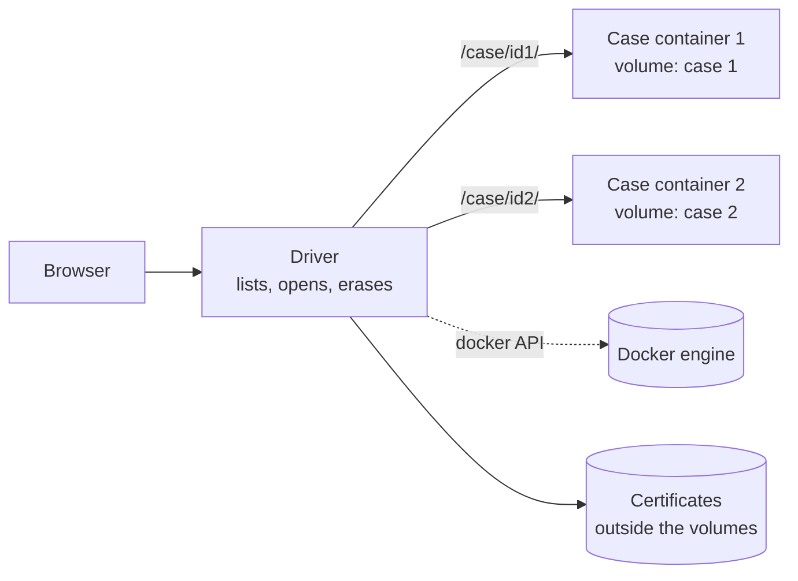

# Kagarasu Host

[](https://github.com/23R0534ZXT/kagarasu/actions/workflows/host.yml)
[](https://github.com/23R0534ZXT/kagarasu/actions/workflows/containers.yml)
[](https://github.com/23R0534ZXT/kagarasu/releases/latest)

[](https://github.com/23R0534ZXT/kagarasu/actions/workflows/windows.yml)

**A local DFIR workspace for Windows artifacts, Linux logs and tabular evidence.**

Kagarasu reads a collected folder, keeps every file accounted for, and puts the results in
one workspace: filterable tables, a cross-analysis timeline, indicator hunting, detections
grouped into findings, an attack graph, and a case that can be saved, moved and erased
verifiably. Everything runs on the analyst's own machine: no upload, no cloud account, no
API key, no telemetry. The optional release check is the only outbound request in the default configuration.
An explicitly configured private inference service can suggest rewrites of analyst drafts.


## Editions

| | **Host** | **Desktop** | **Server** |
| --- | --- | --- | --- |
| Status | **maintained** | frozen at 0.7.9 | planned |
| Runs on | a Linux container, in a browser | Windows x64 | a Linux host with Docker |
| Users | one analyst, on their own machine | one analyst | several analysts at once, on the same case or on different ones |
| Cases | persistent case folders; optional container per case | files on disk | one container per case |
| Access control | none — local use only | none | accounts, roles, audit log |

Host and the historical Desktop share the engine (`src/fireblade/core`) and reader toolchain.
Host opens Desktop cases; new Host features, including sparse combined analyses, require the
current Host and are not a compatibility promise for the frozen Desktop.

The **Host** is the Desktop's workspace served to a browser from a container. It is meant to
run on the analyst's own machine and to listen on it alone; it has no accounts, and nothing in
it is designed to be exposed to a network. The **Server** edition, for collaboration, is
specified but not started — see [Roadmap](#roadmap).

## Host

### Run it

One line; Docker downloads the image the first time, and creates the cases folder if it is missing:

```bash
docker run -d --name kagarasu --restart unless-stopped -p 127.0.0.1:8080:8080 -v "$HOME/kagarasu-cases:/data/cases" ghcr.io/23r0534zxt/kagarasu:latest && echo "Kagarasu is starting: open http://localhost:8080 in a few seconds"
```

Prefix the command with `sudo` if your user is not in the `docker` group. Then open <http://localhost:8080>. `/data/cases` is the path inside the container; your cases are in
`~/kagarasu-cases` on your machine, and a case written by the Desktop opens as soon as its
folder is there. On Windows PowerShell, write the folder as `"$HOME\kagarasu-cases"`.

| | |
| --- | --- |
| Stop / start | `docker stop kagarasu` · `docker start kagarasu` |
| Upgrade | `docker pull ghcr.io/23r0534zxt/kagarasu:latest && docker rm -f kagarasu`, then run the line above again (the cases stay in their folder) |
| Pin a version | replace `:latest` with `:0.10.0` · `:edge` follows `main` |
| Remove | `docker rm -f kagarasu` (your cases are not touched) |

To build from a clone instead: `docker build -t kagarasu:host .`.

### Investigation layouts

Choose **one grid per file**, **one grid per artifact family**, or **one combined grid**
from the collection settings. A combined grid retains the original fields, with source
provenance and a common event clock. Wide collections load the visible column window on
demand; the column manager lets you find, show and reorder fields. Row and cell notes follow
the source records when the layout changes.

Artifact families keep supporting configuration files collapsed by default. Use grouping,
filters and saved column layouts to focus a large collection without discarding its fields.
Changing a layout rebuilds its analyses as a background job and can take several minutes.

### Investigation log and follow-up

The investigation log and disk explorer below are part of the development image (`:edge`).

Right-click an analysis row and choose **Tag this observation**. The case keeps the original
record reference, selected value, event time and machine alongside your tags, interest level,
confidence and verdict. Use **Add this grid’s bookmarks to the investigation log** to bring in
existing marks. Open **Actions & tracking → Investigation log** to filter by tags, include false
positives or export the resulting chronology. The selected tags match any of the chosen labels.

A tagged connection uses a source and destination IP and an inbound, outbound or unknown
direction. The log shows later tagged file, process and authentication events on the same
machine in the selected time window when both timestamps include a time zone. These links
are temporal associations. The observed sequence view groups tagged events by machine. Tabular
firewall, Sysmon and EDR exports with recognized
fields can prefill the tags dialog. The analyst confirms the proposed network fields.

Right-click an IP cell to hunt it across the case or declare it as an indicator. Each declaration
adds its artifact, source row, machine and column to the existing indicator. The Actions table
can show the current case, cases with the same client name, or every case.

The log produces a six-sheet **follow-up workbook (XLSX)** and an editable **investigation report
(DOCX)**. The workbook includes actions, chronology, collected evidence, indicators, and the
machines and accounts marked compromised in the case. The Word report follows the executive
summary, method, analysis, limits, recommendations and annex structure. Collection times are
recorded in UTC, with creation and modification times when supplied by the source. The original
archive name remains available for extracted members. Optional Office templates can be mounted
privately and selected with `FIREBLADE_TRACKING_TEMPLATE` and `FIREBLADE_REPORT_TEMPLATE`.
Use an empty six-sheet workbook with the matching headers as the XLSX template. The DOCX
template supplies styles and page setup. Its example body is replaced with the current case.

For an optional analyst-reviewed rewrite of a draft description, configure a private,
OpenAI-compatible chat completions service through `FIREBLADE_REWRITE_URL` and
`FIREBLADE_REWRITE_MODEL`. The selected draft is sent only when the analyst clicks **Suggest
rewrite** and the result can be reviewed before saving. Without those settings, Host makes no
inference request.

### Explore an E01 disk image

Mount the directory containing the original and all its segments read-only, for example with
`-v /path/to/images:/evidence:ro` on the Host container. Open **File → Analyse a disk… →
Explore disk images…** and enter the path inside the container, such as `/evidence/disk.E01`.
The explorer lists readable file systems and lets you navigate directories, preview regular
files and copy selected files into the case. Each copy retains its image, file-system number,
in-image path, available timestamps and SHA-256. Collection through the explorer is limited
to 2 GiB per file. Attachments and forensic paths remain case-local.

Use **Start the analysis** to run the artifact readers over the image, including accessible
NTFS `$Extend` entries. Host reads the image and rejects incomplete EWF segment sets. Case
erasure operates on the case and its copies. The original remains on its separately mounted
volume.

### Qualified on a real collection

The Docker GUI qualification for **0.10.0** imported **2,674 source files** into
**1,386,061 rows and 1,478 source analyses**. The three layouts retained the same total:
1,478 file grids, 56 family grids, or **one combined grid with 12,559 data columns**.

The review checked source counts and 66,308 original values, independent EVTX counts,
filtered CSV/Excel exports, IOC matches, the timeline, notes across layouts, and persistence
after container recreation. These measurements describe this collection and test environment;
performance depends on the evidence, selected operations and available resources.

Read the [qualification report](docs/validation/reports/20261127-host-gui/REAL_COLLECTION.md)
and the [0.10.0 release notes](docs/development/RELEASE-NOTES.md) for methods and limits.
Private evidence and screenshots are not distributed with the source code.

### Updates

When a newer release exists, a band across the top of the page says so, with the release notes
and the line to run: pull the new image, remove the old container, start it again. Your cases
stay in their folder, and nothing updates itself — a tool that signs destruction certificates
changes version when someone decides to.

To find out, the container asks GitHub's public releases API at most once every six hours. That
request carries no information about you or your cases, and it is the only one the Host makes.
On an isolated network, or if you prefer it that way, switch it off with
`-e FIREBLADE_UPDATE_CHECK=off`: the band never appears, and you follow the
[releases](https://github.com/23R0534ZXT/kagarasu/releases) yourself.

The image carries the .NET 10 runtime and the thirteen pinned readers, so it reads the same
artifacts as the Desktop.

### One container per case

The default deployment above serves every case from one container. For isolation, run the
driver: it creates a container for each case that is opened, mounts that case's volume and
nothing else, and removes the container and the volume when the case is erased. The
destruction certificate is written outside the volumes.



```bash
docker network create kagarasu-cases 2>/dev/null || true
docker run -d --name kagarasu-driver -p 127.0.0.1:8080:8080 --network kagarasu-cases \
    -v /var/run/docker.sock:/var/run/docker.sock \
    -v /srv/kagarasu/volumes:/data/volumes \
    -v /srv/kagarasu/certificates:/data/certificates \
    ghcr.io/23r0534zxt/kagarasu-driver:latest \
    python -m fireblade.web.agency serve \
      --image ghcr.io/23r0534zxt/kagarasu:latest \
      --volumes /data/volumes --host-volumes /srv/kagarasu/volumes \
      --certificates /data/certificates --host-certificates /srv/kagarasu/certificates \
      --host 0.0.0.0 --port 8080
```

From a clone: `docker compose -f deploy/host/docker-compose.driver.yml up -d --build`. The driver
mounts the Docker socket, which is root on the machine: run it only where that is acceptable.
Deployment notes and the upgrade recipe: [deploy/host](deploy/host/README.md).

### What you can do

- **Import** a file, a folder (sent from the browser), a mounted volume or a disk image. Every
  file is hashed, copied into the case and read by the matching reader; the Imports tab says
  which files were read, by which reader, and why one was not.
- **Investigate a table**: per-column filters, grouping, multi-column sort, pinned and derived
  columns, bookmarks, row and cell notes, colour rules and visual formats, saved views. Source
  values are never rewritten.
- **Build a timeline** across analyses from the dates the analyst designates, with the rows that
  carry no usable date counted rather than dropped.
- **Hunt indicators** (IPs, domains, URLs, hashes) across every analysis of a case.
- **Detect**: Hayabusa rules run locally over parsed EVTX; findings are grouped, mapped to
  ATT&CK and drawn as an attack graph.
- **Track the work**: actions, machines and accounts, indicators.
- **Report**: an investigation report and a client report, as HTML or PDF (the PDF keeps the
  report's headings and table columns, repeats table headers across pages and numbers its pages).
- **Keep or move a case**: portable `.fireblade` packages with verified hashes, history and
  recovery, and a verified erasure with a certificate.

Long commands (import, scan, timeline, detection, report, package) run as jobs with a progress
bar, the engine's own messages, and a Stop.

### Limits

| | |
| --- | --- |
| `SRUDB.dat` (SRUM) | Read by Kagarasu's own reader: the database's own columns, not `SrumECmd`'s names. `SrumECmd` itself needs Windows' ESE libraries; for its exact output, import the CSV the Desktop produced. |
| Assistant | The local analyst assistant exists in the Desktop only. |
| Language | English. |
| Erasure | Overwriting files cannot be guaranteed on SSDs, copy-on-write or journaled file systems; the certificate states the method used, not a physical guarantee. |
| Access control | None. Do not expose the Host to a network. |
| Tested at scale | Docker GUI: 1,386,061 rows, 1,478 source analyses and 12,559 data columns in one combined grid. Rebuilding the layout takes several minutes on the qualified collection. Earlier Windows 11 qualification also covers Hayabusa and attack graphs. See the linked reports for measured coverage. |

The full statement of what is and is not verified: [docs/host/STATUS.md](docs/host/STATUS.md).
Reader by reader, with the rows each wrote: [docs/host/LINUX-READERS.md](docs/host/LINUX-READERS.md).

## Desktop

The Windows edition is frozen: version 0.7.9 is its last build and receives no changes.

**[Download Fireblade 0.7.9 — Windows x64](https://github.com/23R0534ZXT/kagarasu/releases/download/v0.7.9/Fireblade-0.7.9-win64.zip)** · [Release notes and SHA-256](https://github.com/23R0534ZXT/kagarasu/releases/tag/v0.7.9)

Unzip and run `Fireblade.exe`; Python, Qt, the parsers and the .NET readers are inside the
folder. The executable is unsigned: Windows may show a SmartScreen prompt (*More info* →
*Run anyway*), and Smart App Control on a fresh Windows 11 may refuse it. Verify the download
against the SHA-256 in the release notes. Documentation: [docs/desktop](docs/desktop).


Sample data: the
[sample collection](https://github.com/23R0534ZXT/kagarasu/releases/download/test-pack-v2/Fireblade-Sample-Collection-2026-11-18.zip)
(a Windows 11 machine: 183 event logs, Amcache, 60 Prefetch entries, 251 scheduled tasks), the
[discovery pack](https://github.com/23R0534ZXT/kagarasu/releases/download/test-pack-v1/Fireblade-Test-Pack-v1.zip)
and the [raw artifact pack](https://github.com/23R0534ZXT/kagarasu/releases/download/raw-artifacts-v1/Fireblade-Raw-Artifacts-v1.zip).

## Roadmap

**Server** is the Host for several analysts working at once, several of them on the same case while
others work on other cases: an application that manages cases and their containers, role-based
access control, an audit log of every action, HTTPS, and a secure erasure that stops the case
container, removes it and wipes its data. Several analysts on one case means one service per case
container that serves all of them, with each analyst's marks, notes and views attributed to them. The design is in
[docs/host/HANDOFF-DOCKER.md](docs/host/HANDOFF-DOCKER.md). Nothing of it is implemented yet.

Planned for the Host: per-case encrypted volumes, so that erasing a case means destroying its key.

## Repository

```
src/fireblade/
  core/        the engine every edition runs: cases, readers, grid, timeline, reports
  web/         the Host: FastAPI service, per-case driver, browser client in static/
  ui/          the Desktop (Qt); frozen, not imported by the Host
  runtime/     bootstrap and resources
  validation/  the Windows qualification harness
config/        the pinned readers and profiles
deploy/host/   building and running the Host
docs/          desktop, host, user guides, development notes
tests/         core, web (including real-browser tests), runtime, ui, fixtures
```

## Build and test

```bash
python -m venv .venv && . .venv/bin/activate
python -m pip install -e '.[dev,web,browser]'
python -m scripts.dev_check          # version, ruff, client JavaScript, full suite
```

The browser tests in `tests/web/test_browser*.py` drive the client with a real mouse; they need
Playwright and a Chromium (`FIREBLADE_CHROMIUM` names one it did not download) and are skipped
without them. Contributing: [CONTRIBUTING.md](CONTRIBUTING.md).

## Documentation

- [Host status and what is verified](docs/host/STATUS.md) · [Host audit against the Desktop](docs/host/HOST-AUDIT.md)
- [Desktop](docs/desktop) · [user guides](docs/guides) · [architecture](docs/development/ARCHITECTURE.md)
- [Release notes](docs/development/RELEASE-NOTES.md) · [Timeline Explorer comparison](docs/development/BENCHMARK-0.4.0.md)

## Known limits

- **Detections assist, they do not conclude**: an alert is a lead for an analyst to verify.
- **An analysis workspace, not an acquisition tool**: no disk imaging, carving, decryption or OCR.
- **.NET plugins run with your rights**: load only assemblies you trust.
- **Paths beyond 260 characters** on Windows need `LongPathsEnabled=1`.

## License

Code under [MIT](LICENSE). Bundled tools and dependencies keep their own licences, including
AGPL components; notices are in [licenses/THIRD_PARTY.md](licenses/THIRD_PARTY.md).
