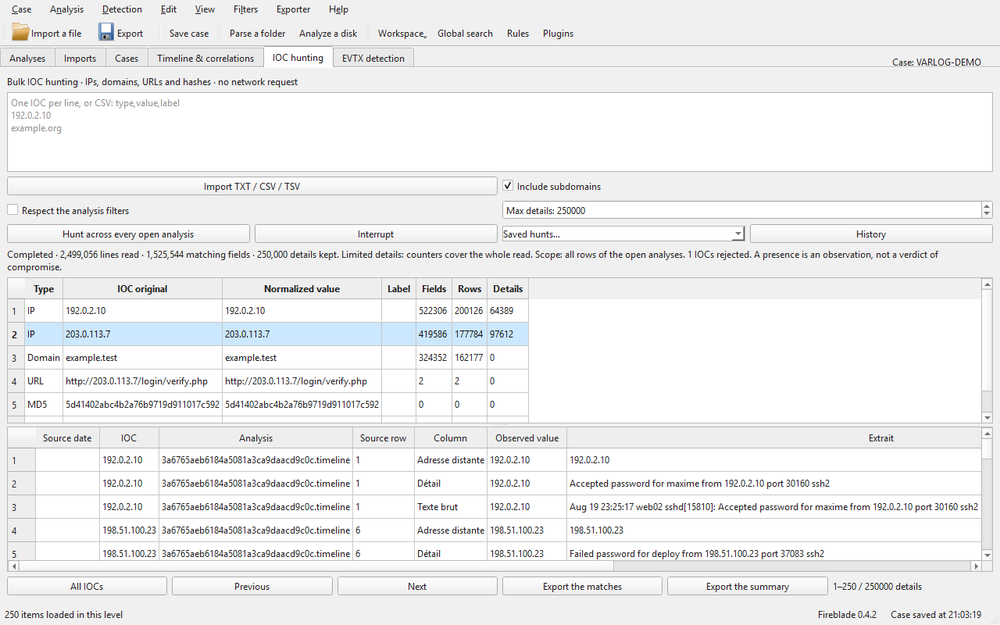

# Fireblade

[](https://github.com/23R0534ZXT/fireblade/actions/workflows/windows.yml)

**A local DFIR workspace for Windows artifacts, Linux logs and tabular evidence.**

Fireblade parses a collected folder, keeps every file accounted for, and puts the results
in one desktop workspace: filterable tables, a cross-analysis timeline, indicator hunting,
detection results and a case that can be saved, archived and reopened. Everything runs
locally — no server, no upload, no cloud account.

**[Download Fireblade 0.4.2 — Windows x64](https://github.com/23R0534ZXT/fireblade/releases/download/v0.4.2/Fireblade.exe)** · [SHA-256 and release notes](https://github.com/23R0534ZXT/fireblade/releases/tag/v0.4.2) · [Windows qualification run](https://github.com/23R0534ZXT/fireblade/actions/runs/44155224788)

Windows, one executable, no installation: Python, Qt, the parsers and the .NET readers
are bundled inside it.


*A workspace over synthetic Linux logs: artifact tree, table, per-column filters and row
details.*

## What it does

- **Turns a collection into one workspace** — Windows artifacts (EVTX, MFT, Prefetch,
  registry, Shellbags, WebCache), raw Linux logs and rotations, CatScale output, CSV/TSV,
  XLS/XLSX, saved HTML pages and PDF text layers.
- **Never loses a file silently** — every file ends in a report with its status, its reason
  and its SHA-256, including the ones no reader recognised.
- **Answers questions fast** on tables of tens of millions of rows without loading them
  into memory.
- **Builds one chronology** across analyses, with the time zone assumption stated rather
  than hidden.
- **Hunts indicators in bulk** and keeps the result attached to the case.
- **Produces evidence** an examiner can defend: provenance, annotations, verified exports
  and a portable archive whose content is checked before it replaces anything.

## Investigate a table

Per-column filters, grouping by one or more columns, sorting, pinned columns, calculated
columns, bookmarks, row and cell notes, colour rules and a command palette. Values are
never rewritten: the source columns, the source row number and the reader that produced
them stay available.


## Build a timeline across analyses

One histogram and one lane per analysis, built from the dates the analyst designates. A
counter says how many rows carry no usable date and how many carry none with an explicit
time zone, so a gap in the chronology is a stated fact rather than a silent one.


## Hunt indicators in bulk

Paste IPs, domains, URLs or hashes (or load a CSV), hunt across every open analysis, then
read the matches per indicator, per analysis and per source row — and export the summary
and the details as verified CSV.



## Know what was imported — and what was not

The Imports report lists every file with its status, the readers that touched it, the
reason when something went wrong and the hash taken at collection. Files can be previewed,
re-read with a chosen reader, copied aside, parked or removed — and a removal is refused
if the file changed since it was collected. The coverage audit then checks the analyses
themselves and reports what it cannot verify.


## Detect, and open the context

Hayabusa rules run locally over the parsed EVTX. An alert opens the events around its date
on the same machine, kept as an analysis tab like any other.

## Case work that survives the investigation

Cases hold their analyses, views, notes and history. A case can be archived after being
verified, moved as a portable package, and reopened later with its recovery history
intact. Exports carry the SHA-256 of what they contain.

## Compared with Timeline Explorer — measured

Same machine, same files, both tools driven to completion. Timeline Explorer 2026.10.0;
Fireblade 0.4 with a 1 GB budget.

| On a 3.65 GB / 32 M-row CSV | Fireblade | Timeline Explorer |
|---|---|---|
| Open the file | **56.6 s** | 108.3 s |
| Search "host07" in every column | **2.4 s** | 149.9 s |
| Group by host (37 groups) | **0.12 s** | 134.3 s |
| Sort by timestamp | **0.64 s** | 8.5 s |
| Memory while open | **1.1 GB** | 15.3 GB |

Both tools were checked to return the same rows (864 865 for one host, 37 groups). The
durable difference is memory, not seconds: Timeline Explorer holds roughly 4.2× the file
size in RAM, so an 8 GB machine caps it near 1.9 GB of log; Fireblade stays at its
configured budget. Method, every figure, and what the comparison does not prove:
[BENCHMARK-0.4.0.md](docs/development/BENCHMARK-0.4.0.md).

## Install

1. Download **Fireblade.exe** from the [latest release](https://github.com/23R0534ZXT/fireblade/releases).
2. Run it. There is nothing else to install — no Python, no Excel, no separate .NET.
3. Create a case, then point Fireblade at a collected folder (**Parse a folder…**), a file
   (**Import a file…**) or a disk image (**Analyze a disk…**).

**First five minutes**: create a case → parse a folder → open the Imports tab to see what
was read and what was not → filter the table or open the timeline → save the case.

The binary is **unsigned**: Windows may show a SmartScreen prompt on first launch
("More info" → "Run anyway"), and Smart App Control on a fresh Windows 11 may refuse it
outright. Verify the download against the SHA-256 published in the release notes.

Sample data, if you have nothing at hand:
[discovery pack](https://github.com/23R0534ZXT/fireblade/releases/download/test-pack-v1/Fireblade-Test-Pack-v1.zip) ·
[raw artifact pack](https://github.com/23R0534ZXT/fireblade/releases/download/raw-artifacts-v1/Fireblade-Raw-Artifacts-v1.zip) ·
[3 GiB CSV](https://github.com/23R0534ZXT/fireblade/releases/download/test-data-3gib/Fireblade-test-3GiB.zip).

## Known limits

- **Unsigned binary**, so SmartScreen warns and Smart App Control can block it on a fresh
  Windows 11 install.
- **Paths beyond 260 characters** need `LongPathsEnabled=1` on the machine.
- **An analysis workspace, not an acquisition tool**: no disk imaging, no carving, no
  decryption and no OCR. A PDF without a text layer is reported as such instead of
  producing empty rows.
- **Detection assists, it does not conclude**: alerts require an analyst's review, and the
  coverage audit states what it could not verify.
- **.NET plugins run with your rights** — load only assemblies you trust.

## What's new in 0.5.0 — prototype

- **A findings map for Hayabusa.** Instead of 35 000 alert rows, the alerts are grouped
  into a few hundred findings and drawn three ways: a dial of the day, a heat map, and a
  timeline per host for one window. A click on a mark selects the finding and the grid
  follows.
- **An assistant tab, wired but not yet generating.** Fireblade builds the evidence pack
  (numbered events, neighbours, what could not be established) and refuses any answer
  whose citation does not exist in it. No model ships with this build: asking a question
  says why.
- This version is **source only**; the published executable stays
  [0.4.2](https://github.com/23R0534ZXT/fireblade/releases/tag/v0.4.2).

## Previous release — 0.4.2

- A 9.74 GiB collection parses in **6 min 0 s** instead of 50 min 49 s, for the same 246
  analyses: each file is read in its own process and a huge file is split into line-aligned
  ranges.
- The Imports table fills while the collection runs, and its report is fully in the
  interface language.
- Tab labels no longer collide, Preferences shows the effective thread count and memory,
  and the coverage and IOC summaries read in English.
- The whole set of findings from the 0.4.1 acceptance run is closed. Details:
  [release notes](docs/development/RELEASE-NOTES.md).

## Documentation

- **User guides** — [documentation index](docs/README.md): tutorial, workspace, collection,
  timeline, IOC hunting, coverage, disk analysis. They are in French today and being
  translated; the interface itself is English.
- **For contributors** — [architecture](docs/development/ARCHITECTURE.md),
  [compatibility](docs/development/COMPATIBILITE.md),
  [benchmark](docs/development/BENCHMARK-0.4.0.md), [plugins](docs/development/PLUGINS.md).
- **Releases** — [release notes](docs/development/RELEASE-NOTES.md) and the
  [releases page](https://github.com/23R0534ZXT/fireblade/releases).

The interface ships in English; French remains selectable in **Preferences → Language** for
the parts already translated, and is no longer maintained.

## Development

```bash
python -m venv .venv
python -m pip install -e '.[dev]'
python -m pytest -q
python -m ruff check src scripts tests
fireblade
```

Source execution is for development; the distributable targets Windows x64 and is built and
qualified by CI on every tag. See [CONTRIBUTING.md](CONTRIBUTING.md).

## License

Code under [MIT](LICENSE). Bundled tools and dependencies keep their own licences, including
AGPL components; notices are listed in [licenses/THIRD_PARTY.md](licenses/THIRD_PARTY.md) and
in **Help → Licences**.
