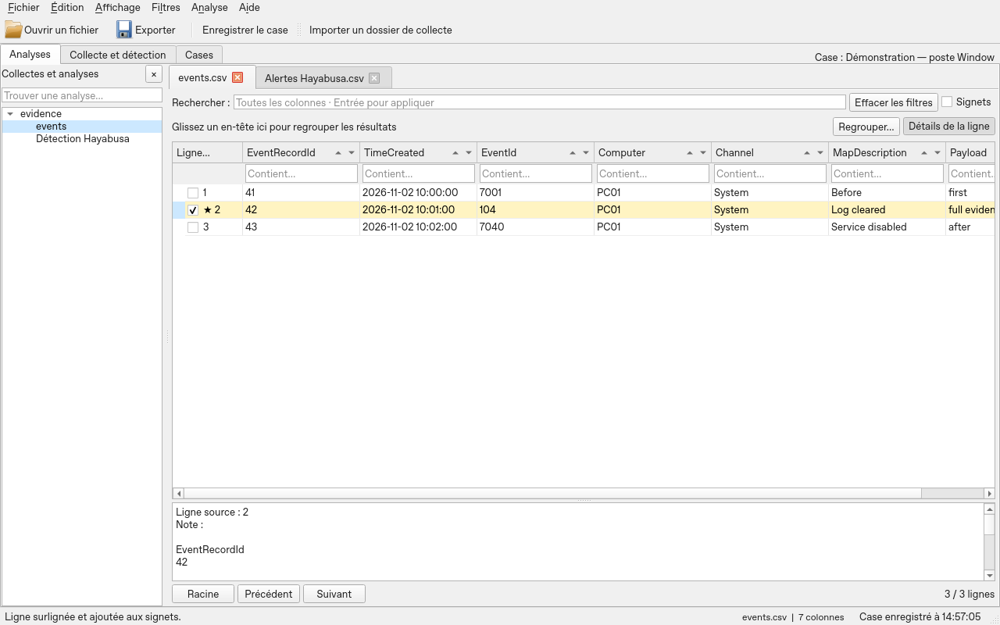
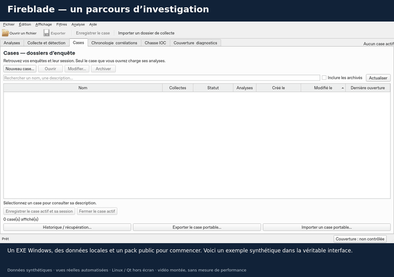

# Fireblade 0.7

**Un espace d’investigation local pour explorer des artefacts Windows, des collectes Linux CatScale et des exports de données.**

**[Télécharger Fireblade 0.7.0 — Windows x64](https://github.com/23R0534ZXT/fireblade/releases/download/prototype-ad1991921b615a209636f0d2c972db0002fb4fe8/Fireblade.exe)** · [Notes et SHA-256](https://github.com/23R0534ZXT/fireblade/releases/tag/prototype-ad1991921b615a209636f0d2c972db0002fb4fe8) · [Pack de découverte, ~5,1 Mo](https://github.com/23R0534ZXT/fireblade/releases/download/test-pack-v1/Fireblade-Test-Pack-v1.zip) · [Donner un retour](https://github.com/23R0534ZXT/fireblade/issues/6)

Fireblade s’adresse aux analystes DFIR et aux personnes qui apprennent l’investigation numérique. Il rassemble les résultats dans des dossiers d’enquête persistants : filtrer les données, retrouver les événements liés à une alerte, conserver des notes et exporter ses constatations.

*Interface en français. Capture de l’application avec des données de démonstration, rendue sous Linux hors écran.*

## Ce que vous pouvez faire

- **Importer des artefacts Windows** avec 13 EZ Tools embarqués, 70 plugins RECmd et des lecteurs dédiés Shellbags et WebCache.
- **Explorer une collecte CatScale**, en dossier ou en archive, organisée en sept familles.
- **Examiner les alertes Hayabusa** et leur contexte EVTX, avec retour à l’événement source.
- **Filtrer, grouper et annoter** des CSV, TSV, TXT délimités, XLS et XLSX ; les requêtes portent sur le résultat complet, pas seulement la page affichée.
- **Construire une chronologie et chercher des IOC**, puis produire un rapport HTML/PDF ou un export CSV/XLSX vérifié.
- **Reprendre et transporter une enquête** avec les sauvegardes de session et les archives de dossiers portables.

[Référence complète : fonctionnalités, captures et limites](docs/guides/FONCTIONNALITES.md) · [Compatibilité Timeline Explorer](docs/development/COMPATIBILITE.md)

## Essayer en 15 minutes

1. Téléchargez **Fireblade.exe** avec le lien ci-dessus, puis lancez-le sous **Windows x64**. Python, Excel et une installation préalable de .NET ne sont pas nécessaires.
2. Téléchargez et décompressez le **pack de découverte** (~5,1 Mo en ZIP, ~60,6 Mo extraits). Son fichier **LIRE-MOI.md** indique les exercices et les avertissements attendus.
3. Dans Fireblade, utilisez **Ouvrir un fichier** pour essayer un CSV du dossier `03-Exports`. Filtrez une colonne, ajoutez un signet et une note.
4. Pour essayer les parseurs, créez un dossier via **Cases → Nouveau case…**, puis **Importer un dossier de collecte…**. Suivez le guide du pack pour choisir les artefacts.
5. Enregistrez votre travail, fermez-le et rouvrez-le. Dites-nous ce qui était clair et ce qui vous a bloqué dans [l’issue des testeurs](https://github.com/23R0534ZXT/fireblade/issues/6).

Ce petit pack couvre des exemples de formats : il ne contient pas une collecte complète de poste ni un incident unique. Le [CSV de 3 Gio](docs/guides/TESTER-3GIB.md) sert au test de charge. [Comprendre les deux jeux et leurs limites](docs/guides/JEUX-DE-TEST.md).

**F1** ouvre le guide rapide ; **Aide → Tutoriel complet** présente les autres parcours.

Le programme est encore un **prototype non signé** : Windows peut afficher un avertissement au lancement. Les notes de la release donnent l’empreinte SHA-256 du téléchargement. Le premier démarrage extrait les ressources embarquées ; prévoyez de l’espace pour les analyses et leurs fichiers temporaires.

[Voir la démonstration commentée de 75 secondes](docs/assets/fireblade-demo.mp4) · [Contexte et reproduction](docs/guides/DEMONSTRATION.md)

## Retours et problèmes

Les premiers retours de testeurs francophones sont les bienvenus, y compris de débutants.

- **Impressions et questions sur le premier essai** : [commenter l’issue d’accueil](https://github.com/23R0534ZXT/fireblade/issues/6).
- **Bug précis ou amélioration** : [ouvrir une issue avec le formulaire adapté](https://github.com/23R0534ZXT/fireblade/issues/new/choose). Vérifiez si le problème existe déjà ; un problème par issue facilite son suivi.
- Indiquez **Aide → À propos**, le tag de la release, votre version de Windows et les étapes du problème. Utilisez le pack public pour les exemples et masquez les informations sensibles.

Un compte GitHub est nécessaire pour publier un retour.

## Validation et limites

L’[EXE 0.7.0 publié](https://github.com/23R0534ZXT/fireblade/actions/runs/41514474442) a réussi les contrôles Windows requis : tests sur Python 3.11/3.12/3.13, programme autonome, lecteurs embarqués, chemins longs et réseau, huit variantes visuelles, 320 analyses et un CSV de plus de 3 Gio. Ces vérifications automatisées ne remplacent pas les essais sur vos postes et vos formats d’artefacts.

- Le traitement est local ; le parcours normal n’a pas besoin de télécharger les moteurs ou les règles.
- Fireblade lit des **artefacts collectés et des exports** ; il ne monte pas les images disque. Hayabusa s’applique aux EVTX Windows.
- Les avertissements, résultats partiels et erreurs de lecteurs restent visibles. Une alerte est une piste à examiner, pas une conclusion automatique.
- Les analyses sont stockées dans des bases DuckDB `.timeline`. Le budget mémoire DuckDB ne plafonne pas toute la RAM du programme et de ses outils externes.
- Les sessions référencent leurs bases et leurs sources. Pour déplacer une enquête, utilisez une archive portable ; conservez les éléments nécessaires à une nouvelle analyse des artefacts.
- Les DLL optionnelles s’exécutent avec les permissions de l’utilisateur et leur compatibilité doit être vérifiée.

[Validation détaillée et mesures](docs/guides/FONCTIONNALITES.md#validation-and-known-limitations) · [Données de charge de 3 Gio](docs/guides/TESTER-3GIB.md) · [Sauvegardes et dossiers portables](docs/guides/CHRONOLOGIE-ET-SAUVEGARDES.md)

## Documentation et contribution

[Guide utilisateur](docs/guides/UTILISATION.md) · [Tutoriel complet](docs/guides/TUTORIEL-COMPLET.md) · [Index des guides](docs/README.md) · [Contribuer](CONTRIBUTING.md) · [Architecture](docs/development/ARCHITECTURE.md) · [Publier une version](docs/development/PUBLICATION.md)

Le code est dans `src/fireblade`, les tests dans `tests`, les versions des moteurs dans `config` et les scripts de construction dans `scripts/windows`. Les contrôles s’exécutent automatiquement ; une nouvelle release de l’application nécessite une publication explicite.

## English overview

Fireblade is a local Windows x64 forensic investigation workspace. Import Windows artifacts, Linux CatScale collections or CSV/TSV/XLS/XLSX exports; filter and annotate the results, investigate Hayabusa alerts with EVTX context, build timelines, hunt IOCs and export findings. The desktop interface and guides currently use French.

Download the single **Fireblade.exe** linked above and try the public sample pack. It includes a French walkthrough and expected results. Fireblade 0.7.0 is an unsigned prototype; see the linked Windows qualification, compatibility notes and limitations. Feedback is welcome in [Issues](https://github.com/23R0534ZXT/fireblade/issues).

## Licence

Le code de Fireblade est sous [licence MIT](LICENSE). Les moteurs et dépendances conservent leurs licences, dont l’AGPL de Hayabusa. Les notices sont disponibles dans **Aide → Licences** ; les sources Hayabusa embarquées peuvent être exportées depuis le menu Aide. [Licences tierces](licenses/THIRD_PARTY.md).
