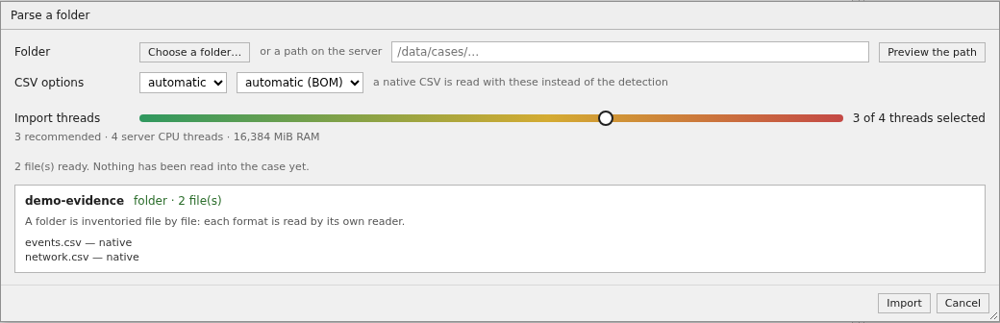

# Kagarasu Host

[](https://github.com/23R0534ZXT/kagarasu/releases/latest)
[](https://github.com/23R0534ZXT/kagarasu/actions/workflows/host.yml)
[](https://github.com/23R0534ZXT/kagarasu/actions/workflows/containers.yml)

Kagarasu Host is a local DFIR workspace for investigating Windows artifacts, Linux logs,
disk images and tabular evidence. Import a collection, inspect its source records, track
findings and actions, and produce evidence-backed reports from the same case.


## Quick start

Run the current stable release on a workstation with Docker.

```bash
docker run -d --name kagarasu --restart unless-stopped \
  -p 127.0.0.1:8080:8080 \
  -v "$HOME/kagarasu-cases:/data/cases" \
  ghcr.io/23r0534zxt/kagarasu:0.10.1
```

Open <http://localhost:8080>. The directory mounted at `/data/cases` contains the persistent
case files. On Windows PowerShell, use `"$HOME\kagarasu-cases:/data/cases"` for the mount.
Host is designed for one local analyst and has no application accounts. Bind the port to
loopback. For upgrades, stop and recreate the container with the new version and the same
case mount. The `:latest` tag follows stable releases. The `:edge` tag follows `main`.
See [deployment and per-case isolation](deploy/host/README.md).

## Investigation workflow

1. **Open a case and import evidence.** Use a file or folder import, or analyze a mounted
   volume or disk image. **Imports** shows the files accounted for, their readers and
   any partial or unread results. Host reads independent files in parallel within the
   configured resources and applies detected profiles in one session save.
   Choose a grid per file, per artifact family or one
   combined grid. Changing layouts retains the source records and their annotations.
2. **Investigate and tag records.** Filter and group the grid, bookmark rows or add notes.
   Right-click a row to tag it with its date, machine, interest, confidence and verdict.
   From an IP cell, hunt across the case or declare an indicator with its source record.
3. **Reconstruct the sequence.** Use the **Timeline** for cross-analysis chronology,
   **IOC hunting** for indicator matches, and the **Attack graph** for Hayabusa findings
   and their ATT&CK mappings. In **Actions & tracking → Investigation log** you can filter
   tags, inspect timed connections, and correlate process creation, file creation and
   network records with an explicit process identity on the same host. The correlation
   view opens the exact source rows and reports its scan cap when reached. Tagged temporal
   associations are leads for review.
4. **Track and report.** Record actions, owners, machines and accounts. View actions in
   the current case, across the same client or across the library. Export the incident
   intake form (DOCX), six-sheet follow-up workbook (XLSX), or editable investigation
   report (DOCX). The standard reports still support HTML and PDF.
5. **Close the case.** Export a portable case with verified hashes, or use case erasure.
   In the development image (`:edge`), **Quick erase** deletes the case files without
   overwriting them. The DoD modes overwrite them and verify the last pass before deletion.
   Both produce HTML and editable Word records outside the case. Deletion frees space in the
   case filesystem once the files are closed and have no remaining links. A VMware snapshot or growing virtual disk can
   retain its size on the physical host. See [erasure limits](docs/host/STATUS.md).

## Import source and resources

In the development image (`:edge`), **Import evidence** opens a source chooser for
files, folders and disks. **Parse a folder** and **Analyse a disk or image** offer a
slider for the number of workers. The recommendation and upper limit use the resources
available to Host, including Docker CPU and memory limits. Green shows lighter resource
use and red shows the upper range. The choice applies to that job. Preferences set the
default for other imports.

<details>
<summary>Import workflow screenshots</summary>





</details>

Folder and disk dialogs show the space available in the case filesystem and the
recommended free space before analysis. For a folder selected in the browser,
the first estimate includes room for the uploaded copy. Host refreshes the
estimate once the folder is staged. For disk images, the estimate uses the
logical image size when available. Actual storage use depends on the readers
and analysis layouts.

In VMware, check the physical host's volume or datastore as well. The free
space displayed by Host comes from inside the guest. VMware must also have
room to grow the VMDK and any snapshots. See [storage planning](deploy/host/README.md#storage-for-imports).

## Explore an E01 image

Mount the directory containing the image and all its segments read-only by adding
`-v /path/to/images:/evidence:ro` to the Docker command. With a case open, choose
**Import evidence**, select **Analyse a disk or image…**, then **Explore disk images…**.
Enter the path inside
the container, such as
`/evidence/disk.E01`. Select a file system, navigate directories, preview bytes and
collect selected files. The case records the original image, partition, path, available
timestamps and the SHA-256 of the extracted copy. Interactive collection supports files
up to 2 GiB. **Analyse a disk…** runs the artifact readers across mounted evidence,
including accessible NTFS `$Extend` entries and the `$UsnJrnl:$J` stream.

## Document templates and local inference

The Office exports include layouts based on the French reference documents. Mount your
organization's templates privately and set the matching path inside the container.

| Export | Environment variable |
| --- | --- |
| Follow-up workbook with the six expected sheets | `FIREBLADE_TRACKING_TEMPLATE` |
| Investigation report | `FIREBLADE_REPORT_TEMPLATE` |
| Incident intake form | `FIREBLADE_IR_TEMPLATE` |
| Destruction certificate | `FIREBLADE_DESTRUCTION_TEMPLATE` |

Use a blank workbook for the tracking template. Word exports reuse the template's styles
and page setup with case-generated content. With one container per case, the driver writes
the erasure certificate, so configure its destruction template on the driver.

The optional **Suggest rewrite** command sends the selected draft to an explicitly
configured private OpenAI-compatible inference service. Set `FIREBLADE_REWRITE_URL`
to its chat-completions URL and `FIREBLADE_REWRITE_MODEL` to the model name. The analyst
reviews the suggestion before saving. Host rejects changes to recognized identifiers and
time literals. By default only the optional GitHub release
check makes an outbound request. Disable it with `FIREBLADE_UPDATE_CHECK=off`.

## Qualification and scope

The 0.10.0 Docker qualification imported a private 2,674-file collection into
**1,386,061 rows**, **1,478 source analyses** and one combined grid with **12,559 data
columns**. The [qualification report](docs/validation/reports/20261127-host-gui/REAL_COLLECTION.md)
records the checks, hardware-dependent behavior and limitations. The test data and customer
Office templates stay private. The [0.10.1 qualification](docs/validation/reports/20261127-host-0101/README.md)
covers the new investigation workflows and synthetic FAT and NTFS E01 fixtures.

Host is the maintained edition. Desktop for Windows is frozen at
[0.7.9](https://github.com/23R0534ZXT/kagarasu/releases/tag/v0.7.9).
The multi-analyst Server design is documented in the [deployment handoff](docs/host/HANDOFF-DOCKER.md).

## Develop

The shared Python and DuckDB engine is in `src/fireblade/core`. The FastAPI service,
browser client and case-isolation driver are in `src/fireblade/web`. For a local
development check, install Python dependencies and Chromium, then run the project checks.

```bash
python -m venv .venv
. .venv/bin/activate
python -m pip install -e '.[dev,web,browser,pdf]'
python -m playwright install chromium
python -m scripts.dev_check
```

[Release notes](docs/development/RELEASE-NOTES.md) ·
[Reader coverage](docs/host/LINUX-READERS.md) ·
[User guides](docs/guides) ·
[Architecture](docs/development/ARCHITECTURE.md) ·
[Contributing](CONTRIBUTING.md)

Kagarasu is distributed under the [MIT license](LICENSE). Bundled readers and third-party
dependencies retain their [respective licenses](licenses/THIRD_PARTY.md).
