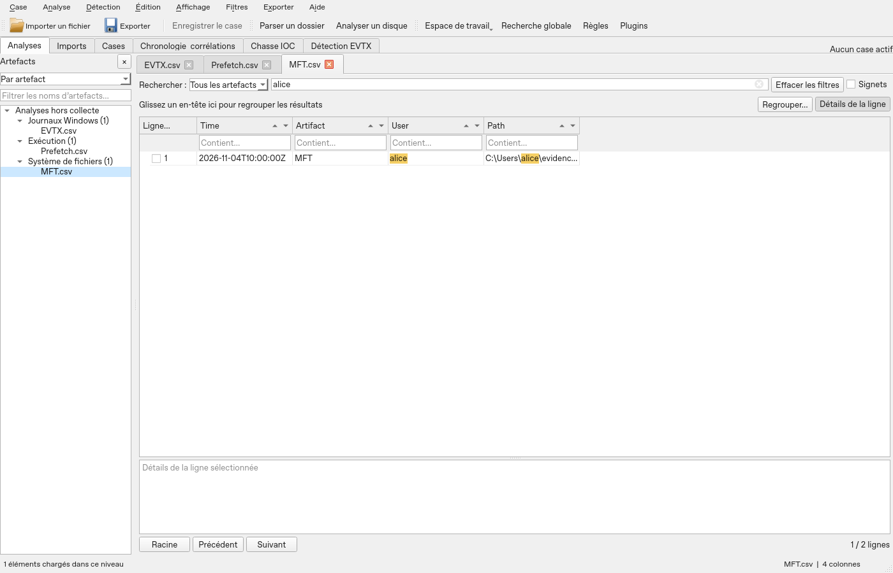

# Fireblade

[](https://github.com/23R0534ZXT/fireblade/actions/workflows/windows.yml)

**A local DFIR workspace for forensic artifact analysis and case management.**

Fireblade brings Windows artifacts, Linux logs, detection results and tabular evidence into a single desktop investigation workspace. Parse collected data, investigate timelines, annotate findings and export reproducible results while retaining source references and integrity information.

[Releases](https://github.com/23R0534ZXT/fireblade/releases) · [Documentation](docs/README.md) · [Report an issue](https://github.com/23R0534ZXT/fireblade/issues/new/choose) · [Release notes](docs/development/RELEASE-NOTES.md)

**[Download Fireblade 0.3.0 — Windows x64](https://github.com/23R0534ZXT/fireblade/releases/download/v0.3.0/Fireblade.exe)** · [Release notes and SHA-256](https://github.com/23R0534ZXT/fireblade/releases/tag/v0.3.0)

The interface now opens in English; French is one click away in **Preferences → Language**. User guides are still in French.



*Fireblade 0.2.2 workspace with synthetic demonstration data.*

Windows CI runs focused regression tests on Python 3.12, builds the standalone EXE in parallel, then checks its appearance, 320-analysis workspace and 3-GiB import/export workflow. The full Python 3.11–3.13 test matrix remains available through the workflow’s **full_validation** option.

## Version 0.3.0 · English interface, grouping and a readable timeline

- The interface opens **in English**; **French** stays available in **Preferences → Language** and the choice is saved. Menus, toolbars, tabs, buttons, headers, filters and input fields are translated; text computed at display time (counters, "no active case") is still French.
- **Grouping bar** rebuilt: numbered levels, drop a header at the exact position, one `×` per level, and a single **Remove all** button.
- **Column manager** in two panes: hidden columns on the left, display order on the right, plus width and pinning for the selected column. Everything is remembered per artifact format.
- **Command palette** (`Ctrl+Shift+K`) exposes every menu entry through one field, including the commands that have no button.
- Cross-artifact search now shows **the matching events** — four real rows under the table — and the remaining volume, instead of a count per file.
- **Timeline**: bars carry the volume (their height is the number of events in the time bucket), lanes fill the available height, and the source label is centred.
- Fixed: a launch could replay the saved timeline focus and open as an empty window; the data toolbar stayed hidden until Workspace → Analysis; a dragged column left a grey ghost behind; a refused case switch said nothing; an `&` in a tab title showed as an underscore.
- The version is displayed in the status bar and on the start screen.

## Previous release · 0.2.3

- The timeline indexes an explicit UTC column (`Horodatage UTC`, `TimestampUtc`) instead of the raw column it was derived from, so Linux journals are no longer read through a syslog stamp without a year or a timezone.
- Dates without a timezone are read as **UTC** in the chronology, as they already were on import. A case keeps the same chronological order on every machine.
- The date column is resolved against the analysis itself, calculated UTC columns included. A guessed index is no longer saved as an analyst choice; timeline settings written by 0.2.2 are reset once.
- A source that stores `date` and `time` in two columns (IIS, W3C, some timelines) is indexed on both, instead of stopping at midnight.
- Artifact detection keeps the most specific profile: eighteen catalogue entries that were never selected — Hayabusa verbose and super-verbose, Chainsaw persistence, nine RECmd profiles — now match, and a declaration recorded on one tab-joined line is split into columns.
- Profile rules survive category colours, so Hayabusa severity colours are no longer overwritten.
- An interrupted export removes its temporary file, so the next export to the same target is no longer refused.

## Previous release · 0.2.2

- Group artifacts by family, source folder or a simple list directly from the navigator.
- Search all loaded artifacts from the main search field; inspect matches in a docked panel and open the original source row.
- Detach, dock and resize workbench panels. Switch to **Analysis**, **Timeline only**, or **Analysis + timeline**, and save your workspace layout.
- Drag column headers into your preferred order. Column order and widths are saved automatically per artifact format.
- Highlight matching text without recoloring the whole row.
- Set query threads, import threads and per-analysis memory in **Preferences → Resources**. Sequential background collection keeps memory bounded.
- Create a column-specific rule directly from a cell value. Access existing rules and custom JSON profiles from the workspace toolbar, create a profile from the current artifact, or import a .NET reader through Preferences.

## Capabilities

| Area | Features |
|---|---|
| Evidence intake | Windows artifacts, raw Linux logs and rotations, CatScale collections, CSV/TSV/TXT and XLS/XLSX exports |
| Disk triage | Read-only extraction of supported artifacts from mounted volumes, RAW/E01 images and physical-device paths |
| Analysis | Filtering, grouping, sorting, calculated columns, bookmarks, notes and source provenance |
| Detection | Embedded Hayabusa rules, EVTX alert context and bulk IOC searches |
| Timelines | Cross-analysis chronology, date normalization and event correlation |
| Case management | Persistent workspaces, recovery history, verified portable archives and cold storage |
| Reporting | CSV/XLSX exports, annotations and HTML/PDF investigation reports |

Windows parsing integrates EZ Tools, RECmd, Shellbags and WebCache readers. Linux support covers common `/var/log/` formats and CatScale output. See the [feature reference](docs/guides/FONCTIONNALITES.md) and [format compatibility](docs/development/COMPATIBILITE.md) for supported inputs and limitations.

## Getting started

1. Download **Fireblade.exe** from a published [Windows x64 release](https://github.com/23R0534ZXT/fireblade/releases). Python, Excel and a separate .NET installation are not required.
2. Create or open a case.
3. Add evidence from **Analyse**: **Importer un fichier**, **Parser un dossier** or **Analyser un disque**. Folder selection supports **Ctrl/Shift**.
4. Explore completed analyses as background parsing continues. Filter records, add notes and investigate related events.
5. Save the case, export findings or create a verified portable archive.

For a first evaluation, use the sample data below. The application remains an **unsigned prototype**; Windows may display a SmartScreen prompt. Release notes identify the qualified source commit and the executable's SHA-256.

## Earlier release · 0.2.1

- Revised menus separate case management, analysis, detection and exports.
- Multiple folders are queued and parsed sequentially in the background.
- Verified results appear progressively without replacing the active analysis.
- Import diagnostics are available on demand from **Aide**, rather than a permanent primary tab.
- Wide CSV imports can fall back to bounded row insertion; wide pages are read in column batches when the native query exceeds its memory budget.
- **Archiver et libérer l’espace** creates and verifies an archive before removing local case work files. Original evidence outside the case is retained; the archive remains available for restoration.
- NTFS traversal, SQLite companion journals, analysis-file validation and export destination protection include the audit fixes.
- The optional ten-second startup sequence uses locally bundled footage and bounded frame decoding.

[Implementation and validation report](docs/validation/reports/20261104-v021-ergonomie.md) · [Audit fixes](docs/validation/reports/20261104-v020-correctifs.md)

## Resource and storage management

Fireblade uses disk-backed DuckDB databases and paged views. The default database budget is **128 MB with one thread**; background parsing receives half that budget, with a 64 MB minimum. Existing user configuration takes precedence.

These settings limit DuckDB, **not total application memory**. Qt, Python and external parsers have separate overhead. Wide tables and expensive queries may require additional resources. The low-memory import path prioritizes bounded memory over speed.

Parsed results, source CSVs and analysis databases consume disk space. Closing a case or marking it archived does not remove these files. Use **Archiver et libérer l’espace** to create verified cold storage, preferably on another volume. The operation streams closed databases without creating a second full database copy. Enough space is still required for the compressed archive itself. Retain original acquisitions independently.

Example configuration:

```toml
[resources]
memory_mb = 128
threads = 1
page_size = 250
max_loaded_rows = 1000
export_batch_rows = 2048
```

[Disk-analysis guide](docs/guides/DISQUES-ET-ESPACE-DE-TRAVAIL.md) · [Cases, backups and portable archives](docs/guides/CHRONOLOGIE-ET-SAUVEGARDES.md)

## Sample datasets

| Dataset | Purpose |
|---|---|
| [Discovery pack](https://github.com/23R0534ZXT/fireblade/releases/download/test-pack-v1/Fireblade-Test-Pack-v1.zip) | Small examples for learning the interface and supported formats |
| [Raw artifact pack](https://github.com/23R0534ZXT/fireblade/releases/download/raw-artifacts-v1/Fireblade-Raw-Artifacts-v1.zip) | Windows artifacts and synthetic Linux logs for exercising parsers |
| [3 GiB CSV](https://github.com/23R0534ZXT/fireblade/releases/download/test-data-3gib/Fireblade-test-3GiB.zip) | Large-table import, querying and export validation |

[Dataset provenance and limitations](docs/guides/JEUX-DE-TEST.md) · [Raw-pack guide](docs/guides/PACK-BRUT.md)

## Validation and scope

The default Windows pipeline runs focused Python 3.12 checks (the full Python 3.11–3.13 matrix is optional), the standalone executable, native readers, UNC and long paths, display scaling, a CSV larger than 3 GiB and a workspace containing 320 analyses. Version-specific results are linked from each release and the validation reports.

Fireblade is an analysis workspace, not a disk-acquisition or deleted-file-recovery tool. It does not provide decryption or carving. Reader errors, unsupported files and partial results remain explicit. Alerts require analyst review; automated checks do not establish complete acquisition coverage or prove the absence of malicious activity.

Optional .NET plugins run with the user's permissions. Use trusted assemblies and consult their compatibility and licensing requirements.

## Development

```bash
python -m venv .venv
# Activate the environment for your platform.
python -m pip install -e '.[dev]'
python -m pytest -q
python -m ruff check src scripts tests
fireblade
```

Source execution supports development and testing; the distributable application targets Windows x64. Native Windows qualification is required before publication.

[Contributing](CONTRIBUTING.md) · [Architecture](docs/development/ARCHITECTURE.md) · [Build and publication](docs/development/PUBLICATION.md) · [User guide](docs/guides/UTILISATION.md)

## License

Fireblade's code is licensed under [MIT](LICENSE). Embedded tools and dependencies retain their own licenses, including AGPL components. Notices are available in **Aide → Licences**, and Hayabusa sources can be exported from the Help menu. The startup footage is public domain and credited in [its provenance record](assets/startup/SOURCES.json).

[Third-party licenses](licenses/THIRD_PARTY.md)
