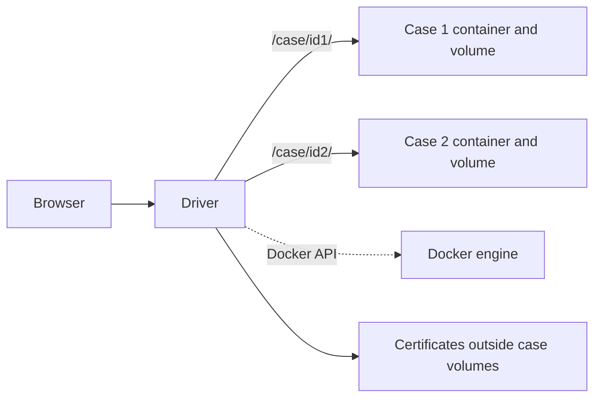

# Building and running the Host

The image is built from the **repository root**: it needs the shared core, the pinned
readers, the toolchain manifest and the web layer. The build inputs therefore stay at
the root — this folder only keeps the entry point and the instructions.

| file | what it is |
| --- | --- |
| [`../../Dockerfile`](../../Dockerfile) | `python:3.12-slim` + the .NET 10 runtime + the thirteen readers fetched by `scripts/fetch_readers.py` |
| [`../../docker-compose.yml`](../../docker-compose.yml) | one service, port `${FIREBLADE_PORT:-8080}`, one volume for the cases and one for the plugins |
| [`../../requirements-core.txt`](../../requirements-core.txt) | the core's Python dependencies, without Qt |
| [`../../.dockerignore`](../../.dockerignore) | what the build must not carry |
| [`Dockerfile.driver`](Dockerfile.driver) | the driver: docker CLI, FastAPI, httpx and the core modules that destroy a case — no readers, no .NET, no DuckDB |
| [`docker-compose.driver.yml`](docker-compose.driver.yml) | one container per case: the driver mounts the socket, the volumes and the certificates folder |

## Published images

| Image | Purpose |
| --- | --- |
| `ghcr.io/23r0534zxt/kagarasu` | Host with the readers, .NET runtime and browser client. The `kagarasu-host` image name is an alias. |
| `ghcr.io/23r0534zxt/kagarasu-driver` | Local case manager for deployments that isolate each case in a separate container. |

The `:latest` tag follows stable releases and `:edge` follows `main`. Use the same release
tag on the driver and case images for a reproducible deployment. [Release tags](https://github.com/23R0534ZXT/kagarasu/releases)

## Build

```bash
docker build -t fireblade:host .
```

The readers are downloaded during the build (the pinned versions in
`config/forensic-toolchain.json`), so the first build needs network access and a few
minutes. For an isolated deployment, set `FIREBLADE_UPDATE_CHECK=off` to disable the optional release check.

## Run

```bash
FIREBLADE_CASES=/srv/fireblade/cases FIREBLADE_PORT=8080 docker compose up -d
```

or, without compose:

```bash
docker run -d --name fireblade-host -p 127.0.0.1:8080:8080 \
    -v /srv/fireblade/cases:/data/cases \
    -v /srv/fireblade/plugins:/data/plugins \
    fireblade:host
```

Open <http://localhost:8080>. The health check is `/health`; the API documents itself at
`/api/docs`.

## Storage for imports

The import dialogs compare free space on the case filesystem with a planning estimate.
The recommended working space is three times the source size plus 256 MiB and an
additional 1 MiB per known input or extraction candidate. The browser folder estimate
also includes the copy staged for upload. When the copy is in the case filesystem,
Host refreshes the comparison against the remaining free space.

For a mounted volume, Host estimates the bytes in recognized artifact candidates and
their likely transaction sidecars. For a disk image, it prefers the logical disk size
and can use the stored image segments as a fallback. A physical device whose size
cannot be measured shows an unknown estimate. Reader output, combined grids and other
writes can change peak usage. At job start, Host refuses a folder import below its
existing minimum of 1.5 times the source size plus 256 MiB. Disk estimates are advisory.

If Docker runs in a VMware guest, check the guest filesystem containing the case
directory and the physical host volume or datastore holding the VMDK and snapshots.
Guest free space can be high while the physical datastore lacks room for a thin or
dynamically growing disk. Deleting a case can free guest filesystem space while the
VMDK stays the same size on the datastore. Use VMware's storage tools to monitor
host-side capacity and reclaim it when appropriate.

## One container per case

From a clone, start the published driver with Docker Compose. The Compose file creates
the named `fireblade-cases` network and binds the user interface to loopback. Set the
case and certificate paths to absolute directories on the Docker host. The driver uses
them when requesting mounts from the Docker daemon.

```bash
export FIREBLADE_VOLUMES=/srv/kagarasu/volumes
export FIREBLADE_CERTIFICATES=/srv/kagarasu/certificates
export FIREBLADE_TAG=0.15.0
docker pull "ghcr.io/23r0534zxt/kagarasu:${FIREBLADE_TAG}"
docker compose -f deploy/host/docker-compose.driver.yml up -d --pull always --no-build
```

Open <http://localhost:8080>. The driver serves each case under `/case/<id>/`. It holds
the Docker socket, which grants control of the host Docker daemon. Only the driver uses
the socket. Each case container sees its own case volume. The driver writes destruction
certificates outside those volumes.



To build the driver from the checkout, use
`docker compose -f deploy/host/docker-compose.driver.yml up -d --build`.
Case containers use the published case image selected by `FIREBLADE_TAG`.

## Upgrade to a new release

For a single Host container, follow the [container operations](../../README.md#operate-the-container).
For the driver, select the new release in `FIREBLADE_TAG`, keep the existing volume and
certificate paths, and repeat the pull and Compose commands above.

From 0.15, the driver manages containers belonging to its own case library and recognizes
older case containers by their labels and matching `/data/library` bind mount.
The driver compares each case container's image ID with the configured image. It removes
stale containers at startup and rebuilds them on demand when the analyst opens a case.
The case files stay in their existing host directories.

## Smoke test of an image

```bash
docker run --rm -v /srv/fireblade/cases:/data/cases fireblade:host \
    python -m fireblade.web count
```

It opens every case in the library and counts its rows: a real number from a real
DuckDB file, with no browser involved.

> What the Host's tests verify, and what they do not: [`../../docs/host/STATUS.md`](../../docs/host/STATUS.md).
