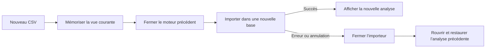

# Modifier Fireblade

L’application utilise Python standard et **trois dépendances directes** : DuckDB, PySide6 Essentials (Qt Widgets) et openpyxl (XLSX). Il n’y a pas de serveur à démarrer, de chaîne de compilation JavaScript, de navigateur embarqué ou de gestionnaire de plugins. Les tests et PyInstaller restent des outils de développement optionnels.

## Où modifier quoi

| Besoin | Fichier | Responsabilité |
|---|---|---|
| Ajuster RAM, threads, pagination et taille des blocs exportés | `fireblade.toml` | Configuration utilisateur, relue au lancement |
| Ajouter / valider un paramètre de ressources | `timeline_next/settings.py` | Dataclass et lecture TOML standard Python |
| Changer les vues, l’état temporaire de reprise ou les opérateurs disponibles | `timeline_next/models.py` | Objets Python simples, sans Qt ni DuckDB |
| Modifier import, requêtes, groupes, signets ou export | `timeline_next/engine.py` | Moteur sans dépendance à l’interface |
| Changer le chargement / affichage des lignes et groupes | `timeline_next/grid.py` | Modèle Qt paginé |
| Changer les boutons, fenêtres et ouvertures de fichiers | `timeline_next/app.py` | Interface et coordination des opérations |
| Changer la confirmation d’import CSV | `timeline_next/dialogs.py` | Destination et options CSV, sans accès à la base |
| Changer les actions de clic droit | `timeline_next/menus.py` | Menus des en-têtes et des cellules, délégués aux commandes existantes |
| Modifier l’apparence | `timeline_next/theme.py` | Palette claire et feuille de style Qt compacte |
| Modifier l’exécution des tâches en arrière-plan | `timeline_next/workers.py` | Un petit job Qt, avec annulation des tâches en attente |
| Distinguer une annulation d’une erreur | `timeline_next/errors.py` | Exception et contexte d’annulation du job, indépendants de Qt |
| Vérifier les comportements | `tests/` | Tests du moteur, de la configuration et de la grille |
| Préparer les tests et le livrable Windows | `.github/workflows/windows.yml`, `scripts/build-windows.ps1` | Automatisation de développement, sans dépendance runtime supplémentaire |

Les dépendances vont dans un seul sens : `models` / `settings` → `engine` → `grid` → `app`. `workers` est utilisé par la grille et l’application. Les dialogues et menus n’importent pas la classe Window : leurs commandes sont raccordées par l’interface. Le moteur peut être utilisé dans un script sans charger Qt. Aucun système d’injection de dépendances ou de classes abstraites n’est nécessaire.

## Utiliser le moteur seul

Depuis le dossier du projet, dans l’environnement Python installé :

```python
from timeline_next.engine import Case
from timeline_next.models import Filter, View
from timeline_next.settings import Settings

case = Case("mon-analyse.timeline", settings=Settings(memory_mb=256, threads=1))
try:
    # Seulement à la première création de cette analyse :
    if not case.headers:
        case.import_csv("artefacts.csv")
    column = case.headers.index("User")  # adapter au CSV
    view = View(filters=[Filter(column, "contains", "alice")], groups=[column])
    print(case.page(view))
finally:
    case.close()
```

Un nouvel opérateur se déclare dans `models.OPERATORS`, se traduit en SQL dans `Case.where`, puis se vérifie dans `tests/test_engine.py`. Les valeurs utilisateur doivent toujours être liées avec `?` ; ne pas les interpoler dans le SQL.

Pour une nouvelle option de vue, ajouter un champ avec une valeur par défaut dans `View`. Les anciennes vues JSON profiteront de cette valeur. Une modification du schéma des tables DuckDB demande en revanche une migration explicite ; ne pas remplacer silencieusement les bases existantes.

## Régler les ressources

Le fichier `fireblade.toml` à la racine du projet est chargé automatiquement. Avec l’exécutable Windows, le fichier se place à côté du `.exe`. Les paramètres restent facultatifs et leurs valeurs par défaut sont définies à un seul endroit : `Settings`. Les clés inconnues et les valeurs incohérentes produisent une erreur explicite au lancement.

```toml
[resources]
memory_mb = 256
threads = 2
page_size = 250
max_loaded_rows = 1000
export_batch_rows = 2048
cache_sorted_pages = true
```

Pour un petit poste, commencer par `threads = 1`, `page_size = 100` et `max_loaded_rows = 400`. Diminuer la mémoire du moteur peut augmenter les accès disque ou rendre certaines opérations impossibles : ce n’est pas une garantie de meilleures performances. `memory_mb` est exprimé en MB DuckDB (base décimale), et n’est pas un plafond de mémoire global du processus.

Un fichier alternatif peut être sélectionné explicitement :

```powershell
.\.venv\Scripts\python.exe -m timeline_next --config "C:\Analyses\petit-poste.toml"
```

## Règles simples de maintenance

- Garder les opérations DuckDB et les lectures de gros fichiers dans les jobs, hors du fil de l’interface.
- Charger les résultats par pages. Une fenêtre par parent est bornée, pour les lignes **et** les groupes ; la page suivante libère la fenêtre précédente lorsqu’elle est pleine.
- Replier un groupe vide ses descendants du cache. Ses données restent dans la base et sont rechargées si on le déplie.
- Les résultats d’une génération précédente ou d’un groupe retiré ne doivent pas être insérés dans le modèle Qt. Les jobs obsolètes encore en attente sont sautés ; une requête déjà commencée peut finir.
- Déconnecter les callbacks des jobs terminés pour libérer leurs références aux anciennes pages et vues.
- Utiliser `Case.operation()` pour les opérations DuckDB : accès sérialisé, reprise après interruption et traduction en `OperationCancelled`. Les jobs ont un signal d’annulation distinct du signal d’erreur. Les opérations qui valident une transaction ou remplacent un fichier contrôlent l’annulation avant cette validation, plutôt qu’après.
- L’import protège le retour en arrière et la validation déjà commencée contre de nouvelles interruptions natives, avec un petit verrou distinct. La demande d’annulation reste mémorisée ; elle est vérifiée avant COMMIT. Ne pas appeler `db.interrupt()` directement depuis l’interface : utiliser `Case.interrupt()` pour respecter cette protection.
- Avant de fermer une analyse pour un nouvel import, mémoriser seulement son chemin, ses métadonnées de source, sa vue et l’état des en-têtes (`AnalysisSnapshot`). En cas d’échec, fermer d’abord l’importeur, vérifier que l’ancien fichier existe toujours et que sa provenance / son encodage / son schéma n’ont pas changé, puis le rouvrir. Les lignes et les buffers ne font pas partie du snapshot.
- Le cache de tri reste une seule table temporaire DuckDB, sans copie des colonnes sources. Le construire au-delà de la première fenêtre évite de matérialiser tous les identifiants pour une consultation courte. Le désactiver avec `cache_sorted_pages = false` permet de comparer le comportement sans cache.
- Ne pas ajouter de bibliothèque pour une fonction déjà disponible dans Python ou Qt. Garder les valeurs originales dans le moteur ; les conversions d’affichage restent dans la grille.

La mémoire de la grille dépend encore du nombre de branches laissées ouvertes et de la largeur des cellules. Les notes sont actuellement chargées ensemble. Un plafond global en octets demanderait une politique d’éviction supplémentaire : il n’est pas implémenté dans cette version.

Le parcours de reprise reste une coordination de méthodes ordinaires dans `Window` :



## Fonctions avancées

- `conditions.py` compile un arbre ET/OU/NON en SQL paramétré, partagé par les filtres et les couleurs. Limites : 24 niveaux, 1024 conditions et 32 règles de couleur. Les regex utilisent RE2 dans DuckDB. NON considère une comparaison NULL comme non correspondante avant de l’inverser.
- `advanced_dialogs.py` contient les éditeurs Qt ordinaires des conditions, règles et tris. Aucun SQL utilisateur libre.
- `workspace.py` gère les onglets et sessions JSON atomiques. Un onglet inactif ne garde ni connexion DuckDB, ni modèle Qt, ni copie de lignes. Revenir à un onglet recharge sa première page ; les branches dépliées, la sélection et le défilement ne sont pas conservés. L’identité des sources est vérifiée avant restauration.
- `spreadsheets.py` lit XLSX en mode read-only, transcode sur disque et produit XLSX en write-only. L’empreinte d’import est celle du classeur original ; la feuille est enregistrée dans les métadonnées. Les formules restent du texte.
- `profiles.py` contient des signatures d’en-têtes et dispositions faciles à modifier, sans toucher aux valeurs.
- `grouping.py` raccorde les gestes Qt d’en-tête à la commande de groupement existante.
- Les couleurs sont évaluées par DuckDB uniquement pour les identifiants de la page affichée ; seuls les indices des règles correspondantes accompagnent chaque nœud de la grille. Les clés de tri multiples utilisent le même cache sur disque que les tris simples.
