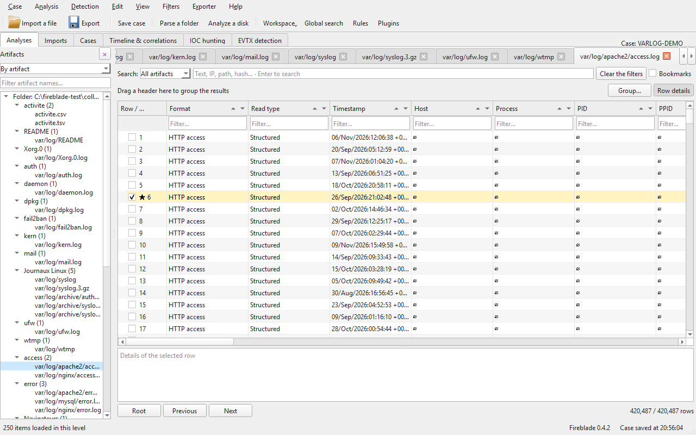
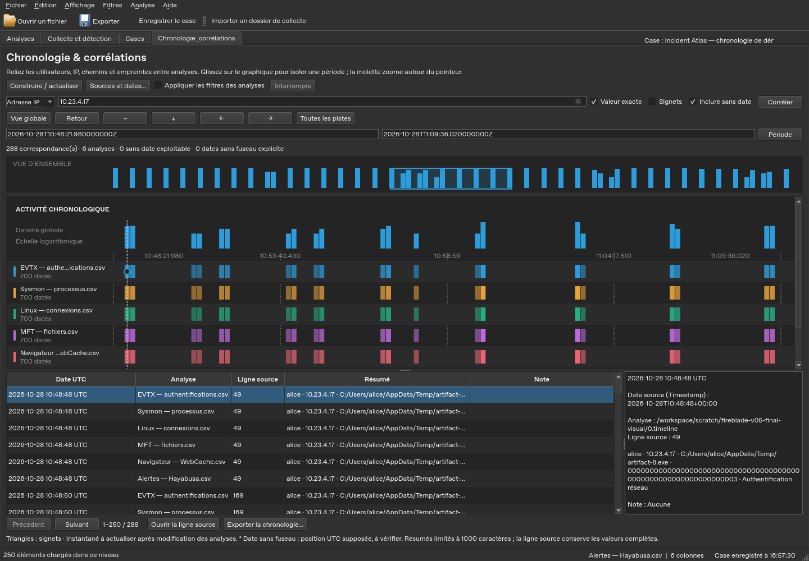

# Fireblade Desktop

The Windows edition: one executable, a window, no server. It parses a collected folder,
keeps every file accounted for, and puts the results in one workspace — filterable
tables, a cross-analysis timeline, IOC hunting, Hayabusa detections grouped into
findings, an attack graph, and a case that can be saved, archived and reopened.

**Current release: 0.7.9** — [download](https://github.com/23R0534ZXT/kogarasu/releases/download/v0.7.9/Fireblade-0.7.9-win64.zip) ·
[notes and SHA-256](https://github.com/23R0534ZXT/kogarasu/blob/main/docs/development/RELEASE-NOTES.md)

Windows x64, a folder to unzip, no installation: Python, Qt, the parsers and the .NET
readers are inside. The assistant is optional and downloaded separately, once.



*A workspace over synthetic Linux logs: artifact tree, table, per-column filters and row
details.*

## The documents

| | |
| --- | --- |
| [User guides](../guides) | the desktop's own guides, shipped inside the application |
| [Release notes](../development/RELEASE-NOTES.md) | what each version changed, and why |
| [Architecture](../development/ARCHITECTURE.md) | how the core, the parsers and the workspace fit together |
| [Plugins](../development/PLUGINS.md) | the column profiles and presentation plugins |
| [Screenshots](../assets) | every screen, with the demo animation |



*A timeline built from several analyses, with the source legend and the correlations.*

## Build and test

```powershell
python -m venv .venv
.venv/Scripts/python.exe -m pip install -e ".[dev]"
.venv/Scripts/python.exe -m scripts.dev_check    # version, lint, client syntax, window, full suite
```

The gate is the same command CI runs. `scripts/dev_check --quick` skips the suite.

## What the desktop has that the Host does not

The AI assistant, the .NET Timeline Explorer plugin, French, the window manager
(detach, dock, splash) and the file-manager gestures. The Host has the rest of the
feature set, in a browser — see [../host](../host).
