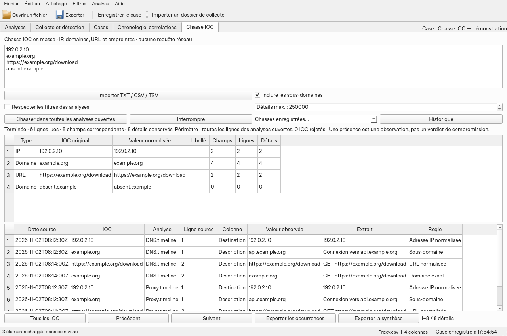

# Bulk IOC hunting

Open your analyses, then the **IOC Hunt** tab. Paste one indicator per line or import a TXT, CSV or TSV file. The CSV accepts the `type,value,label` columns (optional label). A [synthetic example](../../examples/ioc/indicators.csv) is provided. The import accepts UTF-8, UTF-16/32 with BOM and Windows-1252. Limits: 8 MiB, 50,000 entries, duplicates and rejections included.

Click **Hunt in all open analyses**. Every column and every row is scanned, unless **Respect the analysis filters** is checked. Duplicates are eliminated by type and normalized value. Invalid rows are counted and excluded; the import displays the first ten reasons. No DNS, HTTP or reputation service access is performed.

Types: IPv4/IPv6, domains, HTTP/HTTPS URLs, MD5, SHA-1, SHA-256 and SHA-512. IP addresses are normalized; hashes match their exact length, case-insensitively. Domains use IDNA and a full name boundary. The subdomain option includes `a.example.org` for `example.org`, never `example.org.attacker.test`. `*.example.org` requires a subdomain. The `hxxp`, `hxxps`, `[.]`, `(.)` and `[:]` forms are recognized. For URLs, the host name and the default port are normalized; the path, query and fragment remain case-sensitive. A trailing prose punctuation mark may be stripped, with an explicit rule in the result.

The upper table counts the **fields** and the **rows** for each IOC. An IOC present twice in the same field counts once; two fields of the same row count as two fields and one row. Click an IOC to isolate its details; **All IOCs** restores the list. Details are paginated by 250, kept on disk and limited to 250,000 by default (adjustable up to 5 million). Reading and counters continue past this limit; the occurrence export contains only the retained details. The retention order depends on the analysis read order.

Double-click an occurrence to open its original row in an analysis that is still open and unchanged. **Back to IOC Hunt** restores the previous view. The displayed date is the raw value of a recognized time column, without conversion or proof of chronological order. Excerpts may be shortened; the source remains intact.

The results indicate the scope, the unreadable analyses and the limited details. A `partial` hunt does not allow concluding an absence on the unread sources. Even a complete hunt covers only the imported data: it does not decode encoded content, does not inspect attachments and does not prove a network connection or a compromise. **Stop** cancels the new hunt and keeps the previous one.

**Export occurrences** and **Export summary** produce CSV or XLSX, with the SHA-256 of the normalized list and the limits. Occurrences comprise the analysis references, the imported source, its recorded hash and the source row. The summary also comprises the IOCs without a match and the rejections. Text is exported as values, never as XLSX formulas.

In a case folder, hunts are kept under `IOC-hunts` and can be viewed via **History**. Outside a case, they are temporary: export them before closing. The portable case carries the completed hunts and reassociates the analyses present in the case; references to closed analyses that were not carried are reported as missing. Observations and IOCs are never rewritten during transport. A hunt interrupted by an abrupt shutdown remains marked `running` and must be restarted; its counters do not represent a completed result.

Demonstration screenshot on Linux with offscreen Qt.
