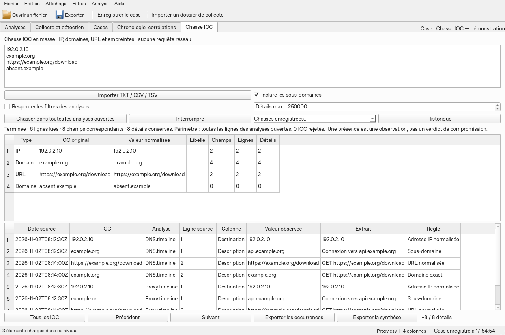

# Chasse IOC en masse

Ouvrez vos analyses, puis l’onglet **Chasse IOC**. Collez un indicateur par ligne ou importez un fichier TXT, CSV ou TSV. Le CSV accepte les colonnes `type,value,label` (libellé facultatif). Un [exemple synthétique](../../examples/ioc/indicators.csv) est fourni. L’import accepte UTF-8, UTF-16/32 avec BOM et Windows-1252. Limites : 8 Mio, 50 000 entrées, doublons et rejets compris.

Cliquez sur **Chasser dans toutes les analyses ouvertes**. Toutes les colonnes et toutes les lignes sont parcourues, sauf si **Respecter les filtres des analyses** est coché. Les doublons sont éliminés par type et valeur normalisée. Les lignes invalides sont comptées et exclues ; l’import affiche les dix premières raisons. Aucun accès DNS, HTTP ou service de réputation n’est réalisé.

Types : IPv4/IPv6, domaines, URL HTTP/HTTPS, MD5, SHA-1, SHA-256 et SHA-512. Les adresses IP sont normalisées ; les empreintes correspondent à leur longueur exacte, sans distinction de casse. Les domaines utilisent IDNA et une frontière de nom complète. L’option sous-domaines inclut `a.example.org` pour `example.org`, jamais `example.org.attacker.test`. `*.example.org` exige un sous-domaine. Les formes `hxxp`, `hxxps`, `[.]`, `(.)` et `[:]` sont reconnues. Pour les URL, le nom d’hôte et le port par défaut sont normalisés ; le chemin, la requête et le fragment restent sensibles à la casse. Une ponctuation finale de prose peut être retirée, avec une règle explicite dans le résultat.

Le tableau supérieur compte les **champs** et les **lignes** pour chaque IOC. Un IOC présent deux fois dans le même champ compte une seule fois ; deux champs de la même ligne comptent deux champs et une ligne. Cliquez sur un IOC pour isoler ses détails ; **Tous les IOC** rétablit la liste. Les détails sont paginés par 250, conservés sur disque et limités à 250 000 par défaut (réglable jusqu’à 5 millions). La lecture et les compteurs continuent après cette limite ; l’export des occurrences contient uniquement les détails conservés. L’ordre de conservation dépend de la lecture des analyses.

Double-cliquez sur une occurrence pour ouvrir sa ligne d’origine dans une analyse encore ouverte et inchangée. **Retour à la chasse IOC** restaure la vue précédente. La date affichée est la valeur brute d’une colonne temporelle reconnue, sans conversion ni preuve d’ordre chronologique. Les extraits peuvent être abrégés ; la source reste intacte.

Les résultats indiquent le périmètre, les analyses illisibles et les détails limités. Une chasse `partial` ne permet pas de conclure à une absence sur les sources non lues. Même une chasse complète ne couvre que les données importées : elle ne décode pas les contenus encodés, n’inspecte pas les pièces jointes et ne prouve pas une connexion réseau ou une compromission. **Interrompre** annule la nouvelle chasse et conserve la précédente.

**Exporter les occurrences** et **Exporter la synthèse** produisent CSV ou XLSX, avec le SHA-256 de la liste normalisée et les limites. Les occurrences comprennent les références d’analyse, la source importée, son empreinte enregistrée et la ligne source. La synthèse comprend aussi les IOC sans correspondance et les rejets. Les textes sont exportés comme valeurs, jamais comme formules XLSX.

Dans un dossier d’enquête, les chasses sont conservées sous `IOC-hunts` et consultables via **Historique**. Hors enquête, elles sont temporaires : exportez-les avant de fermer. Le case portable transporte les chasses terminées et réassocie les analyses présentes dans le case ; les références à des analyses fermées non transportées sont signalées comme manquantes. Les observations et IOC ne sont jamais réécrits pendant le transport. Une chasse interrompue par un arrêt brutal reste marquée `running` et doit être relancée ; ses compteurs ne représentent pas un résultat achevé.

Capture de démonstration sous Linux avec Qt hors écran.
