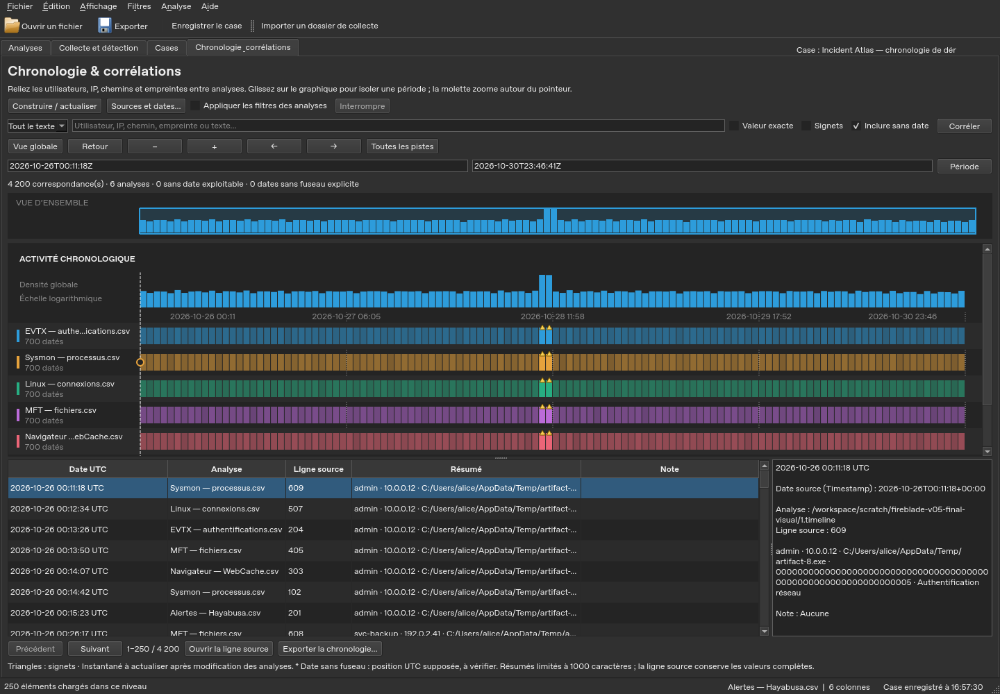
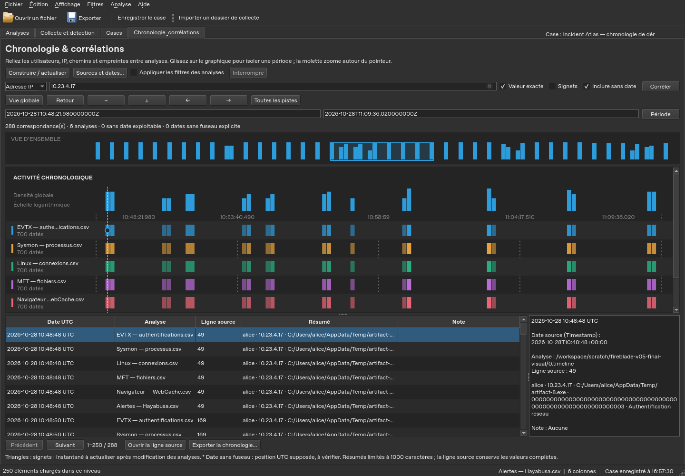

# Chronology, correlations and backups — Fireblade 0.5

These features use the analyses already imported. They do not launch any
additional collector or detection engine.

## Recovering work after an incident

In an open case, automatic backup is enabled by default every two minutes. It
waits for in-progress operations to finish. The **File → Automatic case backup
(2 min)** menu lets you disable it; this choice is kept in the workstation
preferences. The permanent **Save case** button remains available.

The **last ten session versions** are retained. In **Cases**, select an
investigation, then **History / recovery…**, choose a version and click
**Restore this version**. The active tab, the analysis references, the filters,
the layouts and the case metadata are restored. If `case.json` is damaged and a
valid version exists, the case is still offered in the catalogue for that
recovery.

The history is lightweight: it **does not copy the databases or their previous
annotations**. Bookmarks and notes are saved in the databases; restoring a
session does not cancel them. The referenced databases must be kept. A version
with a missing analysis does not replace the current case. The last successful
backup is displayed; an automatic failure stays reported in the status bar.
Sessions remain limited to 1000 analyses and 4 MiB.

## Transporting the current state of a case

1. Open the case, then **File → Export portable case…**.
2. Choose whether to include the source files of the available analyses: CSV,
   spreadsheets or entries from compatible drives. This can greatly increase
   the size of the archive.
3. Save the **`.fireblade-case`** file outside the collection folder.
4. On the destination workstation, use **Import portable case…**. Open the new
   case from the catalogue.

The archive contains the databases with their annotations and views, the current
session, the collection results and reports and the timeline settings. CSV files
already present in a collection's results are transported with that folder, even
if the other sources are not included. Unavailable sources or collections are
counted in the result. Previous history versions are not duplicated in this
archive.

Each file has a size and a SHA-256 hash. The archive is re-read before replacing
any destination file; its hashes are verified again on import. The import
creates a **new case**, reassigns the paths and preserves the original values of
the events. The links of the retained EVTX contexts remain resolved to the
transported analyses. Filters on a path present in the data keep their original
value.

The raw artefacts of a collection, its collector and the .NET plugins are not
automatically grouped with its results. Keep the originals to rerun the parsers
or Hayabusa. The DLLs require installation and approval on the new workstation.
Archive hashes detect file tampering; they are not a signature of the author.

Links, dangerous paths and name collisions incompatible with Windows are
refused or reported. Limits: 50,000 files, 64 GiB decompressed, a 16 MiB
manifest and 16 MiB of collection references. A failure or cancellation keeps
the previous destination and cleans up the temporary files.

## Exploring a graphical timeline

1. Open the investigation's analyses, then the **Timeline & correlations** tab.
2. In **Sources and dates…**, check the time column of each analysis. Dates are
   suggested from the column names and the profiles, an explicit UTC column
   (`Horodatage UTC`, `TimestampUtc`) taking precedence over the raw column it is
   derived from; you can choose another column, including a computed UTC column.
   A date **without a time zone** is read as **UTC**, on every machine: the
   timeline stays identical from one workstation to another. The affected rows
   are counted separately and flagged as such in the index and in the export.
3. Click **Build / refresh**. A progress indicator shows the analyses read and
   the events indexed. **Stop** keeps the previous index.
4. Examine the overall density and the per-analysis tracks. Triangles mark the
   buckets containing bookmarks; selecting a row in the table places a marker on
   the chart.

Synthetic capture: 4,200 events spread over six analyses, on Linux with Qt
offscreen. This is not a capture of the real Windows EXE.

| Gesture or button | Effect |
|---|---|
| Mouse wheel on the chart | Zoom around the pointer |
| Drag on the chart | Isolate a period |
| − / + | Zoom out / zoom in |
| ← / → | Move the time window |
| Click the overview | Recentre the time window |
| Back | Return to the previous period |
| Global view | Fit the period to all matches of the current filter |
| Click a track name | Isolate that analysis |
| All tracks | Remove that analysis filter |
| Period | Apply the stated ISO bounds; the end bound is inclusive |
| Double-click a row / Open source row | Find the event in Analyses |
| Return to timeline | Restore the analysis view from before the jump to the source |
| Export timeline… | Export all matches of the last applied filter |

Density is logarithmic: it makes peaks and infrequent activity easier to read.
The height or intensity of a track is not a severity assessment. The table loads
250 rows per page; the counts, the chart and the export cover the whole scope,
not just that page.

Zoned dates are placed in UTC with an integer key at nanosecond resolution. The
source value remains available, in particular if its precision differs.
**A date without an explicit time zone is positioned as UTC and marked `*`**:
this does not prove that the source was in UTC. For a known local date, first
create a UTC column with **Analysis → Calculations and conversions → Convert a
date…**, then choose that column. No FILETIME or epoch numeric format is guessed
automatically in the timeline.

Rows without a usable date remain viewable with **Include undated** and
searchable by entity, but are not drawn in the density. Read errors remain
explicit; **Sources and dates…** shows the state of each analysis. The index is
a temporary snapshot on disk: refresh it after a change of analyses, notes or
bookmarks. Column settings, the search, the tracks and the period are kept with
the case, then reapplied when the index is rebuilt.

## Correlating artefacts

A cell's context menu offers **Correlate across all analyses**. It opens the
timeline with that value. You can also type a value directly into the search
bar:

- **User**, **IP address**, **Path**, **Hash** target the columns whose names
  match those families.
- **All text** searches across all the values of each event and suits schemas
  that have no recognised column name.
- **Exact value** compares the full field, ignoring case; otherwise, the value is
  searched as a substring. Identities, IPv6 addresses, domain prefixes and paths
  are not canonicalized automatically.
- **Bookmarks** limits the results to the rows marked at indexing time.
- **Apply analysis filters** is taken into account on the next build; without
  this option, all imported rows take part.

Click **Correlate**, then explore the common periods and sources. A common value
or temporal proximity is a lead; it does not demonstrate an identity or a causal
relationship. The Summary column and its export are limited to 1000 characters
per event; the source row keeps the full fields and the exact identifiers.

The same synthetic demonstration, after searching for an IP and zooming into a
period.

## Producing an HTML or PDF report

Use **File → Create an HTML / PDF report…**, enter a title and your summary, then
choose the scope. By default, only bookmarks and notes are included, with the
filters of each analysis. The selection option includes the currently selected
rows, even if they are not marked.

The report keeps the values, notes, row numbers, analysis paths and SHA-256
hashes **recorded at import**. It does not claim to have re-verified the source
files. The filters are described in plain language. It does not execute the HTML
present in the values and adds no automatic conclusion.

The **Add the current graphical timeline view** option includes the visible part
of the chart, its applied filter and its period. Tracks off-screen are not
included in this capture. The image reflects the timeline snapshot, which may
predate an annotation added afterwards.

Choose HTML for a self-contained document that can be viewed offline, or PDF for
sharing and printing. Unavailable analyses and reached limits are flagged in the
report. Limits: 2,000 findings by default, 10,000 maximum, 20,000 characters
displayed per cell and 16 million characters for the document. Reduce the scope
for a more readable report. A failed export does not replace a previous report.
