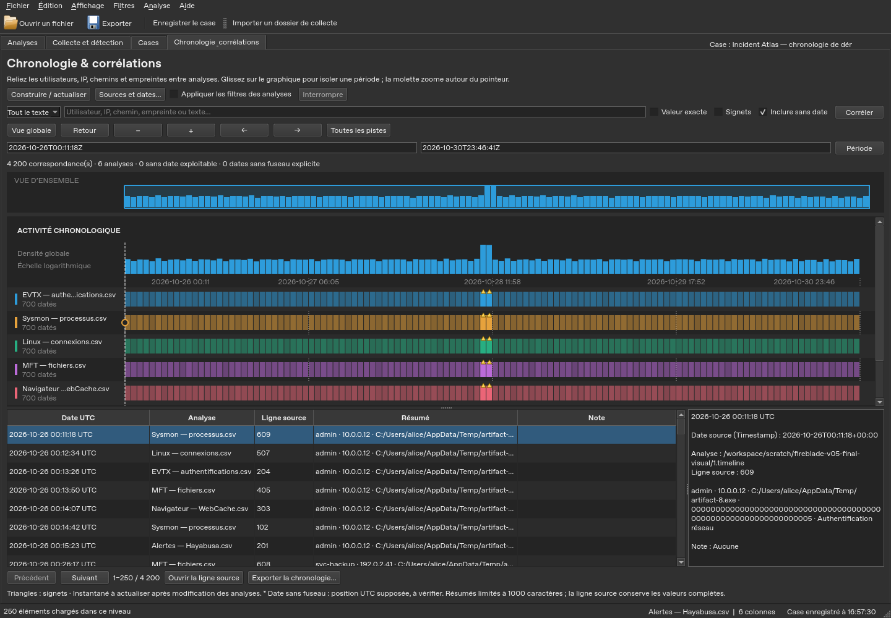
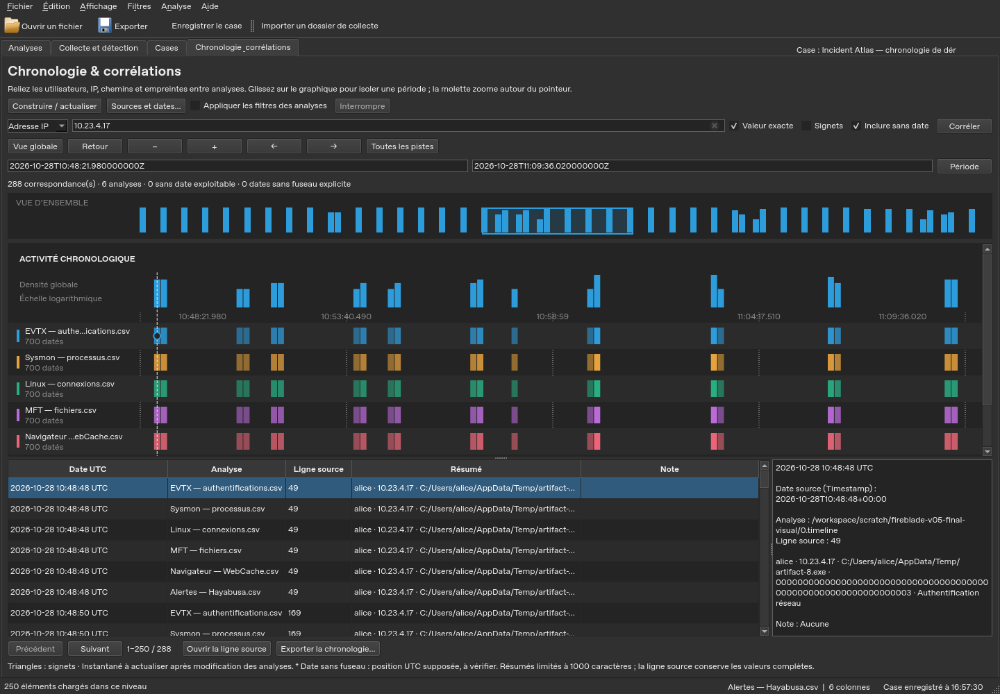

# Chronologie, corrélations et sauvegardes — Fireblade 0.5

Ces fonctions utilisent les analyses déjà importées. Elles ne lancent aucun
collecteur ni moteur de détection supplémentaire.

## Retrouver le travail après un incident

Dans un case ouvert, la sauvegarde automatique est activée par défaut toutes les
deux minutes. Elle attend que les opérations en cours soient terminées. Le menu
**Fichier → Sauvegarde automatique du case (2 min)** permet de la désactiver ;
ce choix est conservé dans les préférences du poste. Le bouton permanent
**Enregistrer le case** reste disponible.

Les **dix dernières versions de session** sont conservées. Dans **Cases**,
sélectionnez une enquête, puis **Historique / récupération…**, choisissez une
version et cliquez sur **Restaurer cette version**. L’onglet actif, les références
aux analyses, les filtres, les dispositions et les métadonnées du case sont
retrouvés. Si `case.json` est endommagé et qu’une version valide existe, le case
reste proposé dans le catalogue pour cette récupération.

L’historique est léger : il **ne copie pas les bases ni leurs anciennes
annotations**. Les signets et notes sont enregistrés dans les bases ; restaurer
une session ne les annule pas. Il faut conserver les bases référencées. Une
version dont une analyse a disparu ne remplace pas le case courant. Le dernier
succès de sauvegarde est affiché ; un échec automatique reste signalé dans la
barre d’état. Les sessions restent limitées à 1000 analyses et 4 Mio.

## Transporter l’état courant d’un case

1. Ouvrez le case, puis **Fichier → Exporter le case portable…**.
2. Choisissez si vous souhaitez inclure les fichiers sources des analyses
   disponibles : CSV, tableurs ou entrées de lecteurs compatibles. Cela peut
   augmenter fortement la taille de l’archive.
3. Enregistrez le fichier **`.fireblade-case`** hors du dossier de collecte.
4. Sur le poste de destination, utilisez **Importer un case portable…**. Ouvrez
   le nouveau case depuis le catalogue.

L’archive contient les bases avec leurs annotations et vues, la session courante,
les résultats et rapports des collectes et les réglages de chronologie. Les
CSV déjà présents dans les résultats d’une collecte sont transportés avec ce
dossier, même si les autres sources ne sont pas incluses. Les sources ou
collectes indisponibles sont comptées dans le résultat. Les anciennes versions
de l’historique ne sont pas dupliquées dans cette archive.

Chaque fichier a une taille et une empreinte SHA-256. L’archive est relue avant
de remplacer un éventuel fichier de destination ; ses empreintes sont à nouveau
vérifiées à l’import. L’import crée un **nouveau case**, réaffecte les chemins et
préserve les valeurs originales des événements. Les liens des contextes EVTX
conservés restent résolus vers les analyses transportées. Les filtres portant
sur un chemin présent dans les données gardent leur valeur d’origine.

Les artefacts bruts d’une collecte, son collecteur et les plugins .NET ne sont
pas automatiquement regroupés avec ses résultats. Conservez les originaux
pour relancer les parseurs ou Hayabusa. Les DLL nécessitent leur installation
et leur approbation sur le nouveau poste. Les empreintes d’archive détectent une
altération des fichiers ; elles ne constituent pas une signature de l’auteur.

Les liens, chemins dangereux et collisions de noms incompatibles avec Windows
sont refusés ou signalés. Limites : 50 000 fichiers, 64 Gio décompressés,
manifeste de 16 Mio et références de collecte de 16 Mio. Un échec ou une
annulation conserve la destination précédente et nettoie les fichiers temporaires.

## Explorer une chronologie graphique

1. Ouvrez les analyses de l’enquête, puis l’onglet **Chronologie & corrélations**.
2. Dans **Sources et dates…**, vérifiez la colonne temporelle de chaque analyse.
   Les dates sont proposées d’après les noms des colonnes et les profils ; vous
   pouvez choisir une autre colonne, y compris une colonne UTC calculée.
3. Cliquez sur **Construire / actualiser**. Une progression indique les analyses
   lues et les événements indexés. **Interrompre** conserve l’index précédent.
4. Examinez la densité globale et les pistes par analyse. Les triangles
   signalent les tranches contenant des signets ; sélectionner une ligne dans
   le tableau place un repère sur le graphique.

Capture synthétique : 4200 événements répartis sur six analyses, sous Linux
avec Qt hors écran. Ce n’est pas une capture du véritable EXE Windows.

| Geste ou bouton | Effet |
|---|---|
| Molette sur le graphique | Zoom autour du pointeur |
| Glisser sur le graphique | Isoler une période |
| − / + | Dézoomer / zoomer |
| ← / → | Déplacer la fenêtre temporelle |
| Cliquer la vue d’ensemble | Recentrer la fenêtre temporelle |
| Retour | Retrouver la période précédente |
| Vue globale | Ajuster la période à toutes les correspondances du filtre courant |
| Cliquer le nom d’une piste | Isoler cette analyse |
| Toutes les pistes | Retirer ce filtre d’analyse |
| Période | Appliquer les bornes ISO indiquées ; la borne de fin est incluse |
| Double-cliquer une ligne / Ouvrir la ligne source | Retrouver l’événement dans Analyses |
| Revenir à la chronologie | Restaurer la vue de l’analyse avant le saut à la source |
| Exporter la chronologie… | Exporter toutes les correspondances du dernier filtre appliqué |

La densité est logarithmique : elle facilite la lecture des pics et des activités
peu fréquentes. La hauteur ou l’intensité d’une piste ne constitue pas une
évaluation de gravité. Le tableau charge 250 lignes par page ; les comptes, le
graphique et l’export portent sur tout le périmètre, pas seulement sur cette page.

Les dates zonées sont placées en UTC avec une clé entière à la nanoseconde. La
valeur source reste disponible, notamment si sa précision est différente.
**Une date sans fuseau explicite est positionnée comme UTC et marquée `*`** :
cela ne prouve pas que la source était en UTC. Pour une date locale connue,
créez d’abord une colonne UTC avec **Analyse → Calculs et conversions → Convertir
une date…**, puis choisissez cette colonne. Aucun format numérique FILETIME ou
epoch n’est deviné automatiquement dans la chronologie.

Les lignes sans date exploitable restent consultables avec **Inclure sans date**
et recherchables par entité, mais ne sont pas dessinées dans la densité. Les
erreurs de lecture restent explicites ; **Sources et dates…** présente l’état de
chaque analyse. L’index est un instantané temporaire sur disque : actualisez-le
après un changement d’analyses, de notes ou de signets. Les réglages de colonnes,
la recherche, les pistes et la période sont conservés avec le case, puis
réappliqués à la reconstruction de l’index.

## Corréler les artefacts

Le menu contextuel d’une cellule propose **Corréler dans toutes les analyses**.
Il ouvre la chronologie avec cette valeur. Vous pouvez aussi saisir directement
une valeur dans la barre de recherche :

- **Utilisateur**, **Adresse IP**, **Chemin**, **Empreinte** ciblent les colonnes
  dont les noms correspondent à ces familles.
- **Tout le texte** cherche dans l’ensemble des valeurs de chaque événement et
  convient aux schémas qui n’ont pas de nom de colonne reconnu.
- **Valeur exacte** compare le champ complet, sans tenir compte des majuscules ;
  sinon, la valeur est recherchée comme sous-chaîne. Les identités, adresses IPv6,
  préfixes de domaine et chemins ne sont pas canonicalisés automatiquement.
- **Signets** limite les résultats aux lignes marquées au moment de l’indexation.
- **Appliquer les filtres des analyses** est pris en compte lors de la prochaine
  construction ; sans cette option, toutes les lignes importées participent.

Cliquez sur **Corréler**, puis explorez les périodes et sources communes. Une
valeur commune ou une proximité temporelle est une piste ; elle ne démontre pas
une identité ou une relation causale. La colonne Résumé et son export sont
limités à 1000 caractères par événement ; la ligne source conserve les champs
complets et les identifiants exacts.

La même démonstration synthétique, après recherche d’une IP et zoom sur une période.

## Produire un rapport HTML ou PDF

Utilisez **Fichier → Créer un rapport HTML / PDF…**, saisissez un titre et votre
synthèse, puis choisissez le périmètre. Par défaut, seuls les signets et notes
sont inclus, avec les filtres de chaque analyse. L’option de sélection inclut
les lignes actuellement sélectionnées, même si elles ne sont pas marquées.

Le rapport conserve les valeurs, notes, numéros de ligne, chemins des analyses
et empreintes SHA-256 **enregistrées à l’import**. Il ne prétend pas avoir
revérifié les fichiers sources. Les filtres sont décrits en clair. Il n’exécute
pas le HTML présent dans les valeurs et n’ajoute aucune conclusion automatique.

L’option **Ajouter la vue graphique courante de la chronologie** intègre la
partie visible du graphique, son filtre appliqué et sa période. Les pistes hors
de l’écran ne sont pas incluses dans cette capture. L’image reflète l’instantané
de chronologie, qui peut précéder une annotation ajoutée ensuite.

Choisissez HTML pour un document autonome consultable hors ligne, ou PDF pour
le partage et l’impression. Les analyses indisponibles et limites atteintes sont
signalées dans le rapport. Limites : 2000 constats par défaut, 10 000 maximum,
20 000 caractères affichés par cellule et 16 millions de caractères pour le
document. Réduisez le périmètre pour un rapport plus lisible. Un export échoué
ne remplace pas un rapport précédent.
