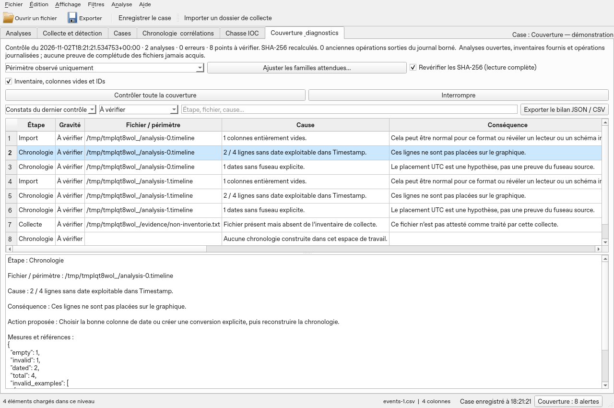

# Coverage audit and diagnostics

The **Coverage & diagnostics** tab links collection, import, analysis, chronology, IOC hunting and exports. The permanent **Coverage** button in the status bar opens the causes, consequences and proposed corrections. It distinguishes the findings of the last check from the history of operations: an earlier incident is not proof that the problem still exists.

## Automatic checks during operations

- **Collection / import**: overall status, inventoried files without complete success, reader errors and warnings. Data import preserves the row count and the fingerprint already verified before and after reading. An empty import remains reported. Task errors, including those with a custom handler, are recorded in the history.
- **Analysis**: query or read errors remain visible with their message. A filtered view may have a smaller scope than the number of imported rows; that choice is not treated as data loss.
- **Chronology**: after the build, the journal reports dated events, undated events, dates without an explicit time zone and failed analyses. Indexing filters are preserved. A date without a time zone is positioned as UTC by assumption.
- **IOC hunting**: partial results, rejected IOCs and capped details are reported. A complete count does not mean that all details are present in the export.
- **CSV/XLSX data exports, bookmarks, chronology and IOC**: the expected number of results is compared with the number passed to the writer. The temporary file is then **reopened and read back**: schema, row count and canonical fingerprint of the text values must match. The file's SHA-256 is computed before atomic replacement. A loss, a modification or an error preserves the previous destination. For XLSX, each sheet has its own header; rows are counted across all sheets. This read-back adds time and input/output for large exports.
- **HTML/PDF reports**: failed analyses, findings omitted by the cap and abbreviated cells are counted. The last coverage check is attached as a snapshot, with its date and its possible “needs refresh” status; only the first hundred problems are detailed there. Without a prior check, the report says so. The portable archive remains fully verified and reports its sources that are not included.

Technical causes remain preserved: access denied, missing source, full disk, memory, encoding, CSV structure, different fingerprint, interruption. The proposed actions guide the correction; they do not replace the reader's complete log. Errors already displayed do not trigger a second series of windows.

## Checking all coverage

Open the investigation's analyses, then click **Check all coverage**. The check runs in the background and can be interrupted. An interruption does not replace the previous audit.

1. **Sources**: existence, accessibility and recorded size. Select **Recheck SHA-256** to read back the content of available sources and of the latest exports with a receipt. Without this option, recorded fingerprints are not presented as rechecked. Symbolic links are not followed during this check.
2. **Databases and views**: opening of each analysis, match between its metadata and the snapshot, rows declared at import, rows actually read, rows retained by the view. Empty analyses and views without results are explicit.
3. **Deep check**: enable **Inventory, empty columns and IDs** to verify the uniqueness and range of row identifiers and fully empty columns. An empty column can be legitimate; compare it with the reader's schema. The source folder of each collection is inventoried again: files present but never inventoried, unreadable paths and symbolic directories are reported. The examination stops at 200,000 files per folder, with an explicit limit.
4. **Time coverage**: the column configured in the current index, or a recognized column as a fallback, is tested on **all imported rows**. The audit distinguishes absent dates, unconvertible dates, usable dates and missing time zones. Up to five invalid values are provided with their row number. No FILETIME or numeric epoch is guessed. A missing index, unindexed analyses, a change of scope or of filtered views and the hiding of undated events are reported. Bookmarks, notes, columns and calculated definitions are also compared with their fingerprint at indexing time.
5. **Inventories and readers**: all inventories attached to the case are checked, not only the last displayed collection. Ignored, unrecognized, interrupted, output-less or failed files, reader warnings, unprocessed CatScale or LinuxLogs members, missing outputs and closed collection analyses are exposed. A closed analysis can exist on disk without taking part in the current hunting or chronology.
6. **Expected families**: the default profile covers only what is observed. The Windows and Linux profiles offer broader expectations. **Adjust expected families…** lets you select only the families planned in your plan. The plan is saved with the investigation. Windows families correspond to artifact readers; Linux also distinguishes CatScale output families. An expected family that is not observed is a point to check, never proof of absence on the host.
7. **Existing exports**: with SHA-256 enabled, the latest receipt for each path is compared with the current file. A more recent export at the same path replaces the previous reference for this check; older receipts remain in the history. Missing, modified or unreadable files are reported.

Filter findings by severity or search for a stage, a file or a cause. Select a row to read the exact measurements and the proposed action. **Export the audit JSON / CSV** produces a standalone audit: JSON also contains the per-analysis metrics, the plan and the history; CSV contains the findings and the operations. The export preserves the “needs refresh” status if it relies on an older check.

## Retention and limits

In a case, the `coverage-state.json` journal and the last audit `coverage-last.json` are saved and transported with the portable case. References are rebound at import, without rewriting the causes or the data samples. An audit loaded after reopening remains **needs refresh**. External exports are not added to the archive automatically. Outside a case, diagnostics remain in memory: export them before closing.

The journal keeps a maximum of 2,000 operations and about 7 MiB of content; earlier entries pushed out of the journal are counted. The details of a very large operation can be explicitly abbreviated, while preserving the essential fields of the export receipt. The last audit is limited to 32 MiB. The first 20,000 detailed findings of the check are kept; counters cover all findings and any omission is reported. The scope remains limited to 1,000 analyses. An unreadable journal or audit is not silently replaced. Save failures remain reported.

This check does not demonstrate that all the files of a machine were acquired. Without a collection plan or an independent inventory, files never collected, absent hosts, complete log retention and expected periods cannot be deduced from the data present. It also does not validate the internal accuracy of each parser, the host clock or the content of an unsupported artifact. A “completed” treatment indicates its technical end; coverage findings state what was actually checked and what remains unknown.

Synthetic capture on Linux with Qt offscreen; it does not qualify the Windows EXE.

The `/var/log/` logs have the **Expected Linux /var/log/ logs** profile. See the [LinuxLogs reader formats and limits](JOURNAUX-LINUX.md).
