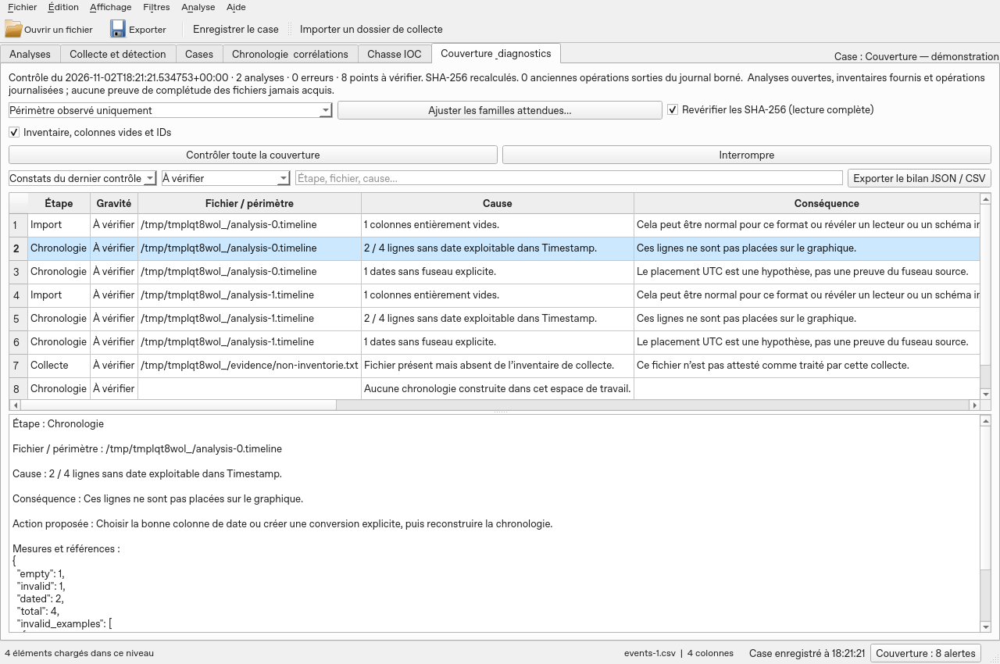

# Contrôle de couverture et diagnostics

L’onglet **Couverture & diagnostics** relie la collecte, l’import, l’analyse, la chronologie, la chasse IOC et les exports. Le bouton permanent **Couverture** dans la barre d’état ouvre les causes, conséquences et corrections proposées. Il distingue les constats du dernier contrôle et l’historique des opérations : un ancien incident n’est pas une preuve que le problème existe encore.

## Contrôles automatiques pendant les opérations

- **Collecte / import** : état global, fichiers inventoriés sans réussite complète, erreurs et avertissements des lecteurs. L’import de données conserve le nombre de lignes et l’empreinte déjà vérifiée avant et après lecture. Un import vide reste signalé. Les erreurs des tâches, y compris celles ayant un gestionnaire personnalisé, sont historisées.
- **Analyse** : les erreurs de requête ou de lecture restent visibles avec leur message. Une vue filtrée peut avoir un périmètre inférieur au nombre de lignes importées ; ce choix n’est pas assimilé à une perte de données.
- **Chronologie** : après construction, le journal indique les événements datés, les événements sans date, les dates sans fuseau explicite et les analyses en erreur. Les filtres d’indexation sont conservés. Une date sans fuseau est positionnée comme UTC par hypothèse.
- **Chasse IOC** : les résultats partiels, IOC rejetés et détails plafonnés sont signalés. Un compteur complet n’implique pas que tous les détails sont présents dans l’export.
- **Exports de données CSV/XLSX, signets, chronologie et IOC** : le nombre de résultats attendu est comparé au nombre transmis au rédacteur. Le fichier temporaire est ensuite **rouvert et relu** : schéma, nombre de lignes et empreinte canonique des valeurs textuelles doivent correspondre. Le SHA-256 du fichier est calculé avant remplacement atomique. Une perte, une modification ou une erreur conserve la destination précédente. Pour XLSX, chaque feuille possède son en-tête ; les lignes sont comptées sur toutes les feuilles. Cette relecture ajoute du temps et des entrées/sorties pour les gros exports.
- **Rapports HTML/PDF** : analyses en erreur, constats omis par le plafond et cellules abrégées sont comptés. Le dernier contrôle de couverture est joint comme instantané, avec sa date et son éventuel état « à actualiser » ; seuls les cent premiers problèmes y sont détaillés. Sans contrôle préalable, le rapport l’indique. L’archive portable reste vérifiée intégralement et signale ses sources non incluses.

Les causes techniques restent conservées : accès refusé, source manquante, disque plein, mémoire, encodage, structure CSV, empreinte différente, interruption. Les actions proposées orientent la correction ; elles ne remplacent pas le journal complet du lecteur. Les erreurs déjà affichées ne déclenchent pas une seconde série de fenêtres.

## Contrôler toute la couverture

Ouvrez les analyses de l’enquête, puis cliquez sur **Contrôler toute la couverture**. Le contrôle s’effectue en arrière-plan et peut être interrompu. Une interruption ne remplace pas le bilan précédent.

1. **Sources** : existence, accessibilité et taille enregistrée. Cochez **Revérifier les SHA-256** pour relire le contenu des sources disponibles et les derniers exports disposant d’un reçu. Sans cette option, les empreintes enregistrées ne sont pas présentées comme revérifiées. Les liens symboliques ne sont pas suivis pendant ce contrôle.
2. **Bases et vues** : ouverture de chaque analyse, correspondance de ses métadonnées avec l’instantané, lignes déclarées à l’import, lignes réellement lues, lignes retenues par la vue. Les analyses vides et les vues sans résultat sont explicites.
3. **Contrôle approfondi** : activez **Inventaire, colonnes vides et IDs** pour vérifier l’unicité et la plage des identifiants de lignes et les colonnes entièrement vides. Une colonne vide peut être légitime ; il faut comparer avec le schéma du lecteur. Le dossier source de chaque collecte est inventorié à nouveau : fichiers présents mais jamais inventoriés, chemins illisibles et dossiers symboliques sont signalés. L’examen s’arrête à 200 000 fichiers par dossier, avec une limite explicite.
4. **Couverture temporelle** : la colonne configurée dans l’index courant, ou une colonne reconnue à défaut, est testée sur **toutes les lignes importées**. Le bilan distingue dates absentes, dates non convertibles, dates exploitables et fuseaux absents. Jusqu’à cinq valeurs invalides sont fournies avec leur numéro de ligne. Aucun FILETIME ou epoch numérique n’est deviné. Un index absent, des analyses non indexées, un changement de périmètre ou de vues filtrées et le masquage des événements sans date sont signalés. Les signets, notes, colonnes et définitions calculées sont aussi comparés à leur empreinte lors de l’indexation.
5. **Inventaires et lecteurs** : tous les inventaires rattachés au case sont contrôlés, pas seulement la dernière collecte affichée. Les fichiers ignorés, non reconnus, interrompus, sans sortie ou en erreur, les avertissements des lecteurs, les membres CatScale ou LinuxLogs non traités, les sorties disparues et les analyses de collecte fermées sont exposés. Une analyse fermée peut exister sur disque sans participer à la chasse ou à la chronologie courante.
6. **Familles attendues** : le profil par défaut porte uniquement sur ce qui est observé. Les profils Windows et Linux proposent des attentes plus larges. **Ajuster les familles attendues…** permet de cocher seulement les familles prévues dans votre plan. Le plan est enregistré avec l’enquête. Les familles Windows correspondent aux lecteurs d’artefacts ; Linux distingue aussi les familles de sorties CatScale. Une famille attendue non observée est un point à vérifier, jamais une preuve d’absence sur l’hôte.
7. **Exports existants** : avec les SHA-256 activés, le dernier reçu de chaque chemin est comparé au fichier actuel. Un export plus récent au même chemin remplace la référence précédente pour ce contrôle ; les anciens reçus restent dans l’historique. Les fichiers absents, modifiés ou illisibles sont signalés.

Filtrez les constats par gravité ou recherchez une étape, un fichier ou une cause. Sélectionnez une ligne pour lire les mesures exactes et l’action proposée. **Exporter le bilan JSON / CSV** produit un bilan autonome : JSON contient aussi les métriques par analyse, le plan et l’historique ; CSV contient les constats et les opérations. L’export conserve l’état « à actualiser » s’il s’appuie sur un ancien contrôle.

## Conservation et limites

Dans un case, le journal `coverage-state.json` et le dernier bilan `coverage-last.json` sont sauvegardés et transportés avec le case portable. Les références sont réaffectées à l’import, sans réécrire les causes ou les exemples de données. Un bilan chargé après réouverture reste **à actualiser**. Les exports externes ne sont pas ajoutés automatiquement à l’archive. Hors case, les diagnostics restent en mémoire : exportez-les avant de fermer.

Le journal conserve au maximum 2 000 opérations et environ 7 Mio de contenu ; les anciennes entrées sorties du journal sont comptées. Les détails d’une opération très volumineuse peuvent être abrégés explicitement, en préservant les champs essentiels du reçu d’export. Le dernier bilan est limité à 32 Mio. Les 20 000 premiers constats détaillés du contrôle sont conservés ; les compteurs portent sur l’ensemble des constats et toute omission est signalée. Le périmètre reste limité à 1 000 analyses. Un journal ou bilan illisible n’est pas silencieusement remplacé. Les échecs de sauvegarde restent signalés.

Ce contrôle ne démontre pas que tous les fichiers d’une machine ont été acquis. Sans plan de collecte ou inventaire indépendant, les fichiers jamais collectés, les hôtes absents, la rétention complète des journaux et les périodes attendues ne sont pas déductibles des données présentes. Il ne valide pas non plus l’exactitude interne de chaque parseur, l’horloge de l’hôte ou le contenu d’un artefact non pris en charge. Un traitement « terminé » indique sa fin technique ; les constats de couverture précisent ce qui a réellement été vérifié et ce qui reste inconnu.

Capture synthétique sous Linux avec Qt hors écran ; elle ne qualifie pas l’EXE Windows.

Les journaux `/var/log/` disposent du profil **Journaux Linux /var/log/ attendus**. Voir les [formats et limites du lecteur LinuxLogs](JOURNAUX-LINUX.md).
