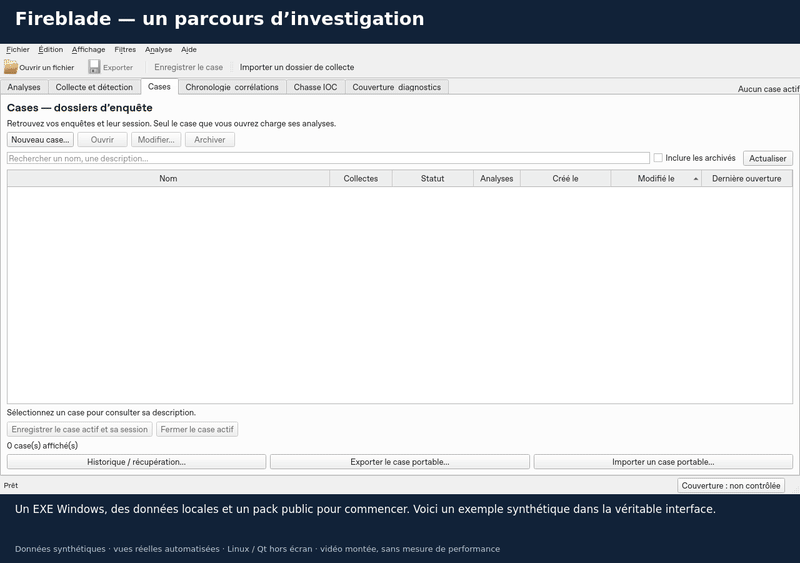

# Fireblade en 75 secondes

[Télécharger / lire la vidéo MP4](../assets/fireblade-demo.mp4)

[](../assets/fireblade-demo.mp4)

Une visite commentée à partir de vues réellement produites par l’application : ouvrir des données, filtrer, conserver une piste, construire une chronologie, chasser un IOC, sauvegarder et générer un rapport.

| Temps | Étape |
|---|---|
| 00:00 | Présentation de l’espace d’investigation |
| 00:08 | Import d’un export synthétique dans un dossier d’enquête |
| 00:18 | Filtre sur l’utilisateur alice : quatre lignes sur six |
| 00:28 | Signet et note conservés dans la base |
| 00:38 | Construction de la chronologie et liens vers les sources |
| 00:48 | Recherche locale de l’adresse de documentation 192.0.2.10 |
| 01:00 | Sauvegarde du dossier et génération réelle d’un rapport HTML contenant la note |
| 01:10 | Invitation à essayer le pack et à donner un retour |

## Contexte de capture

Cette vidéo est **montée à partir de captures de l’interface réelle**, avec des opérations automatisées sous **Linux / Qt hors écran**. Les durées des plans sont choisies pour lire les explications ; ce ne sont pas des mesures de performance ni un enregistrement de gestes humains sous Windows.

Les six lignes sont synthétiques, les noms et machines sont fictifs, et 192.0.2.10 est une adresse de documentation. Le script vérifie les comptages, crée réellement l’index chronologique et la chasse IOC, enregistre la session et produit le rapport. Il ne simule pas une exécution des parseurs Windows ou de Hayabusa.

Le MP4 dure 75 secondes. Le GIF est un aperçu accéléré. Le parcours des parseurs Windows et les contrôles du véritable EXE sont documentés séparément dans [la validation Windows](../validation/WINDOWS.md).

## Reproduire

Depuis les sources et leur environnement de développement, installer aussi `ffmpeg`, puis choisir un dossier de sortie inexistant :

```sh
QT_QPA_PLATFORM=offscreen PYTHONPATH=src python -m scripts.presentation.demo --out /tmp/fireblade-demo
```

Le script isole le profil utilisateur dans un dossier temporaire. Il produit les captures, le MP4, le GIF et un manifeste des chapitres. Les exports et bases synthétiques temporaires sont supprimés à la fin.
