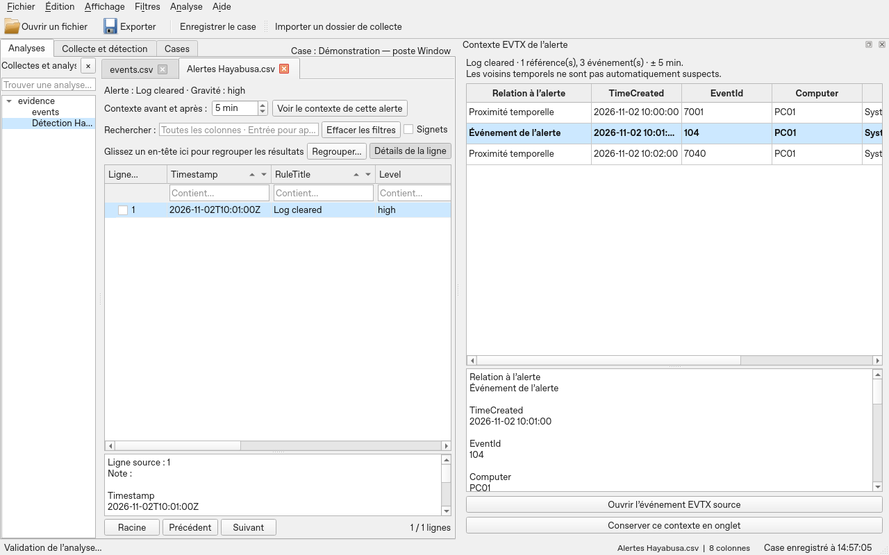
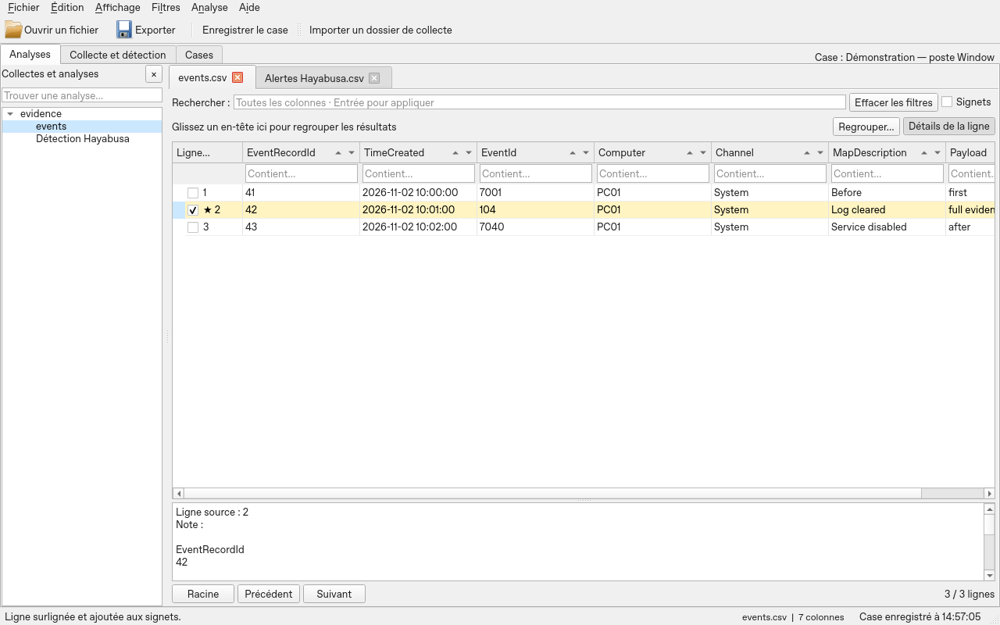

# Complete tutorial — all Fireblade features

This tutorial describes the current Fireblade path: persistent cases, Windows and Linux CatScale collections, parsing, Shellbags, WebCache, Hayabusa detection, EVTX context and results exploration. It offers learning with the downloadable test pack, then a reference for filters, rules, expressions, profiles, plugins, backups and limits. It is accessible without an open analysis via **Help → Complete tutorial — all Fireblade features**.

Start with your entry path, then use the reference sections as needed. Commands that depend on an analysis stay inactive while no analysis is open. The Windows engines require the Windows build pack. The CatScale parser is built in without an external engine.

## Table of contents

- [Getting started](#getting-started)
- [First investigation with the test pack](#first-investigation-with-the-test-pack)
- [Cases — investigation folders](#cases--investigation-folders)
- [Timeline, recovery and reports](#timeline-recovery-and-reports)
- [Finding your way around the window](#finding-your-way-around-the-window)
- [Raw collection and Hayabusa detection](#raw-collection-and-hayabusa-detection)
- [Windows Shellbags and WebCache](#windows-shellbags-and-webcache)
- [Importing a Linux CatScale collection](#importing-a-linux-catscale-collection)
- [Going from alerts to EVTX evidence and its context](#going-from-alerts-to-evtx-evidence-and-its-context)
- [Guided tour](#guided-tour)
- [Opening data](#opening-data)
- [Searching and filtering](#searching-and-filtering)
- [Sorting](#sorting)
- [Grouping and summarizing](#grouping-and-summarizing)
- [Tabs and sessions](#tabs-and-sessions)
- [Bookmarks and notes](#bookmarks-and-notes)
- [Columns, details and copying](#columns-details-and-copying)
- [Colour rules](#colour-rules)
- [Dates and calculated columns](#dates-and-calculated-columns)
- [Advanced expressions](#advanced-expressions)
- [Profiles, readers and .NET functions](#profiles-readers-and-net-functions)
- [Layouts and Timeline Explorer compatibility](#layouts-and-timeline-explorer-compatibility)
- [Preferences and themes](#preferences-and-themes)
- [Saving and exporting](#saving-and-exporting)
- [Resources and storage](#resources-and-storage)
- [Interrupting an operation](#interrupting-an-operation)
- [Complete exercise with expected results](#complete-exercise-with-expected-results)
- [Reference for all commands](#reference-for-all-commands)
- [Keyboard shortcuts — reference](#keyboard-shortcuts--reference)
- [Troubleshooting by symptom](#troubleshooting-by-symptom)
- [Fidelity, storage and limits](#fidelity-storage-and-limits)
- [Technical reference and scope](#technical-reference-and-scope)

## Timeline, recovery and reports

Version 0.5 completes this path with:

- a **Timeline & correlations** tab, with an overview, leads per analysis,
  zoom, period selection, bookmarks and access to the source rows;
- cross-cutting search by user, IP, path, hash or text, also accessible from
  the context menu of a cell;
- an automatic backup every two minutes and ten recovery versions of the case
  sessions, without cancelling the annotations of the databases;
- **`.fireblade-case`** archives, with SHA-256 verification, reassignment of the
  references and creation of a new case on import;
- **HTML/PDF** reports, from bookmarks, notes or selected rows, with an optional
  capture of the timeline.

Open **Help → Timeline, backups and reports** for the detailed path, or read the
[dedicated guide](CHRONOLOGIE-ET-SAUVEGARDES-en.md). It explains the dates without
a time zone, the rows without a date, the sources not carried over and the limits of
the reports. The correlations remain leads to verify.

## Getting started

Download `Fireblade.exe` from a [**Fireblade - Windows prototype** release](https://github.com/23R0534ZXT/fireblade/releases), then double-click it. The **test-pack-v1** and **test-data-3gib** releases contain the datasets; they do not replace downloading the program. The automatic **Source code** archives contain the sources to build. Python, Excel and a library folder next to the program are not required. The guide and the licences are accessible in the **Help** menu, even without an open analysis.

The program prepares its libraries in the Windows temporary folder at startup. This step may take a few seconds. This folder is normally deleted on exit. The analyses are saved separately to preserve the work.

The program distinguishes two paths:

- **Raw artifacts**: import a collection folder, parse, choose the organisation of the results, then analyse the EVTX with Hayabusa.
- **Existing exports**: open CSV, delimited TSV, TXT, XLS or XLSX directly to explore them.

The Windows pack includes the engines and their dependencies. Launching from the sources does not build them automatically: if the report says "no built-in pack", exploring the exports remains available but raw parsing requires a complete build of the pack.

The EXE is a single program file; the analyses, artifacts and results are not incorporated into that file. Allow for the disk space of the temporary extraction and of the working folder.

### Telling the working parts apart

| Item | What it represents |
|---|---|
| Case | A saved investigation that finds its analyses and its collections again. |
| Collection | A source folder and its processing, with a report, results and logs. A case can contain several. |
| `.timeline` analysis | The data imported into a database, with their notes, bookmarks and views. |
| View | The filters, sorts, groups and presentation settings of an analysis. |
| Session | The list and the state of the analyses to find again. It references the databases without copying them. Saving the case also saves its session. |

## First investigation with the test pack

### Download and choose your path

Download the [**forensic ZIP v1 — about 5.1 MB**](https://github.com/23R0534ZXT/fireblade/releases/download/test-pack-v1/Fireblade-Test-Pack-v1.zip), then extract it entirely. The paths below start from the `Fireblade-Test-Pack-v1` folder. Keep its structure and the registry logs next to their hive. The pack contains `LIRE-MOI.md`, `RESULTATS-ATTENDUS.json`, `MANIFEST.json` and the licences in `NOTICES`.

| Your goal | Entry to choose | Command |
|---|---|---|
| Test the 13 EZ Tools | `01-Windows/01-Collecte-principale` | **Parse a folder…** |
| Read a Shellbags hive | `01-Windows/02-Shellbags` | **Parse a folder…** |
| Read an ESE WebCache database | `01-Windows/03-WebCache` | **Parse a folder…** |
| Read CatScale already extracted | `02-Linux-CatScale/01-Dossier-extrait` | **Parse a folder…** |
| Read CatScale in an archive | `02-Linux-CatScale/02-Archive` | Choose this folder with **Parse a folder…** |
| Test a larger CatScale timeline | `02-Linux-CatScale/03-Volume` | **Parse a folder…** |
| Learn the filters without parsing | A file in `03-Exports` | **Open a file…** |

The Windows artifacts are in their **native formats**, and not already parsed CSV. They come from independent public sources: they do not tell a single incident. The CatScale collection is **synthetic**, in the format of the collector outputs; it is not a collection from a real Linux machine. The pack covers representative entries of the built-in readers, not all their variants.

Start with a precise sub-folder rather than the root of the ZIP. You will be able to check its report and its counts before adding the rest. To compare extracted and archived CatScale, use two separate cases: the data of these two examples is identical.

### Step 1 — Windows and Hayabusa

1. In **Cases**, create `Formation Windows`, with the **Windows** label. Fireblade then opens **Analyses**. The centre offers **Import a collection…** for raw artifacts and **Open an export…** for files already produced.
2. Select `01-Windows/01-Collecte-principale`. Keep **One tab per artifact type or CatScale family**, then **Import and parse**.
3. Wait for the end and check **Imports**. Verify that the 13 engines ran, their outputs and any warnings. The number of organised tabs is not the number of source files nor of CSV produced by the engines.
4. In the EVTX tab, clear any filter to get back to **13 events**. Read an event in **Details**, then add a bookmark and a note.
5. Go back to **Imports**, choose the minimum severity **Low** and click **Analyse with Hayabusa**. With the qualified rules of the pack, at least **two alerts** are expected: erasure of a log and modification of the startup of the Event Log service.
6. Select an alert and click **See the context of this alert**, with **5 min** before and after. In the side panel, distinguish the alert reference from the temporal neighbours. Open **the source EVTX event**, then **Back to alerts**. Use **Keep this context as a tab** if you want to find it in the saved session.
7. Save the case and its session with **Ctrl+Alt+S**.

An alert is not proof of compromise; the neighbouring events do not become suspicious because they are close. The expected counts concern the pinned files and engines of the pack. Another version of the rules may change the detections: see the [published Windows report](https://github.com/23R0534ZXT/fireblade/releases/tag/test-pack-v1) to compare the versions.

### Step 2 — Add Shellbags and WebCache to the same case

Import the following folders in turn, without closing `Formation Windows`. Each import adds its analyses. In **Imports**, the **Case collection** selector finds the report of each import.

| Folder | Expected | Practical check |
|---|---|---|
| `01-Windows/02-Shellbags` | **523 Shellbags** | Read `Path`, `RegistryKey`, `Status` and `RawHex`. The hive is dirty and without logs: a Shellbags warning and the refusal of the RECmd run are expected. This is not a complete recovery. |
| `01-Windows/03-WebCache` | **1,612 rows**, metadata included | Filter `WebCache_Container` on `History` or `Url` on `code.google.com/p/libyal`. Compare raw FILETIME and UTC column. The rows are not all web visits. |

The WebCache reader produces several tables; their organisation in Fireblade depends on the initial choice per artifact or in a single grid. Compare the total of the rows after removing the filters, not the number of tables or pages displayed.

To test the other organisation without mixing two identical imports, create a new case and re-import a small folder with **Everything in a single tab, grouped by artifact or CatScale family**. The groups are prepared on opening; the provenance remains available.

### Step 3 — Linux CatScale

1. Create the case `Formation Linux`, label **Linux**. The change saves the previous case.
2. Import **a single** folder: `02-Linux-CatScale/01-Dossier-extrait` or `02-Linux-CatScale/02-Archive`. For an archive, select its containing folder, without decompressing it manually.
3. Choose one tab per artifact or family, then check **26 rows in total**:

| Family | Expected rows |
|---|---:|
| Processes and network | 8 |
| Persistence | 4 |
| Logs and connections | 2 |
| System | 5 |
| Users | 4 |
| Files and timeline | 1 |
| Containers and virtualization | 2 |

Of these 26 rows, **25 are structured and one is kept in raw reading**. A warning is intentional. Find this row with `Lecture = Brute`, then read **Texte brut**, **Source**, **Ligne** and **Fin de ligne**. An archived source also indicates the TAR entry. In a combined grid, clear the filters before checking the total.

Open the process and network data, filter a command or a user, then add a note. The commands appearing in the corpus are values to read; they are not executed. Hayabusa does not process these Linux texts.

Optionally, import `02-Linux-CatScale/03-Volume`: **100,000 rows** are expected, split between `alice` and `bob`. Check the accented paths containing a comma, the inodes with leading zeros and the exact size `18446744073709551615`. This dataset is distinct from the small collection; the total of the case may therefore exceed 26 rows.

### Step 4 — Exports, filters and annotations

Open the CSV, TSV and XLSX files of `03-Exports` separately with **Open a file…**. For XLSX, choose the **Activite** sheet. Each file contains **six rows**. Check:

- The identifiers `000001` and `9007199254740993` stay exact.
- The message from `charlie` contains a comma, accents and a line break, while staying in a single cell.
- The **Contains…** fields, the sort arrows and the groups apply to the complete result.
- A note and a bookmark are found again after reopening the analysis.

The [five-row exercise](#complete-exercise-with-expected-results) further down gives the exact counts for learning AND, OR, NOT and the summaries. It is another dataset, to create separately; do not expect these same counts in the files of `03-Exports`.

### Step 5 — Close, resume and archive

1. Save the Linux case, open `Formation Windows` from **Cases** and check its own tabs, notes and filters. The change does not merge the investigations.
2. Exit Fireblade normally, then start it again. The cases must stay visible in the catalogue, **without loaded analyses**.
3. Explicitly open a case: its session must come back. A referenced database that has moved or is missing prevents its normal restoration; keep its paths.
4. Select an old case and click **Archive**. It disappears from the normal list. Tick **Include archived**, then **Reactivate** to find it again.
5. Back up the complete folder of the case, any external databases and the useful sources. **Archive** files a case; this button does not make a backup ZIP.

### Test a large CSV separately

The [CSV of more than 3 GiB](TESTER-3GIB.md) is a separate download: **2,441,216 records**, to open as a file, not as a raw artifact. Check its counts with its guide. Importing a CSV and organising a collection do not have the same memory load. The Linux result recorded on **12,206,080 rows / about 15 GiB** concerns the engine and its precise corpus; it does not guarantee display on Windows at that size. The memory limits are detailed in [Resources and storage](#resources-and-storage).

## Cases — investigation folders

At launch, the **Cases** tab shows your saved investigations. It loads no old analysis: the catalogue only reads their records. Double-click a case, or select it then click **Open**, to resume its session.

1. Click **New case…** (`Ctrl+Alt+N`). Fill in its name, its description, its collection type and its status. Windows, Linux and Mixed are organisation labels; they are used only for sorting.
2. If analyses are already open outside a case, leave **Include the currently open analyses** ticked to attach them to the new case. The existing databases stay at their location: they are not copied.
3. Import your files or your collections. The proposed destinations belong to the case: `Analyses` for the imports, `Collectes` for the collection results. Several collections can belong to the same case; the **Case collection** selector finds their report. Importing a collection adds its analyses to the tabs already present.
4. Use the permanent **Save the case** button (`Ctrl+Alt+S`), also available in File; the catalogue keeps its **Save the active case and its session** button. The time of the last successful save appears in the status bar. `Ctrl+Shift+S` also saves the active case and its session. Without an active case, the latter shortcut keeps its session export behaviour.
5. **Close the active case** returns to the catalogue. Opening another case or exiting Fireblade also saves the session before closing the analyses. In case of a save failure, the change or the closure is refused to let you fix the problem.

Resuming keeps the tabs, their order, the active tab, the filters, the sort, the groupings and the column layout. The bookmarks and notes are kept in the analysis databases. The automatic layouts belong to the case, so that its filters are not reapplied to the imports of another case. The shared preferences and rules remain common to Fireblade.

The catalogue offers a search on the name and the description, sortable columns, the creation, modification and last-opened dates, as well as the number of analyses. **Edit…** changes the record. **Archive** hides an old case without deleting its data; tick **Include archived**, select it then use **Reactivate** to find it again in the normal list. The **Completed** status indicates a finished investigation without hiding it.

The cases are kept under `%LOCALAPPDATA%\Fireblade\Cases\<identifiant>`. Back up this complete folder, the databases referenced outside and the original artifacts necessary for a new analysis. `case.json` and the session contain paths: moving a folder does not fix them automatically. Reusing the same database in several cases shares its annotations. A given case can only be opened in one window at a time.

Before changing case, finish or cancel the operations in progress and empty the pending imports. If a referenced analysis is missing on reopening, Fireblade reports the problem and keeps the workspace already open.

## Finding your way around the window

| Area | Role and gestures |
|---|---|
| Menu bar and toolbar | The toolbar gives quick access to opening, export, adding a filter and grouping. The other commands stay in the menus. |
| Analyses / Imports / Cases | Analysis grids; report and detection; catalogue of the investigations kept without automatic loading. |
| Analysis tabs | One analysis per tab. Use the selector of the open analyses to find a name or a path. |
| General search | Search on the columns of the active analysis; Enter applies the text. |
| Filter list | Shows the simple filters and whether an expression exists. Double-click a simple filter to remove it; the expression entry opens its editor. |
| Sort options | Optional panel: column, type and direction. The header arrows provide quick sorting. |
| Grouping bar | Numbered buttons in nesting order; × removes the corresponding level. Drag another header to add a level. |
| Grid | Rows or groups, selection, movable, resizable, hideable and pinnable columns. The header menu stays accessible on right click. |
| Details | Values and note of the active row; its size is set with the splitter. Its position is chosen in the preferences. |
| Root / Previous / Next | Navigation in the pages of the selected level. Root deselects the current level to act at the main level. |
| Counts and status bar | Headcounts, progress, source identity and brief messages. See Messages to find the diagnostics. |

**View → Sort options** and **Row details** show or hide their panels. Hiding a panel does not remove the settings it represents. The full content of a cell is read in the details, even when its representation in the grid is abbreviated.

## Raw collection and Hayabusa detection

**Analysis → Parse a folder…** and the **Add data** bar open the parsing path. In an active case, the imports are added to its analyses. Outside a case, loading a new collection replaces the displayed workspace and keeps its previous session in the working folder (`previous-workspace.fireblade-session`). Create a case if you want to bring several collections together.

Choose a source folder. The recommended mode opens each verified result as it comes, without blocking the grid. You can also choose **one tab per artifact type** or **a single tab grouped by artifact**; these groupings appear at the end of their background build. Files of the same type are brought together; the columns of different schemas remain available, with empty cells if the field is absent. The provenance of each row is kept. The choice is saved with the session; Hayabusa keeps its alerts tab.

Fireblade creates a separate working folder in the user profile and inventories the files recursively. The CSV/TSV already produced are loaded directly; the recognised artifacts are sent to the corresponding engines. The results are saved in a collection session and opened in Fireblade. The **Imports** tab allows reviewing the successes, errors, absence of output and unsupported files, then resuming an existing working folder.

The pack contains EvtxECmd, AmcacheParser, AppCompatCacheParser, PECmd, MFTECmd, RECmd with its Kroll batch, LECmd, JLECmd, SrumECmd, WxTCmd, RBCmd, RecentFileCacheParser and SQLECmd. The source versions are pinned in the build manifest. A recognition proposes an engine; it does not prove that the file will be valid for that engine. A failure stays in the report, with its log. Links are not followed.

**Detection → Analyse the collection with Hayabusa** processes together the inventoried and verified EVTX, via temporary copies. Choose the severity threshold in the EVTX Detection tab; the default is Low. The **Alertes Hayabusa.csv** tab exposes the rule matches, with UTC time, machine, channel, EventID, RecordID, RuleID, rule name, details and path of the source EVTX. The filters, sorts, notes, bookmarks, views and exports of Fireblade apply to this tab as to the other analyses.

The embedded Hayabusa rules are those of the 4.3.1 distribution. This version uses `dfir-timeline`, the verbose profile and the no-wizard mode; the rules are not updated automatically during the investigation. Noisy, obsolete or unsupported rules are not enabled by default. An absence of detection does not prove the absence of compromise; a match must be verified in the events and their context.

The working folder contains the original CSV of the parsers, their enriched copies with provenance, the analysis databases, the logs, `collection.json` and the `collection.fireblade-session` session. The sources remain necessary to re-run Hayabusa; their fingerprints are verified before copying. The data already imported stays in the databases. Cancelling keeps the processing completed; the maximum delay of each engine is one hour. A missing engine, an invalid output or a modified EVTX does not become a successful result.

The engines and their runtime are embedded in the single Windows EXE; the results are saved separately. This build is more voluminous and requires temporary space for its extraction and the working copies. **Help → Export the Hayabusa sources…** provides the sources distributed with this engine; the notices remain accessible in Licences. The details and the resume path are in [the collection guide](UTILISATION-en.md#importer-une-collecte-dartefacts-et-lancer-hayabusa).

### Artifacts and engines

| Engine | Artifacts directed by Fireblade |
|---|---|
| EvtxECmd | EVTX logs |
| AmcacheParser | Amcache / Inventory recognised |
| AppCompatCacheParser | AppCompatCache in a SYSTEM hive |
| PECmd | Prefetch `.pf` |
| MFTECmd | `$MFT`, `$J`, `$Boot` and recognised entries |
| RECmd | Registry hives, Kroll batch and RegistryPlugins plugins |
| LECmd | LNK shortcuts |
| JLECmd | Automatic and custom Jump Lists |
| SrumECmd | `SRUDB.dat` |
| WxTCmd | `ActivitiesCache.db` |
| RBCmd | `$I` metadata of the Recycle Bin |
| RecentFileCacheParser | `RecentFileCache.bcf` |
| SQLECmd | SQLite databases recognised by its maps |
| Fireblade Shellbags host | Offline UsrClass.dat / NTUSER.DAT hives, Registry libraries and ExtensionBlocks. |
| WebCache reader | ESE WebCacheV*.dat databases, dissect.esedb library. |
| Hayabusa 4.3.1 | Detections and correlations on the inventoried EVTX |

The name and the signature of the file guide the choice of the engine; Fireblade does not arbitrarily run all the parsers on each file. The `.LOG1` and `.LOG2` logs associated with a hive are processed as companions. The UsrClass / NTUSER hives are also directed to the dedicated Shellbags reader; the existing Shellbags exports remain importable. The unrecognised variants are kept in the report.

### Read the report before concluding

The report is a sortable table with a search and a filter **All files**, **Succeeded**, **Warnings / to verify**, **Errors / interrupted** or **Unrecognised / ignored**. Select a file to read its warnings, its SHA-256 and its outputs. **Full report** finds the general information; **Open the results** opens the working folder. The **1. Import and parse** part is distinct from **2. Detect in the Windows EVTX**; Hayabusa stays disabled if no usable EVTX collection is ready.

| State | Interpretation |
|---|---|
| Completed | The processing finished and provided its outputs. An output may contain zero rows. |
| Completed with warnings / To verify | Read the warnings and the log; the result requires a check. |
| No output | The engine produced no CSV to import. This is not proof of absence of activity. |
| Unrecognised | The file was not directed to a supported engine. |
| Transaction log | Hive companion; not a standalone hive to open. |
| Ignored | For example a link, which is not followed. |
| Error / Interrupted | Read the cause; the results already completed may remain viewable. |

A collection may be globally finished with some files in error. Check the rows of the report, not only the global status. The original CSV of the parsers remain distinct from the enriched copies and the organised analyses.

### Resume and re-run

**Resume a collection…** asks for the working folder containing `collection.json`, not the artifacts folder. The imported databases allow consulting the data without the originals. A new Hayabusa run asks for the original EVTX at the recorded paths, with their fingerprints unchanged. Each run keeps its results separately.

The minimum level is chosen before **Analyse with Hayabusa**. Zero alerts, an unexpected empty output and an engine error are distinct states. The embedded rules are not updated during the analysis. The context described in the following section does not re-run Hayabusa.

## Windows Shellbags and WebCache

Create or open a case, then use **Parse a folder…**. Place `UsrClass.dat`, `NTUSER.DAT` and/or `WebCacheV01.dat` in the chosen folder, with the `.LOG1` / `.LOG2` registry logs next to their hive. Organisation by artifact opens **Shellbags** and **WebCache** tabs; the combined grid groups them by artifact. The analyses are kept in the case, with the filters, bookmarks, notes and layouts of its session.

### Reading Shellbags

| Field | Use |
|---|---|
| Path / Value | Path rebuilt in the Shell namespace and decoded name of the item. |
| RegistryKey / ValueName | Exact location in the hive. |
| MRUPosition / NodeSlot | Available MRU order and slot of the associated view; `-1` means that the MRU position is not available. |
| BagMRUKeyLastWriteUtc | Last write of the registry key, distinct from a certain visit time. |
| ShellItemModified / Created / Accessed | Dates embedded in the item when they exist. The DOS/FAT dates do not on their own allow deducing an original time zone. |
| Status / RawHex | Decoded, unknown or damaged item; bytes kept for verification. |

The Fireblade reader uses the MIT Registry and ExtensionBlocks libraries with the already embedded .NET runtime. It does not embed SBECmd. The usable logs are replayed in memory; the originals are not rewritten. A dirty hive or one with an invalid checksum remains reported if its recovery is unavailable or incomplete. The separate RECmd run may refuse this hive while the Shellbags reader still extracts readable items from it. The deleted keys are not recovered. Reader limits: 512 MiB hive, one million keys traversed, depth of 512.

A Shellbags path may be virtual, network, old or deleted. It does not prove that the directory still exists nor that a file was opened. The key or item timestamps do not constitute an exact timeline of the visits.

### Reading WebCache

The ESE format of `WebCacheV*.dat` is read by dissect.esedb; it is not SQLite. The user tables are exported with **WebCache_Table**, **WebCache_Container** and **WebCache_Directory**. **WebCache_RecordType** distinguishes `CacheEntry`, `AppCacheEntry`, `DependencyEntry`, `Metadata` and the other `TableRecord` rows. Filter on these columns to separate history, content and other containers according to what the database actually contains.

The original values are kept, notably URL, identifiers, binary fields prefixed by `hex:` and exact FILETIME integers. The `*_UTC` columns give a distinct UTC interpretation, to within 100 ns; the sentinels and absent dates stay empty. The **WebCache_ReadError** column signals the unreadable fields or out-of-range dates. The table errors also appear in the report and in `collection.json`.

The reading does not repair the database, does not replay the ESE logs, does not recover the deleted rows and does not open the URLs. A database not closed properly produces a warning: its readable pages do not guarantee a complete result. Work on a copy collected offline; Fireblade does not bypass the locks of a database in use.

## Importing a Linux CatScale collection

1. Create or open a case, then click **Parse a folder…**.
2. Choose the CatScale folder already extracted, the `extracted` folder containing several hosts, or a folder containing the original `catscale_*.tar.gz` / older `FSecure_*.tar.gz` archives.
3. Choose **One tab per artifact type or CatScale family**, or the single grid grouped by family. The outputs are stored in the active case; without an active case, they stay in the usual Collections folder.
4. Read the report, then explore the tabs with the usual filters, groups, bookmarks, notes and exports. Save the case to find the session again.

| Family | Content |
|---|---|
| Processes and network | Process tables, `/proc` details, connections, hashes, links, command and environment captures. |
| Persistence | Crontabs, systemd configurations and service states. |
| Logs and connections | Collected logs, syslog, audit and textual connection outputs. |
| System | Host information, memory, kernel, software and configurations. |
| Users | Personal files and shell histories. |
| Files and timeline | Collector timeline, file lists and hashes. |
| Containers and virtualization | Docker, Podman and Virsh outputs. |

The main formats have dedicated readers: processes, `ss`, `netstat`, hashes, links, cron, systemctl, passwd/group, histories, syslog/audit and timeline. For the other texts, Fireblade extracts the key/value pairs when they are present and keeps the remaining rows. The arbitrary tables and JSON are not presented as fully structured.

The **Read type** column distinguishes **Structured** and **Raw**. An unknown row stays visible in **Plain text** and produces a warning. The **Source**, **Row** and **End of line** columns allow finding its context; the notation `archive[entry N]!/fichier` distinguishes the TAR entries, even when several carry the same name. The fully empty columns are removed from the generated CSV.

The tar/gzip archives and sub-archives are read without executing the scripts nor extracting their paths to disk. The sources are verified by SHA-256 before and after processing. The unsupported binaries, including binary logs and connection databases, links, dangerous paths and damaged files remain reported in the report and in the `catscale.members` detail of `collection.json`.

Limits per source entry: 1 MiB line or `/proc` block, 256 MiB archived member, three archive levels, a guard of 100,000 entries traversed and a budget of 4 GiB of decompressed data (the nested readings also count). A limit does not mean that the whole collection was parsed. The outputs already written stay in the working folder; see the report. The dates stay in their original representation: Fireblade invents neither a missing year nor a missing time zone.

This path works in the single Fireblade EXE, without Linux, CatScale or Logstash to install on the analysis workstation. It reads the formats of the [CatScale collector](https://github.com/WithSecureLabs/LinuxCatScale) at revision `0014f234a472f536d28664902daed90527ff5858`, without embedding or running that collector. **Hayabusa analyses only the Windows EVTX**: it does not apply its rules to the Linux text files.

## Going from alerts to EVTX evidence and its context

In the alerts tab, select a detection. The bar above the grid shows its rule and its severity. Choose a window **before and after**, then **See the context of this alert**. A reusable side panel shows the timeline without leaving the alerts. **Keep this context as a tab** creates the analysis to find in the session; the previews not kept remain temporary.

The EVTX context groups the referenced event and the events close to it from the other logs of the same machine. The date, EventID, machine, channel and description columns are placed first; the full data and technical references remain available in the other columns and the Details panel.

The matching uses the EVTX path and **EventRecordID**, which is neither the row number displayed in Fireblade nor the physical RecordNumber of the parser. The same identifiers may exist in several logs: a RecordID alone does not constitute proof of a match. The machine and the EventID serve as additional checks when they are filled in. An aggregated alert keeps the uncertain nature of the multiple associations and reports them as candidates.

In a context kept as a tab, the **Relation to the alert** column stays pinned. The event of the alert is in bold; the neighbours carry **Temporal proximity** and do not become suspicious merely because they are displayed. The default window is five minutes on each side, adjustable up to 24 hours. The maximum of one thousand events keeps the references and favours the closest neighbours. The absent references, inaccessible sources and limits are reported.

The **Open the source EVTX event** button opens the saved EvtxECmd analysis and filters on the precise record. It also works for a neighbouring event; its role remains specified in the navigation bar. **Back to alerts** restores the alerts tab without erasing its notes nor its view. The analyses initially brought together by artifact or in a single table remain available: the link uses their individual saved databases.

The preview is read-only; keep it as a tab to use filters, notes, bookmarks and exports on this timeline.

A context kept as a tab, its parameters and its link with the alert are saved in the collection. A resume can rely only on the imported databases; the absence of the raw EVTX prevents a new Hayabusa run, not the reading of the existing context. The details are in [the EVTX context path](UTILISATION-en.md#comprendre-une-alerte-avec-son-contexte-evtx).



Capture of synthetic events and an alert, Qt offscreen rendering under Linux.

### Verify the link in the grid

1. Select an alert row; a group header is not an alert.
2. Set **Context before and after**; 5 minutes means from five minutes before to five minutes after.
3. Click **See the context of this alert**, also available on right click and in the Analysis menu.
4. In the side panel or the kept tab, read **Relation to the alert** before interpreting the timeline. A multiple reference remains a candidate, even if the cap only allows one of its events to be displayed.
5. Select a reference or a neighbour then **Open the source EVTX event**. The view is filtered on that row; **Clear the filters** finds all the events of that database again.
6. Click **Back to alerts** to resume the list with its filters and annotations.

The matching concerns the EVTX already imported from the same machine. It does not automatically add Amcache, Prefetch or the registry to the context of an alert. An unknown machine disables the neighbourhood; an unusable timestamp produces no invented window. The references found are kept in priority. In case of a cap, the closest temporal neighbours are retained and the limitation is reported. The original precision of the dates stays in the cells.

Each context kept as a tab is a saved analysis in the collection. It keeps the parameters of its creation; subsequently modifying the duration in the alerts list does not rewrite an old context. Recreate a preview to compare another window; keep it as a tab if necessary. A resume finds the links if the referenced databases are still accessible. The working folder is not a portable archive that automatically fixes all the paths after a move.

## Guided tour

To learn Fireblade on a small file without touching the evidence, prepare a test CSV with a header row and a few rows. Open it with **Analysis → Import a data file**, then follow this tour:

1. Search for a term in the **Search** bar. Then try a right click on a cell to filter on its value.
2. Click on the header of a date to sort, then use **View → Sort on several columns** to add a second key.
3. Drag a header into the grouping bar. Expand a group, browse its pages, then collapse it.
4. Select a row and add a bookmark with a note. Use **Details** to read the full content of a cell.
5. Save a view with **Ctrl+S**, change the search, then reload it with **Ctrl+L**.
6. Export the filtered result with **File → Export**, then compare it to the source: the export is a new destination.
7. Open **View → Preferences** and try a theme. The preview is cancellable; **OK** saves the choice.

The following sections detail each function and the cases where the data is transformed, kept or refused.

## Opening data

1. Click **Analysis → Import a data file** or press **Ctrl+O**.
2. Choose a CSV, TSV, TXT, XLS or XLSX.
3. Confirm the name and the location of the `.timeline` analysis file. For XLS/XLSX, select the sheet; the first row must contain the column names.
4. Wait for the end of the import. The source is read without rewriting.

The PowerShell CSV exports with a first metadata row `#TYPE` are accepted. Such a value in the middle of the data remains a normal record.

For a CSV, the options allow specifying the separator and the encoding: automatic by BOM, UTF-8, UTF-16, UTF-32, Windows-1252 or Latin-1. If the detection is ambiguous, explicitly select the separator. The empty cells are normalized to NULL.

The values are kept as text to preserve the leading zeros and the large identifiers. The XLSX formulas are imported as text, without calculation. The styles and zeros coming only from an Excel numeric format are not imported. XLS is also supported: the formulas are read as their stored results; the macros are not executed.

## Searching and filtering

The **Contains…** fields under the columns filter directly after a short pause, or with Enter. They combine with AND and are cleared with **Clear the filters**.

Type the text in **Search**, then press Enter. This search applies to the columns of the active analysis.

A right click on a cell allows filtering on its value or excluding it. A right click on a header opens the column filters. The simple filters combine with AND; a double-click in their list removes a filter.

**Filters → AND / OR / NOT editor** allows building nested groups. The cards offer **All conditions (AND)**, **At least one (OR)**, **Exclude (NOT)** on a condition and **Invert the group (NOT)**. Each block has add and remove buttons. The reading of the filter updates before application. The **Collapse / Expand** buttons hide the content of a group without modifying the filter, whose sentence reading stays visible. The internal language represents NOT with a child condition or group. The operators include textual search, exact equality, RE2 regex, empty cells, numeric comparisons and ISO date bounds. The data whose numeric or temporal conversion is impossible does not match that comparison.

**Clear the filters**, near the search, removes the searches and criteria without changing the groups, the sort, the colours nor the pins. **View → Reset the view** restores a default view, with the global rules enabled.

### Choosing the right filtering method

| Need | Method |
|---|---|
| Find a word without knowing its column | General search, then Enter. |
| Search for a text in a column | **Contains…** field under that header. |
| Use exactly a value already visible | Right click on the cell → filter or exclude; or Ctrl+Shift+F on the active cell. |
| Find the empty cells | Add a filter, operator **Empty / NULL**. An empty Contains field removes its filter, it does not search for the empty values. |
| Compare a number or a date | Typed filter in the editor; do not choose a Text comparison for a file size. |
| Combine several possibilities | **At least one** sub-group in the visual editor. |
| Exclude an entire combination | **Invert the group (NOT)**, and not several independent exclusions. |
| Write calculations, functions or collections | **Textual expression**. |
| Search in several open sources | **Search in all analyses**, with or without their filters. |

The general search, the simple filters, the expression and the restriction to bookmarks combine with **AND**. An OR block of the expression therefore does not bypass a Contains field active on the same view. If a search returns zero results, check each layer.

#### Contains fields and header arrows

The column filter applies after about **450 ms** without typing; Enter applies it immediately. Clear the field, or use its clear-text command, to remove this filter. The pinned columns also have these commands and stay synchronized with the central view.

The field shows and modifies the first simple **Contains** filter of that column. It does not replace the other operators or the conditions of an expression. If several Contains filters exist on the same column, their list allows seeing and removing the others.

**▲** chooses the ascending sort and **▼** the descending sort; the active button stays selected. Clicking the name of the header alternates the direction. The sort type is chosen in the header menu or the sort options. A quick sort replaces the keys of the multi-column sort; use its dialogue to keep several criteria.

#### Building AND, OR and NOT with the cards

Each block has two choices: **All conditions** means AND; **At least one** means OR. The nested frames show which conditions belong to the same block. The labels stay visible without depending on a colour.

1. Click **+ Condition** in the block that must receive the condition.
2. Choose the column and the operator, then enter the value. With Empty / NULL or Not empty, no comparison text is necessary.
3. Click **+ Sub-group** in that same block to add an independent combination.
4. Use **Exclude (NOT)** to invert a single condition, or **Invert the group (NOT)** to invert its entire combination.
5. Remove a condition with **×**, or the sub-group with **Remove the group**.
6. Re-read **Filter reading**, then **Apply the filters**. **Cancel** abandons the changes of the dialogue.

Example: "alice on PC01 or PC02" is built with a main AND containing `User = alice` and an OR sub-group containing `Computer = PC01` and `Computer = PC02`. Place the two computers in the sub-group, not in the main AND block.

An AND without condition matches all the rows; an OR without condition matches no row. The conditions remain subject to the depth and complexity limits of the compiler. The colour rules editor uses the same cards, but its condition decides an appearance, not the presence of the event in the view.

#### Filter operator catalogue

The following labels correspond to the catalogue of the program. The codes serve to read the JSON views and the profiles; they are not typed in the Contains fields.

| Operator | Code |
|---|---|
| Contains | `contains` |
| Does not contain | `not_contains` |
| Equal to (exact) | `eq` |
| Different from (exact) | `ne` |
| Starts with | `starts` |
| Ends with | `ends` |
| RE2 regular expression | `regex` |
| Empty / NULL | `empty` |
| Not empty | `not_empty` |
| Number > | `gt` |
| Number ≥ | `ge` |
| Number < | `lt` |
| Number ≤ | `le` |
| Date ≥ (ISO) | `after` |
| Date ≤ (ISO) | `before` |
| Date < (ISO) | `date_before` |
| Date > (ISO) | `date_after` |
| Date equal | `date_eq` |
| Date different | `date_ne` |
| Text > | `text_gt` |
| Text ≥ | `text_ge` |
| Text < | `text_lt` |
| Text ≤ | `text_le` |
| Named expression | `expression` |

The usual text searches do not distinguish case; the explicitly **exact** operators keep their exact comparison. RE2 does not accept all the constructs of the other regex engines: a refused expression must be adapted, not interpreted as an absence of match. For an empty value, use the dedicated operators rather than an equality with a space.

### Searching across files and tabs

**Filters → Search in all analyses** or **Ctrl+F** searches in the databases of the open tabs. The counts concern all their records, not the loaded pages. An option keeps the filters and bookmarks of each view. A double-click on a result opens the filtered analysis. An error per file is displayed, without silent omission.

The search goes through one analysis at a time and can be interrupted. **View → Open analyses** filters the names or paths. **Ctrl+Shift+T** reopens the last closed tab with its view and its notes. The preferences allow tabs on several rows. A closure keeps at most 20 snapshots.

The Open dialogue accepts several files. The files dropped during an operation wait in a sequential queue. Each import keeps its destination confirmation; cancelling a confirmation moves to the next file. **File → Empty the opening queue** removes the pending files without interrupting the current operation.

## Sorting

Use the ▲ / ▼ arrows to the right of the header to choose the direction, click its name to alternate the direction, or open its context menu. Choose the type **Text**, **Number** or **ISO date** according to the data.

**View → Sort on several columns** allows ordering several keys. The first has priority, then the following ones separate the identical values. The NULL cells come last. The numeric conversions avoid the floating-point rounding of the large identifiers.

## Grouping and summarizing

Drag a header into the grouping bar, or choose **Group by this column** in its menu. Several columns create nested levels. The bar shows them with numbered buttons; **×** removes a level without removing the others.

**Group…** allows selecting the columns and their order. Expanding a group loads a page of its children; collapsing it releases the loaded descendants. The counts of the groups apply to the filtered results, not only to the visible rows.

The **Next** and **Previous** buttons browse the pages of the selected level. **Root** allows returning to the main level. Pagination avoids loading the whole analysis into the grid.

### Summaries: reference for each calculation

In **View → Summaries and group sorting**, use **Add a summary** then choose column, calculation and type. **Remove** deletes the selected calculation. The **Global footer** summaries are a list distinct from the **Per group** summaries.

| Calculation | Question it answers |
|---|---|
| Rows | How many events belong to this population? |
| Non-empty | How many filled values for the chosen field? |
| Distinct values | How many different values for this field? |
| Sum | What total numeric quantity? |
| Average | What average of the convertible values? |
| Minimum | What smallest value according to the chosen type? |
| Maximum | What largest value according to the chosen type? |

Choose **Number**, **Text** or **ISO date** according to the field and the calculation. A Text minimum is lexical; it does not replace a numeric minimum. To count the events even if a field is empty, prefer **Rows** to **Non-empty**.

**Sort groups by** offers Count, Group value or Summary; the **Descending** checkbox inverts that order. The **Number of the summary used for the sort** starts at 1 and must designate an existing calculation. The multi-criteria sorts per level imported from a TLE XML are kept when the dialogue is accepted without modification of the settings concerned.

The **Footer column** places the calculation in the header of the group, its value column or an explicitly chosen column. The footers can be **Hidden**, limited to **Expanded groups** or **Always visible**. **Show the global summaries** controls the global footer independently of these footers. A footer is neither a source row nor an annotatable item.

### Group footers and row height

In **View → Summaries and group sorting**, the **Per group** tab chooses the calculations, their footer column and the footer display mode: hidden, expanded groups or always visible. A summary placed in the header stays at that location. The **Global footer** tab chooses independent calculations applying to all the filtered results. The group footers keep their own appearances and do not constitute data rows to mark or export.

**View → Row height** allows adapting the rows to the displayed text, wrapping the text and setting the heights of rows, groups and headers. The automatic height may exceed three rows; the pinned columns keep the same alignment and scrolling allows browsing a row taller than the window. Only the cells already loaded are measured. The grid displays at most 600 characters per cell; use the details for the full content.

## Tabs and sessions

The **Collections and analyses** navigation panel groups the results by collection and artifact/family; its search filters the names without opening the inactive databases. Click an analysis to activate it. On a small window, the navigation hides temporarily when the side context is displayed. The **×** button hides the navigation; **View → Analysis navigation** finds it again. The tabs remain available. The **Row details** button, near Group, collapses or shows the details panel.

Each analysis opens in a tab. **Ctrl+Tab** and **Ctrl+Shift+Tab** change tab; **Ctrl+W** closes the active tab. Wait for or interrupt an operation before changing analysis.

Only the database of the active tab stays open. Returning to a tab restores its view and its columns, then reloads the first pages. The selection, the scrolling and the expanded groups are not kept.

Without an active case, **File → Save the session** keeps the references to the analyses, their order, the views and the column layout in a `.fireblade-session` file. This file does not contain the data: keep the referenced `.timeline` databases. A session in which an analysis is missing or has changed is reported.

The global rules belong to the user profile: export them separately if the session must be shared with the same presentation.

**File → Timeline Explorer compatibility → Export a TLE session (sources and bookmarks)…** creates a `.tle_sess` referencing the original source files of all the tabs and their bookmarks, even hidden by a filter. The notes, views and layouts remain specific to Fireblade. Keep the sources at the indicated paths and install the necessary readers in TLE. An integrity check reads the sources before saving; it can be interrupted and does not rewrite the data. The cases that would change the tags are refused: modified source, same source open in several analyses, ambiguous reader number or Excel sheet other than the first. The failure or the cancellation keeps a session already present at the destination. See [the contract and the limits](../development/COMPATIBILITE.md#export-de-sessions-timeline-explorer).

### Workspace with many tabs

The tabs can be displayed on several rows; the preferences allow choosing this presentation. The bar keeps at most three visible rows and scrolls to reach the others. **View → Open analyses** filters and activates an analysis; **Ctrl+F** searches in all the open analyses. Each inactive document keeps a light snapshot; Fireblade keeps a single active database connection and reloads the pages on reactivation.

The automated Qt offscreen scenario covers 320 distinct analyses, the global search, the clicks at the initial, central and final positions, as well as the save/restore of a session. A run of the real Windows EXE is required by the release workflow; check the Actions qualification of the commit concerned to know whether it succeeded. The working databases stay separate. To resume a session, save it and keep all the referenced databases.



Capture of synthetic data, Qt offscreen rendering under Linux.

## Bookmarks and notes

A click in the first column highlights the whole row and adds it to the bookmarks. The marker is kept in the database and found again after reopening. A new click removes the bookmark; if a note exists, Fireblade asks for confirmation before deleting it. A double-click on a data cell opens the bookmark and its note. In this individual dialogue, an empty note removes the bookmark.

For several rows, use Ctrl/click or Shift/click, then the **Edit** menu:

- **Mark the selection** adds a bookmark without erasing an existing note; an empty note remains possible.
- **Add a note** adds the text after the existing note, with a line break.
- **Replace the notes** explicitly replaces their content.
- **Remove the bookmarks** deletes the bookmarks and their notes on the selected rows.

The group headers are ignored: selecting a group alone does not automatically mark its descendants. The **Bookmarks** checkbox restricts the view to the marked rows.

The notes are kept in the analysis. The grid only loads the annotations of the loaded pages.

## Columns, details and copying

The menu of a header allows pinning a column to the left or to the right, moving it aside or unpinning it. The two panes share the same model and the same selection; they do not load another copy of the data. The copies and exports order the pinned columns on the left, the visible central columns, then the pinned columns on the right. Hiding a pinned column also removes it from its pane. **Ctrl+R** resets the widths.

The checkbox of the Row/group column marks a row without asking for a note; the notes remain accessible by double-click and by the Edit menu. A source column recognised as Boolean can be displayed as checkboxes without becoming editable. The header menu also allows toggling this display.

### Gestures and navigation

- Moving a header changes the order of the columns; dragging its separator changes its width. **Columns…** sets their visibility; the copies and exports follow the visible order.
- Dragging a header to the groups bar creates a level; the moving of the levels is set in **Group…**.
- Expanding a group loads its children on demand. Collapsing it releases the descendants; pagination remains necessary for the large populations.
- Clicking the checkbox of an event in **Row / group** marks the row; double-clicking opens the note dialogue. A Boolean checkbox coming from the source is a presentation and does not modify its value.
- Ctrl+click adds or removes a row from the selection; Shift+click selects a loaded range. The selection of a group does not mean the selection of all its rows on disk.
- **Copy the rows** places the selected events in the clipboard, separated by tabs. The groups are ignored. For a complete filtered set exceeding the loaded selection, use the export.
- In **Details**, the menu of a field allows copy, filter and exclusion on its value. In the cell window, the raw text keeps the full content and the JSON/XML formatting remains a reading aid.
- Moving the splitter between grid and details adapts the available space. The automatic height of the rows measures the displayed text of the loaded cells, not the whole file.
- The **Open with**, **Show in Explorer** and **Open the parent folder** commands use the paths accessible on the current workstation; they do not mount a disk image.

The **Details** panel shows the note and the full values of the active row. **Analysis → Show the cell / JSON** opens the raw text and the available JSON/XML formatting. An abbreviated value in the grid is not necessarily truncated in the data. The position of the panel and the copy options are set in Preferences.

### Reading and formatting a cell

The detail, the copy and the export keep the source text, even if the grid displays a date or a Boolean. The cell window can format JSON or XML up to 2 MB; the raw text remains accessible and the XML DTDs/entities are refused. The path opening commands use the files present on the workstation, without mounting a disk image.


## Colour rules

The editor follows three steps: **1. When?** for the condition cards, **2. Apply to** for the activation, the target and the stop after the rule, then **3. Appearance** for the colours or graphics. In Appearance, **Advanced settings: statistics and font** expands the additional options. The preview uses a sample value; it checks neither the condition nor the statistical distribution of the source. Bookmark highlighting keeps a uniform background across the whole row, even when a rule colours a cell; the rules are not removed.

Colour rules can target a row, a cell, a value or an expression. They support text and background, alpha colours, bold/italic/underline/strikethrough styles, a font and size specific to the rule, borders and priority. The active properties allow several rules to be combined; the stop option controls whether the following rules are evaluated.

The statistical rules offer top/bottom ranking, average, unique values and duplicates. They can compute on the filtered population or on the whole source, explicitly chosen, and work with strict or inclusive thresholds. The graphical rules offer positive/negative bars with a zero axis, two- or three-colour gradients, fixed or automatic bounds, exact percentages and percentiles, as well as three to five icon levels. The shapes include indicators and PNG images; the thresholds, units, floors and priorities are adjustable.

Invalid values do not become numbers or dates by approximation. A statistical rule can request a computation on the whole source, ignoring the active filter. The computations may require a first full pass and cache space; later displays benefit from the cache. The CSV/XLSX exports the values, not the drawings of the grid.

The global rules are stored in `%LOCALAPPDATA%\Fireblade\regles-globales.json`. They are associated with column names, can be imported/exported and reloaded from disk. Each view can disable them; the local rules keep priority. The profile and rule JSON files are not executable programs.

### Colour rule workshops

#### Colouring failed sign-ins

1. Open **Analysis → Colour rules**, then **Add**.
2. In **1. When?**, select EventID, Equal to (exact), `4625`.
3. In **2. Apply to**, leave **Active**, choose **Whole row**.
4. In **3. Appearance**, choose a discreet background. The advanced settings give access to **Active background**, **Active text** and **Active font**; disable the properties that this rule must not impose, then confirm.

On the exercise CSV, only the failed sign-in takes this appearance. The number of events does not change. **Analysis → Highlight text** colours the rows containing a text; an empty entry disables this highlighting. This setting is distinct from the rule list and does not filter the events.

#### Ordering and combining the rules

Select a rule in the list to modify it. Use the move commands to change its priority; disable it to compare the rendering without deleting it. **Remove** deletes the selected rule. Check the target: a rule bearing on a cell does not necessarily colour its whole row.

An inactive property leaves the other rules to decide that property. **Stop after this rule** prevents the following rules from contributing when the condition matches. To combine a background and a text provided by two rules, leave those distinct properties active and allow the continuation. A font specific to a rule can specify family, fractional size, bold, italic, underline and strikethrough.

#### Reading a bar, a gradient or a percentile

| Setting | Interpretation |
|---|---|
| Fixed value | Chosen numeric bound, independent of the distribution. |
| Automatic | Bound computed on the retained population. |
| Percentage of range | Position between minimum and maximum; this is not the rank of an event. |
| Exact percentile | Threshold computed from the distribution of the values; may differ from the same percentage of range. |
| Whole source | Statistics and bounds computed without the active filter; the displayed rows remain filtered. |
| Values of the target field / explicit field | Chooses the data from which the graphic or the statistic comes. With a row target, specify the field. |

To compare several views with an identical scale, use fixed bounds or a common source population. With bounds computed on the filter, the same value can change colour when the filter changes.

The icons offer circles, arrows, signs, triangles, squares, diamonds, stars, rankings and flags, with **3, 4 or 5 levels**. Set the common type of the thresholds, then the individual types if necessary. `>` excludes the exact threshold; `≥` includes it. The floor defines the lower bound; the thresholds must remain consistent. The PNG images chosen are embedded in the rule. Hiding a value in the graphic does not erase it from the detail, the copy or the export.

#### Reusing a global rule

Create a library in **Analysis → Global rules → Edit**. The columns are associated by name: a rule on User stays associated with User if its order changes. It does not automatically become a rule on another name such as AccountName.

**Export** copies the JSON library; **Import and replace** replaces the local library after confirmation, it is not a merge. **Reload from disk** picks up the modified local file. Back up the library before a replacement. **Apply to this view** disables the global rules for this view only; the local rules remain available. The global rules are not automatically embedded in each session or view.

## Dates and calculated columns

These three actions have distinct effects:

| Action | Result |
|---|---|
| Choosing the date format in Preferences | Changes the representation in the grid of the recognised dates. |
| Choosing an ISO Date sort or a Date filter | Compares interpretable temporal values; an invalid date is not invented. |
| Converting a date | Adds a UTC column in the analysis; keeps the source columns. |

### All the conversion formats offered

| Source format | Code |
|---|---|
| ISO / date and time | `iso` |
| Month/day/year | `mdy` |
| Day/month/year | `dmy` |
| Forensic dates (ISO, mactime, month/day/year) | `invariant` |
| Unix seconds | `unix_s` |
| Unix milliseconds | `unix_ms` |
| Unix microseconds | `unix_us` |
| Unix nanoseconds | `unix_ns` |
| Windows FILETIME (100 ns since 1601) | `filetime` |
| WebKit microseconds since 1601 | `webkit` |
| .NET ticks (100 ns since 0001) | `dotnet` |
| OLE Automation days | `ole` |

With a separate date and time, fill in both columns in the dialogue. Choose the time zone of the values **without offset**; a `Z` or an explicit offset in the value remains prioritary. The daylight saving rules make certain local times ambiguous: keep the context and use a source with an explicit offset when possible.

Example: convert Time of the exercise to ISO, UTC time zone, new column `Time UTC`. Check the derived columns: the five values must be present. For a Unix in milliseconds, choose Unix milliseconds; the unit is not inferred from the column name.

### Custom presentation formats

The format uses the tokens supported by Fireblade, and not a Python or Excel formula. Example: `yyyy-MM-dd HH:mm:ss.fffffffK`.

| Tokens | Use |
|---|---|
| `yyyy`, `yy` | Year in four or two digits. |
| `M`, `MM`, `MMM`, `MMMM` | Numeric month or its name. |
| `d`, `dd`, `ddd`, `dddd` | Numeric day or day of the week. |
| `H`, `HH` / `h`, `hh` | Hour on 24 h / 12 h. |
| `m`, `mm` / `s`, `ss` | Minute / second; do not confuse `MM` and `mm`. |
| `f` to `fffffffff` | Fractions of a second, up to nine decimals. |
| `F` to `FFFFFFFFF` | Fractions with removal of the trailing zeros according to the format. |
| `z`, `zz`, `zzz`, `K` | Offset or zone indication. |
| `t`, `tt` | Half-day indication. |
| `'text'`, `"text"` | Literal text. |
| `o`, `O`, `s` used alone | Abbreviated formats translated into ISO patterns. |

An unknown token is refused. A value not recognised as a date keeps its source text. The ISO format with seven decimals does not truncate a higher source precision.

### Calculations and quality control

In **Add a calculated column**, name the result and enter a scalar expression. Examples on the exercise: `Upper([User])`, `Len([Message])`, `Iif([Size] > 1024, 'large', 'small')`. The language is that of controlled expressions, not free SQL or Python.

After adding, check the NULLs with **Check derived columns**. This check covers the derived columns of the analysis, not only the visible page; NULL can mean absent source, impossible conversion or normal null result. It does not by itself prove that the non-NULL values are correct. Always compare a few examples to the source. The calculated columns remain available on reopening and on export.

## Advanced expressions

**Filters → Text expression** accepts a limited and controlled grammar: `Contains`, `StartsWith`, `EndsWith`, `IsNull`, `IsNullOrEmpty`, `In`, `Between`, comparisons, `And`, `Or`, `Not`. Examples: `Contains([User], 'alice') And [ID] >= 10`; `[Date] >= #2026-01-01# And [Date] < #2026-02-01#`. The expressions also accept nested functions, calculations, `Iif`, `Upper`, `Substring`, `ToInt`, `Round`, `GetYear`, `AddDays`, `DateDiffDay` and the virtual fields `Line`, `Tag`, `Note`. The unsupported DevExpress functions are refused. The AND/OR/NOT editor allows the conditions to be built without knowing this syntax.

**View → Messages** shows the last 500 messages of the session. The startup log remains available separately.

### Advanced criteria

Examples usable in the filters and colour rules:

```text
EventID=4624 And InRange(PID,1m,10000m)
[Items][[Amount]>[^.Limit]].Count()>0
[Groups].Sum([Children][[Amount]>[^.^.Limit]].Sum([Amount]))>100m
[Items][]
IsJanuary([Time]) And IsSameDay([Time],#!2026-01-02!#)
CharIndex('error',[Message],10)>=0
[Identifier]={513724e5-17b7-4ec6-abc4-0eae12c72c1f}
```

`^` goes up one collection context; it can be repeated for the nested collections. A restriction `[Items][condition]` is true as soon as one element matches. `[Items][]` tests whether the collection is non-empty. The simple names can be written without brackets; `@Or` targets a column bearing a reserved word. The names containing spaces remain in brackets.

The calendar functions follow the UTC convention and the weeks start on Monday. `GetTimeOfDay` returns 100 ns ticks; `AddTimeSpan` accepts ticks or a duration `[-][days.]hh:mm:ss[.fffffff]`. The three-argument form of `InDateRange` includes the end day; `InRange` excludes its upper bound. The date-only and time-only types use `#!…!#`.

The native register also includes the text functions `Like`, `Upper`, `Lower`, `Trim`, `Len`, `Substring`, `Replace`, `Insert`, `Remove`, `Concat`, `PadLeft/Right`, `CharIndex`, the tests `IsNull`, `IsNullOrEmpty`, `IsNullOrWhiteSpace`, `Coalesce`, `Iif`, the conversions and numeric calculations, as well as `GetYear/Month/Day/Hour/Minute/Second`, `AddDays/Months/Years` and `DateDiffDay`. The additional functions comprise `Atn`, `Atn2`, `Sqr`, `Cosh`, `Sinh`, `Tanh`, `Trunc`, `Pi`, `Rnd`, the constructors `DateTimeFromParts`, `DateOnlyFromParts`, `TimeOnlyFromParts`, the duration operations, the period comparisons, relative dates and `InDateRange`. `Regex` uses RE2. The aggregates of the JSON collections are `Count`, `Exists`, `Sum`, `Avg/Average`, `Min`, `Max` and `Single`. The details of types, positional parameters and conventions are in the [complete expression reference](../development/COMPATIBILITE.md#expressions).

## Profiles, readers and .NET functions

The supertimeline profiles adapt notably Plaso/L2T, Psort, mactime and ForensicTimeline, with normalised columns, categories or MACB indicators according to the recognised profile. **View → Supertimeline legend** explains the categories offered. Check the values: a colour is not a forensic conclusion. The formats and variants remain subject to the documented compatibility limits.

The embedded catalogue contains signatures and forensic format names taken from the public declarations of TLEFilePlugins. It helps Fireblade to recognise the columns, present dates and booleans, reorder the fields and propose certain rules. It does not contain a specialised parser for each format name. The exports already produced are opened; the presentation profiles do not decode the raw artefacts. The **Import a folder to parse** course delegates the hives, EVTX, Prefetch and other recognised formats to the integrated engines. The disk images are not mounted by Fireblade.

A personal JSON profile can define a name, a signature, the date/boolean columns, an order, rules and certain declarative transformations. In **View → Profiles and plugins**, install or remove these profiles. They cannot contain code. The unknown fields remain present; an insufficient recognition falls back to the generic import.

The profile transformations can create UTC columns, normalise temporal fields, produce categories/MACB or calculate scalar values. They remain derived columns persisted in the analysis; the source file remains intact. Consult the [catalogue and its contract](../development/PLUGINS.md).

The TLE DLL readers can be installed in `%LOCALAPPDATA%\Fireblade\Readers` or the `Readers` folder next to the EXE. Fireblade detects those that publish a matching `ExpectedHeaders`. If several readers match, it reports it; the manual import allows one to be chosen. A DLL present only near the CSV is not loaded automatically. The explicitly selected readers are associated with the analysis.

The .NET functions exposed by `Name`/`Evaluate(object[])` are used in the expressions by their name or via `Custom`. The adapters `PluginText`, `PluginNumber`, `PluginBool` and `PluginDate` specify the result type. The complex CLR objects produced by the reader can be passed to functions by reference, with their types, methods and collections. The single file embeds a CLR4 helper for the compatible .NET Framework plugins and a modern helper for the recent .NET plugins; no .NET runtime is required for the integrated functions. The objects of one CLR do not automatically cross to the other. To rebuild the graph on reopening, the source and the DLL must remain accessible and identical; Fireblade checks the fingerprints, the count and the public projection of the values. A reconstruction that does not give back the imported values is refused. The arbitrary private states of a reader are not serialised.

The plugin runs with the user's rights in a separate helper process; this process is not a sandbox. A third-party reader can load its entire list into memory. Use the native import for large CSV if the plugin is not necessary. See [the plugins guide](../development/PLUGINS.md).

## Layouts and Timeline Explorer compatibility

**Analysis → Export/import layout** shares a `.fireblade-view` view between analyses having exactly the same columns. The import also accepts certain TLE XML layouts for the order, the widths, the pinning to the left/right, the groups and the sorts. The incompatible filters and rules cause an explicit message instead of being ignored.

**File → Timeline Explorer compatibility → Import a Timeline Explorer session** reads a `.tle_sess`, checks its sources and reimports them into new databases, with the tags. The sources must be available; the CSV uses its UTF-8/16/32 BOM (UTF-8 in the absence of a BOM), the workbooks use their first sheet for this migration. The local layouts of the format are found again automatically when each tab is opened. In case of failure or cancellation, the new databases of this migration are deleted and the previous analysis is restored.

The Fireblade `.layout.local` layouts automatically memorise columns, order, width, hiding, pinning, groups, sorts, filters, search, summaries and rules per profile and schema. A Fireblade analysis also keeps its views. The local/default XML can be placed in the `Layouts/Local` and `Layouts/Default` folders of the user profile or in the corresponding folders next to the EXE. A memorised Fireblade layout takes priority; a migration error is displayed in **View → Messages** and the file remains intact.

The import of TLE XML translates the known field names, columns, compatible filters, search, temporal groupings, simple/multi-criteria sorts, summaries, footers, heights, appearances and standard rules. The PNG, JPEG, BMP and GIF raster images included are decoded into an image, without interpreting arbitrary serialised content or following an external path. The named custom styles must be available in a library; a name without definition is not guessed.

**Analysis → Export a layout** produces a declarative `XtraSerializer` XML layout. It can contain columns, filters/groups/sorts/summaries, pinning, appearances and representable rules. The functions specific to Fireblade without translation, the statistical populations that cannot be represented and the options requiring external data are refused or reported. This generation does not guarantee that each export will be accepted by every TLE version; opening in TLE remains a distinct verification. Consult [the formats and limits](LAYOUTS-TLE.md) and [the compatibility tracking](../development/PARITE-TIMELINE-EXPLORER.md).

An imported `.tle_sess` checks the sources then copies them into new Fireblade databases with the tags. The `.tle_sess` export describes the sources and bookmarks of all the tabs; it checks the sources, refuses the ambiguities and replaces its destination atomically. Neither the Fireblade views nor the notes are converted into TLE tags.

### Timeline Explorer preferences

**File → Timeline Explorer compatibility → Import Timeline Explorer preferences…** reads `Settings/TLE_settings.xml`: font, size, header copying, right-click copy, tabs on several rows, details at the top/bottom, date format and a simple list of pinned columns. The Office, Visual Studio, blue, silver and high contrast families are associated with the corresponding Fireblade themes; this association adapts the colours and does not load the DevExpress skins. The unknown or untranslated structured fields are reported in Messages. The TLE file remains intact. The same settings can be modified in the Fireblade preferences; the default pinning uses one name per line.

The recognised forensic profiles apply automatically to the new imports, before the display of their columns. Disable **Apply the recognised forensic profile on import** in the preferences to keep a generic grid. The addition of a derived column keeps the order, the widths, the hiding and the pinning of the existing columns.

If `TLE_settings.xml` contains a dictionary of columns pinned by reader or profile, Fireblade takes up the known matches and saves them in its preferences. An unknown structure is reported and kept instead of being guessed.

## Preferences and themes

These settings are accessible in **View → Preferences**. The preferences are divided between **Appearance**, **Grid and copy**, **Dates** and **Compatibility**. The pages remain scrollable on a small screen. **OK** applies and saves; **Cancel** keeps the active preferences. They remain distinct from the resources TOML file.

| Field | Effect |
|---|---|
| Theme gallery | Chooses a predefined palette; the change is visible in the preview of the dialogue. |
| Mode | Light or dark; a modification incompatible with the chosen theme returns to standard/custom mode. |
| Customise the colours | Window background, text, fields, alternation, selection and selected text. Restoring the theme colours removes these customisations. |
| Font | Family used for the interface; the rules can impose a font on certain cells. |
| Size in points | From 8 to 32, with fractional precision. |
| Recognised dates | Source text, normalised ISO, ISO with seven decimals or custom format. |
| Custom date format | Presentation pattern, distinct from the UTC conversion; consult the token table. |
| Details | At the bottom, on the right or at the top. |
| Default pinning | One column name per line; the names must match the columns of the file. |
| Include the headers when copying | Adds the column names to the copied tabulated text. |
| Copy the cell on right click (Shift: menu) | Makes the right click immediately copying; Shift+right click opens the menu. |
| Show the tabs on several rows | Spreads the tabs over several lines. |
| Apply the recognised forensic profile on import | Enables the presentation and the transformations proposed when new imports are opened. Disabling does not delete the data already imported. |

The pinnings per reader/profile taken from the TLE preferences are kept separately from the generic pinning names. A theme does not convert the data and does not replace the colour rules.

### Theme gallery

**View → Preferences → Theme gallery** offers Office light/dark grey/black, Classic blue, Silver, Graphite, Studio light/dark, Sand, Forest and High contrast light/dark, as well as Deep night, Moonlit night, Dark code, Midnight blue, Purple night, Nocturnal ocean, Nordic, Light aurora, Light workshop, Nocturnal amber, Nocturnal rose and Nocturnal emerald, that is 24 palettes in total. The standard light and dark modes remain available. The preview shows a small grid, a selection and commands. It remains local to the dialogue: **Cancel** keeps the application theme. **OK** applies and saves the choice for the next start.

Choosing a gallery theme restores its palette; **Customise the colours** then allows it to be modified. Manually changing the mode to a mode different from that of the theme returns to "Standard / custom". The preferences remain scrollable when the screen or the zoom limits the space, with OK/Cancel always accessible.

These palettes and renderings are Qt creations of Fireblade. The proprietary resources, drawings and metrics of the DevExpress skins are not integrated and no visual identity with Timeline Explorer is claimed.

## Saving and exporting

The bookmarks and notes are saved in `.timeline`. **Ctrl+S** saves a named view in this analysis; **Ctrl+L** reloads it.

**File → Export** produces a CSV or an XLSX of the visible columns in their order, for all the filtered results, even if the grid only shows one page of them. For a grouped view, choose the rows or the counts per group.

**Export the bookmarks and notes** exports the marked rows of the filtered view and adds three columns: source record number, presence of the bookmark and note. The number corresponds to the order of the imported records, excluding the header; a multiline CSV field can occupy several physical lines.

XLSX writes the values as text, including those that start with `=`. The results exceeding the capacity of one sheet are spread over several sheets. A cell of more than 32767 characters causes an explicit error: use CSV to keep its complete value.

A failed or cancelled export keeps the old destination file. The source and the open analyses cannot serve as an export destination.

### Choosing what is saved or transmitted

| Object | Contains | To keep with it |
|---|---|---|
| Source CSV/XLS/XLSX | Original export; Fireblade does not rewrite it. | Collection context and fingerprint according to your procedure. |
| `.timeline` | Imported data, provenance, annotations and named views. | Source and reader if you use the reconstruction of CLR objects. |
| `.fireblade-session` | References to the databases and workspace. | All the referenced databases; the session is not a self-contained archive. |
| `.fireblade-view` | Shareable layout/view compatible with the schema. | Analysis with the expected columns; no copy of the events. |
| `.layout.local` | Automatic layout per format and schema. | The corresponding presentation profile; the filters can be memorised. |
| TLE XML | Compatible declarative subset of the layouts. | Possible named style definitions and qualification in TLE. |
| `.tle_sess` | References to the sources and tags. | Sources at the expected paths and necessary readers; notes and views remain separate. |
| Global rules JSON | Shared library, associated with the column names. | Library to import on the other workstation. |
| JSON profiles | Signatures, presentation and declarative transformations. | Installation of the personal profile on the other workstation. |
| Preferences / TOML | User presentation / engine resources. | User profile; these are not the data of the investigation. |
| Exported CSV/XLSX | Filtered result and chosen columns, possibly annotations or summaries. | Source and analysis if the recipient must continue the complete investigation. |

#### Before an export

Check the search, the filters, the Bookmarks box, the sort and the visible columns. A hidden field is not exported by the view export. The export goes through **the whole result**, without depending on the loaded pages. For a grouped view, distinguish the events from the counts/summaries.

The annotated export adds `Fireblade_SourceRecord`, `Fireblade_Bookmarked` and `Fireblade_Note`, with a suffix if a name already exists. It concerns the marked rows of the filtered view: an annotation hidden by your filters does not appear in it. The TLE session export, for its part, checks the bookmarks of all the tabs, even filtered ones.

XLSX writes the values as text so as not to execute the strings starting with `=`. CSV keeps the values: the software used afterwards can apply its own conversions or interpretations to them. The colours, icons, fonts and bars of the grid are not exported Excel styles.

#### Moving an investigation to another workstation

1. Finish the operations. In an active case, use **Save the active case and its session**; outside a case, save the session. Also save the useful named views.
2. For a case, keep its complete folder (`case.json`, sessions, analyses, collections and layouts). Add all the databases referenced externally, the necessary sources and the personal libraries.
3. Check the session paths on the destination workstation. The DLLs approved locally on the first workstation are not automatically approved on the second.
4. Reopen an analysis, reload the view and compare the counts, the annotations and the provenance.
5. Only delete the starting copy after your verification and according to your backup procedure.

The source can remain necessary to the plugins even when the grid reads a snapshot on disk. A modified source prevents the reliable reconstruction of its CLR objects. The .NET helper executes code with the user's rights; its process isolation does not turn it into a sandbox.

## Resources and storage

The TOML file does not replace the presentation preferences. The following six settings constitute the `[resources]` section; any other key is refused.

| Setting | Default | Allowed range | Effect |
|---|---:|---|---|
| `memory_mb` | 256 | 64–16384 | DuckDB buffer in MiB; not a total memory limit of the process. |
| `threads` | 2 | 1–32 | Engine threads; increasing does not guarantee speeding up each query. |
| `page_size` | 250 | 25–1000 | Number of elements requested per page. |
| `max_loaded_rows` | 1000 | 25–10000 | Window per parent; mandatory multiple of page_size. |
| `export_batch_rows` | 2048 | 1–10000 | Size of the export batches. |
| `cache_sorted_pages` | true | true / false | Order cache to avoid certain repeated sorts on the deep pages. |

During the preparation of the v1 pack, a CatScale timeline of **250,000 rows** exceeded the default buffer of **256 MiB** during the organization under Windows. The published pack contains **100,000 rows** and passed this scenario with the default settings. A paginated grid does not dispense with memory to prepare the results. In case of memory shortage, keep the report, check the disk space, reduce the test collection or adapt `memory_mb` to the available RAM then restart; increasing the value is not a guarantee for all the collections.

Example of a smaller window: `page_size = 100`, `max_loaded_rows = 400`. Keep the other values of the previous template and restart. An invalid value prevents the launch: restore the last valid file and consult the log. The open branches, the large fields, the statistical rules and the third-party readers add their own memory.

The user file is `%LOCALAPPDATA%\Fireblade\fireblade.toml`. Complete example:

```toml
[resources]
memory_mb = 256
threads = 2
page_size = 250
max_loaded_rows = 1000
export_batch_rows = 2048
cache_sorted_pages = true
```

In an active case, the imports, the collections and the automatic layouts are offered under `Cases\<identifier>`. Outside a case, the ordinary analyses are offered in `%LOCALAPPDATA%\Fireblade\Analyses`; the collections are in `%LOCALAPPDATA%\Fireblade\Collectes`. The preferences are in `preferences.json`, the shared rules in `regles-globales.json`, and the automatic layouts in `Layouts\Local`, under this same user profile.


### Configuration priorities and recovery after an incident

At startup, the TOML of the user profile takes priority. For the standalone EXE, an old `fireblade.toml` or `timeline-next.toml` next to the program can serve as portable configuration if the user file is absent. Otherwise the program uses its embedded configuration. Avoid maintaining several different copies without knowing which one is active.

A named view is replaced if you save it again under the same name. Save another view to compare two working methods. The notes are stored in the analysis independently of the view name; loading an old view does not cancel the annotations added since.

After a cancelled or failed import, the previous analysis and its view are restored when possible. There is no import recovery in the middle of a write after a crash: check the final state, then start again in a new destination. The cancellation of a transaction does not constitute a general undo history for the modifications already committed.

When a long query prevents a closure, use **Interrupt the query**, wait for the interface to return then close normally. After an abrupt interruption, keep the working files and the exact message before starting again; do not replace the source to solve a presentation problem.

## Interrupting an operation

Use **Analysis → Interrupt the query**. A cancelled import or an error reopens the previous analysis and its view. A final commit already engaged can complete despite a late request. An empty database can remain after the cancellation of an import.

The cancellation of a collective annotation before confirmation cancels the whole selection.

The same command interrupts the parsing or Hayabusa; the files already processed remain in the report. An interruption is not a guarantee that all the files of a collection have been parsed. Wait for the interface to return before changing analysis or closing the program. The external engines have a maximum delay of one hour per processing.

## Complete exercise with expected results

Copy this content into `exercice.csv` with a text editor and UTF-8 encoding. The column names of this exercise are used in the examples below; adapt them to your exports.

```csv
Artifact,User,Computer,EventID,Time,Size,Message
EVTX,alice,PC01,4624,2026-10-31T09:00:00Z,120,Successful sign-in
EVTX,alice,PC01,4625,2026-10-31T09:05:00Z,40,Failed sign-in
MFT,bob,PC02,1,2026-10-31T10:00:00Z,2048,File created
MFT,alice,PC01,2,2026-11-01T08:00:00Z,512,File modified
EVTX,,PC02,4624,2026-11-01T11:00:00Z,0,User absent
```

1. Open this file, choose a new analysis and wait for the counting: **5 records**.
2. Under **User**, enter `alice` in **Contains…**: **3 records**. Under **Artifact**, enter `EVTX`: **2 records**. The two fields combine with AND.
3. Choose **Filters → Clear the filters**: the fields empty and the **5 records** come back.
4. Open the condition editor. In the main block, keep **All the conditions** and add `User`, **Equal to (exact)**, `alice`.
5. Add a **Subgroup**, choose **At least one** and create two conditions: `EventID` equal to `4624`, then equal to `4625`. Apply: **2 records**.
6. Reopen the editor and tick **Exclude (NOT)** for the condition `EventID = 4625`. The filter becomes `User = alice AND (EventID = 4624 OR NOT(EventID = 4625))`: **2 records**, those of EventID `4624` and `2`. This modification illustrates why an exclusion in an OR block can widen the result.
7. Clear the filters. Drag **Artifact**, then **User**, into the grouping bar: **EVTX: 3**, **MFT: 2**. The EVTX group notably contains an empty user.
8. Remove the User level with its **×** button. In the summaries, add the **Sum** of **Size**, type **Number**: **EVTX: 160**, **MFT: 2560**. The total of the five rows is **2720**.
9. Return to the rows, select two events and choose **Edit → Mark the selection**. The **Bookmarks** box must show only these two rows.
10. Untick **Bookmarks**. Sort **Size** with type **Number**, descending: `2048`, `512`, `120`, `40`, `0`. A Text sort would have another order.
11. Save the view, export the rows to CSV, close the tab then reopen the `.timeline` database. Reload the named view and check your bookmarks.

The group headers and the footers are not events. The number of visible rows depends on the expansion and the pagination; check the counts, not only the height of the grid.

## Reference of all commands

This list serves as a functional index by menu. The previous sections explain the gestures and the limits; the links to the specialised guides give the detailed contracts.

### File

| Command | Use |
|---|---|
| New case / Cases | Create an investigation or find the persistent catalogue. |
| Save the case and its session / Close the case | Save the work or return to the catalogue after saving. |
| Open a file | Import CSV, TSV, delimited TXT, XLS or XLSX. Several files can be chosen; the following imports wait in the sequential queue. |
| Import a folder to parse | Choose the artefacts folder, then the organisation by tabs or by groups. |
| Import with a TLE plugin (.NET) | Explicitly choose a DLL and its `ProcessFile` / `DataList` reader. For a recognised reader, the ordinary opening can also detect it according to its header. |
| Open an analysis | Resume an existing `.timeline` file. |
| Import the Timeline Explorer preferences | Read `Settings/TLE_settings.xml` and apply the supported properties, with a report of the adaptations. |
| Import a Timeline Explorer session | Read a `.tle_sess`, check the sources and create new analyses with the sources and tags. |
| Open / Save a session | Restore or save the Fireblade workspace. The session references the `.timeline` databases; it does not pack them. |
| Export a TLE session (sources and bookmarks) | Write a `.tle_sess` to transmit the references to the sources and the bookmarks. The Fireblade notes, views and layouts are not part of this format. |
| Close the tab / Reopen the last closed tab | Close an active analysis or restore its recent snapshot. |
| Empty the opening queue | Remove the pending imports without interrupting the current import. |
| Export / Export the bookmarks and notes | Export all the filtered results of the visible columns or the annotated rows, with CSV/XLSX and annotation source columns. |
| Quit | Close Fireblade. An operation in progress must be finished or interrupted before closing. |

### Edit

Copy the selected rows; open or modify the bookmark and the note of a row; mark a selection; add or replace its notes; remove its bookmarks. The groups are not events and do not automatically mark their descendants.

### View

| Command | Use |
|---|---|
| Group / Columns | Choose the group levels, the order and the visible columns. Drag and drop of the headers remains possible. |
| Row height | Choose fixed or automatic heights for the rows, groups and headers; the computation is shared with the pinned panes. |
| Reset the widths | Restore the initial width of the columns. |
| Summaries and group sort | Set the calculations and sorts of each group, the group footers and the global footer. The summaries bear on the filtered population. |
| Expand all the groups (paginated view) / Collapse all the groups | Browse the complete tree with its disk index and bounded windows, then return to the interactive tree. |
| Open analyses | Filter the open tabs by name or path and activate an analysis. Only one database is active at a time. |
| Messages | Read the diagnostics and the recent layout/plugin adaptations. Up to 500 messages are kept for the session. |
| Analysis navigation | Show or hide the tree of the collections and results. |
| Reset the view | Return the groups, rules, pinnings and other view settings to their default state. |
| Preferences | Set themes and colours, font, date formats, details panels, copy, tabs and default pinning. |
| Sort options / Row details | Show or hide these panels. |
| Next / previous tab | Navigate between the open documents. |
| Apply the detected profile | Apply the recognised presentation for a forensic format, without rewriting the source values. |
| Profiles and plugins | Consult the catalogue, install JSON profiles and manage the approved plugins. |
| Supertimeline legend | Show the first categories/colours of the recognised supertimeline profiles. |
| Multi-column sort | Build an order with several keys, type and direction. |

The **View → Open analyses** selector is also accessible with **Ctrl+Shift+P**.

### Filters

The AND/OR/NOT editor builds trees of criteria; Text expression writes the controlled language; Filter on the active cell uses its value; Add a filter creates a column filter; Clear the filters removes those of the view; Search in all the analyses inspects all the records of the open tabs and can be interrupted.

### Analysis

| Command | Use |
|---|---|
| Save / Load a view | Persist or reapply search, filters, sorts, groups, summaries, columns and rules in the database. |
| Export / Import a layout | Share a Fireblade view, or import/export the compatible subset of the TLE layouts. The detail is in the [layouts guide](LAYOUTS-TLE.md). |
| Colour rules | Create local, statistical and graphical conditions. The local rules take priority over the global rules. |
| Load .NET functions | Load the approved functions of a plugin for the expressions of the analysis. |
| Global rules | Modify, reload, import, replace, export the JSON library and enable/disable its application for the view. |
| Highlight text | Highlight the matching occurrences in the grid. |
| Show the cell / JSON | Read the complete text or format JSON/XML without modifying the source. |
| Provenance and SHA-256 | Consult the path, the size, the record count and the fingerprint of the source. |
| Convert a date | Create a distinct UTC column from standard formats or forensic timestamps. |
| Add a calculated column | Create a persistent SQL view from an expression. |
| Check the derived columns | Count the NULL values produced by the conversions and expressions. |
| Analyse the collection with Hayabusa | Run the EVTX rules of the pack at the minimum level chosen in Imports. |
| Show the EVTX context of the alert | Create the timeline linked to a selected alert of an associated collection. |
| Interrupt the query | Cancel an import, computation, search, export or annotation while it is still cancellable. |

### Help

**Complete tutorial** opens this document; **User guide** opens the getting-started guide; **Licences** displays the distributed licences; **About Fireblade** displays version and build information.

## Keyboard shortcuts — reference

| Action | Shortcut |
|---|---|
| Open data / an analysis | Ctrl+O / Ctrl+Shift+O |
| Export the data | Ctrl+Shift+E |
| Save / load a view | Ctrl+S / Ctrl+L |
| Save a session | Ctrl+Shift+S |
| Filter on the active cell | Ctrl+Shift+F |
| Open the filter editor | Ctrl+Alt+F |
| Clear the filters | Ctrl+E |
| Expand / collapse the groups | Ctrl+M / Ctrl+K |
| Mark / remove the selection | Ctrl+Alt+B / Ctrl+Shift+M |
| Search in the open analyses | Ctrl+F |
| Choose an open analysis | Ctrl+Shift+P |
| Next / previous open analysis | Ctrl+Tab / Ctrl+Shift+Tab |
| Close / reopen the last tab | Ctrl+W / Ctrl+Shift+T |
| Reset the widths | Ctrl+R |
| Copy the selected rows | Ctrl+C |
| User guide | F1 |
| New case / save the case and its session | Ctrl+Alt+N / Ctrl+Alt+S |
| Quit Fireblade | Alt+F4 |

The shortcuts are also available from the menus; the actions depending on an analysis are only active after a file is opened.

## Troubleshooting by symptom

| Symptom | Check and action |
|---|---|
| Everything is in a single column | Restart the import with the explicit separator. A CSV extension does not guarantee the comma. |
| Unreadable accents | Check the original encoding; choose UTF-8, UTF-16, UTF-32, cp1252 or latin-1 in the CSV options. The automatic mode relies on the BOM. |
| A destination analysis already exists | Choose a new name; the import does not replace an existing database. |
| Fewer results after a new import | Examine the Contains fields, the search, Bookmarks and the automatic layout of the format. Clear the filters to compare with the source count. |
| Size or identifier badly sorted | Choose Number for a numeric order; Text keeps a lexical order. The large identifiers must not be rounded as floating point. |
| A column or a value seems absent | Check Columns, pinning, horizontal scrolling and details. A cell truncated in the grid can be complete in the panel. |
| A group seems incomplete | Expand, select the right level and use Next. The count of the group includes its filtered results beyond the page. |
| A note is missing from the export | Check Bookmarks and active filters, then choose the annotated export. The notes do not pass into `.tle_sess`. |
| A colour changes with the filter | Check automatic bounds, percentiles and computation population; prefer fixed bounds for a stable comparison. |
| A rule does not apply | Check Active, target, value field, column names, condition, active properties and the stop of a priority rule. |
| A conversion produces NULLs | Check unit, format, separate date/time and time zone; check the derived columns and read the sources. |
| A layout is refused | Read Messages; check schema, field names, functions and named styles. Do not conclude a complete compatibility from a partial XML. |
| A DLL reader is not detected | Check Readers folder, dependencies and ExpectedHeaders signature; use the manual import to specify an ambiguous reader. |
| A .NET call fails after reopening | Check access and fingerprints of source/DLL, local approval and CLR compatibility. |
| A large file takes a lot of RAM | Identify native import or third-party reader, open branches and wide fields; the DuckDB buffer is only a part of the memory. |
| A command is greyed out | Open an analysis; wait for or interrupt the operation occupying the interface. |
| Interrupting does not return instantly | A transaction commit already engaged can finish; wait for its conclusion and check the final state. |
| The program does not start | Read the log, check the TOML and the write rights of the user and temporary folders. |

To report a reproducible problem, give the version/commit from **About**, Windows, input format, expected count, commands used and the exact message. Prefer a small synthetic example to investigation data. The Actions reports concern a precise commit; a success of an old version does not automatically qualify the next one.

### Imports

| Symptom | Check |
|---|---|
| Case visible but no analysis at launch | Expected behaviour: open the case explicitly from the catalogue. |
| A case does not open | Check its referenced databases, its paths and its possible opening in another window. Do not move its files to correct a filter. |
| An old collection seems to have disappeared | In a case, choose its report with **Case collection**. Outside a case, resume its working folder. |
| Shellbags readable but RECmd in error | A dirty hive without usable logs can be partially readable by Shellbags and refused by the RECmd pass. Read both diagnostics. |
| WebCache contains more rows than visits | Separate `WebCache_RecordType`, table and container: the reader also keeps the metadata. |
| CatScale displays a Brute warning | Filter `Lecture = Brute`; check the text and the provenance. The v1 pack intentionally contains such a row. |
| CatScale extracted and archive double the results | These two small examples of the pack are identical. Compare them in distinct cases. |
| Organisation interrupted by lack of memory | Consult the Resources section; do not confuse DuckDB buffer and total RAM. |
| No engine available | Check the build: simply launching the sources does not embed the Windows pack. |
| File not recognised or no output | Read the report and `parser.log`. The name/signature, the version of the artefact and the maps determine the processing. |
| SRUM or SQLite fails | Read the message and the native dependencies; a Linux test of a Windows engine does not validate its operation in the Windows EXE. |
| Hayabusa does not start | Check the presence of the inventoried EVTX, the fingerprints, the rights and `hayabusa.log`. |
| Zero detection | Check the minimum level and the report; zero detection does not automatically mean absence of compromise. |
| Context button inactive | Select an alert, not a group, and resume its own collection if it is not associated. |
| Reference not found or candidate | Read the limits of the context and the identifiers; a neighbour does not replace an exact reference. |
| Data lost after moving | Check the paths recorded in the collection and the session; keep the original databases. |

The engine logs are in the subfolders of `results`. The startup log is `%LOCALAPPDATA%\Fireblade\Journaux\demarrage.log`.

## Fidelity, storage and limits

The source values are stored as text to preserve the leading zeros, the large identifiers and the forensic content. The conversions do not modify these columns; the derived results occupy new columns. The provenance contains the SHA-256 of the source. Fireblade checks that the file has not changed during the import.

A `.timeline` analysis contains the imported data, views, annotations and provenance. A Fireblade session contains references and settings, not the data. The shared rules and approved plugins are separate in the Windows profile. Back up the databases, the sessions, the necessary sources, the profiles and the libraries that you want to move.

DuckDB works on disk and the Qt grid only loads pages; the collapsed branches release their descendants. The window, the cache, the statistical computations, the .NET and Qt readers add their own memory cost. The DuckDB memory setting is not a memory ceiling of the process. Plan disk space for the databases, the expansion index, the exports and the caches.

The Linux report of the engine on a 15 GiB replay verifies 12,206,080 records, initial/final pages, filter, groups and reopening with a DuckDB buffer limit of 256 MiB. The file repeats five times the records of the published synthetic CSV of 3 GiB. This course does not represent a total RAM ceiling, a Windows measurement of the real EXE, a TLE benchmark or a test of each real export. The qualifications are described in [the reports](../validation/20261101-compatibilite.md).

The known compatibility differences and the missing proofs are tracked in [the inventory of gaps](../development/ECARTS-TLE.md). The Fireblade themes are original Qt palettes: the proprietary skins, fonts, drawings and metrics of DevExpress are not integrated. The proprietary TLE DLLs, their dependencies and all the export variants must be qualified on their real data. Fireblade does not present itself as certified at complete parity with Timeline Explorer.

The native Windows qualification of each commit is distinct from its local Linux tests. The fixtures of the parsers are representative examples, not a validation of each format variant or corrupted file. The checking of the EXE requires non-empty results and verifies their display; the statuses and Actions reports remain the proof of its execution. See [the forensic validation](../validation/COLLECTE-FORENSIC.md).

## Technical reference and scope

This tutorial describes the user commands and the settings present in the code of this version. The specialised guides provide the detailed contracts, notably for the third-party format variants, the expression syntax and the personal profiles:

- [Short guide](UTILISATION-en.md): getting started quickly.
- [TLE layouts](LAYOUTS-TLE.md): layouts, styles, images, footers and XML translations.
- [Profiles and plugins](../development/PLUGINS.md): declarative profiles, DLL contracts, functions and CLR objects.
- [Compatibility and expressions](../development/COMPATIBILITE.md): grammar, types, functions, collections and differences with TLE.
- [Parity tracking](../development/PARITE-TIMELINE-EXPLORER.md) and [gaps](../development/ECARTS-TLE.md): limits and remaining proofs.
- [Architecture](../development/ARCHITECTURE.md): layers, storage, concurrency and modification points.
- [Contribution](../development/CONTRIBUER.md): development environment, checking and build.
- [Qualification](../validation/QUALIFICATION.md): Windows course and validation conditions.
- [Forensic pack v1](https://github.com/23R0534ZXT/fireblade/releases/tag/test-pack-v1): ZIP, fingerprints, sources and Windows report.
- [CatScale validation](../validation/CATSCALE.md), [case/CatScale reliability](../validation/FIABILITE-CASES-CATSCALE.md) and [Shellbags/WebCache](../validation/SHELLBAGS-WEBCACHE.md): checks and limits of the readers.
- [3 GiB trial](TESTER-3GIB.md): published file, checks and expected results.

The development functions, the EXE build and the qualification scenarios are distinct from the analysis gestures. Consulting them allows the performance and compatibility claims to be verified without confusing them with a guarantee on each real file.

## Bulk IOC hunting

The **IOC hunting** tab searches for a list of IPs, domains, URLs and fingerprints in all the open analyses. Import TXT/CSV/TSV or paste one IOC per line, then launch the hunt. Consult the counters, the paginated results and the exports. The **Help → Bulk IOC hunting** menu details the rules and the limits; [complete guide](CHASSE-IOC-en.md).

## Checking collection coverage

The **Help → Check imports and diagnostics…** window and the permanent **Coverage** button present the errors, exclusions, unusable dates, missing sources and partial results. Launch the complete check, adjust the expected families and enable the SHA-256 if you want to recheck the files. The log distinguishes the historical incidents from the last check. See **Help → Collection coverage and diagnostics** or [the detailed guide](COUVERTURE-COLLECTE-en.md).
