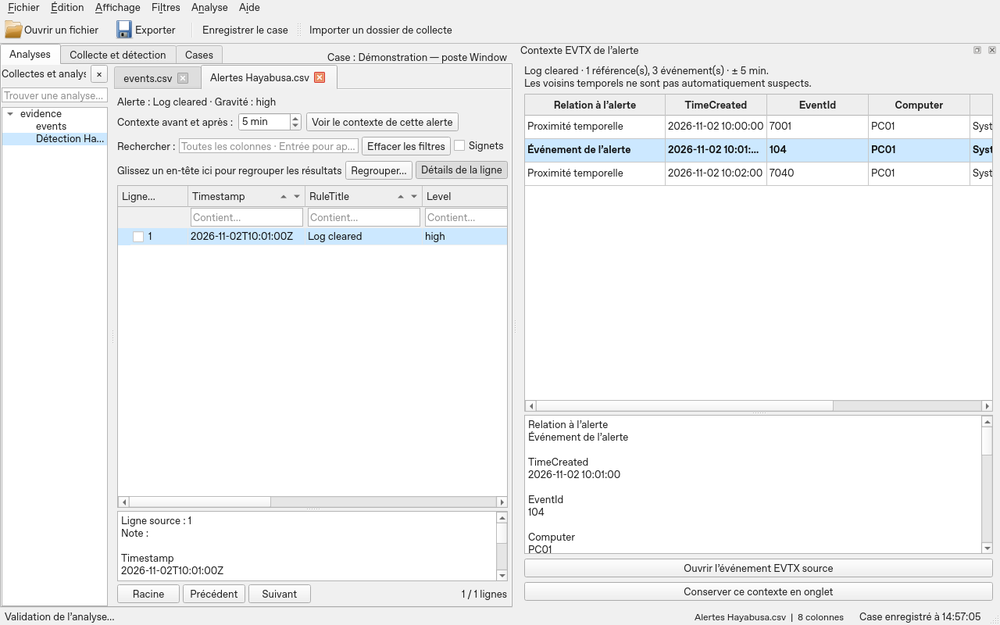
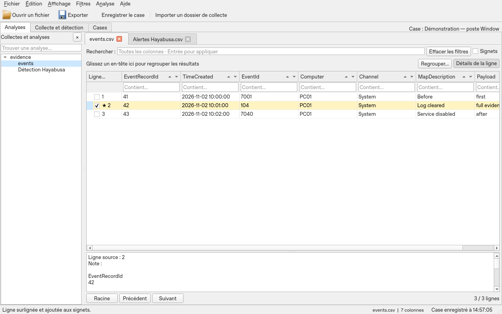

# Tutoriel complet — toutes les fonctionnalités de Fireblade

Ce tutoriel décrit le parcours actuel de Fireblade : cases persistants, collectes Windows et Linux CatScale, parsing, Shellbags, WebCache, détection Hayabusa, contexte EVTX et exploration des résultats. Il propose un apprentissage avec le pack de test téléchargeable, puis une référence des filtres, règles, expressions, profils, plugins, sauvegardes et limites. Il est accessible sans analyse ouverte via **Aide → Tutoriel complet — toutes les fonctionnalités**.

Commencez par votre parcours d’entrée, puis utilisez les sections de référence selon votre besoin. Les commandes dépendant d’une analyse restent inactives tant qu’aucune analyse n’est ouverte. Les moteurs Windows nécessitent le pack de la construction Windows. Le parser CatScale est intégré sans moteur externe.

## Table des matières

- [Démarrage](#démarrage)
- [Première enquête avec le pack de test](#première-enquête-avec-le-pack-de-test)
- [Cases — dossiers d’enquête](#cases--dossiers-denquête)
- [Chronologie, récupération et rapports](#chronologie-récupération-et-rapports)
- [Se repérer dans la fenêtre](#se-repérer-dans-la-fenêtre)
- [Collecte brute et détection Hayabusa](#collecte-brute-et-détection-hayabusa)
- [Shellbags et WebCache Windows](#shellbags-et-webcache-windows)
- [Importer une collecte Linux CatScale](#importer-une-collecte-linux-catscale)
- [Passer des alertes aux preuves EVTX et à leur contexte](#passer-des-alertes-aux-preuves-evtx-et-à-leur-contexte)
- [Parcours guidé](#parcours-guidé)
- [Ouvrir des données](#ouvrir-des-données)
- [Rechercher et filtrer](#rechercher-et-filtrer)
- [Trier](#trier)
- [Regrouper et résumer](#regrouper-et-résumer)
- [Onglets et sessions](#onglets-et-sessions)
- [Signets et notes](#signets-et-notes)
- [Colonnes, détails et copie](#colonnes-détails-et-copie)
- [Règles de coloration](#règles-de-coloration)
- [Dates et colonnes calculées](#dates-et-colonnes-calculées)
- [Expressions avancées](#expressions-avancées)
- [Profils, lecteurs et fonctions .NET](#profils-lecteurs-et-fonctions-net)
- [Dispositions et compatibilité Timeline Explorer](#dispositions-et-compatibilité-timeline-explorer)
- [Préférences et thèmes](#préférences-et-thèmes)
- [Enregistrer et exporter](#enregistrer-et-exporter)
- [Ressources et stockage](#ressources-et-stockage)
- [Interrompre une opération](#interrompre-une-opération)
- [Exercice complet avec résultats attendus](#exercice-complet-avec-résultats-attendus)
- [Référence de toutes les commandes](#référence-de-toutes-les-commandes)
- [Raccourcis clavier — référence](#raccourcis-clavier--référence)
- [Dépannage par symptôme](#dépannage-par-symptôme)
- [Fidélité, stockage et limites](#fidélité-stockage-et-limites)
- [Référence technique et périmètre](#référence-technique-et-périmètre)

## Chronologie, récupération et rapports

La version 0.5 complète ce parcours avec :

- un onglet **Chronologie & corrélations**, avec vue d’ensemble, pistes par
  analyse, zoom, sélection de période, signets et accès aux lignes sources ;
- la recherche transversale par utilisateur, IP, chemin, empreinte ou texte,
  également accessible depuis le menu contextuel d’une cellule ;
- une sauvegarde automatique toutes les deux minutes et dix versions de
  récupération des sessions de cases, sans annuler les annotations des bases ;
- les archives **`.fireblade-case`**, avec vérification SHA-256, réaffectation des
  références et création d’un nouveau case à l’import ;
- les rapports **HTML/PDF**, à partir des signets, notes ou lignes sélectionnées,
  avec une capture facultative de la chronologie.

Ouvrez **Aide → Chronologie, sauvegardes et rapports** pour le parcours détaillé,
ou lisez le [guide dédié](CHRONOLOGIE-ET-SAUVEGARDES.md). Il explique les dates sans
fuseau, les lignes sans date, les sources non transportées et les limites des
rapports. Les corrélations restent des pistes à vérifier.

## Démarrage

Téléchargez `Fireblade.exe` dans une [release **Fireblade - prototype Windows**](https://github.com/23R0534ZXT/fireblade/releases), puis double-cliquez dessus. Les releases **test-pack-v1** et **test-data-3gib** contiennent les jeux de données ; elles ne remplacent pas le téléchargement du programme. Les archives automatiques **Source code** contiennent les sources à construire. Python, Excel et un dossier de bibliothèques à côté du programme ne sont pas nécessaires. Le guide et les licences sont accessibles dans le menu **Aide**, même sans analyse ouverte.

Le programme prépare ses bibliothèques dans le dossier temporaire de Windows au démarrage. Cette étape peut prendre quelques secondes. Ce dossier est normalement supprimé à la fermeture. Les analyses sont enregistrées séparément pour conserver le travail.

Le programme distingue deux parcours :

- **Artefacts bruts** : importer un dossier de collecte, parser, choisir l’organisation des résultats, puis analyser les EVTX avec Hayabusa.
- **Exports existants** : ouvrir directement CSV, TSV, TXT délimités, XLS ou XLSX pour les explorer.

Le pack Windows inclut les moteurs et leurs dépendances. Le lancement depuis les sources ne les construit pas automatiquement : si le bilan indique « aucun pack intégré », l’exploration des exports reste disponible mais le parsing brut nécessite une construction complète du pack.

L’EXE est un seul fichier de programme ; les analyses, artefacts et résultats ne sont pas incorporés à ce fichier. Prévoyez l’espace disque de l’extraction temporaire et du dossier de travail.

### Distinguer les éléments du travail

| Élément | Ce qu’il représente |
|---|---|
| Case | Une enquête enregistrée qui retrouve ses analyses et ses collectes. |
| Collecte | Un dossier source et son traitement, avec un bilan, des résultats et des journaux. Un case peut en contenir plusieurs. |
| Analyse `.timeline` | Les données importées dans une base, avec leurs notes, signets et vues. |
| Vue | Les filtres, tris, groupes et réglages de présentation d’une analyse. |
| Session | La liste et l’état des analyses à retrouver. Elle référence les bases sans les copier. La sauvegarde du case enregistre aussi sa session. |

## Première enquête avec le pack de test

### Télécharger et choisir son parcours

Téléchargez le [**ZIP forensic v1 — environ 5,1 Mo**](https://github.com/23R0534ZXT/fireblade/releases/download/test-pack-v1/Fireblade-Test-Pack-v1.zip), puis extrayez-le entièrement. Les chemins ci-dessous partent du dossier `Fireblade-Test-Pack-v1`. Gardez sa structure et les journaux de registre à côté de leur ruche. Le pack contient `LIRE-MOI.md`, `RESULTATS-ATTENDUS.json`, `MANIFEST.json` et les licences dans `NOTICES`.

| Votre objectif | Entrée à choisir | Commande |
|---|---|---|
| Tester les 13 EZ Tools | `01-Windows/01-Collecte-principale` | **Parser un dossier…** |
| Lire une ruche Shellbags | `01-Windows/02-Shellbags` | **Parser un dossier…** |
| Lire une base ESE WebCache | `01-Windows/03-WebCache` | **Parser un dossier…** |
| Lire CatScale déjà extrait | `02-Linux-CatScale/01-Dossier-extrait` | **Parser un dossier…** |
| Lire CatScale en archive | `02-Linux-CatScale/02-Archive` | Choisir ce dossier avec **Parser un dossier…** |
| Tester une timeline CatScale plus volumineuse | `02-Linux-CatScale/03-Volume` | **Parser un dossier…** |
| Apprendre les filtres sans parsing | Un fichier dans `03-Exports` | **Ouvrir un fichier…** |

Les artefacts Windows sont dans leurs **formats natifs**, et non des CSV déjà parsés. Ils proviennent de sources publiques indépendantes : ils ne racontent pas un incident unique. La collecte CatScale est **synthétique**, au format des sorties du collecteur ; ce n’est pas une collecte d’une machine Linux réelle. Le pack couvre des entrées représentatives des lecteurs embarqués, pas toutes leurs variantes.

Commencez par un sous-dossier précis plutôt que par la racine du ZIP. Vous pourrez vérifier son bilan et ses comptes avant d’ajouter la suite. Pour comparer CatScale extrait et archivé, utilisez deux cases distincts : les données de ces deux exemples sont identiques.

### Étape 1 — Windows et Hayabusa

1. Dans **Cases**, créez `Formation Windows`, avec l’étiquette **Windows**. Fireblade ouvre alors **Analyses**. Le centre propose **Importer une collecte…** pour les artefacts bruts et **Ouvrir un export…** pour les fichiers déjà produits.
2. Sélectionnez `01-Windows/01-Collecte-principale`. Gardez **Un onglet par type d’artefact ou famille CatScale**, puis **Importer et parser**.
3. Attendez la fin et consultez **Imports**. Vérifiez le passage des 13 moteurs, leurs sorties et les éventuels avertissements. Le nombre d’onglets organisés n’est pas le nombre de fichiers source ni de CSV produits par les moteurs.
4. Dans l’onglet EVTX, effacez tout filtre pour retrouver **13 événements**. Lisez un événement dans **Détails**, puis ajoutez un signet et une note.
5. Revenez à **Imports**, choisissez la gravité minimale **Faible** et cliquez **Analyser avec Hayabusa**. Avec les règles qualifiées du pack, au moins **deux alertes** sont attendues : effacement d’un journal et modification du démarrage du service Event Log.
6. Sélectionnez une alerte et cliquez **Voir le contexte de cette alerte**, avec **5 min** avant et après. Dans le panneau latéral, distinguez la référence de l’alerte des voisins temporels. Ouvrez **l’événement EVTX source**, puis **Revenir aux alertes**. Utilisez **Conserver ce contexte en onglet** si vous voulez le retrouver dans la session sauvegardée.
7. Enregistrez le case et sa session avec **Ctrl+Alt+S**.

Une alerte n’est pas une preuve de compromission ; les événements voisins ne deviennent pas suspects parce qu’ils sont proches. Les comptes attendus concernent les fichiers et moteurs épinglés du pack. Une autre version des règles peut changer les détections : consultez le [rapport Windows publié](https://github.com/23R0534ZXT/fireblade/releases/tag/test-pack-v1) pour comparer les versions.

### Étape 2 — Ajouter Shellbags et WebCache au même case

Importez successivement les dossiers suivants, sans fermer `Formation Windows`. Chaque import ajoute ses analyses. Dans **Imports**, le sélecteur **Collecte du case** retrouve le bilan de chaque import.

| Dossier | Attendu | Vérification pratique |
|---|---|---|
| `01-Windows/02-Shellbags` | **523 Shellbags** | Lire `Path`, `RegistryKey`, `Status` et `RawHex`. La ruche est sale et sans journaux : un avertissement Shellbags et le refus du passage RECmd sont attendus. Ce n’est pas une récupération complète. |
| `01-Windows/03-WebCache` | **1 612 lignes**, métadonnées comprises | Filtrer `WebCache_Container` sur `History` ou `Url` sur `code.google.com/p/libyal`. Comparer FILETIME brut et colonne UTC. Les lignes ne sont pas toutes des visites web. |

Le lecteur WebCache produit plusieurs tables ; leur organisation dans Fireblade dépend du choix initial par artefact ou en grille unique. Comparez le total des lignes après avoir retiré les filtres, pas le nombre de tables ou de pages affichées.

Pour tester l’autre organisation sans mélanger deux imports identiques, créez un nouveau case et réimportez un petit dossier avec **Tout dans un seul onglet, regroupé par artefact ou famille CatScale**. Les groupes sont préparés à l’ouverture ; la provenance reste disponible.

### Étape 3 — Linux CatScale

1. Créez le case `Formation Linux`, étiquette **Linux**. Le changement sauvegarde le case précédent.
2. Importez **un seul** dossier : `02-Linux-CatScale/01-Dossier-extrait` ou `02-Linux-CatScale/02-Archive`. Pour une archive, sélectionnez son dossier contenant, sans la décompresser manuellement.
3. Choisissez un onglet par artefact ou famille, puis vérifiez **26 lignes au total** :

| Famille | Lignes attendues |
|---|---:|
| Processus et réseau | 8 |
| Persistance | 4 |
| Journaux et connexions | 2 |
| Système | 5 |
| Utilisateurs | 4 |
| Fichiers et chronologie | 1 |
| Conteneurs et virtualisation | 2 |

Sur ces 26 lignes, **25 sont structurées et une est conservée en lecture brute**. Un avertissement est volontaire. Retrouvez cette ligne avec `Lecture = Brute`, puis lisez **Texte brut**, **Source**, **Ligne** et **Fin de ligne**. Une source archivée indique aussi l’entrée TAR. En cas de grille combinée, effacez les filtres avant de vérifier le total.

Ouvrez les données de processus et réseau, filtrez une commande ou un utilisateur, puis ajoutez une note. Les commandes figurant dans le corpus sont des valeurs à lire ; elles ne sont pas exécutées. Hayabusa ne traite pas ces textes Linux.

En option, importez `02-Linux-CatScale/03-Volume` : **100 000 lignes** sont attendues, réparties entre `alice` et `bob`. Vérifiez les chemins accentués contenant une virgule, les inodes avec zéros initiaux et la taille exacte `18446744073709551615`. Ce jeu est distinct de la petite collecte ; le total du case peut donc dépasser 26 lignes.

### Étape 4 — Exports, filtres et annotations

Ouvrez séparément les fichiers CSV, TSV et XLSX de `03-Exports` avec **Ouvrir un fichier…**. Pour XLSX, choisissez la feuille **Activite**. Chaque fichier contient **six lignes**. Vérifiez :

- Les identifiants `000001` et `9007199254740993` restent exacts.
- Le message de `charlie` contient une virgule, des accents et un retour à la ligne, tout en restant dans une seule cellule.
- Les champs **Contient…**, les flèches de tri et les groupes portent sur le résultat complet.
- Une note et un signet sont retrouvés après réouverture de l’analyse.

L’[exercice de cinq lignes](#exercice-complet-avec-résultats-attendus) plus bas donne les comptes exacts pour apprendre ET, OU, NON et les résumés. Il s’agit d’un autre jeu de données, à créer séparément ; n’attendez pas ces mêmes comptes dans les fichiers de `03-Exports`.

### Étape 5 — Fermer, reprendre et archiver

1. Enregistrez le case Linux, ouvrez `Formation Windows` depuis **Cases** et vérifiez ses propres onglets, notes et filtres. Le changement ne fusionne pas les enquêtes.
2. Quittez normalement Fireblade, puis relancez-le. Les cases doivent rester visibles dans le catalogue, **sans analyses chargées**.
3. Ouvrez explicitement un case : sa session doit revenir. Une base référencée déplacée ou manquante empêche sa restauration normale ; conservez ses chemins.
4. Sélectionnez un ancien case et cliquez **Archiver**. Il disparaît de la liste normale. Cochez **Inclure les archivés**, puis **Réactiver** pour le retrouver.
5. Sauvegardez le dossier complet du case, les éventuelles bases externes et les sources utiles. **Archiver** classe un case ; ce bouton ne fabrique pas un ZIP de sauvegarde.

### Tester un gros CSV séparément

Le [CSV de plus de 3 Gio](TESTER-3GIB.md) est un téléchargement séparé : **2 441 216 enregistrements**, à ouvrir comme fichier, pas comme artefact brut. Vérifiez ses comptes avec son guide. L’import de CSV et l’organisation d’une collecte n’ont pas la même charge mémoire. Le résultat Linux enregistré sur **12 206 080 lignes / environ 15 Gio** concerne le moteur et son corpus précis ; il ne garantit pas l’affichage Windows à cette taille. Les limites mémoire sont détaillées dans [Ressources et stockage](#ressources-et-stockage).

## Cases — dossiers d’enquête

Au lancement, l’onglet **Cases** affiche vos enquêtes enregistrées. Il ne charge aucune ancienne analyse : le catalogue lit seulement leurs fiches. Double-cliquez un case, ou sélectionnez-le puis cliquez sur **Ouvrir**, pour reprendre sa session.

1. Cliquez sur **Nouveau case…** (`Ctrl+Alt+N`). Renseignez son nom, sa description, son type de collecte et son statut. Windows, Linux et Mixte sont des étiquettes d’organisation ; elles servent uniquement au classement.
2. Si des analyses sont déjà ouvertes hors d’un case, laissez **Inclure les analyses actuellement ouvertes** coché pour les rattacher au nouveau case. Les bases existantes restent à leur emplacement : elles ne sont pas copiées.
3. Importez vos fichiers ou vos collectes. Les destinations proposées sont propres au case : `Analyses` pour les imports, `Collectes` pour les résultats de collecte. Plusieurs collectes peuvent appartenir au même case ; le sélecteur **Collecte du case** retrouve leur bilan. Importer une collecte ajoute ses analyses aux onglets déjà présents.
4. Utilisez le bouton permanent **Enregistrer le case** (`Ctrl+Alt+S`), également disponible dans Fichier ; le catalogue conserve son bouton **Enregistrer le case actif et sa session**. L’heure de la dernière sauvegarde réussie apparaît dans la barre d’état. `Ctrl+Maj+S` enregistre également le case actif et sa session. Sans case actif, ce dernier raccourci conserve son fonctionnement d’export de session.
5. **Fermer le case actif** revient au catalogue. Ouvrir un autre case ou quitter Fireblade enregistre aussi la session avant de fermer les analyses. En cas d’échec de sauvegarde, le changement ou la fermeture est refusé pour vous laisser corriger le problème.

La reprise conserve les onglets, leur ordre, l’onglet actif, les filtres, le tri, les regroupements et la disposition des colonnes. Les signets et notes sont conservés dans les bases d’analyse. Les dispositions automatiques sont propres au case, afin que ses filtres ne se réappliquent pas aux imports d’un autre case. Les préférences et règles partagées restent communes à Fireblade.

Le catalogue propose une recherche sur le nom et la description, des colonnes triables, les dates de création, modification et dernière ouverture, ainsi que le nombre d’analyses. **Modifier…** change la fiche. **Archiver** masque un ancien case sans supprimer ses données ; cochez **Inclure les archivés**, sélectionnez-le puis utilisez **Réactiver** pour le retrouver dans la liste normale. Le statut **Terminé** indique une enquête achevée sans la masquer.

Les cases sont conservés sous `%LOCALAPPDATA%\Fireblade\Cases\<identifiant>`. Sauvegardez ce dossier complet, les bases référencées à l’extérieur et les artefacts originaux nécessaires à une nouvelle analyse. `case.json` et la session contiennent des chemins : déplacer un dossier ne les corrige pas automatiquement. Réutiliser la même base dans plusieurs cases partage ses annotations. Un même case ne peut être ouvert que dans une fenêtre à la fois.

Avant de changer de case, terminez ou annulez les opérations en cours et videz les imports en attente. Si une analyse référencée manque à la réouverture, Fireblade signale le problème et conserve l’espace de travail déjà ouvert.

## Se repérer dans la fenêtre

| Zone | Rôle et gestes |
|---|---|
| Barre de menus et barre d’outils | La barre d’outils donne les accès rapides à l’ouverture, l’export, l’ajout de filtre et le regroupement. Les autres commandes restent dans les menus. |
| Analyses / Imports / Cases | Grilles d’analyse ; bilan et détection ; catalogue des enquêtes conservées sans chargement automatique. |
| Onglets d’analyse | Une analyse par onglet. Utilisez le sélecteur des analyses ouvertes pour retrouver un nom ou un chemin. |
| Recherche générale | Recherche sur les colonnes de l’analyse active ; Entrée applique le texte. |
| Liste des filtres | Affiche les filtres simples et l’existence d’une expression. Double-cliquez un filtre simple pour le retirer ; l’entrée d’expression ouvre son éditeur. |
| Options de tri | Panneau facultatif : colonne, type et sens. Les flèches d’en-tête fournissent le tri rapide. |
| Barre de groupement | Boutons numérotés dans l’ordre d’imbrication ; × retire le niveau correspondant. Glissez un autre en-tête pour ajouter un niveau. |
| Grille | Lignes ou groupes, sélection, colonnes déplaçables, redimensionnables, masquables et épinglables. Le menu d’en-tête reste accessible au clic droit. |
| Détails | Valeurs et note de la ligne active ; sa taille se règle avec le séparateur. Sa position se choisit dans les préférences. |
| Racine / Précédent / Suivant | Navigation dans les pages du niveau sélectionné. Racine désélectionne le niveau courant pour agir au niveau principal. |
| Comptages et barre d’état | Effectifs, progression, identité de source et messages brefs. Consultez Messages pour retrouver les diagnostics. |

**Affichage → Options de tri** et **Détails de la ligne** affichent ou masquent leurs panneaux. Masquer un panneau ne retire pas les réglages qu’il représente. Le plein contenu d’une cellule se lit dans les détails, même quand sa représentation dans la grille est abrégée.

## Collecte brute et détection Hayabusa

**Analyse → Parser un dossier…** et la barre **Ajouter des données** ouvrent le parcours de parsing. Dans un case actif, les imports s’ajoutent à ses analyses. Hors d’un case, le chargement d’une nouvelle collecte remplace l’espace affiché et conserve sa session précédente dans le dossier de travail (`previous-workspace.fireblade-session`). Créez un case si vous souhaitez réunir plusieurs collectes.

Choisissez un dossier source. Le mode recommandé ouvre chaque résultat vérifié au fur et à mesure, sans bloquer la grille. Vous pouvez aussi choisir **un onglet par type d’artefact** ou **un onglet unique regroupé par artefact** ; ces regroupements apparaissent à la fin de leur construction en arrière-plan. Les fichiers de même type sont réunis ; les colonnes de schémas différents restent disponibles, avec cellules vides si le champ est absent. La provenance de chaque ligne est conservée. Le choix est enregistré avec la session ; Hayabusa garde son onglet d’alertes.

Fireblade crée un dossier de travail séparé dans le profil utilisateur et inventorie récursivement les fichiers. Les CSV/TSV déjà produits sont chargés directement ; les artefacts reconnus sont envoyés aux moteurs correspondants. Les résultats sont enregistrés dans une session de collecte et ouverts dans Fireblade. L’onglet **Imports** permet de consulter les succès, erreurs, absences de sortie et fichiers non pris en charge, puis de reprendre un dossier de travail existant.

Le pack contient EvtxECmd, AmcacheParser, AppCompatCacheParser, PECmd, MFTECmd, RECmd avec son batch Kroll, LECmd, JLECmd, SrumECmd, WxTCmd, RBCmd, RecentFileCacheParser et SQLECmd. Les versions sources sont épinglées dans le manifeste de construction. Une reconnaissance propose un moteur ; elle ne prouve pas que le fichier sera valide pour ce moteur. Un échec reste dans le bilan, avec son journal. Les liens ne sont pas suivis.

**Détection → Analyser la collecte avec Hayabusa** traite ensemble les EVTX inventoriés et vérifiés, via des copies temporaires. Choisissez le seuil de gravité dans l’onglet Détection EVTX ; le défaut est Faible. L’onglet **Alertes Hayabusa.csv** expose les correspondances aux règles, avec heure UTC, machine, canal, EventID, RecordID, RuleID, nom de règle, détails et chemin de l’EVTX source. Les filtres, tris, notes, signets, vues et exports Fireblade s’appliquent à cet onglet comme aux autres analyses.

Les règles Hayabusa embarquées sont celles de la distribution 4.3.1. Cette version utilise `dfir-timeline`, le profil verbose et le mode sans assistant ; les règles ne sont pas mises à jour automatiquement pendant l’enquête. Les règles bruyantes, obsolètes ou non prises en charge ne sont pas activées par défaut. Une absence de détection ne prouve pas l’absence de compromission ; une correspondance doit être vérifiée dans les événements et leur contexte.

Le dossier de travail contient les CSV originaux des parseurs, leurs copies enrichies avec provenance, les bases d’analyse, les journaux, `collection.json` et la session `collection.fireblade-session`. Les sources restent nécessaires pour relancer Hayabusa ; leurs empreintes sont vérifiées avant copie. Les données déjà importées restent dans les bases. L’annulation conserve les traitements terminés ; le délai maximal de chaque moteur est d’une heure. Un moteur absent, une sortie invalide ou un EVTX modifié ne devient pas un résultat réussi.

Les moteurs et leur runtime sont embarqués dans le seul EXE Windows ; les résultats sont enregistrés séparément. Cette construction est plus volumineuse et demande de l’espace temporaire pour son extraction et les copies de travail. **Aide → Exporter les sources Hayabusa…** fournit les sources distribuées avec ce moteur ; les notices restent accessibles dans Licences. Les détails et le parcours de reprise sont dans [le guide de collecte](UTILISATION.md#importer-une-collecte-dartefacts-et-lancer-hayabusa).

### Artefacts et moteurs

| Moteur | Artefacts orientés par Fireblade |
|---|---|
| EvtxECmd | Journaux EVTX |
| AmcacheParser | Amcache / Inventory reconnus |
| AppCompatCacheParser | AppCompatCache dans une ruche SYSTEM |
| PECmd | Prefetch `.pf` |
| MFTECmd | `$MFT`, `$J`, `$Boot` et entrées reconnues |
| RECmd | Ruches de registre, batch Kroll et plugins RegistryPlugins |
| LECmd | Raccourcis LNK |
| JLECmd | Jump Lists automatiques et personnalisées |
| SrumECmd | `SRUDB.dat` |
| WxTCmd | `ActivitiesCache.db` |
| RBCmd | Métadonnées `$I` de la corbeille |
| RecentFileCacheParser | `RecentFileCache.bcf` |
| SQLECmd | Bases SQLite reconnues par ses maps |
| Hôte Shellbags Fireblade | Ruches hors ligne UsrClass.dat / NTUSER.DAT, bibliothèques Registry et ExtensionBlocks. |
| Lecteur WebCache | Bases ESE WebCacheV*.dat, bibliothèque dissect.esedb. |
| Hayabusa 4.3.1 | Détections et corrélations sur les EVTX inventoriés |

Le nom et la signature du fichier orientent le choix du moteur ; Fireblade ne lance pas arbitrairement tous les parseurs sur chaque fichier. Les journaux `.LOG1` et `.LOG2` associés à une ruche sont traités comme compagnons. Les ruches UsrClass / NTUSER sont également orientées vers le lecteur Shellbags dédié ; les exports Shellbags existants restent importables. Les variantes non reconnues sont conservées dans le bilan.

### Lire le bilan avant de conclure

Le bilan est une table triable avec une recherche et un filtre **Tous les fichiers**, **Réussis**, **Avertissements / à vérifier**, **Erreurs / interrompus** ou **Non reconnus / ignorés**. Sélectionnez un fichier pour lire ses avertissements, son SHA-256 et ses sorties. **Bilan complet** retrouve les informations générales ; **Ouvrir les résultats** ouvre le dossier de travail. La partie **1. Importer et parser** est distincte de **2. Détecter dans les EVTX Windows** ; Hayabusa reste désactivé si aucune collecte EVTX exploitable n’est prête.

| État | Interprétation |
|---|---|
| Terminé | Le traitement s’est terminé et a fourni ses sorties. Une sortie peut contenir zéro ligne. |
| Terminé avec avertissements / À vérifier | Lire les avertissements et le journal ; le résultat nécessite une vérification. |
| Aucune sortie | Le moteur n’a pas produit de CSV à importer. Ce n’est pas une preuve d’absence d’activité. |
| Non reconnu | Le fichier n’a pas été orienté vers un moteur pris en charge. |
| Journal de transaction | Compagnon de ruche ; pas une ruche autonome à ouvrir. |
| Ignoré | Par exemple un lien, qui n’est pas suivi. |
| Erreur / Interrompu | Lire la cause ; les résultats déjà terminés peuvent rester consultables. |

Une collecte peut être globalement terminée avec certains fichiers en erreur. Vérifiez les lignes du bilan, pas seulement le statut global. Les CSV d’origine des parseurs restent distincts des copies enrichies et des analyses organisées.

### Reprendre et relancer

**Reprendre une collecte…** demande le dossier de travail contenant `collection.json`, pas le dossier d’artefacts. Les bases importées permettent de consulter les données sans les originaux. Une nouvelle exécution de Hayabusa demande les EVTX originaux aux chemins enregistrés, avec leurs empreintes inchangées. Chaque exécution conserve ses résultats séparément.

Le niveau minimal se choisit avant **Analyser avec Hayabusa**. Zéro alerte, une sortie vide inattendue et une erreur de moteur sont des états distincts. Les règles embarquées ne sont pas mises à jour pendant l’analyse. Le contexte décrit dans la section suivante ne réexécute pas Hayabusa.

## Shellbags et WebCache Windows

Créez ou ouvrez un case, puis utilisez **Parser un dossier…**. Placez `UsrClass.dat`, `NTUSER.DAT` et/ou `WebCacheV01.dat` dans le dossier choisi, avec les journaux de registre `.LOG1` / `.LOG2` à côté de leur ruche. L’organisation par artefact ouvre des onglets **Shellbags** et **WebCache** ; la grille combinée les regroupe par artefact. Les analyses sont conservées dans le case, avec les filtres, signets, notes et dispositions de sa session.

### Lire les Shellbags

| Champ | Utilisation |
|---|---|
| Path / Value | Chemin reconstruit dans l’espace de noms Shell et nom décodé de l’élément. |
| RegistryKey / ValueName | Emplacement exact dans la ruche. |
| MRUPosition / NodeSlot | Ordre MRU disponible et slot de la vue associée ; `-1` signifie que la position MRU n’est pas disponible. |
| BagMRUKeyLastWriteUtc | Dernière écriture de la clé de registre, distincte d’une heure de visite certaine. |
| ShellItemModified / Created / Accessed | Dates embarquées dans l’élément lorsqu’elles existent. Les dates DOS/FAT ne permettent pas de déduire à elles seules un fuseau d’origine. |
| Status / RawHex | Élément décodé, inconnu ou endommagé ; octets conservés pour vérification. |

Le lecteur Fireblade utilise les bibliothèques MIT Registry et ExtensionBlocks avec le runtime .NET déjà embarqué. Il n’embarque pas SBECmd. Les journaux utilisables sont rejoués en mémoire ; les originaux ne sont pas réécrits. Une ruche sale ou avec checksum invalide reste signalée si sa récupération est indisponible ou incomplète. Le passage séparé de RECmd peut refuser cette ruche alors que le lecteur Shellbags en extrait encore des éléments lisibles. Les clés supprimées ne sont pas récupérées. Limites du lecteur : ruche de 512 Mio, un million de clés parcourues, profondeur de 512.

Un chemin Shellbags peut être virtuel, réseau, ancien ou supprimé. Il ne prouve pas que le répertoire existe encore ni qu’un fichier a été ouvert. Les horodatages de clé ou d’élément ne constituent pas une chronologie exacte des visites.

### Lire le WebCache

Le format ESE de `WebCacheV*.dat` est lu par dissect.esedb ; ce n’est pas SQLite. Les tables utilisateur sont exportées avec **WebCache_Table**, **WebCache_Container** et **WebCache_Directory**. **WebCache_RecordType** distingue `CacheEntry`, `AppCacheEntry`, `DependencyEntry`, `Metadata` et les autres lignes `TableRecord`. Filtrez sur ces colonnes pour séparer historique, contenu et autres conteneurs selon ce que contient réellement la base.

Les valeurs d’origine sont conservées, notamment URL, identifiants, champs binaires préfixés par `hex:` et entiers FILETIME exacts. Les colonnes `*_UTC` donnent une interprétation UTC distincte, à 100 ns près ; les sentinelles et dates absentes restent vides. La colonne **WebCache_ReadError** signale les champs illisibles ou dates hors plage. Les erreurs de table figurent également dans le bilan et dans `collection.json`.

La lecture ne répare pas la base, ne rejoue pas les journaux ESE, ne récupère pas les lignes supprimées et n’ouvre pas les URL. Une base non fermée proprement produit un avertissement : ses pages lisibles ne garantissent pas un résultat complet. Travaillez sur une copie collectée hors ligne ; Fireblade ne contourne pas les verrous d’une base en cours d’utilisation.

## Importer une collecte Linux CatScale

1. Créez ou ouvrez un case, puis cliquez sur **Parser un dossier…**.
2. Choisissez le dossier CatScale déjà extrait, le dossier `extracted` contenant plusieurs hôtes, ou un dossier contenant les archives d’origine `catscale_*.tar.gz` / anciennes `FSecure_*.tar.gz`.
3. Choisissez **Un onglet par type d’artefact ou famille CatScale**, ou la grille unique regroupée par famille. Les sorties sont rangées dans le case actif ; sans case actif, elles restent dans le dossier Collectes habituel.
4. Lisez le bilan, puis explorez les onglets avec les filtres, les groupes, les signets, les notes et les exports habituels. Enregistrez le case pour retrouver la session.

| Famille | Contenu |
|---|---|
| Processus et réseau | Tables de processus, détails `/proc`, connexions, hashes, liens, captures de commande et d’environnement. |
| Persistance | Crontabs, configurations systemd et états des services. |
| Journaux et connexions | Journaux collectés, syslog, audit et sorties textuelles de connexion. |
| Système | Informations de l’hôte, mémoire, noyau, logiciels et configurations. |
| Utilisateurs | Fichiers personnels et historiques de shell. |
| Fichiers et chronologie | Timeline du collecteur, listes et hashes de fichiers. |
| Conteneurs et virtualisation | Sorties Docker, Podman et Virsh. |

Les principaux formats ont des lecteurs dédiés : processus, `ss`, `netstat`, hashes, liens, cron, systemctl, passwd/group, historiques, syslog/audit et timeline. Pour les autres textes, Fireblade extrait les paires clé/valeur lorsqu’elles sont présentes et conserve les lignes restantes. Les tableaux arbitraires et JSON ne sont pas présentés comme entièrement structurés.

La colonne **Lecture** distingue **Structurée** et **Brute**. Une ligne inconnue reste visible dans **Texte brut** et produit un avertissement. Les colonnes **Source**, **Ligne** et **Fin de ligne** permettent de retrouver son contexte ; la notation `archive[entry N]!/fichier` distingue les entrées TAR, même lorsque plusieurs portent le même nom. Les colonnes entièrement vides sont retirées des CSV générés.

Les archives tar/gzip et sous-archives sont lues sans exécuter les scripts ni extraire leurs chemins sur disque. Les sources sont vérifiées par SHA-256 avant et après traitement. Les binaires non pris en charge, dont les journaux binaires et bases de connexion, les liens, chemins dangereux et fichiers endommagés restent signalés dans le bilan et dans le détail `catscale.members` de `collection.json`.

Limites par entrée source : ligne ou bloc `/proc` de 1 Mio, membre archivé de 256 Mio, trois niveaux d’archives, garde de 100 000 entrées parcourues et budget de 4 Gio de données décompressées (les lectures imbriquées comptent aussi). Une limite ne signifie pas que la collecte entière a été parsée. Les sorties déjà écrites restent dans le dossier de travail ; consultez le bilan. Les dates restent dans leur représentation d’origine : Fireblade n’invente ni année ni fuseau horaire manquant.

Ce parcours fonctionne dans le seul EXE Fireblade, sans Linux, CatScale ou Logstash à installer sur le poste d’analyse. Il lit les formats du [collecteur CatScale](https://github.com/WithSecureLabs/LinuxCatScale) à la révision `0014f234a472f536d28664902daed90527ff5858`, sans embarquer ou lancer ce collecteur. **Hayabusa analyse uniquement les EVTX Windows** : il n’applique pas ses règles aux fichiers texte Linux.

## Passer des alertes aux preuves EVTX et à leur contexte

Dans l’onglet des alertes, sélectionnez une détection. La barre au-dessus de la grille affiche sa règle et sa gravité. Choisissez une fenêtre **avant et après**, puis **Voir le contexte de cette alerte**. Un panneau latéral réutilisable affiche la chronologie sans quitter les alertes. **Conserver ce contexte en onglet** crée l’analyse à retrouver dans la session ; les aperçus non conservés restent temporaires.

Le contexte EVTX regroupe l’événement référencé et les événements proches des autres journaux de la même machine. Les colonnes de date, EventID, machine, canal et description sont placées en premier ; les données complètes et références techniques restent disponibles dans les autres colonnes et le panneau Détails.

La correspondance utilise le chemin EVTX et **EventRecordID**, qui n’est ni le numéro de ligne affiché dans Fireblade ni le RecordNumber physique du parseur. Les mêmes identifiants peuvent exister dans plusieurs journaux : un RecordID seul ne constitue pas une preuve de correspondance. La machine et l’EventID servent de contrôles supplémentaires quand ils sont renseignés. Une alerte agrégée conserve le caractère incertain des associations multiples et les signale comme candidates.

Dans un contexte conservé en onglet, la colonne **Relation à l’alerte** reste épinglée. L’événement de l’alerte est en gras ; les voisins portent **Proximité temporelle** et ne deviennent pas suspects du seul fait d’être affichés. La fenêtre par défaut est de cinq minutes de chaque côté, réglable jusqu’à 24 heures. Les mille événements au maximum conservent les références et privilégient les voisins les plus proches. Les références absentes, sources inaccessibles et limites sont signalées.

Le bouton **Ouvrir l’événement EVTX source** ouvre l’analyse EvtxECmd conservée et filtre sur l’enregistrement précis. Il fonctionne également pour un événement voisin ; son rôle reste précisé dans la barre de navigation. **Revenir aux alertes** restaure l’onglet d’alertes sans effacer ses notes ni sa vue. Les analyses initialement réunies par artefact ou dans une table unique restent disponibles : le lien utilise leurs bases individuelles conservées.

L’aperçu est en lecture seule ; conservez-le en onglet pour utiliser filtres, notes, signets et exports sur cette chronologie.

Un contexte conservé en onglet, ses paramètres et son lien avec l’alerte sont enregistrés dans la collecte. Une reprise peut s’appuyer uniquement sur les bases importées ; l’absence des EVTX bruts empêche une nouvelle exécution de Hayabusa, pas la lecture du contexte existant. Les détails sont dans [le parcours contexte EVTX](UTILISATION.md#comprendre-une-alerte-avec-son-contexte-evtx).



Capture d’événements et d’une alerte synthétiques, rendu Qt hors écran sous Linux.

### Vérifier le lien dans la grille

1. Sélectionnez une ligne d’alerte ; un en-tête de groupe n’est pas une alerte.
2. Réglez **Contexte avant et après** ; 5 minutes signifie de cinq minutes avant à cinq minutes après.
3. Cliquez **Voir le contexte de cette alerte**, également disponible au clic droit et dans le menu Analyse.
4. Dans le panneau latéral ou l’onglet conservé, lisez **Relation à l’alerte** avant d’interpréter la chronologie. Une référence multiple reste candidate, même si le plafond ne permet d’afficher qu’un de ses événements.
5. Sélectionnez une référence ou un voisin puis **Ouvrir l’événement EVTX source**. La vue est filtrée sur cette ligne ; **Effacer les filtres** retrouve tous les événements de cette base.
6. Cliquez **Revenir aux alertes** pour reprendre la liste avec ses filtres et annotations.

Le rapprochement porte sur les EVTX déjà importés de la même machine. Il n’ajoute pas automatiquement Amcache, Prefetch ou le registre au contexte d’une alerte. Une machine inconnue désactive le voisinage ; un horodatage inexploitable ne produit pas de fenêtre inventée. Les références retrouvées sont conservées en priorité. En cas de plafond, les voisins temporels les plus proches sont retenus et la limitation est signalée. La précision d’origine des dates reste dans les cellules.

Chaque contexte conservé en onglet est une analyse enregistrée dans la collecte. Il garde les paramètres de sa création ; modifier ensuite la durée dans la liste des alertes ne réécrit pas un ancien contexte. Recréez un aperçu pour comparer une autre fenêtre ; conservez-le en onglet si nécessaire. Une reprise retrouve les liens si les bases référencées sont toujours accessibles. Le dossier de travail n’est pas une archive portable qui corrige automatiquement tous les chemins après déplacement.

## Parcours guidé

Pour apprendre Fireblade sur un petit fichier sans toucher aux preuves, préparez un CSV de test avec une ligne d’en-tête et quelques lignes. Ouvrez-le avec **Analyse → Importer un fichier de données**, puis effectuez ce parcours :

1. Recherchez un terme dans la barre **Rechercher**. Essayez ensuite un clic droit sur une cellule pour filtrer sur sa valeur.
2. Cliquez sur l’en-tête d’une date pour trier, puis utilisez **Affichage → Tri sur plusieurs colonnes** pour ajouter une seconde clé.
3. Glissez un en-tête dans la barre de groupement. Dépliez un groupe, parcourez ses pages, puis repliez-le.
4. Sélectionnez une ligne et ajoutez un signet avec une note. Utilisez **Détails** pour lire le contenu complet d’une cellule.
5. Enregistrez une vue avec **Ctrl+S**, changez la recherche, puis rechargez-la avec **Ctrl+L**.
6. Exportez le résultat filtré avec **Fichier → Exporter**, puis comparez-le à la source : l’export est une nouvelle destination.
7. Ouvrez **Affichage → Préférences** et essayez un thème. L’aperçu est annulable ; **OK** sauvegarde le choix.

Les sections suivantes détaillent chaque fonction et les cas où les données sont transformées, conservées ou refusées.

## Ouvrir des données

1. Cliquer sur **Analyse → Importer un fichier de données** ou appuyer sur **Ctrl+O**.
2. Choisir un CSV, TSV, TXT, XLS ou XLSX.
3. Confirmer le nom et l’emplacement du fichier d’analyse `.timeline`. Pour XLS/XLSX, sélectionner la feuille ; la première ligne doit contenir les noms de colonnes.
4. Attendre la fin de l’import. La source est lue sans réécriture.

Les exports CSV PowerShell avec une première ligne de métadonnées `#TYPE` sont acceptés. Une telle valeur au milieu des données reste un enregistrement normal.

Pour un CSV, les options permettent de préciser le séparateur et l’encodage : automatique par BOM, UTF-8, UTF-16, UTF-32, Windows-1252 ou Latin-1. Si la détection est ambiguë, sélectionner explicitement le séparateur. Les cellules vides sont normalisées en NULL.

Les valeurs sont conservées comme texte pour préserver les zéros initiaux et les grands identifiants. Les formules XLSX sont importées comme texte, sans calcul. Les styles et zéros provenant seulement d’un format numérique Excel ne sont pas importés. XLS est aussi pris en charge : les formules sont lues comme leurs résultats mémorisés ; les macros ne sont pas exécutées.

## Rechercher et filtrer

Les champs **Contient…** sous les colonnes filtrent directement après une courte pause, ou avec Entrée. Ils se combinent par ET et se vident avec **Effacer les filtres**.

Saisir le texte dans **Rechercher**, puis appuyer sur Entrée. Cette recherche porte sur les colonnes de l’analyse active.

Un clic droit sur une cellule permet de filtrer sur sa valeur ou de l’exclure. Un clic droit sur un en-tête ouvre les filtres de colonne. Les filtres simples se combinent par ET ; un double-clic dans leur liste retire un filtre.

**Filtres → Éditeur ET / OU / NON** permet de construire des groupes imbriqués. Les cartes proposent **Toutes les conditions (ET)**, **Au moins une (OU)**, **Exclure (NON)** sur une condition et **Inverser le groupe (NON)**. Chaque bloc dispose de boutons d’ajout et de suppression. La lecture du filtre se met à jour avant application. Les boutons **Replier / Déplier** masquent le contenu d’un groupe sans modifier le filtre, dont la lecture en phrase reste visible. Le langage interne représente NON avec une condition ou un groupe enfant. Les opérateurs comprennent recherche textuelle, égalité exacte, regex RE2, cellules vides, comparaisons numériques et bornes de dates ISO. Les données dont la conversion numérique ou temporelle est impossible ne correspondent pas à cette comparaison.

**Effacer les filtres**, près de la recherche, retire les recherches et critères sans changer les groupes, le tri, les couleurs ni les épinglages. **Affichage → Réinitialiser la vue** remet une vue par défaut, avec les règles globales activées.

### Choisir la bonne méthode de filtre

| Besoin | Méthode |
|---|---|
| Retrouver un mot sans connaître sa colonne | Recherche générale, puis Entrée. |
| Chercher un texte dans une colonne | Champ **Contient…** sous cet en-tête. |
| Utiliser exactement une valeur déjà visible | Clic droit sur la cellule → filtrer ou exclure ; ou Ctrl+Maj+F sur la cellule active. |
| Chercher les cellules vides | Ajouter un filtre, opérateur **Vide / NULL**. Un champ Contient vide retire son filtre, il ne recherche pas les valeurs vides. |
| Comparer un nombre ou une date | Filtre typé dans l’éditeur ; ne choisissez pas une comparaison Texte pour une taille de fichier. |
| Combiner plusieurs possibilités | Sous-groupe **Au moins une** dans l’éditeur visuel. |
| Exclure une combinaison entière | **Inverser le groupe (NON)**, et non plusieurs exclusions indépendantes. |
| Écrire des calculs, fonctions ou collections | **Expression textuelle**. |
| Chercher dans plusieurs sources ouvertes | **Rechercher dans toutes les analyses**, avec ou sans leurs filtres. |

La recherche générale, les filtres simples, l’expression et la restriction aux signets se combinent avec **ET**. Un bloc OU de l’expression ne contourne donc pas un champ Contient actif sur la même vue. Si une recherche renvoie zéro résultat, vérifiez chaque couche.

#### Champs Contient et flèches d’en-tête

Le filtre de colonne s’applique après environ **450 ms** sans saisie ; Entrée l’applique immédiatement. Effacez le champ, ou utilisez sa commande de suppression de texte, pour retirer ce filtre. Les colonnes épinglées disposent aussi de ces commandes et restent synchronisées avec la vue centrale.

Le champ affiche et modifie le premier filtre simple **Contient** de cette colonne. Il ne remplace pas les autres opérateurs ou les conditions d’une expression. S’il existe plusieurs filtres Contient sur la même colonne, leur liste permet de voir et retirer les autres.

**▲** choisit le tri croissant et **▼** le tri décroissant ; le bouton actif reste sélectionné. Cliquer le nom de l’en-tête alterne le sens. Le type de tri se choisit dans le menu de l’en-tête ou les options de tri. Un tri rapide remplace les clés du tri multiple ; utilisez son dialogue pour conserver plusieurs critères.

#### Construire ET, OU et NON avec les cartes

Chaque bloc possède deux choix : **Toutes les conditions** signifie ET ; **Au moins une** signifie OU. Les cadres imbriqués montrent quelles conditions appartiennent au même bloc. Les libellés restent visibles sans dépendre d’une couleur.

1. Cliquez **+ Condition** dans le bloc qui doit recevoir la condition.
2. Choisissez la colonne et l’opérateur, puis saisissez la valeur. Avec Vide / NULL ou Non vide, aucun texte de comparaison n’est nécessaire.
3. Cliquez **+ Sous-groupe** dans ce même bloc pour ajouter une combinaison indépendante.
4. Utilisez **Exclure (NON)** pour inverser une seule condition, ou **Inverser le groupe (NON)** pour inverser sa combinaison entière.
5. Retirez une condition avec **×**, ou le sous-groupe avec **Supprimer le groupe**.
6. Relisez **Lecture du filtre**, puis **Appliquer les filtres**. **Annuler** abandonne les modifications du dialogue.

Exemple : « alice sur PC01 ou PC02 » se construit avec un ET principal contenant `User = alice` et un sous-groupe OU contenant `Computer = PC01` et `Computer = PC02`. Placez les deux ordinateurs dans le sous-groupe, pas dans le bloc ET principal.

Un ET sans condition correspond à toutes les lignes ; un OU sans condition ne correspond à aucune ligne. Les conditions restent soumises aux limites de profondeur et de complexité du compilateur. L’éditeur des règles de coloration utilise les mêmes cartes, mais sa condition décide d’une apparence, pas de la présence de l’événement dans la vue.

#### Catalogue des opérateurs de filtre

Les libellés suivants correspondent au catalogue du programme. Les codes servent à lire les vues JSON et les profils ; ils ne se saisissent pas dans les champs Contient.

| Opérateur | Code |
|---|---|
| Contient | `contains` |
| Ne contient pas | `not_contains` |
| Égal à (exact) | `eq` |
| Différent de (exact) | `ne` |
| Commence par | `starts` |
| Finit par | `ends` |
| Expression régulière RE2 | `regex` |
| Vide / NULL | `empty` |
| Non vide | `not_empty` |
| Nombre > | `gt` |
| Nombre ≥ | `ge` |
| Nombre < | `lt` |
| Nombre ≤ | `le` |
| Date ≥ (ISO) | `after` |
| Date ≤ (ISO) | `before` |
| Date < (ISO) | `date_before` |
| Date > (ISO) | `date_after` |
| Date égale | `date_eq` |
| Date différente | `date_ne` |
| Texte > | `text_gt` |
| Texte ≥ | `text_ge` |
| Texte < | `text_lt` |
| Texte ≤ | `text_le` |
| Expression nommée | `expression` |

Les recherches de texte usuelles ne distinguent pas la casse ; les opérateurs explicitement **exacts** conservent leur comparaison exacte. RE2 n’accepte pas toutes les constructions des autres moteurs regex : une expression refusée doit être adaptée, pas interprétée comme une absence de correspondance. Pour une valeur vide, utilisez les opérateurs dédiés plutôt qu’une égalité avec un espace.

### Recherche entre fichiers et onglets

**Filtres → Rechercher dans toutes les analyses** ou **Ctrl+F** cherche dans les bases des onglets ouverts. Les comptages concernent tous leurs enregistrements, pas les pages chargées. Une option conserve les filtres et signets de chaque vue. Un double-clic sur un résultat ouvre l’analyse filtrée. Une erreur par fichier est affichée, sans omission silencieuse.

La recherche parcourt une analyse à la fois et peut être interrompue. **Affichage → Analyses ouvertes** filtre les noms ou chemins. **Ctrl+Maj+T** rouvre le dernier onglet fermé avec sa vue et ses notes. Les préférences permettent les onglets sur plusieurs rangées. Une fermeture conserve au maximum 20 snapshots.

La boîte Ouvrir accepte plusieurs fichiers. Les fichiers déposés pendant une opération attendent dans une file séquentielle. Chaque import conserve sa confirmation de destination ; annuler une confirmation passe au fichier suivant. **Fichier → Vider la file d’ouverture** retire les fichiers en attente sans interrompre l’opération courante.

## Trier

Utiliser les flèches ▲ / ▼ à droite de l’en-tête pour choisir le sens, cliquer son nom pour alterner le sens, ou ouvrir son menu contextuel. Choisir le type **Texte**, **Nombre** ou **Date ISO** selon les données.

**Affichage → Tri sur plusieurs colonnes** permet d’ordonner plusieurs clés. La première a priorité, puis les suivantes départagent les valeurs identiques. Les cellules NULL viennent en dernier. Les conversions numériques évitent les arrondis en flottants des grands identifiants.

## Regrouper et résumer

Glisser un en-tête dans la barre de groupement, ou choisir **Grouper par cette colonne** dans son menu. Plusieurs colonnes créent des niveaux imbriqués. La barre les montre avec des boutons numérotés ; **×** retire un niveau sans retirer les autres.

**Regrouper…** permet de sélectionner les colonnes et leur ordre. Déplier un groupe charge une page de ses enfants ; le replier libère les descendants chargés. Les comptages des groupes portent sur les résultats filtrés, pas seulement sur les lignes visibles.

Les boutons **Suivant** et **Précédent** parcourent les pages du niveau sélectionné. **Racine** permet de revenir au niveau principal. La pagination évite de charger toute l’analyse dans la grille.

### Résumés : référence de chaque calcul

Dans **Affichage → Résumés et tri des groupes**, utilisez **Ajouter un résumé** puis choisissez colonne, calcul et type. **Retirer** enlève le calcul sélectionné. Les résumés du **Pied global** sont une liste distincte des résumés **Par groupe**.

| Calcul | Question à laquelle il répond |
|---|---|
| Lignes | Combien d’événements appartiennent à cette population ? |
| Non vides | Combien de valeurs renseignées pour le champ choisi ? |
| Valeurs distinctes | Combien de valeurs différentes pour ce champ ? |
| Somme | Quelle quantité numérique totale ? |
| Moyenne | Quelle moyenne des valeurs convertibles ? |
| Minimum | Quelle plus petite valeur selon le type choisi ? |
| Maximum | Quelle plus grande valeur selon le type choisi ? |

Choisissez **Nombre**, **Texte** ou **Date ISO** selon le champ et le calcul. Un minimum Texte est lexical ; il ne remplace pas un minimum numérique. Pour compter les événements même si un champ est vide, préférez **Lignes** à **Non vides**.

**Trier les groupes par** propose Effectif, Valeur du groupe ou Résumé ; la case **Décroissant** inverse cet ordre. Le **Numéro du résumé utilisé pour le tri** commence à 1 et doit désigner un calcul existant. Les tris multicritères par niveau importés d’un XML TLE sont conservés lorsque le dialogue est accepté sans modification des réglages concernés.

La **Colonne du pied** place le calcul dans l’en-tête du groupe, sa colonne de valeurs ou une colonne explicitement choisie. Les pieds peuvent être **Masqués**, limités aux **Groupes dépliés** ou **Toujours visibles**. **Afficher les résumés globaux** commande le pied global indépendamment de ces pieds. Un pied n’est ni une ligne source ni un élément annotable.

### Pieds de groupes et hauteur des lignes

Dans **Affichage → Résumés et tri des groupes**, l’onglet **Par groupe** choisit les calculs, leur colonne de pied et le mode d’affichage des pieds : masqués, groupes dépliés ou toujours visibles. Un résumé placé dans l’en-tête reste à cet emplacement. L’onglet **Pied global** choisit des calculs indépendants portant sur tous les résultats filtrés. Les pieds de groupes gardent leurs propres apparences et ne constituent pas des lignes de données à marquer ou exporter.

**Affichage → Hauteur des lignes** permet d’adapter les lignes au texte affiché, de renvoyer le texte à la ligne et de régler les hauteurs de lignes, groupes et en-têtes. La hauteur automatique peut dépasser trois lignes ; les colonnes épinglées gardent le même alignement et le défilement permet de parcourir une ligne plus haute que la fenêtre. Seules les cellules déjà chargées sont mesurées. La grille affiche au plus 600 caractères par cellule ; utilisez les détails pour le contenu intégral.

## Onglets et sessions

Le panneau de navigation **Collectes et analyses** regroupe les résultats par collecte et artefact/famille ; sa recherche filtre les noms sans ouvrir les bases inactives. Cliquez une analyse pour l’activer. Sur une petite fenêtre, la navigation se masque temporairement lorsque le contexte latéral est affiché. Le bouton **×** masque la navigation ; **Affichage → Navigation des analyses** la retrouve. Les onglets restent disponibles. Le bouton **Détails de la ligne**, près de Regrouper, replie ou affiche le panneau de détails.

Chaque analyse s’ouvre dans un onglet. **Ctrl+Tab** et **Ctrl+Shift+Tab** changent d’onglet ; **Ctrl+W** ferme l’onglet actif. Attendre ou interrompre une opération avant de changer d’analyse.

Seule la base de l’onglet actif reste ouverte. Revenir à un onglet restaure sa vue et ses colonnes, puis recharge les premières pages. La sélection, le défilement et les groupes dépliés ne sont pas conservés.

Sans case actif, **Fichier → Enregistrer la session** conserve les références aux analyses, leur ordre, les vues et la disposition des colonnes dans un fichier `.fireblade-session`. Ce fichier ne contient pas les données : conserver les bases `.timeline` référencées. Une session dont une analyse manque ou a changé est signalée.

Les règles globales appartiennent au profil utilisateur : les exporter séparément si la session doit être partagée avec la même présentation.

**Fichier → Compatibilité Timeline Explorer → Exporter une session TLE (sources et signets)…** crée un `.tle_sess` référençant les fichiers sources originaux de tous les onglets et leurs signets, même masqués par un filtre. Les notes, vues et dispositions restent propres à Fireblade. Garder les sources aux chemins indiqués et installer les lecteurs nécessaires dans TLE. Une vérification d’intégrité lit les sources avant l’enregistrement ; elle peut être interrompue et ne réécrit pas les données. Les cas qui changeraient les tags sont refusés : source modifiée, même source ouverte dans plusieurs analyses, numéro de lecteur ambigu ou feuille Excel autre que la première. L’échec ou l’annulation conserve une session déjà présente à la destination. Voir [le contrat et les limites](../development/COMPATIBILITE.md#export-de-sessions-timeline-explorer).

### Espace de travail avec de nombreux onglets

Les onglets peuvent s’afficher sur plusieurs rangées ; les préférences permettent de choisir cette présentation. La barre garde au plus trois rangées visibles et défile pour atteindre les autres. **Affichage → Analyses ouvertes** filtre et active une analyse ; **Ctrl+F** cherche dans toutes les analyses ouvertes. Chaque document inactif conserve un snapshot léger ; Fireblade garde une seule connexion de base active et recharge les pages à la réactivation.

Le scénario automatisé Qt hors écran couvre 320 analyses distinctes, la recherche globale, les clics aux positions initiale, centrale et finale, ainsi que la sauvegarde/restauration de session. Un parcours du véritable EXE Windows est exigé par le workflow de publication ; vérifiez la qualification Actions du commit concerné pour savoir s’il a réussi. Les bases de travail restent séparées. Pour reprendre une session, enregistrez-la et conservez toutes les bases référencées.



Capture de données synthétiques, rendu Qt hors écran sous Linux.

## Signets et notes

Un clic dans la première colonne surligne toute la ligne et l’ajoute aux signets. Le repère est conservé dans la base et retrouvé après réouverture. Un nouveau clic retire le signet ; si une note existe, Fireblade demande confirmation avant de la supprimer. Un clic droit sur une valeur propose **Ajouter une note à la cellule…** ; une fois la note écrite, l'entrée devient **Éditer la note de la cellule…** et la cellule prend un fond vert. Un double-clic sur une cellule de données affiche la cellule en texte, JSON ou XML. Le signet et sa note s'ouvrent depuis le menu Édition.

Pour plusieurs lignes, utiliser Ctrl/clic ou Maj/clic, puis le menu **Édition** :

- **Marquer la sélection** ajoute un signet sans effacer une note existante ; une note vide reste possible.
- **Ajouter une note** ajoute le texte après la note existante, avec un saut de ligne.
- **Remplacer les notes** remplace explicitement leur contenu.
- **Retirer les signets** supprime les signets et leurs notes sur les lignes sélectionnées.

Les en-têtes de groupes sont ignorés : sélectionner un groupe seul ne marque pas automatiquement ses descendants. La case **Signets** limite la vue aux lignes marquées.

Les notes sont conservées dans l’analyse. La grille charge seulement les annotations des pages chargées.

## Colonnes, détails et copie

Le menu d’un en-tête permet d’épingler une colonne à gauche ou à droite, de la déplacer de côté ou de la désépingler. Les deux volets partagent le même modèle et la même sélection ; ils ne chargent pas une autre copie des données. Les copies et exports ordonnent les colonnes épinglées à gauche, les colonnes centrales visibles, puis les colonnes épinglées à droite. Masquer une colonne épinglée la retire également de son volet. **Ctrl+R** réinitialise les largeurs.

La case à cocher de la colonne Ligne/groupe marque une ligne sans demander de note ; les notes restent accessibles par le menu Édition. Une colonne source reconnue comme booléenne peut s’afficher en cases sans devenir éditable. Le menu de l’en-tête permet aussi de basculer cet affichage.

### Gestes et navigation

- Déplacer un en-tête change l’ordre des colonnes ; tirer sa séparation change sa largeur. **Colonnes…** règle leur visibilité ; les copies et exports suivent l’ordre visible.
- Glisser un en-tête vers la barre des groupes crée un niveau ; le déplacement des niveaux se règle dans **Regrouper…**.
- Déplier un groupe charge ses enfants à la demande. Le replier libère les descendants ; la pagination reste nécessaire pour les grandes populations.
- Cliquer la case d’un événement dans **Ligne / groupe** marque la ligne ; double-cliquer affiche la cellule. Une case booléenne issue de la source est une présentation et ne modifie pas sa valeur.
- Ctrl+clic ajoute ou retire une ligne à la sélection ; Maj+clic sélectionne une plage chargée. La sélection d’un groupe ne signifie pas la sélection de toutes ses lignes sur disque.
- **Copier les lignes** place les événements sélectionnés dans le presse-papiers, séparés par tabulations. Les groupes sont ignorés. Pour un ensemble filtré complet dépassant la sélection chargée, utilisez l’export.
- Dans **Détails**, le menu d’un champ permet copie, filtre et exclusion sur sa valeur. Dans la fenêtre de cellule, le texte brut garde le contenu complet et le formatage JSON/XML reste une aide de lecture.
- Déplacer le séparateur entre grille et détails adapte l’espace disponible. La hauteur automatique des lignes mesure le texte affiché des cellules chargées, pas l’intégralité du fichier.
- Les commandes **Ouvrir avec**, **Afficher dans l’Explorateur** et **Ouvrir le dossier parent** utilisent les chemins accessibles sur le poste courant ; elles ne montent pas une image disque.

Le panneau **Détails** affiche la note et les valeurs complètes de la ligne active. **Analyse → Afficher la cellule / JSON** ouvre le texte brut et le formatage JSON/XML disponible. Une valeur abrégée dans la grille n’est pas nécessairement tronquée dans les données. La position du panneau et les options de copie se règlent dans Préférences.

### Lire et formater une cellule

Le détail, la copie et l’export conservent le texte source, même si la grille présente une date ou un booléen. La fenêtre de cellule peut formater JSON ou XML jusqu’à 2 Mo ; le texte brut reste accessible et les DTD/entités XML sont refusées. Les commandes d’ouverture de chemins utilisent les fichiers présents sur le poste, sans remonter une image disque.

## Règles de coloration

L’éditeur suit trois étapes : **1. Quand ?** pour les cartes de conditions, **2. Appliquer à** pour l’activation, la cible et l’arrêt après la règle, puis **3. Apparence** pour les couleurs ou graphiques. Dans Apparence, **Réglages avancés : statistiques et police** déplie les options supplémentaires. L’aperçu utilise une valeur d’exemple ; il ne vérifie ni la condition ni la distribution statistique de la source. Le surlignage des signets garde un fond uniforme sur toute la ligne, même lorsqu’une règle colore une cellule ; les règles ne sont pas supprimées.

Les règles de coloration peuvent cibler une ligne, une cellule, une valeur ou une expression. Elles prennent en charge texte et fond, couleurs alpha, styles gras/italique/souligné/barré, police et taille propres à la règle, bordures et priorité. Les propriétés actives permettent de combiner plusieurs règles ; l’option d’arrêt contrôle si les règles suivantes sont évaluées.

Les règles statistiques proposent classement haut/bas, moyenne, valeurs uniques et doublons. Elles peuvent calculer sur la population filtrée ou toute la source, explicitement choisi, et travailler avec des seuils stricts ou inclusifs. Les règles graphiques proposent barres positives/négatives avec axe zéro, dégradés à deux ou trois couleurs, bornes fixes ou automatiques, pourcentages et percentiles exacts, ainsi que trois à cinq niveaux d’icônes. Les formes incluent indicateurs et images PNG ; les seuils, unités, planchers et priorités sont réglables.

Les valeurs invalides ne deviennent pas des nombres ou dates par approximation. Une règle statistique peut demander un calcul sur toute la source en ignorant le filtre actif. Les calculs peuvent nécessiter un premier parcours complet et de l’espace cache ; les affichages ultérieurs bénéficient du cache. Le CSV/XLSX exporte les valeurs, pas les dessins de la grille.

Les règles globales sont stockées dans `%LOCALAPPDATA%\Fireblade\regles-globales.json`. Elles sont associées aux noms de colonnes, peuvent être importées/exportées et rechargées depuis le disque. Chaque vue peut les désactiver ; les règles locales gardent priorité. Les fichiers JSON de profils et règles ne sont pas des programmes exécutables.

### Ateliers de règles de coloration

#### Colorer les échecs de connexion

1. Ouvrez **Analyse → Règles de coloration**, puis **Ajouter**.
2. Dans **1. Quand ?**, sélectionnez EventID, Égal à (exact), `4625`.
3. Dans **2. Appliquer à**, laissez **Active**, choisissez **Toute la ligne**.
4. Dans **3. Apparence**, choisissez un fond discret. Les réglages avancés donnent accès à **Fond actif**, **Texte actif** et **Police active** ; désactivez les propriétés que cette règle ne doit pas imposer, puis validez.

Sur le CSV d’exercice, seul l’échec de connexion prend cette apparence. Le nombre d’événements ne change pas. **Analyse → Surligner un texte** colore les lignes contenant un texte ; une saisie vide désactive ce surlignage. Ce réglage est distinct de la liste des règles et ne filtre pas les événements.

#### Ordonner et combiner les règles

Sélectionnez une règle dans la liste pour la modifier. Utilisez les commandes de déplacement pour changer sa priorité ; désactivez-la pour comparer le rendu sans la supprimer. **Retirer** supprime la règle sélectionnée. Vérifiez la cible : une règle portant sur une cellule ne colore pas nécessairement toute sa ligne.

Une propriété inactive laisse les autres règles décider de cette propriété. **Arrêter après cette règle** empêche les règles suivantes de contribuer quand la condition convient. Pour combiner un fond et un texte fournis par deux règles, laissez ces propriétés distinctes actives et autorisez la poursuite. Une police propre à une règle peut préciser famille, taille fractionnaire, gras, italique, souligné et barré.

#### Lire une barre, un dégradé ou un percentile

| Réglage | Interprétation |
|---|---|
| Valeur fixe | Borne numérique choisie, indépendante de la distribution. |
| Automatique | Borne calculée sur la population retenue. |
| Pourcent de la plage | Position entre minimum et maximum ; ce n’est pas le rang d’un événement. |
| Percentile exact | Seuil calculé à partir de la distribution des valeurs ; peut différer du même pourcentage de plage. |
| Toute la source | Statistiques et bornes calculées sans le filtre actif ; les lignes affichées restent filtrées. |
| Valeurs du champ cible / champ explicite | Choisit les données dont provient le graphique ou la statistique. Avec une cible ligne, précisez le champ. |

Pour comparer plusieurs vues avec une échelle identique, utilisez des bornes fixes ou une population source commune. Avec des bornes calculées sur le filtre, la même valeur peut changer de couleur lorsque le filtre change.

Les icônes proposent ronds, flèches, signes, triangles, carrés, losanges, étoiles, classements et drapeaux, avec **3, 4 ou 5 niveaux**. Réglez le type commun des seuils, puis les types individuels si nécessaire. `>` exclut le seuil exact ; `≥` l’inclut. Le plancher définit la borne basse ; les seuils doivent rester cohérents. Les images PNG choisies sont intégrées à la règle. Masquer une valeur dans le graphique ne l’efface pas du détail, de la copie ou de l’export.

#### Réutiliser une règle globale

Créez une bibliothèque dans **Analyse → Règles globales → Modifier**. Les colonnes sont associées par nom : une règle sur User reste associée à User si son ordre change. Elle ne devient pas automatiquement une règle sur un autre nom comme AccountName.

**Exporter** copie la bibliothèque JSON ; **Importer et remplacer** remplace la bibliothèque locale après validation, ce n’est pas une fusion. **Recharger depuis le disque** reprend le fichier local modifié. Sauvegardez la bibliothèque avant un remplacement. **Appliquer à cette vue** ne désactive les règles globales que pour cette vue ; les règles locales restent disponibles. Les règles globales ne sont pas embarquées automatiquement dans chaque session ou vue.

## Dates et colonnes calculées

Ces trois actions ont des effets distincts :

| Action | Résultat |
|---|---|
| Choisir le format de dates dans Préférences | Change la représentation dans la grille des dates reconnues. |
| Choisir un tri Date ISO ou un filtre Date | Compare des valeurs temporelles interprétables ; une date invalide n’est pas inventée. |
| Convertir une date | Ajoute une colonne UTC dans l’analyse ; conserve les colonnes sources. |

### Tous les formats de conversion proposés

| Format source | Code |
|---|---|
| ISO / date et heure | `iso` |
| Mois/jour/année | `mdy` |
| Jour/mois/année | `dmy` |
| Dates forensic (ISO, mactime, mois/jour/année) | `invariant` |
| Unix secondes | `unix_s` |
| Unix millisecondes | `unix_ms` |
| Unix microsecondes | `unix_us` |
| Unix nanosecondes | `unix_ns` |
| Windows FILETIME (100 ns depuis 1601) | `filetime` |
| WebKit microsecondes depuis 1601 | `webkit` |
| .NET ticks (100 ns depuis 0001) | `dotnet` |
| OLE Automation jours | `ole` |

Avec une date et une heure séparées, renseignez les deux colonnes dans le dialogue. Choisissez le fuseau des valeurs **sans décalage** ; un `Z` ou un décalage explicite dans la valeur reste prioritaire. Les règles d’heure d’été rendent certaines heures locales ambiguës : conservez le contexte et utilisez une source avec décalage explicite lorsque possible.

Exemple : convertissez Time de l’exercice en ISO, fuseau UTC, nouvelle colonne `Time UTC`. Contrôlez les colonnes dérivées : les cinq valeurs doivent être présentes. Pour un Unix en millisecondes, choisissez bien Unix millisecondes ; l’unité ne se déduit pas du nom de colonne.

### Formats de présentation personnalisés

Le format utilise les jetons pris en charge par Fireblade, et non une formule Python ou Excel. Exemple : `yyyy-MM-dd HH:mm:ss.fffffffK`.

| Jetons | Usage |
|---|---|
| `yyyy`, `yy` | Année à quatre ou deux chiffres. |
| `M`, `MM`, `MMM`, `MMMM` | Mois numérique ou son nom. |
| `d`, `dd`, `ddd`, `dddd` | Jour numérique ou jour de semaine. |
| `H`, `HH` / `h`, `hh` | Heure sur 24 h / 12 h. |
| `m`, `mm` / `s`, `ss` | Minute / seconde ; ne pas confondre `MM` et `mm`. |
| `f` à `fffffffff` | Fractions de seconde, jusqu’à neuf décimales. |
| `F` à `FFFFFFFFF` | Fractions avec suppression des zéros finaux selon le format. |
| `z`, `zz`, `zzz`, `K` | Décalage ou indication de zone. |
| `t`, `tt` | Indication de demi-journée. |
| `'texte'`, `"texte"` | Texte littéral. |
| `o`, `O`, `s` utilisés seuls | Formats abrégés traduits en modèles ISO. |

Un jeton inconnu est refusé. Une valeur non reconnue comme date garde son texte source. Le format ISO à sept décimales ne tronque pas une précision source supérieure.

### Calculs et contrôle de qualité

Dans **Ajouter une colonne calculée**, nommez le résultat et entrez une expression scalaire. Exemples sur l’exercice : `Upper([User])`, `Len([Message])`, `Iif([Size] > 1024, 'large', 'small')`. Le langage est celui des expressions contrôlées, pas du SQL libre ni du Python.

Après ajout, contrôlez les NULL avec **Contrôler les colonnes dérivées**. Ce contrôle porte sur les colonnes dérivées de l’analyse, pas seulement la page visible ; NULL peut signifier source absente, conversion impossible ou résultat nul normal. Il ne prouve pas à lui seul que les valeurs non NULL sont correctes. Comparez toujours quelques exemples à la source. Les colonnes calculées restent disponibles à la réouverture et à l’export.

## Expressions avancées

**Filtres → Expression textuelle** accepte une grammaire limitée et contrôlée : `Contains`, `StartsWith`, `EndsWith`, `IsNull`, `IsNullOrEmpty`, `In`, `Between`, comparaisons, `And`, `Or`, `Not`. Exemples : `Contains([User], 'alice') And [ID] >= 10` ; `[Date] >= #2026-01-01# And [Date] < #2026-02-01#`. Les expressions acceptent aussi fonctions imbriquées, calculs, `Iif`, `Upper`, `Substring`, `ToInt`, `Round`, `GetYear`, `AddDays`, `DateDiffDay` et les champs virtuels `Line`, `Tag`, `Note`. Les fonctions DevExpress non prises en charge sont refusées. L’éditeur ET/OU/NON permet de construire les conditions sans connaître cette syntaxe.

**Affichage → Messages** montre les 500 derniers messages de la session. Le journal de démarrage reste disponible séparément.

### Critères avancés

Exemples utilisables dans les filtres et règles de couleur :

```text
EventID=4624 And InRange(PID,1m,10000m)
[Items][[Amount]>[^.Limit]].Count()>0
[Groups].Sum([Children][[Amount]>[^.^.Limit]].Sum([Amount]))>100m
[Items][]
IsJanuary([Time]) And IsSameDay([Time],#!2026-01-02!#)
CharIndex('error',[Message],10)>=0
[Identifier]={513724e5-17b7-4ec6-abc4-0eae12c72c1f}
```

`^` remonte d’un contexte de collection ; on peut le répéter pour les collections imbriquées. Une restriction `[Items][condition]` est vraie dès qu’un élément convient. `[Items][]` teste si la collection est non vide. Les noms simples peuvent être écrits sans crochets ; `@Or` permet de viser une colonne portant un mot réservé. Les noms contenant des espaces restent entre crochets.

Les fonctions de calendrier suivent la convention UTC et les semaines commencent le lundi. `GetTimeOfDay` renvoie des ticks de 100 ns ; `AddTimeSpan` accepte des ticks ou une durée `[-][jours.]hh:mm:ss[.fffffff]`. La forme à trois arguments de `InDateRange` inclut la journée de fin ; `InRange` exclut sa borne supérieure. Les types de date seule et d’heure seule utilisent `#!…!#`.

Le registre natif inclut aussi les fonctions texte `Like`, `Upper`, `Lower`, `Trim`, `Len`, `Substring`, `Replace`, `Insert`, `Remove`, `Concat`, `PadLeft/Right`, `CharIndex`, les tests `IsNull`, `IsNullOrEmpty`, `IsNullOrWhiteSpace`, `Coalesce`, `Iif`, les conversions et calculs numériques, ainsi que `GetYear/Month/Day/Hour/Minute/Second`, `AddDays/Months/Years` et `DateDiffDay`. Les fonctions supplémentaires comprennent `Atn`, `Atn2`, `Sqr`, `Cosh`, `Sinh`, `Tanh`, `Trunc`, `Pi`, `Rnd`, les constructeurs `DateTimeFromParts`, `DateOnlyFromParts`, `TimeOnlyFromParts`, les opérations de durée, les comparaisons de périodes, dates relatives et `InDateRange`. `Regex` utilise RE2. Les agrégats des collections JSON sont `Count`, `Exists`, `Sum`, `Avg/Average`, `Min`, `Max` et `Single`. Les détails de types, paramètres positionnels et conventions sont dans la [référence complète des expressions](../development/COMPATIBILITE.md#expressions).

## Profils, lecteurs et fonctions .NET

Les profils de supertimelines adaptent notamment Plaso/L2T, Psort, mactime et ForensicTimeline, avec des colonnes normalisées, catégories ou indicateurs MACB selon le profil reconnu. **Affichage → Légende des supertimelines** explique les catégories proposées. Vérifiez les valeurs : une couleur n’est pas une conclusion forensic. Les formats et variantes restent soumis aux limites de compatibilité documentées.

Le catalogue embarqué contient des signatures et des noms de formats forensic issus des déclarations publiques de TLEFilePlugins. Il aide Fireblade à reconnaître les colonnes, présenter dates et booléens, réordonner les champs et proposer certaines règles. Il ne contient pas un parseur spécialisé pour chaque nom de format. Les exports déjà produits sont ouverts ; les profils de présentation ne décodent pas les artefacts bruts. Le parcours **Importer un dossier à parser** délègue les ruches, EVTX, Prefetch et autres formats reconnus aux moteurs intégrés. Les images disque ne sont pas montées par Fireblade.

Un profil JSON personnel peut définir un nom, une signature, les colonnes date/booléennes, un ordre, des règles et certaines transformations déclaratives. Dans **Affichage → Profils et plugins**, installez ou retirez ces profils. Ils ne peuvent pas contenir du code. Les champs inconnus restent présents ; une reconnaissance insuffisante revient à l’import générique.

Les transformations de profils peuvent créer des colonnes UTC, normaliser des champs temporels, produire des catégories/MACB ou calculer des valeurs scalaires. Elles restent des colonnes dérivées persistées dans l’analyse ; le fichier source reste intact. Consultez le [catalogue et son contrat](../development/PLUGINS.md).

Les lecteurs DLL TLE peuvent être installés dans `%LOCALAPPDATA%\Fireblade\Readers` ou le dossier `Readers` voisin de l’EXE. Fireblade détecte ceux qui publient un `ExpectedHeaders` correspondant. Si plusieurs lecteurs conviennent, il le signale ; l’import manuel permet de choisir. Une DLL présente seulement près du CSV n’est pas chargée automatiquement. Les lecteurs explicitement sélectionnés sont associés à l’analyse.

Les fonctions .NET exposées par `Name`/`Evaluate(object[])` s’utilisent dans les expressions par leur nom ou via `Custom`. Les adaptateurs `PluginText`, `PluginNumber`, `PluginBool` et `PluginDate` précisent le type de résultat. Les objets CLR complexes produits par le lecteur peuvent être transmis à des fonctions par référence, avec leurs types, méthodes et collections. Le fichier unique embarque un helper CLR4 pour les plugins .NET Framework compatibles et un helper moderne pour les plugins .NET récents ; aucun runtime .NET n’est requis pour les fonctions intégrées. Les objets d’un CLR ne traversent pas automatiquement vers l’autre. Pour reconstruire le graphe à la réouverture, la source et la DLL doivent rester accessibles et identiques ; Fireblade contrôle les empreintes, le compte et la projection publique des valeurs. Une reconstruction qui ne redonne pas les valeurs importées est refusée. Les états privés arbitraires d’un lecteur ne sont pas sérialisés.

Le plugin s’exécute avec les droits de l’utilisateur dans un processus helper séparé ; ce processus n’est pas un bac à sable. Un lecteur tiers peut charger sa liste entière en mémoire. Utilisez l’import natif pour de grands CSV si le plugin n’est pas nécessaire. Voir [le guide des plugins](../development/PLUGINS.md).

## Dispositions et compatibilité Timeline Explorer

**Analyse → Exporter/importer la disposition** partage une vue `.fireblade-view` entre analyses ayant exactement les mêmes colonnes. L’import accepte aussi certains layouts XML TLE pour l’ordre, les largeurs, l’épinglage à gauche/droite, les groupes et les tris. Les filtres et règles non compatibles provoquent un message explicite au lieu d’être ignorés.

**Fichier → Compatibilité Timeline Explorer → Importer une session Timeline Explorer** lit un `.tle_sess`, vérifie ses sources et les réimporte dans de nouvelles bases, avec les tags. Les sources doivent être disponibles ; le CSV utilise sa BOM UTF-8/16/32 (UTF-8 en l’absence de BOM), les classeurs utilisent leur première feuille pour cette migration. Les dispositions locales du format sont retrouvées automatiquement à l’ouverture de chaque onglet. En cas d’échec ou d’annulation, les nouvelles bases de cette migration sont supprimées et l’analyse précédente est restaurée.

Les layouts `.layout.local` Fireblade mémorisent automatiquement colonnes, ordre, largeur, masquage, épinglage, groupes, tris, filtres, recherche, résumés et règles par profil et schéma. Une analyse Fireblade garde aussi ses vues. Les XML locaux/default peuvent être déposés dans les dossiers `Layouts/Local` et `Layouts/Default` du profil utilisateur ou dans les dossiers correspondants près de l’EXE. Une disposition Fireblade mémorisée est prioritaire ; une erreur de migration est affichée dans **Affichage → Messages** et le fichier reste intact.

L’import de XML TLE traduit les noms de champs connus, colonnes, filtres compatibles, recherche, groupements temporels, tris simples/multicritères, résumés, pieds, hauteurs, apparences et règles standards. Les images raster PNG, JPEG, BMP et GIF incluses sont décodées en image, sans interpréter de contenu sérialisé arbitraire ni suivre un chemin externe. Les styles personnalisés nommés doivent être disponibles dans une bibliothèque ; un nom sans définition n’est pas deviné.

**Analyse → Exporter une disposition** produit une disposition XML déclarative `XtraSerializer`. Elle peut contenir colonnes, filtres/groupes/tris/résumés, épinglage, apparences et règles représentables. Les fonctions propres à Fireblade sans traduction, populations statistiques non représentables et options nécessitant des données externes sont refusées ou signalées. Cette génération ne garantit pas que chaque export sera accepté par toute version TLE ; l’ouverture dans TLE reste une vérification distincte. Consultez [les formats et limites](LAYOUTS-TLE.md) et [le suivi de compatibilité](../development/PARITE-TIMELINE-EXPLORER.md).

Un `.tle_sess` importé vérifie les sources puis les copie dans de nouvelles bases Fireblade avec les tags. L’export `.tle_sess` décrit les sources et signets de tous les onglets ; il vérifie les sources, refuse les ambiguïtés et remplace sa destination atomiquement. Ni les vues ni les notes Fireblade ne se convertissent en tags TLE.

### Préférences Timeline Explorer

**Fichier → Compatibilité Timeline Explorer → Importer les préférences Timeline Explorer…** lit `Settings/TLE_settings.xml` : police, taille, copie des en-têtes, copie au clic droit, onglets sur plusieurs rangées, détails en haut/bas, format des dates et liste simple de colonnes épinglées. Les familles Office, Visual Studio, bleu, argent et contraste élevé sont associées aux thèmes Fireblade correspondants ; cette association adapte les couleurs et ne charge pas les skins DevExpress. Les champs inconnus ou structurés non traduits sont signalés dans Messages. Le fichier TLE reste intact. Les mêmes réglages sont modifiables dans les préférences Fireblade ; l’épinglage par défaut utilise un nom par ligne.

Les profils forensic reconnus s’appliquent automatiquement aux nouveaux imports, avant l’affichage de leurs colonnes. Désactiver **Appliquer le profil forensic reconnu à l’import** dans les préférences pour garder une grille générique. L’ajout d’une colonne dérivée conserve l’ordre, les largeurs, le masquage et l’épinglage des colonnes existantes.

Si `TLE_settings.xml` contient un dictionnaire de colonnes épinglées par lecteur ou profil, Fireblade reprend les correspondances connues et les sauvegarde dans ses préférences. Une structure inconnue est signalée et conservée au lieu d’être devinée.

## Préférences et thèmes

Ces réglages sont accessibles dans **Affichage → Préférences**. Les préférences sont réparties entre **Apparence**, **Grille et copie**, **Dates** et **Compatibilité**. Les pages restent défilables sur un petit écran. **OK** applique et enregistre ; **Annuler** conserve les préférences actives. Ils restent distincts du fichier TOML des ressources.

| Champ | Effet |
|---|---|
| Galerie de thèmes | Choisit une palette prédéfinie ; le changement est visible dans l’aperçu du dialogue. |
| Mode | Clair ou sombre ; une modification incompatible avec le thème choisi revient au mode standard/personnalisé. |
| Personnaliser les couleurs | Fond des fenêtres, texte, champs, alternance, sélection et texte sélectionné. Rétablir les couleurs du thème retire ces personnalisations. |
| Police | Famille utilisée pour l’interface ; les règles peuvent imposer une police à certaines cellules. |
| Taille en points | De 8 à 32, avec précision fractionnaire. |
| Dates reconnues | Texte source, ISO normalisé, ISO avec sept décimales ou format personnalisé. |
| Format de date personnalisé | Modèle de présentation, distinct de la conversion UTC ; consulter le tableau de jetons. |
| Détails | En bas, à droite ou en haut. |
| Épinglage par défaut | Un nom de colonne par ligne ; les noms doivent correspondre aux colonnes du fichier. |
| Inclure les en-têtes lors de la copie | Ajoute les noms de colonnes au texte tabulé copié. |
| Copier la cellule au clic droit (Maj : menu) | Rend le clic droit immédiatement copiant ; Maj+clic droit ouvre le menu. |
| Afficher les onglets sur plusieurs rangées | Répartit les onglets sur plusieurs lignes. |
| Appliquer le profil forensic reconnu à l’import | Active la présentation et les transformations proposées à l’ouverture de nouveaux imports. Désactiver ne supprime pas les données déjà importées. |

Les épinglages par lecteur/profil repris depuis les préférences TLE sont conservés séparément des noms d’épinglage génériques. Un thème ne convertit pas les données et ne remplace pas les règles de coloration.

### Galerie de thèmes

**Affichage → Préférences → Galerie de thèmes** propose Office clair/gris foncé/noir, Bleu classique, Argent, Graphite, Studio clair/sombre, Sable, Forêt et Contraste élevé clair/sombre, ainsi que Nuit profonde, Nuit éclairée, Code sombre, Bleu minuit, Nuit violette, Océan nocturne, Nordique, Aurore claire, Atelier clair, Ambre nocturne, Rose nocturne et Émeraude nocturne, soit 24 palettes au total. Les modes clair et sombre standards restent disponibles. L’aperçu montre une petite grille, une sélection et des commandes. Il reste local au dialogue : **Annuler** conserve le thème de l’application. **OK** applique et sauvegarde le choix pour le prochain démarrage.

Choisir un thème de galerie rétablit sa palette ; **Personnaliser les couleurs** permet ensuite de la modifier. Changer manuellement de mode vers un mode différent de celui du thème revient à « Standard / personnalisé ». Les préférences restent défilables lorsque l’écran ou le zoom limite l’espace, avec OK/Annuler toujours accessibles.

Ces palettes et rendus sont des créations Qt de Fireblade. Les ressources, dessins et métriques propriétaires des skins DevExpress ne sont pas intégrés et l’identité visuelle avec Timeline Explorer n’est pas revendiquée.

## Enregistrer et exporter

Les signets et notes sont enregistrés dans `.timeline`. **Ctrl+S** enregistre une vue nommée dans cette analyse ; **Ctrl+L** la recharge.

**Fichier → Exporter** produit un CSV ou un XLSX des colonnes visibles dans leur ordre, pour tous les résultats filtrés, même si la grille n’en montre qu’une page. Pour une vue regroupée, choisir les lignes ou les comptages par groupe.

**Exporter les signets et notes** exporte les lignes marquées de la vue filtrée et ajoute trois colonnes : numéro d’enregistrement source, présence du signet et note. Le numéro correspond à l’ordre des enregistrements importés, hors en-tête ; un champ multiligne CSV peut occuper plusieurs lignes physiques.

XLSX écrit les valeurs comme texte, y compris celles qui commencent par `=`. Les résultats dépassant la capacité d’une feuille sont répartis sur plusieurs feuilles. Une cellule de plus de 32767 caractères provoque une erreur explicite : utiliser CSV pour conserver sa valeur complète.

Un export échoué ou annulé conserve l’ancien fichier de destination. La source et les analyses ouvertes ne peuvent pas servir de destination d’export.

### Choisir ce que l’on sauvegarde ou transmet

| Objet | Contient | À conserver avec lui |
|---|---|---|
| CSV/XLS/XLSX source | Export d’origine ; Fireblade ne le réécrit pas. | Contexte de collecte et empreinte selon votre procédure. |
| `.timeline` | Données importées, provenance, annotations et vues nommées. | Source et lecteur si vous utilisez la reconstruction d’objets CLR. |
| `.fireblade-session` | Références aux bases et espace de travail. | Toutes les bases référencées ; la session n’est pas une archive autonome. |
| `.fireblade-view` | Disposition/vue partageable compatible avec le schéma. | Analyse avec les colonnes attendues ; pas de copie des événements. |
| `.layout.local` | Disposition automatique par format et schéma. | Le profil de présentation correspondant ; les filtres peuvent être mémorisés. |
| XML TLE | Sous-ensemble déclaratif compatible des dispositions. | Définitions de styles nommés éventuelles et qualification dans TLE. |
| `.tle_sess` | Références aux sources et tags. | Sources aux chemins attendus et lecteurs nécessaires ; notes et vues restent séparées. |
| Règles globales JSON | Bibliothèque partagée, associée aux noms de colonnes. | Bibliothèque à importer sur l’autre poste. |
| Profils JSON | Signatures, présentation et transformations déclaratives. | Installation du profil personnel sur l’autre poste. |
| Préférences / TOML | Présentation utilisateur / ressources moteur. | Profil utilisateur ; ce ne sont pas les données de l’enquête. |
| CSV/XLSX exporté | Résultat filtré et colonnes choisies, éventuellement annotations ou résumés. | Source et analyse si le destinataire doit poursuivre l’enquête complète. |

#### Avant un export

Vérifiez la recherche, les filtres, la case Signets, le tri et les colonnes visibles. Un champ masqué n’est pas exporté par l’export de la vue. L’export parcourt **tout le résultat**, sans dépendre des pages chargées. Pour une vue regroupée, distinguez les événements et les comptages/résumés.

L’export annoté ajoute `Fireblade_SourceRecord`, `Fireblade_Bookmarked` et `Fireblade_Note`, avec suffixe si un nom existe déjà. Il concerne les lignes marquées de la vue filtrée : une annotation masquée par vos filtres n’y apparaît pas. L’export de session TLE, lui, vérifie les signets de tous les onglets, même filtrés.

XLSX écrit les valeurs comme texte pour ne pas exécuter les chaînes commençant par `=`. CSV conserve les valeurs : le logiciel utilisé ensuite peut leur appliquer ses propres conversions ou interprétations. Les couleurs, icônes, polices et barres de la grille ne sont pas des styles Excel exportés.

#### Transporter une enquête sur un autre poste

1. Terminez les opérations. Dans un case actif, utilisez **Enregistrer le case actif et sa session** ; hors d’un case, sauvegardez la session. Enregistrez aussi les vues nommées utiles.
2. Pour un case, conservez son dossier complet (`case.json`, sessions, analyses, collectes et dispositions). Ajoutez toutes les bases référencées à l’extérieur, les sources nécessaires et les bibliothèques personnelles.
3. Vérifiez les chemins de la session sur le poste destinataire. Les DLL approuvées localement sur le premier poste ne sont pas automatiquement approuvées sur le second.
4. Rouvrez une analyse, rechargez la vue et comparez effectifs, annotations et provenance.
5. N’effacez la copie de départ qu’après votre vérification et selon votre procédure de sauvegarde.

La source peut rester nécessaire aux plugins même quand la grille lit un instantané sur disque. Une source modifiée empêche la reconstruction fiable de ses objets CLR. Le helper .NET exécute du code avec les droits de l’utilisateur ; son isolation de processus ne le transforme pas en bac à sable.

## Ressources et stockage

Le fichier TOML ne remplace pas les préférences de présentation. Les six réglages suivants constituent la section `[resources]` ; toute autre clé est refusée.

| Réglage | Défaut | Plage autorisée | Effet |
|---|---:|---|---|
| `memory_mb` | 256 | 64–16384 | Buffer DuckDB en Mio ; pas une limite de mémoire totale du processus. |
| `threads` | 2 | 1–32 | Threads du moteur ; augmenter ne garantit pas d’accélérer chaque requête. |
| `page_size` | 250 | 25–1000 | Nombre d’éléments demandé par page. |
| `max_loaded_rows` | 1000 | 25–10000 | Fenêtre par parent ; multiple obligatoire de page_size. |
| `export_batch_rows` | 2048 | 1–10000 | Taille des lots d’export. |
| `cache_sorted_pages` | true | true / false | Cache d’ordre pour éviter certains tris répétés sur les pages profondes. |

Lors de la préparation du pack v1, une timeline CatScale de **250 000 lignes** a dépassé le buffer par défaut de **256 Mio** pendant l’organisation sous Windows. Le pack publié contient **100 000 lignes** et a passé ce scénario avec les réglages par défaut. Une grille paginée ne dispense pas de mémoire pour préparer les résultats. En cas de manque de mémoire, conservez le bilan, vérifiez l’espace disque, réduisez la collecte de test ou adaptez `memory_mb` à la RAM disponible puis redémarrez ; augmenter la valeur n’est pas une garantie pour toutes les collectes.

Exemple de fenêtre plus petite : `page_size = 100`, `max_loaded_rows = 400`. Gardez les autres valeurs du modèle précédent et redémarrez. Une valeur invalide empêche le lancement : restaurez le dernier fichier valide et consultez le journal. Les branches ouvertes, grands champs, règles statistiques et lecteurs tiers ajoutent leur propre mémoire.

Le fichier utilisateur est `%LOCALAPPDATA%\Fireblade\fireblade.toml`. Exemple complet :

```toml
[resources]
memory_mb = 256
threads = 2
page_size = 250
max_loaded_rows = 1000
export_batch_rows = 2048
cache_sorted_pages = true
```

Dans un case actif, les imports, collectes et dispositions automatiques sont proposés sous `Cases\<identifiant>`. Hors d’un case, les analyses ordinaires sont proposées dans `%LOCALAPPDATA%\Fireblade\Analyses` ; les collectes sont dans `%LOCALAPPDATA%\Fireblade\Collectes`. Les préférences sont dans `preferences.json`, les règles partagées dans `regles-globales.json`, et les dispositions automatiques dans `Layouts\Local`, sous ce même profil utilisateur.


### Priorités de configuration et reprise après incident

Au démarrage, le TOML du profil utilisateur est prioritaire. Pour l’EXE autonome, un ancien `fireblade.toml` ou `timeline-next.toml` à côté du programme peut servir de configuration portable si le fichier utilisateur est absent. Sinon le programme utilise sa configuration embarquée. Évitez de maintenir plusieurs copies différentes sans savoir laquelle est active.

Une vue nommée est remplacée si vous l’enregistrez à nouveau sous le même nom. Enregistrez une autre vue pour comparer deux méthodes de travail. Les notes sont stockées dans l’analyse indépendamment du nom de vue ; charger une ancienne vue n’annule pas les annotations ajoutées depuis.

Après un import annulé ou échoué, l’analyse précédente et sa vue sont restaurées lorsque possible. Il n’existe pas de reprise d’import au milieu d’une écriture après panne : vérifiez l’état final, puis recommencez dans une nouvelle destination. L’annulation d’une transaction ne constitue pas un historique général d’annulation des modifications déjà validées.

Lorsqu’une requête longue empêche une fermeture, utilisez **Interrompre la requête**, attendez le retour de l’interface puis fermez normalement. Après une interruption brutale, conservez les fichiers de travail et le message exact avant de recommencer ; ne remplacez pas la source pour résoudre un problème de présentation.

## Interrompre une opération

Utiliser **Analyse → Interrompre la requête**. Une annulation d’import ou une erreur rouvre l’analyse précédente et sa vue. Une validation finale déjà engagée peut se terminer malgré une demande tardive. Une base vide peut rester après l’annulation d’un import.

L’annulation d’une annotation collective avant validation annule toute la sélection.

La même commande interrompt le parsing ou Hayabusa ; les fichiers déjà traités restent dans le bilan. Une interruption n’est pas une garantie que tous les fichiers d’une collecte ont été parsés. Attendez le retour de l’interface avant de changer d’analyse ou de fermer le programme. Les moteurs externes ont un délai maximal d’une heure par traitement.

## Exercice complet avec résultats attendus

Copiez ce contenu dans `exercice.csv` avec un éditeur de texte et l’encodage UTF-8. Les noms de colonnes de cet exercice sont utilisés dans les exemples ci-dessous ; adaptez-les à vos exports.

```csv
Artifact,User,Computer,EventID,Time,Size,Message
EVTX,alice,PC01,4624,2026-10-31T09:00:00Z,120,Connexion réussie
EVTX,alice,PC01,4625,2026-10-31T09:05:00Z,40,Échec de connexion
MFT,bob,PC02,1,2026-10-31T10:00:00Z,2048,Fichier créé
MFT,alice,PC01,2,2026-11-01T08:00:00Z,512,Fichier modifié
EVTX,,PC02,4624,2026-11-01T11:00:00Z,0,Utilisateur absent
```

1. Ouvrez ce fichier, choisissez une nouvelle analyse et attendez le comptage : **5 enregistrements**.
2. Sous **User**, saisissez `alice` dans **Contient…** : **3 enregistrements**. Sous **Artifact**, saisissez `EVTX` : **2 enregistrements**. Les deux champs se combinent avec ET.
3. Choisissez **Filtres → Effacer les filtres** : les champs se vident et les **5 enregistrements** reviennent.
4. Ouvrez l’éditeur de conditions. Dans le bloc principal, gardez **Toutes les conditions** et ajoutez `User`, **Égal à (exact)**, `alice`.
5. Ajoutez un **Sous-groupe**, choisissez **Au moins une** et créez deux conditions : `EventID` égal à `4624`, puis égal à `4625`. Appliquez : **2 enregistrements**.
6. Rouvrez l’éditeur et cochez **Exclure (NON)** pour la condition `EventID = 4625`. Le filtre devient `User = alice ET (EventID = 4624 OU NON(EventID = 4625))` : **2 enregistrements**, ceux d’EventID `4624` et `2`. Cette modification illustre pourquoi une exclusion dans un bloc OU peut élargir le résultat.
7. Effacez les filtres. Glissez **Artifact**, puis **User**, dans la barre de groupement : **EVTX : 3**, **MFT : 2**. Le groupe EVTX contient notamment un utilisateur vide.
8. Retirez le niveau User avec son bouton **×**. Dans les résumés, ajoutez la **Somme** de **Size**, type **Nombre** : **EVTX : 160**, **MFT : 2560**. Le total des cinq lignes est **2720**.
9. Revenez aux lignes, sélectionnez deux événements et choisissez **Édition → Marquer la sélection**. La case **Signets** doit ne montrer que ces deux lignes.
10. Décochez **Signets**. Triez **Size** en type **Nombre**, décroissant : `2048`, `512`, `120`, `40`, `0`. Un tri Texte aurait un autre ordre.
11. Enregistrez la vue, exportez les lignes en CSV, fermez l’onglet puis rouvrez la base `.timeline`. Rechargez la vue nommée et vérifiez vos signets.

Les en-têtes de groupes et les pieds ne sont pas des événements. Le nombre de lignes visibles dépend du dépliage et de la pagination ; contrôlez les effectifs, pas seulement la hauteur de la grille.

## Référence de toutes les commandes

Cette liste sert d’index fonctionnel par menu. Les sections précédentes expliquent les gestes et les limites ; les liens vers les guides spécialisés donnent les contrats détaillés.

### Fichier

| Commande | Utilisation |
|---|---|
| Nouveau case / Cases | Créer une enquête ou retrouver le catalogue persistant. |
| Enregistrer le case et sa session / Fermer le case | Sauvegarder le travail ou revenir au catalogue après sauvegarde. |
| Ouvrir un fichier | Importer CSV, TSV, TXT délimité, XLS ou XLSX. Plusieurs fichiers peuvent être choisis ; les imports suivants attendent dans la file séquentielle. |
| Importer un dossier à parser | Choisir le dossier d’artefacts, puis l’organisation par onglets ou par groupes. |
| Importer avec un plugin TLE (.NET) | Choisir explicitement une DLL et son lecteur `ProcessFile` / `DataList`. Pour un lecteur reconnu, l’ouverture ordinaire peut aussi le détecter selon son en-tête. |
| Ouvrir une analyse | Reprendre un fichier `.timeline` existant. |
| Importer les préférences Timeline Explorer | Lire `Settings/TLE_settings.xml` et appliquer les propriétés prises en charge, avec compte rendu des adaptations. |
| Importer une session Timeline Explorer | Lire un `.tle_sess`, vérifier les sources et créer de nouvelles analyses avec les sources et tags. |
| Ouvrir / Enregistrer une session | Restaurer ou sauvegarder l’espace de travail Fireblade. La session référence les bases `.timeline` ; elle ne les emballe pas. |
| Exporter une session TLE (sources et signets) | Écrire un `.tle_sess` pour transmettre les références aux sources et les signets. Les notes, vues et dispositions Fireblade ne font pas partie de ce format. |
| Fermer l’onglet / Rouvrir le dernier onglet fermé | Fermer une analyse active ou restaurer son snapshot récent. |
| Vider la file d’ouverture | Retirer les imports en attente sans interrompre l’import en cours. |
| Exporter / Exporter les signets et notes | Exporter tous les résultats filtrés des colonnes visibles ou les lignes annotées, avec CSV/XLSX et colonnes source d’annotation. |
| Quitter | Fermer Fireblade. Une opération en cours doit être terminée ou interrompue avant la fermeture. |

### Édition

Copier les lignes sélectionnées ; ouvrir ou modifier le signet et la note d’une ligne ; marquer une sélection ; ajouter ou remplacer ses notes ; retirer ses signets. Les groupes ne sont pas des événements et ne marquent pas automatiquement leurs descendants.

### Affichage

| Commande | Utilisation |
|---|---|
| Regrouper / Colonnes | Choisir les niveaux de groupe, l’ordre et les colonnes visibles. Glisser-déposer les en-têtes reste possible. |
| Hauteur des lignes | Choisir des hauteurs fixes ou automatiques pour les lignes, groupes et en-têtes ; le calcul est partagé avec les volets épinglés. |
| Réinitialiser les largeurs | Restaurer la largeur initiale des colonnes. |
| Résumés et tri des groupes | Régler les calculs et tris de chaque groupe, les pieds de groupe et le pied global. Les résumés portent sur la population filtrée. |
| Déplier tous les groupes (vue paginée) / Replier tous les groupes | Parcourir l’arbre complet avec son index disque et des fenêtres bornées, puis revenir à l’arbre interactif. |
| Analyses ouvertes | Filtrer les onglets ouverts par nom ou chemin et activer une analyse. Une seule base est active à la fois. |
| Messages | Lire les diagnostics et les adaptations de layout/plugin récents. Jusqu’à 500 messages sont gardés pour la session. |
| Navigation des analyses | Afficher ou masquer l’arborescence des collectes et résultats. |
| Réinitialiser la vue | Remettre les groupes, règles, épinglages et autres réglages de vue à leur état par défaut. |
| Préférences | Régler thèmes et couleurs, police, formats de date, panneaux de détails, copie, onglets et épinglage par défaut. |
| Options de tri / Détails de la ligne | Afficher ou masquer ces panneaux. |
| Onglet suivant / précédent | Naviguer entre les documents ouverts. |
| Appliquer le profil détecté | Appliquer la présentation reconnue pour un format forensic, sans réécrire les valeurs sources. |
| Profils et plugins | Consulter le catalogue, installer des profils JSON et gérer les plugins approuvés. |
| Légende des supertimelines | Afficher les premières catégories/couleurs des profils de supertimeline reconnus. |
| Tri sur plusieurs colonnes | Construire un ordre avec plusieurs clés, type et direction. |

Le sélecteur **Affichage → Analyses ouvertes** est aussi accessible par **Ctrl+Maj+P**.

### Filtres

L’éditeur ET/OU/NON construit des arbres de critères ; Expression textuelle écrit le langage contrôlé ; Filtrer sur la cellule active utilise sa valeur ; Ajouter un filtre crée un filtre de colonne ; Effacer les filtres retire ceux de la vue ; Rechercher dans toutes les analyses inspecte tous les enregistrements des onglets ouverts et peut être interrompu.

### Analyse

| Commande | Utilisation |
|---|---|
| Enregistrer / Charger une vue | Persister ou réappliquer recherche, filtres, tris, groupes, résumés, colonnes et règles dans la base. |
| Exporter / Importer une disposition | Partager une vue Fireblade, ou importer/exporter le sous-ensemble compatible des layouts TLE. Le détail est dans le [guide des layouts](LAYOUTS-TLE.md). |
| Règles de coloration | Créer des conditions locales, statistiques et graphiques. Les règles locales sont prioritaires sur les règles globales. |
| Charger des fonctions .NET | Charger les fonctions approuvées d’un plugin pour les expressions de l’analyse. |
| Règles globales | Modifier, recharger, importer, remplacer, exporter la bibliothèque JSON et activer/désactiver son application pour la vue. |
| Surligner un texte | Mettre en évidence les occurrences correspondantes dans la grille. |
| Afficher la cellule / JSON | Lire le texte complet ou formater du JSON/XML sans modifier la source. |
| Provenance et SHA-256 | Consulter le chemin, la taille, le compte d’enregistrements et l’empreinte de la source. |
| Convertir une date | Créer une colonne UTC distincte à partir de formats standards ou d’horodatages forensic. |
| Ajouter une colonne calculée | Créer une vue SQL persistante depuis une expression. |
| Contrôler les colonnes dérivées | Compter les valeurs NULL produites par les conversions et expressions. |
| Analyser la collecte avec Hayabusa | Lancer les règles EVTX du pack au niveau minimal choisi dans Imports. |
| Voir le contexte EVTX de l’alerte | Créer la chronologie liée à une alerte sélectionnée d’une collecte associée. |
| Interrompre la requête | Annuler un import, calcul, recherche, export ou annotation lorsqu’il est encore annulable. |

### Aide

**Tutoriel complet** ouvre ce document ; **Guide d’utilisation** ouvre le guide de prise en main ; **Licences** affiche les licences distribuées ; **À propos de Fireblade** affiche version et informations de construction.

## Raccourcis clavier — référence

| Action | Raccourci |
|---|---|
| Ouvrir des données / une analyse | Ctrl+O / Ctrl+Maj+O |
| Exporter les données | Ctrl+Maj+E |
| Enregistrer / charger une vue | Ctrl+S / Ctrl+L |
| Enregistrer une session | Ctrl+Maj+S |
| Filtrer sur la cellule active | Ctrl+Maj+F |
| Ouvrir l’éditeur de filtres | Ctrl+Alt+F |
| Effacer les filtres | Ctrl+E |
| Déplier / replier les groupes | Ctrl+M / Ctrl+K |
| Marquer / retirer la sélection | Ctrl+Alt+B / Ctrl+Maj+M |
| Chercher dans les analyses ouvertes | Ctrl+F |
| Choisir une analyse ouverte | Ctrl+Maj+P |
| Analyse ouverte suivante / précédente | Ctrl+Tab / Ctrl+Maj+Tab |
| Fermer / rouvrir le dernier onglet | Ctrl+W / Ctrl+Maj+T |
| Réinitialiser les largeurs | Ctrl+R |
| Copier les lignes sélectionnées | Ctrl+C |
| Guide d’utilisation | F1 |
| Nouveau case / enregistrer le case et sa session | Ctrl+Alt+N / Ctrl+Alt+S |
| Quitter Fireblade | Alt+F4 |

Les raccourcis sont aussi disponibles depuis les menus ; les actions dépendant d’une analyse ne sont actives qu’après ouverture d’un fichier.

## Dépannage par symptôme

| Symptôme | Vérification et action |
|---|---|
| Tout est dans une seule colonne | Reprendre l’import avec le séparateur explicite. Une extension CSV ne garantit pas la virgule. |
| Accents illisibles | Vérifier l’encodage d’origine ; choisir UTF-8, UTF-16, UTF-32, cp1252 ou latin-1 dans les options CSV. Le mode automatique s’appuie sur la BOM. |
| Une analyse de destination existe déjà | Choisir un nouveau nom ; l’import ne remplace pas une base existante. |
| Moins de résultats après un nouvel import | Examiner champs Contient, recherche, Signets et disposition automatique du format. Effacer les filtres pour comparer au compte source. |
| Taille ou identifiant mal trié | Choisir Nombre pour un ordre numérique ; Texte garde un ordre lexical. Les grands identifiants ne doivent pas être arrondis en flottant. |
| Une colonne ou une valeur paraît absente | Vérifier Colonnes, épinglage, défilement horizontal et détails. Une cellule abrégée dans la grille peut être complète dans le panneau. |
| Un groupe semble incomplet | Déplier, sélectionner le bon niveau et utiliser Suivant. Le compte du groupe inclut ses résultats filtrés au-delà de la page. |
| Une note manque dans l’export | Vérifier Signets et filtres actifs, puis choisir l’export annoté. Les notes ne passent pas dans `.tle_sess`. |
| Une couleur change avec le filtre | Vérifier bornes automatiques, percentiles et population de calcul ; préférer des bornes fixes pour une comparaison stable. |
| Une règle ne s’applique pas | Vérifier Active, cible, champ de valeurs, noms de colonnes, condition, propriétés actives et arrêt d’une règle prioritaire. |
| Une conversion produit des NULL | Vérifier unité, format, date/heure séparées et fuseau ; contrôler les colonnes dérivées et lire les sources. |
| Un layout est refusé | Lire Messages ; contrôler schéma, noms de champs, fonctions et styles nommés. Ne pas conclure à une compatibilité complète à partir d’un XML partiel. |
| Un lecteur DLL n’est pas détecté | Vérifier dossier Readers, dépendances et signature ExpectedHeaders ; utiliser l’import manuel pour préciser un lecteur ambigu. |
| Un appel .NET échoue après réouverture | Vérifier accès et empreintes de source/DLL, approbation locale et compatibilité du CLR. |
| Un gros fichier prend beaucoup de RAM | Identifier import natif ou lecteur tiers, branches ouvertes et champs larges ; le buffer DuckDB n’est qu’une partie de la mémoire. |
| Une commande est grisée | Ouvrir une analyse ; attendre ou interrompre l’opération qui occupe l’interface. |
| Interrompre ne revient pas instantanément | Une validation de transaction déjà engagée peut finir ; attendre sa conclusion et vérifier l’état final. |
| Le programme ne démarre pas | Lire le journal, vérifier le TOML et les droits d’écriture des dossiers utilisateur et temporaires. |

Pour signaler un problème reproductible, indiquez version/commit depuis **À propos**, Windows, format d’entrée, compte attendu, commandes utilisées et message exact. Préférez un petit exemple synthétique aux données d’enquête. Les rapports Actions concernent un commit précis ; un succès d’une ancienne version ne qualifie pas automatiquement la suivante.

### Imports

| Symptôme | Vérification |
|---|---|
| Case visible mais aucune analyse au lancement | Comportement attendu : ouvrez explicitement le case depuis le catalogue. |
| Un case ne s’ouvre pas | Vérifier ses bases référencées, ses chemins et son éventuelle ouverture dans une autre fenêtre. Ne pas déplacer ses fichiers pour corriger un filtre. |
| Une ancienne collecte semble avoir disparu | Dans un case, choisir son bilan avec **Collecte du case**. Hors d’un case, reprendre son dossier de travail. |
| Shellbags lisibles mais RECmd en erreur | Une ruche sale sans journaux utilisables peut être partiellement lisible par Shellbags et refusée par le passage RECmd. Lire les deux diagnostics. |
| WebCache contient plus de lignes que de visites | Séparer `WebCache_RecordType`, table et conteneur : le lecteur conserve aussi les métadonnées. |
| CatScale affiche un avertissement Brute | Filtrer `Lecture = Brute` ; vérifier le texte et la provenance. Le pack v1 contient volontairement une telle ligne. |
| CatScale extrait et archive doublent les résultats | Ces deux petits exemples du pack sont identiques. Les comparer dans des cases distincts. |
| Organisation interrompue par manque de mémoire | Consulter la section Ressources ; ne pas confondre buffer DuckDB et RAM totale. |
| Aucun moteur disponible | Vérifier la construction : le simple lancement des sources n’embarque pas le pack Windows. |
| Fichier non reconnu ou aucune sortie | Lire le bilan et `parser.log`. Le nom/signature, la version de l’artefact et les maps déterminent le traitement. |
| SRUM ou SQLite échoue | Lire le message et les dépendances natives ; un test Linux d’un moteur Windows ne valide pas son fonctionnement dans l’EXE Windows. |
| Hayabusa ne démarre pas | Vérifier présence des EVTX inventoriés, empreintes, droits et `hayabusa.log`. |
| Zéro détection | Vérifier le niveau minimal et le bilan ; zéro détection ne signifie pas automatiquement absence de compromission. |
| Bouton de contexte inactif | Sélectionner une alerte, pas un groupe, et reprendre sa propre collecte si elle n’est pas associée. |
| Référence introuvable ou candidate | Lire les limites du contexte et les identifiants ; un voisin ne remplace pas une référence exacte. |
| Données perdues après déplacement | Vérifier les chemins enregistrés dans la collecte et la session ; conserver les bases originales. |

Les journaux des moteurs sont dans les sous-dossiers de `results`. Le journal de démarrage est `%LOCALAPPDATA%\Fireblade\Journaux\demarrage.log`.

## Fidélité, stockage et limites

Les valeurs source sont stockées comme texte pour préserver zéros initiaux, identifiants larges et contenu forensic. Les conversions ne modifient pas ces colonnes ; les résultats dérivés occupent de nouvelles colonnes. La provenance contient SHA-256 de la source. Fireblade vérifie que le fichier n’a pas changé pendant l’import.

Une analyse `.timeline` contient les données importées, vues, annotations et provenance. Une session Fireblade contient des références et réglages, pas les données. Les règles partagées et plugins approuvés sont séparés dans le profil Windows. Sauvegardez les bases, les sessions, les sources nécessaires, les profils et les bibliothèques que vous souhaitez transporter.

DuckDB travaille sur disque et la grille Qt ne charge que des pages ; les branches repliées libèrent leurs descendants. La fenêtre, le cache, les calculs statistiques, les lecteurs .NET et Qt ajoutent leur propre coût mémoire. Le réglage mémoire DuckDB n’est pas un plafond de mémoire du processus. Prévoyez de l’espace disque pour les bases, l’index de dépliage, les exports et les caches.

Le rapport Linux du moteur sur un replay de 15 GiB vérifie 12 206 080 enregistrements, pages initiales/finales, filtre, groupes et réouverture avec une limite de buffer DuckDB de 256 Mio. Le fichier répète cinq fois les enregistrements du CSV synthétique publié de 3 GiB. Ce parcours ne représente pas un plafond RAM total, une mesure Windows du véritable EXE, un benchmark TLE ou un test de chaque export réel. Les qualifications sont décrites dans [les rapports](../validation/20261101-compatibilite.md).

Les différences connues de compatibilité et les preuves manquantes sont suivies dans [l’inventaire des écarts](../development/ECARTS-TLE.md). Les thèmes de Fireblade sont des palettes Qt originales : les skins, polices, dessins et métriques propriétaires DevExpress ne sont pas intégrés. Les DLL TLE propriétaires, leurs dépendances et toutes les variantes d’export doivent être qualifiées sur leurs données réelles. Fireblade ne se présente pas comme certifié à parité complète avec Timeline Explorer.

La qualification native Windows de chaque commit est distincte de ses tests locaux Linux. Les fixtures des parseurs sont des exemples représentatifs, pas une validation de chaque variante de format ou fichier endommagé. Le contrôle de l’EXE exige des résultats non vides et vérifie leur affichage ; les statuts et rapports Actions restent la preuve de son exécution. Voir [la validation forensic](../validation/COLLECTE-FORENSIC.md).

## Référence technique et périmètre

Ce tutoriel décrit les commandes utilisateur et les réglages présents dans le code de cette version. Les guides spécialisés fournissent les contrats détaillés, notamment pour les variantes de formats tiers, la syntaxe des expressions et les profils personnels :

- [Guide court](UTILISATION.md) : démarrer rapidement.
- [Layouts TLE](LAYOUTS-TLE.md) : dispositions, styles, images, pieds et traductions XML.
- [Profils et plugins](../development/PLUGINS.md) : profils déclaratifs, contrats DLL, fonctions et objets CLR.
- [Compatibilité et expressions](../development/COMPATIBILITE.md) : grammaire, types, fonctions, collections et différences avec TLE.
- [Suivi de parité](../development/PARITE-TIMELINE-EXPLORER.md) et [écarts](../development/ECARTS-TLE.md) : limites et preuves restantes.
- [Architecture](../development/ARCHITECTURE.md) : couches, stockage, concurrence et points de modification.
- [Contribution](../development/CONTRIBUER.md) : environnement de développement, vérification et construction.
- [Qualification](../validation/QUALIFICATION.md) : parcours Windows et conditions de validation.
- [Pack forensic v1](https://github.com/23R0534ZXT/fireblade/releases/tag/test-pack-v1) : ZIP, empreintes, sources et rapport Windows.
- [Validation CatScale](../validation/CATSCALE.md), [fiabilité cases/CatScale](../validation/FIABILITE-CASES-CATSCALE.md) et [Shellbags/WebCache](../validation/SHELLBAGS-WEBCACHE.md) : contrôles et limites des lecteurs.
- [Essai de 3 GiB](TESTER-3GIB.md) : fichier publié, vérifications et résultats attendus.

Les fonctions de développement, la construction de l’EXE et les scénarios de qualification sont distincts des gestes d’analyse. Les consulter permet de vérifier les affirmations de performance et de compatibilité sans les confondre avec une garantie sur chaque fichier réel.

## Chasse IOC en masse

L’onglet **Chasse IOC** recherche une liste d’IP, domaines, URL et empreintes dans toutes les analyses ouvertes. Importez TXT/CSV/TSV ou collez un IOC par ligne, puis lancez la chasse. Consultez les compteurs, les résultats paginés et les exports. Le menu **Aide → Chasse IOC en masse** détaille les règles et les limites ; [guide complet](CHASSE-IOC.md).

## Contrôler la couverture de collecte

La fenêtre **Aide → Vérifier les imports et diagnostics…** et le bouton permanent **Couverture** présentent les erreurs, exclusions, dates inexploitables, sources manquantes et résultats partiels. Lancez le contrôle complet, ajustez les familles attendues et activez les SHA-256 si vous souhaitez revérifier les fichiers. Le journal distingue les incidents historiques du dernier contrôle. Voir **Aide → Couverture de collecte et diagnostics** ou [le guide détaillé](COUVERTURE-COLLECTE.md).
