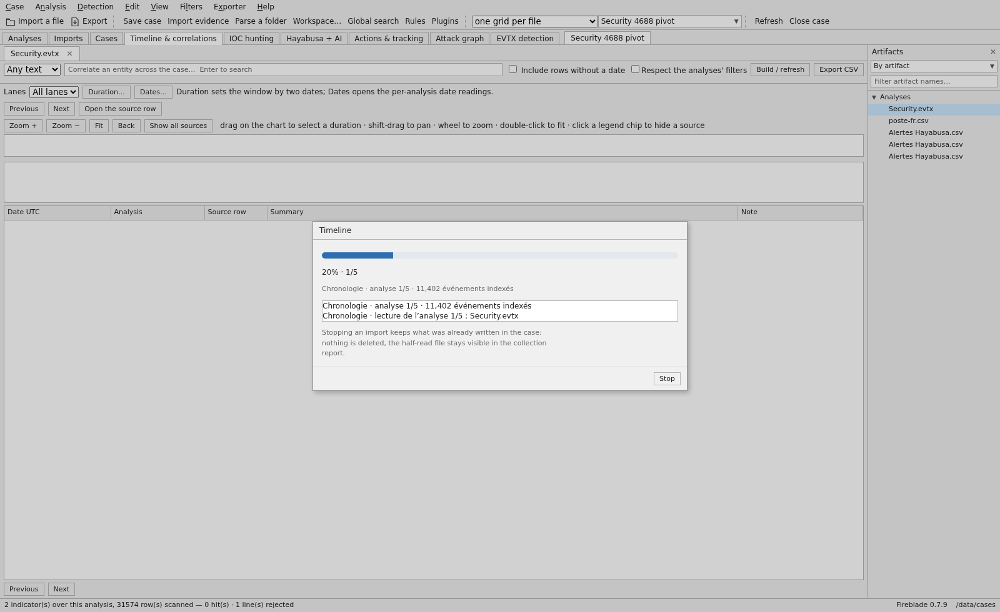

# Fireblade Host — **beta of a beta**

> **Status: beta of a beta.** The Host edition exists, imports real evidence, and has
> been walked screen by screen against the desktop. It is **not** a production
> deliverable: no support, no migration promise, and its HTTP API may change between
> two commits. Do not put an investigation you cannot redo in it.

The Host is the desktop's engine behind HTTP: the same `src/fireblade/core`, the same
readers, the same case format on disk — without Qt, without a Windows session. One
analyst, one container per case, a browser as the window.


*A case opened in the Host: analyses, grid, artifacts, and the nine tabs of the desktop.*

## What it does

- **Imports what the desktop imports**, with the same pinned readers (EvtxECmd,
  PECmd, MFTECmd, RECmd, LECmd, JLECmd, WxTCmd, RBCmd, AmcacheParser,
  AppCompatCacheParser, SrumECmd, RecentFileCacheParser, SQLECmd) run by the .NET 10
  runtime inside the image.
- **Works a case like the desktop**: filters, groups, colour rules, derived columns,
  views, bookmarks and cell notes, timeline and correlations, IOC hunting, Hayabusa
  findings with their maps, attack graph, actions and tracking, reports (HTML, PDF,
  client), portable `.fireblade` packages, history and recovery.
- **Shows its work**: every long command — import, IOC scan, timeline build,
  Hayabusa, report, portable case — runs as a job with a percentage, the engine's own
  messages, and a Stop.



*The timeline builds five analyses here; the bar counts them and the message is the
core's own.*

## What it does not do — measured, not guessed

| | |
| --- | --- |
| `SRUDB.dat` (SRUM) | `SrumECmd` refuses to run outside Windows (ESE libraries). The Host says so and points at the desktop's CSV. |
| Assistant IA | no model is connected; the button that would lie is absent. |
| Langue | English only, by product decision since 0.3.2. |
| Fenêtres | no detach/dock, no splash: a browser tab has no window manager. |
| Fichiers | no "show in Explorer", no "open with": a browser has no file manager. |
| Timeline Explorer | the .NET plugin is not in the container. |

The measured import run (333 files of real artifacts) is in
[LINUX-READERS.md](LINUX-READERS.md): 327 files read, EVTX 1 327 rows and
AppCompatCache 239 rows — the Windows counts, on the same files.

## Run it

```bash
# from the repository root: the image needs the core, the readers and the config
docker build -t fireblade:host .
docker run --rm -p 8080:8080 \
    -v /srv/fireblade/cases:/data/cases \
    -v /srv/fireblade/plugins:/data/plugins \
    fireblade:host
# then open http://localhost:8080
```

The container needs the .NET runtime (it is inside the image) and reads the cases from
`/data/cases`. A case written by the desktop opens as soon as its folder is there.

## The documents of this edition

| | |
| --- | --- |
| [HOST-EDITION.md](HOST-EDITION.md) | what the edition is, and the decisions behind it |
| [HOST-AUDIT.md](HOST-AUDIT.md) | the feature-by-feature audit against the desktop, and the seven defects the comparison recette found |
| [HOST-PARITY.md](HOST-PARITY.md) | the command-level parity page, generated |
| [LINUX-READERS.md](LINUX-READERS.md) | every reader under Linux, tool by tool, with the rows it wrote |
| [BETA.md](BETA.md) | what "beta of a beta" means, precisely |
| [HANDOFF-HOST.md](HANDOFF-HOST.md) · [HANDOFF-DOCKER.md](HANDOFF-DOCKER.md) | the working notes |


*The findings of a Hayabusa run, drawn as a clock — the desktop's four views are all
in the Host.*


*The attack graph, drawn server-side: hosts, techniques and free nodes, with the
ATT&CK layer and the PNG export.*
