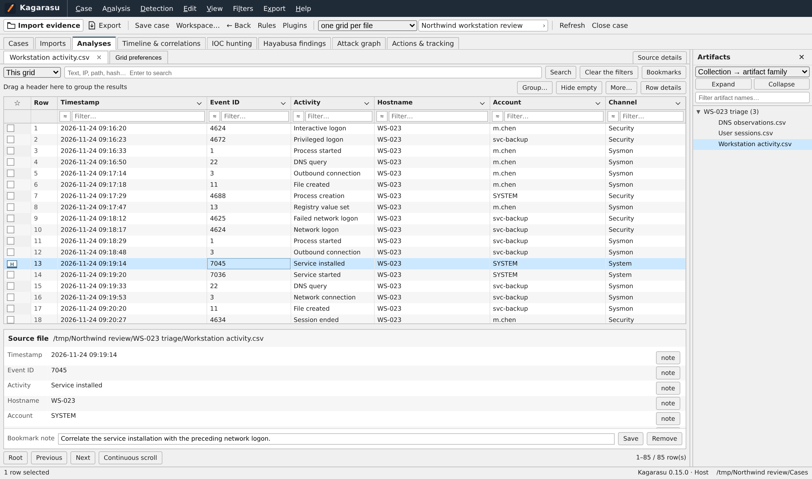
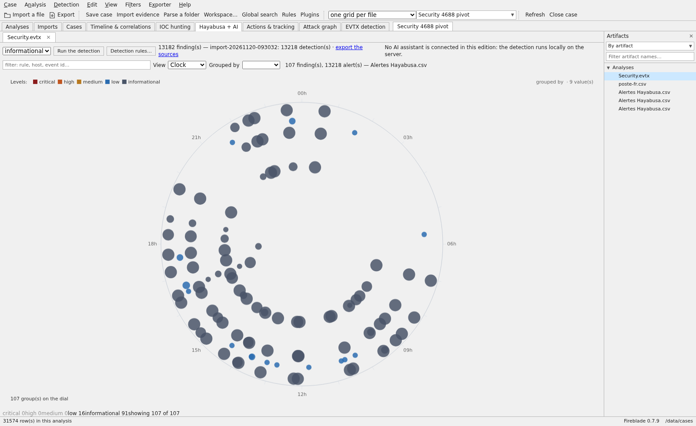
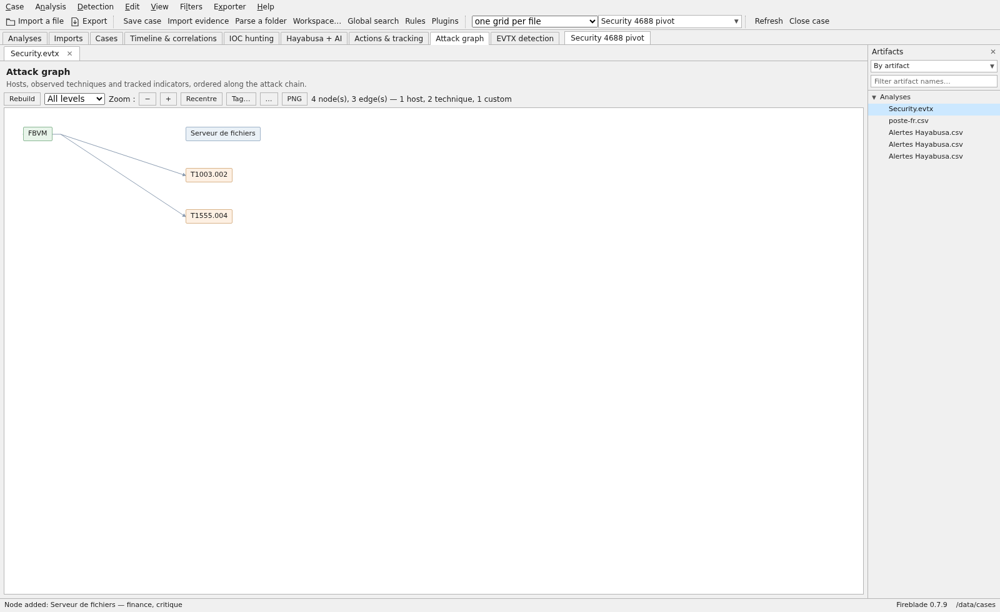

# Kagarasu Host

Host runs the shared Fireblade analysis engine in a Linux container and serves its
interface in a browser on the analyst's workstation. The standard deployment keeps
multiple cases in one persistent library. The optional driver gives each case its own
container and volume. For installation and a first investigation, follow the
[quick start](../../README.md#quick-start).

## From evidence to a finding

- **Import.** Review the source, reader and import result for each file. Windows artifacts
  use the pinned toolchain shipped with the image. Linux logs and supported disk images
  use the appropriate readers for each source. The Linux SRUM reader exposes the database
  columns. Import a Desktop-generated CSV if you need its exact SrumECmd layout.
- **Review.** Inspect records in the grid, select date fields for the UTC timeline and
  follow indicator matches or Hayabusa findings back to individual records.
- **Document.** Add observations, bookmarks and notes, assign follow-up actions and export
  an incident report. A portable case carries the investigation to another Host instance.
- **Deploy.** Bind the port to loopback for single-analyst operation. Case storage, private
  Office templates and the optional draft rewrite service are configured on the workstation.
  [Deployment guide](../../deploy/host/README.md)

*During timeline indexing, the progress window identifies the analysis being processed.*

## Technical references

| Document | Scope |
| --- | --- |
| [HOST-EDITION.md](HOST-EDITION.md) | what the edition is, and the decisions behind it |
| [HOST-AUDIT.md](HOST-AUDIT.md) | the feature-by-feature audit against the desktop, and the seven defects the comparison recette found |
| [HOST-PARITY.md](HOST-PARITY.md) | the command-level parity page, generated |
| [LINUX-READERS.md](LINUX-READERS.md) | every reader under Linux, tool by tool, with the rows it wrote |
| [STATUS.md](STATUS.md) | what is verified, and what cannot be relied on |
| [HANDOFF-DOCKER.md](HANDOFF-DOCKER.md) | the Server edition design · [earlier working notes](../archive/host) |

*Hayabusa findings in the clock view.*

*The attack graph links hosts and techniques. Analysts can export the graph as a PNG or an ATT&CK Navigator layer.*
